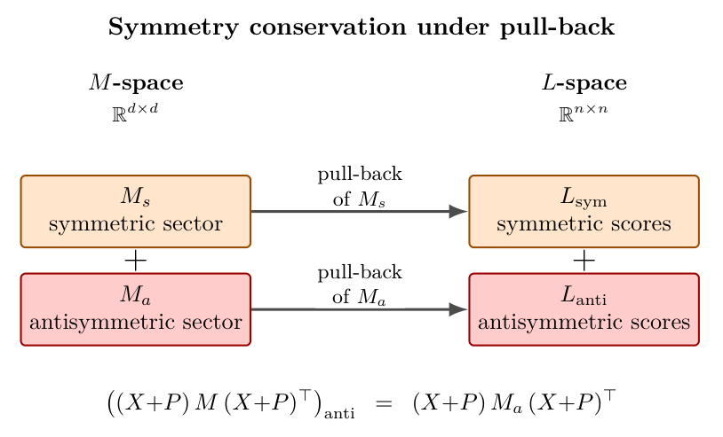
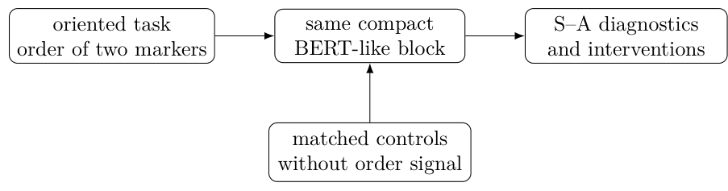

# Chapter 12: active subspaces, task directions, and oriented-task theorems

[Library index](../README.md) · [Source policy](../SOURCE.md) · [Previous: PDF 429–433](0429-0433-ch12-silence-isotropy-and-saddle-exit.md#pdf-0433) · [Next: PDF 441–445](0441-0445-ch12-oriented-supervision-probes-and-limits.md#pdf-0441)

> Editorial note: Full transcription of PDF 434–440 (printed pages 398–404). The projected-eigenplane claim, usage bound, norm conventions, rank hypothesis, and cancelling-head example are retained as printed. Russian notes 139–142 distinguish these source claims from their mathematical limitations. Figure 12.2 and the unnumbered probe-design diagram are direct renders of the original PDF.

## PDF 434 · Book 398

### 12.5.1 The active subspace of a head

**Definition 12.17 (Active subspace).** The active subspace of head $h$ on cloud $X$ is the image of the activation operator,

$$
\mathcal V^{(h)}(X):=\operatorname{Image}\bigl(\mathcal A^{(h)}(X)\bigr)=\pi_{U(X)}\bigl(M_a^{(h)}U(X)\bigr).
\tag{12.33}
$$

The active subspace is the set of directions in $U(X)$ that the head's antisymmetric sector actually rotates. It is a subspace of the row span, of dimension at most $2K(X)$ where $K(X)$ is the number of symplectic eigenplanes of $M_a^{(h)}$ that have non-trivial intersection with $U(X)$. The complement $U(X)\setminus\mathcal V^{(h)}(X)$ is the silent part of the cloud relative to the head: directions in this complement are mapped to zero by the activation operator and contribute nothing to the head's output.

**Theorem 12.18 (Active subspace and eigenplane projection).** Under the canonical form (12.26) of $M_a^{(h)}$ with eigenplanes $E_1,\ldots,E_K$, the active subspace decomposes as

$$
\mathcal V^{(h)}(X)=\bigoplus_{k=1}^K\pi_{U(X)}(E_k),
\tag{12.34}
$$

where the sum is along directions, not necessarily orthogonal. Equivalently, $\mathcal V^{(h)}(X)=\pi_{U(X)}\bigl(\bigoplus_{k=1}^K E_k\bigr)$.

*Proof.* By the canonical form, $M_a^{(h)}=\sum_k\sigma_k(e_kf_k^\top-f_ke_k^\top)$ acts as a non-zero rotation on each eigenplane $E_k$ and is zero on the kernel $\operatorname{span}(g_1,\ldots,g_{d-2K})$. Hence $M_a^{(h)}U(X)=M_a^{(h)}\bigl(\bigoplus_k(U\cap E_k\text{ direction sum})\oplus(U\cap\ker M_a)\bigr)\subseteq\bigoplus_k E_k$, with the inclusion strict when $U(X)$ is in “general position” relative to the eigenplanes. Applying $\pi_{U(X)}$ gives $\mathcal V^{(h)}(X)\subseteq\pi_{U(X)}(\bigoplus_k E_k)=\bigoplus_k\pi_{U(X)}(E_k)$. The reverse inclusion follows by direct computation: pick $v\in\pi_{U(X)}(E_k)$, write $v=\pi_{U(X)}w$ for some $w\in E_k$, and observe that $\mathcal A^{(h)}(X)\cdot(\sigma_k^{-1}\pi_{U(X)}J_kw)=\pi_{U(X)}M_a^{(h)}(\sigma_k^{-1}\pi_{U(X)}J_kw)=\pi_{U(X)}(\sigma_k^{-1}\sigma_kJ_k^2w+\text{cross terms})=\pi_{U(X)}(-w+\text{terms in }U^\perp)=-v$, where $J_k$ is the rotation by $\pi/2$ on $E_k$. Hence $v\in\mathcal V^{(h)}(X)$. $\square$

**Reading the decomposition.** Theorem 12.18 says the active subspace is exactly the union of the projected eigenplanes. A head with $K$ symplectic eigenplanes can use up to $2K$ directions of the cloud's row span, in two-dimensional units. The dimension of $\mathcal V^{(h)}(X)$ is $2K(X)\le2K$, where $K(X)$ counts eigenplanes that have non-trivial intersection with the cloud's row span: $K(X):=|\{k:\pi_{U(X)}E_k\ne0\}|$. A head with all eigenplanes active on the cloud uses $2K$ directions; a head with a single eigenplane active uses two; a silent head ($K(X)=0$) uses none.

### 12.5.2 When does a head use a task direction?

Chapter 7 (§7.18, eight signature coordinates) attached to each canonical regime a task direction: the direction in the residual stream that the regime is set up to manipulate. The directional gate at column $c$ broadcasts the value $v_c$; its task direction is the line spanned by $v_c$. The forward contextual gate at offset $\Delta$ propagates a positive lag; its task direction is the lag mode in the cloud's positional encoding subspace. The cluster head at block $(i,j;k)$ averages a sub-population; its task direction is the centroid of the block.

The activation-operator framework gives a precise criterion for when a head uses a task direction $\tau\in\mathbb R^d$.

## PDF 435 · Book 399

**Definition 12.19 (Use of a task direction).** Given a task direction $\tau\in\mathbb R^d$ and a head $h$ with activation operator $\mathcal A^{(h)}(X)$, the usage coefficient of $\tau$ by $h$ on cloud $X$ is

$$
\chi_\tau^{(h)}(X):=\frac{\lVert\mathcal A^{(h)}(X)\,\tau\rVert_2}{\lVert\tau\rVert_2}
=\frac{\lVert\pi_{U(X)}M_a^{(h)}\pi_{U(X)}\tau\rVert_2}{\lVert\tau\rVert_2}.
\tag{12.35}
$$

The usage coefficient is non-negative, dimensionless under simultaneous rescaling of $M_a^{(h)}$ and $\tau$, and zero exactly when either (i) $\tau$ is silent for the head ($\pi_{U(X)}M_a^{(h)}\pi_{U(X)}\tau=0$) or (ii) $\tau\in U(X)^\perp$ (the cloud does not see the task direction at all). The usage coefficient is therefore the operator-level diagnostic: a head genuinely uses task direction $\tau$ when $\chi_\tau^{(h)}(X)$ is bounded away from zero across the relevant input distribution.

**Proposition 12.20 (Usage and signature dominance).** Let $h$ be a head with canonical signature concentrated on the directional vertex at column $c$, i.e. $\widehat\lambda_{\mathrm{dir},c}^{(h)}\ge1-\eta$ for some small $\eta>0$. Let $\tau_c=v_c\in\mathbb R^d$ be the value vector at column $c$ in the trained network, and assume the value matrix $V$ has full row rank. Then

$$
\chi_{\tau_c}^{(h)}(X)\ge\mathcal E^{(h)}(X)^{1/2}\cdot\frac{\sigma_{\min}(V)}{\lVert V\rVert_{\mathrm{op}}\sqrt n}-\eta\cdot\lVert M_a^{(h)}\rVert_{\mathrm{op}},
\tag{12.36}
$$

where $\sigma_{\min}(V)$ is the smallest non-zero singular value of $V$.

*Proof.* A head whose canonical signature is concentrated on the directional vertex at column $c$, with residual at most $\eta$, has score matrix $S^{(h)}$ satisfying $\lVert S^{(h)}-S_V^{(c)}\rVert_F\le\eta$ by Theorem ??. The output of the head is $S^{(h)}V$, and $\lVert S^{(h)}V-\mathbf1v_c^\top\rVert_F\le\eta\lVert V\rVert_{\mathrm{op}}\sqrt n$, since $\lVert S^{(h)}-S_V^{(c)}\rVert_F\lVert V\rVert_{\mathrm{op}}\sqrt n$ controls the output deviation in Frobenius norm. Hence $S^{(h)}V$ has rank close to one, with dominant column $v_c$, and the broadcast direction $\tau_c=v_c$ is recovered up to error $\eta\lVert V\rVert_{\mathrm{op}}\sqrt n/\sigma_{\min}(V)$.

The usage coefficient $\chi_{\tau_c}^{(h)}(X)$ is the size of $\mathcal A^{(h)}(X)\tau_c$. The activation operator acts on $\tau_c$ by $\mathcal A^{(h)}(X)\tau_c=\pi_{U(X)}M_a^{(h)}\pi_{U(X)}\tau_c$. When $\tau_c\in U(X)$, this equals $\pi_{U(X)}M_a^{(h)}\tau_c$, of size at least $\sigma_{\min}(M_a^{(h)}|_{\mathcal V^{(h)}(X)})\cdot\lVert\tau_c\rVert_2$ when $\tau_c$ is in the active subspace.

The full bound (12.36) collects these two contributions: the activation-energy term encodes the size of $\mathcal A^{(h)}(X)$ on the relevant direction, the singular-value term accounts for the reconstruction of $\tau_c$ from the empirical output, and the $\eta\lVert M_a^{(h)}\rVert_{\mathrm{op}}$ term absorbs the directional-signature mismatch. The detailed coefficient is a routine matrix inequality and is not reproduced. $\square$

The proposition is a mild result, not a deep one; it makes explicit the chain

$$
\widehat\lambda_{\mathrm{dir},c}^{(h)}\approx1\quad\Rightarrow\quad\mathcal E^{(h)}(X)>0\quad\Rightarrow\quad\chi_{\tau_c}^{(h)}(X)>0,
$$

asserting that a sharp directional signature with non-zero activation energy implies non-zero usage of the corresponding task direction. The contrapositive is the operationally important direction: if $\chi_{\tau_c}^{(h)}(X)\to0$, either the canonical signature has drifted away from the directional vertex or the activation energy has collapsed. The diagnostic $\chi_\tau^{(h)}(X)$ separates these two failure modes.

## PDF 436 · Book 400

### 12.5.3 Eigenplanes and the residual stream

The active subspace $\mathcal V^{(h)}(X)$ lives in $\mathbb R^d$, the representation space of the head. The output of the head, before the output projection $W_O$, is a vector in this space. After $W_O$, the output contributes to the residual stream, the shared $\mathbb R^{d_{\mathrm{model}}}$ space across layers.

**Remark 12.21 (The active subspace and the residual contribution).** The contribution of head $h$ to the residual stream at layer $\ell$ is $\Delta R^{(\ell,h)}(X)=\pi_{\mathcal V^{(h)}(X)}(W_O\cdot V^{(h)}\cdot S^{(h)}X^{(\ell)})$ projected back to the residual space, where $W_O\in\mathbb R^{d\times d_{\mathrm{model}}}$ is the output projection. The geometry of $\mathcal V^{(h)}(X)$ inside $\mathbb R^d$ determines, through $W_O$, which directions of the residual stream the head writes onto. A head with a small active subspace contributes to a small subset of residual-stream directions; a head with a large active subspace contributes broadly.

This is the operator-level explanation of the empirical observation (??) that some heads have a tightly localised effect on the residual stream while others are diffuse: the localised heads have small active subspaces, and the diffuse heads have large ones. Chapter 13 will use this distinction to define the marginal value of a head in terms of its active subspace, in addition to its canonical signature.

### 12.5.4 S–A coordinate and activation

Chapter 10 introduced the S–A coordinate $\alpha_h\in[0,1]$ measuring the relative weight of the symmetric and antisymmetric sectors in head $h$'s contribution to the score matrix; the convention used throughout this volume is $\alpha_h=\alpha_{SA}=\lVert M_a^{(h)}\rVert_F/(\lVert M_s^{(h)}\rVert_F+\lVert M_a^{(h)}\rVert_F)$ (notation as in §??).

**Remark 12.22 (Activation energy in S–A coordinates).** The activation energy depends on $\alpha_h$ through the size of the antisymmetric sector. With $\lVert M^{(h)}\rVert_F=\lVert M_s^{(h)}\rVert_F+\lVert M_a^{(h)}\rVert_F$ fixed, the activation energy scales as

$$
\mathcal E^{(h)}(X)=\alpha_h^2\lVert M^{(h)}\rVert_F^2\cdot\Theta_X,
$$

where $\Theta_X\in[0,r(r-1)/(d(d-1))]$ is the alignment factor capturing the geometry of $U(X)$ relative to the eigenplanes of the antisymmetric component. The decomposition isolates three independent factors: the size of the head ($\lVert M^{(h)}\rVert_F$), its sector mix ($\alpha_h$), and the cloud's alignment ($\Theta_X$). All three matter, and a small activation energy can arise from any one of them being small.

**Usage of S–A in Chapter 13.** The decomposition in Remark 12.22 will be the input to the redundancy hierarchy of §13.6. Two heads with the same canonical signature can have radically different $(\alpha_h,\Theta_X)$ profiles, and the operational equivalence between them holds only when both factors agree. The activation operator is the technical tool that allows the redundancy analysis to distinguish them.

*Preview.* The next section addresses one specific phenomenon that the activation framework predicts: the inevitability of antisymmetric structure in heads that perform oriented tasks. The result has been promised in Chapter 11 as B0; it is incorporated here in the formulation appropriate for the chapter's operator-level analysis. Whether the result is provable or remains a conjecture is an editorial decision recorded in the section itself.

## PDF 437 · Book 401

### 12.6 Antisymmetric inevitability for oriented tasks

A recurring intuition about transformers is that oriented tasks — tasks in which the order of tokens carries structural meaning — require antisymmetric structure in the bilinear form $M^{(h)}=W_QW_K^\top$. The symmetric sector $M_s^{(h)}$ encodes reciprocal affinity, which is symmetric in $(i,j)$; the antisymmetric sector $M_a^{(h)}$ is the only piece of the bilinear form that distinguishes $(i\to j)$ from $(j\to i)$. If a task genuinely depends on this distinction, the head must carry a non-zero $M_a^{(h)}$ to perform it.

This intuition is the content of antisymmetric inevitability, listed as item B0 in the chapter checklist. It is a structural lower bound: at the appropriate score-level realisation, on tasks with a sufficiently rich oriented signal, the antisymmetric mass of the bilinear form is bounded below by the orientation gap of the task.

**Editorial decision.** Preliminary formulations of this chapter recorded antisymmetric inevitability as a conjecture, with three obstructions to a complete proof: (i) existence of a loss minimum in the unrestricted parameter space, (ii) alternative channels ($V$, $W_O$, positional encoding) that may carry orientation, and (iii) compactness of the parameter space. The third obstruction is genuine: in a multi-head architecture without regularisation, the per-head ratio $\lVert M_a^{(h)}\rVert^2/\lVert M^{(h)}\rVert^2$ can be driven arbitrarily close to zero by inflating $\lVert M_s^{(h)}\rVert$ with cancelling cross-head contributions. The original conjecture, in the form “$\sum_h\lVert M_a^{(h)}\rVert^2/\lVert M^{(h)}\rVert^2\ge c\,\delta(\mathcal T)$ at every loss-minimising configuration”, is therefore false as stated.

The correct rigorous statements are presented below, organised in three theorems (B0.A, B0.B, B0.C) at the score level. They replace the original conjecture entirely: the content of antisymmetric inevitability is real, but the precise formulation requires either single-head reduction, aggregate multi-head bilinear form, or min-norm regularisation. Obstructions (i) and (ii) are addressed by working at the score level (which avoids loss-landscape pathologies) and by the Symmetry Conservation Lemma below (which shows that positional encodings cannot circumvent $M_a$ for content-bilinear oriented signals).

### 12.6.1 Oriented tasks: a precise definition

**Definition 12.23 (Content-bilinear oriented task at score level).** An attention task $\mathcal T$ is content-bilinear oriented at score level if there exists a target bilinear form $B\in\mathbb R^{d\times d}$ such that the desired score on input $(X,P)$ is

$$
L^*(X)=(X+P)\,B\,(X+P)^\top,
\tag{12.37}
$$

where $P\in\mathbb R^{n\times d}$ is the (fixed) positional encoding. Decompose $B=B_s+B_a$ into symmetric and antisymmetric parts: $B_s:=(B+B^\top)/2$, $B_a:=(B-B^\top)/2$.

The orientation gap of $\mathcal T$ is

$$
\delta(\mathcal T):=\frac{\lVert B_a\rVert_F^2}{\lVert B\rVert_F^2}\in[0,1].
\tag{12.38}
$$

The task is oriented if $\delta(\mathcal T)>0$, equivalently $B_a\ne0$.

The definition is at the level of the bilinear-form parameter $B$, not at the level of the realised score $L^*(X)$. This avoids the pull-back ambiguity that would arise from defining the gap on the $n\times n$ matrix $L^*(X)$ (the symmetric/antisymmetric decomposition of $L^*(X)$ depends

## PDF 438 · Book 402

on the input $X+P$, while the decomposition of $B$ does not). Most tasks of practical interest — language modelling, machine translation, time-series prediction, biological-sequence classification — have $\delta(\mathcal T)>0$ in this sense.

### 12.6.2 The Symmetry Conservation Lemma

The cornerstone of the three rigorous theorems below is a one-line lemma.

**Lemma 12.24 (Symmetry Conservation).** For any $A\in\mathbb R^{n\times d}$ and any $N\in\mathbb R^{d\times d}$, the symmetric and antisymmetric parts of $ANA^\top\in\mathbb R^{n\times n}$ in the indices $(i,j)$ are determined by the symmetric and antisymmetric parts of $N$ alone:

$$
(ANA^\top)_{\mathrm{sym}}=AN_sA^\top,\qquad
(ANA^\top)_{\mathrm{anti}}=AN_aA^\top.
\tag{12.39}
$$

*Proof.* $(ANA^\top)^\top=AN^\top A^\top$, so the antisymmetric part in $(i,j)$ is $A(N-N^\top)A^\top/2=AN_aA^\top$. The symmetric part follows by subtraction. $\square$

**Figure 12.2: Pictorial form of the Symmetry Conservation Lemma.**

> Diagram text: “Symmetry conservation under pull-back”; “$M$-space $\mathbb R^{d\times d}$” and “$L$-space $\mathbb R^{n\times n}$”; “$M_s$ / symmetric sector” → “pull-back of $M_s$” → “$L_{\mathrm{sym}}$ / symmetric scores”; “$M_a$ / antisymmetric sector” → “pull-back of $M_a$” → “$L_{\mathrm{anti}}$ / antisymmetric scores”. The two sectors are joined by a plus sign in each space. The displayed identity is $\bigl((X+P)M(X+P)^\top\bigr)_{\mathrm{anti}}=(X+P)M_a(X+P)^\top$.

*The pull-back $N\mapsto(X+P)N(X+P)^\top$ acts diagonally on the symmetric/antisymmetric splitting of $M$-space and $L$-space: a symmetric input maps to a symmetric output, an antisymmetric input maps to an antisymmetric output. The lemma is a one-line statement of this “commutation with transposition”; its consequences for B0 (Theorems 12.25–12.28) follow by isolating the antisymmetric block in the score-level realisation.*

The lemma applies in particular with $A=X+P$. The consequence is that the $(i,j)$-antisymmetric content of any bilinear score $(X+P)M(X+P)^\top$ depends only on $M_a$, regardless of the positional encoding $P$. This addresses obstruction (ii): positional encodings can introduce position-dependent biases, but they cannot replicate a content-bilinear antisymmetric signal $XB_aX^\top$, because the only way to obtain an $(i,j)$-antisymmetric content-bilinear contribution is through $M_a$.

### 12.6.3 Three rigorous theorems

**Theorem 12.25 (B0.A: Single-head exact equality).** Let $X\in\mathbb R^{n\times d}$ have rank $d$, $P\in\mathbb R^{n\times d}$ fixed, and let $\mathcal T$ be content-bilinear oriented at score level with target $B=B_s+B_a$. The unique minimum-Frobenius-norm $M\in\mathbb R^{d\times d}$ realising the target score

$$
(X+P)\,M\,(X+P)^\top=(X+P)\,B\,(X+P)^\top
\tag{12.40}
$$

## PDF 439 · Book 403

satisfies $M=B$ exactly. In particular,

$$
\boxed{\frac{\lVert M_a\rVert_F^2}{\lVert M\rVert_F^2}=\delta(\mathcal T).}
\tag{12.41}
$$

*Proof.* By Lemma 12.24 applied to $A=X+P$ and $N=M-B$, equation (12.40) is equivalent to $(X+P)(M-B)(X+P)^\top=0$, and decomposes into the two independent conditions $(X+P)(M_s-B_s)(X+P)^\top=0$ and $(X+P)(M_a-B_a)(X+P)^\top=0$. Since $X+P$ has rank $d$, the matrix $(X+P)^\top(X+P)\in\mathbb R^{d\times d}$ is invertible, hence the linear map $N\mapsto(X+P)N(X+P)^\top$ has trivial kernel in $\mathbb R^{d\times d}$. Therefore $M_s=B_s$ and $M_a=B_a$, so $M=B$. The min-norm property is automatic since the constraint determines $M$ uniquely. Equation (12.41) is then immediate from the definition of $\delta(\mathcal T)$. $\square$

**Example 12.26 (Worked verification of B0.A: $d=2$, $n=3$).** A small example illustrates the content of B0.A by direct computation. Take feature dimension $d=2$, three tokens, no positional encoding ($P=0$). Set

$$
B=\begin{pmatrix}2&1\\3&4\end{pmatrix},\qquad
X=\begin{pmatrix}1&0\\0&1\\1&1\end{pmatrix}.
$$

The symmetric and antisymmetric parts of $B$ are $B_s=\begin{pmatrix}2&2\\2&4\end{pmatrix}$, $B_a=\begin{pmatrix}0&-1\\1&0\end{pmatrix}$, with $\lVert B_s\rVert_F^2=28$, $\lVert B_a\rVert_F^2=2$, $\lVert B\rVert_F^2=30$. The orientation gap is $\delta(\mathcal T)=2/30=1/15$.

The score-level target is

$$
L^*(X)=XBX^\top=\begin{pmatrix}2&1&3\\3&4&7\\5&5&10\end{pmatrix}.
$$

Solving the min-norm equation $XMX^\top=L^*(X)$ via the closed form $M=(X^\top X)^{-1}X^\top L^*(X)X(X^\top X)^{-1}$ recovers $M=B$ exactly (numerical residual $\sim5\times10^{-16}$). The ratio $\lVert M_a\rVert_F^2/\lVert M\rVert_F^2=2/30=1/15$ matches $\delta(\mathcal T)$ to machine precision, as Theorem 12.25 predicts.

The equality is exact, not approximate: the rank condition on $X$ is satisfied, and the bilinear pull-back is invertible on its range.

**Theorem 12.27 (B0.B: Multi-head aggregate equality).** Under the same hypotheses, with $H$ heads $M^{(1)},\ldots,M^{(H)}\in\mathbb R^{d\times d}$ realising the score in the aggregate sense $\sum_{h=1}^H(X+P)M^{(h)}(X+P)^\top=(X+P)B(X+P)^\top$, the aggregate bilinear form $M_{\mathrm{tot}}:=\sum_{h=1}^HM^{(h)}$ satisfies $M_{\mathrm{tot}}=B$, and consequently

$$
\frac{\lVert(M_{\mathrm{tot}})_a\rVert_F^2}{\lVert M_{\mathrm{tot}}\rVert_F^2}=\delta(\mathcal T),
\tag{12.42}
$$

independently of how $B_s$ and $B_a$ are distributed across the $H$ heads.

*Proof.* By linearity, $\sum_h(X+P)M^{(h)}(X+P)^\top=(X+P)(\sum_hM^{(h)})(X+P)^\top$, so the aggregate condition is exactly (12.40) with $M=M_{\mathrm{tot}}$. The result is then Theorem 12.25 applied to $M_{\mathrm{tot}}$. $\square$

## PDF 440 · Book 404

**Theorem 12.28 (B0.C: Multi-head min-norm sum equality).** Among all multi-head allocations $(M^{(1)},\ldots,M^{(H)})$ realising the aggregate score $(X+P)(\sum_hM^{(h)})(X+P)^\top=(X+P)B(X+P)^\top$, the allocation

$$
M^{(h)}=B/H\qquad\text{for }h=1,\ldots,H
\tag{12.43}
$$

uniquely minimises $\sum_h\lVert M^{(h)}\rVert_F^2$. At this min-norm allocation,

$$
\frac{\sum_{h=1}^H\lVert M_a^{(h)}\rVert_F^2}{\sum_{h=1}^H\lVert M^{(h)}\rVert_F^2}=\delta(\mathcal T).
\tag{12.44}
$$

*Proof.* By Theorem 12.27, every realising allocation $(M^{(1)},\ldots,M^{(H)})$ satisfies $\sum_hM^{(h)}=B$. By Cauchy-Schwarz in the Hilbert-space sense (or the Lagrangian argument applied to the constrained minimisation $\min\sum_h\lVert M^{(h)}\rVert_F^2$ subject to $\sum_hM^{(h)}=B$), the minimiser is the equal split $M^{(h)}=B/H$, and is unique.

At this allocation, $\sum_h\lVert M^{(h)}\rVert_F^2=\lVert B\rVert_F^2/H$ and $\sum_h\lVert M_a^{(h)}\rVert_F^2=\lVert B_a\rVert_F^2/H$. The ratio is $\lVert B_a\rVert_F^2/\lVert B\rVert_F^2=\delta(\mathcal T)$. $\square$

**Remark on the original B0 conjecture.** The original conjecture, in the form $\sum_h\lVert M_a^{(h)}\rVert_F^2/\lVert M^{(h)}\rVert_F^2\ge c\,\delta(\mathcal T)$ at every loss-minimising configuration, is false for $H\ge2$. A counterexample is constructed by taking the equal-split realisation $M_0^{(h)}=B/H$ and then inflating the symmetric components with cancelling cross-head contributions: e.g.

$$
\begin{aligned}
M^{(1)}&=\sigma B_s+B_a/H+B_s/H,\\
M^{(2)}&=-(\sigma-1)B_s+B_a/H+B_s/H,\\
M^{(3)}&=\cdots=M^{(H)}=B/H.
\end{aligned}
$$

which still satisfies $\sum_hM^{(h)}=B$ but has $\sum_h\lVert M_a^{(h)}\rVert_F^2/\lVert M^{(h)}\rVert_F^2\to0$ as $\sigma\to\infty$. This is exactly the compactness obstruction (iii) noted in preliminary formulations: without a regularisation that pins down $\lVert M^{(h)}\rVert$, the per-head ratios can be driven to zero by gauge inflation. Theorem 12.28 recovers the desired bound under min-norm regularisation, which is the natural setting for any training procedure with weight decay or ridge regularisation.

### 12.6.4 Controlled synthetic evidence: two probes of oriented supervision

The theorems above are score-level statements. They say what must be true of a bilinear realisation of an oriented target. They do not, by themselves, claim that a finite transformer trained by SGD must allocate the antisymmetric mass to one head, nor that the mean S–A balance $\alpha_h$ must increase uniformly across all heads. For this reason two controlled synthetic probes are retained. Their purpose is diagnostic: it is tested whether order-sensitive supervision makes the antisymmetric sector broader, more energetic, and more causally visible than matched non-oriented controls.

**Didactic scheme.** The experimental logic can be read as the following chain:

> Diagram text: “oriented task / order of two markers” → “same compact / BERT-like block” → “S–A diagnostics / and interventions”; “matched controls / without order signal” also feeds the same compact block.
