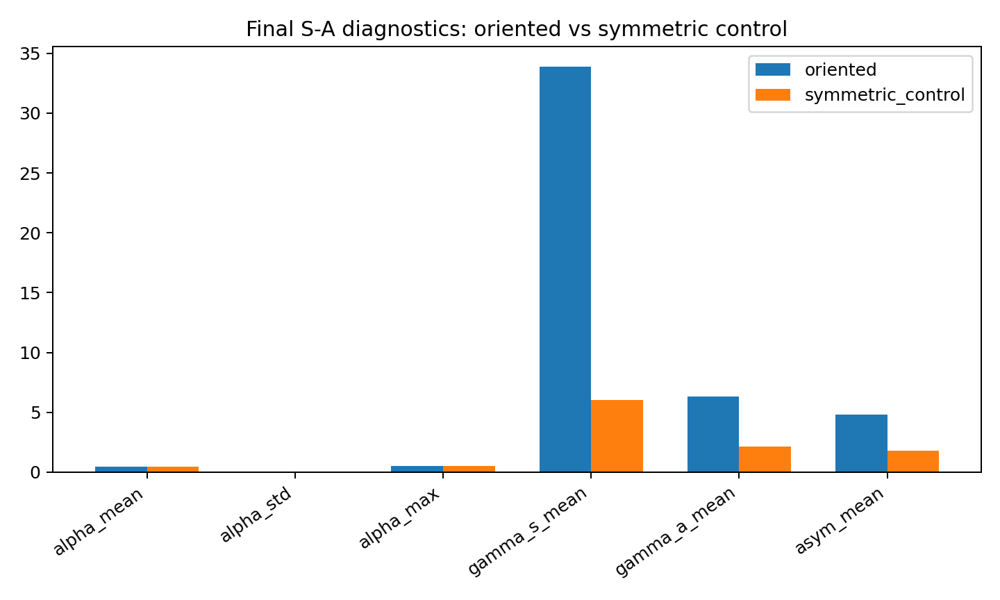
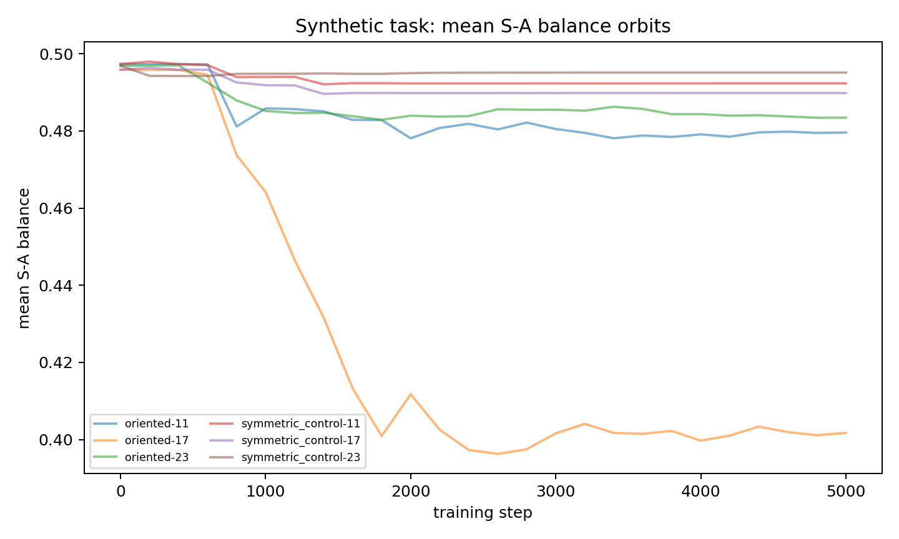
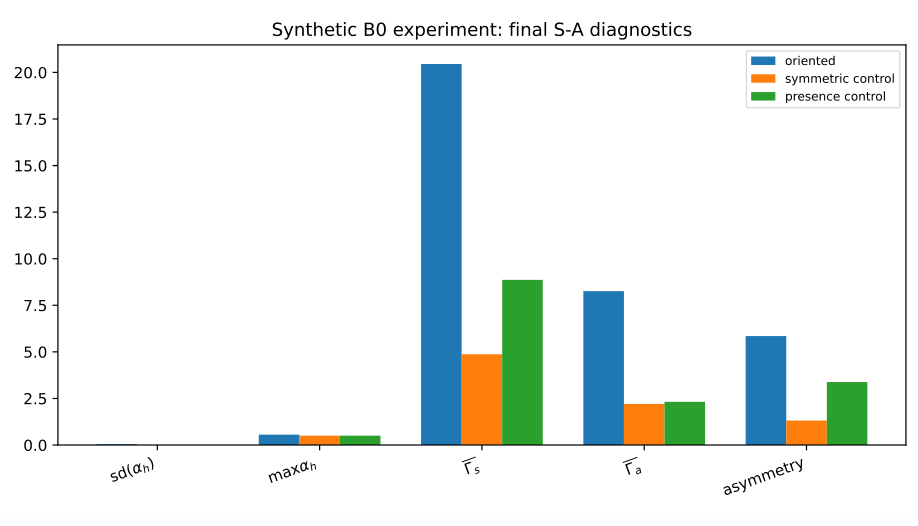
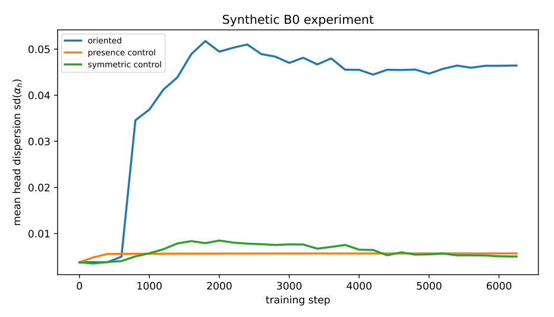
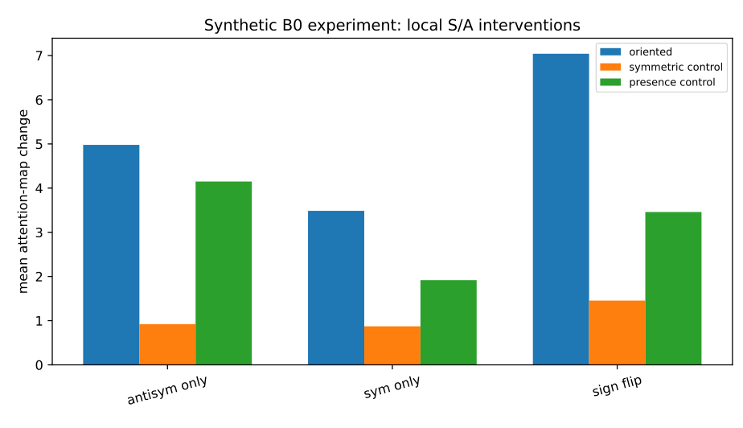

# Chapter 12: oriented-supervision probes, theorem dependencies, and limits

[Library index](../README.md) · [Source policy](../SOURCE.md) · [Previous: PDF 434–440](0434-0440-ch12-active-subspaces-and-oriented-task-theorems.md#pdf-0440) · [Next: PDF 446–450](0446-0450-ch12-orientation-gaps-and-architecture-no-go.md#pdf-0446)

> Editorial note: Full transcription of PDF 441–445 (printed pages 405–409), including Tables 12.1–12.2 and Figures 12.3–12.7. Tables, numerical ratios, plot labels, author-reported experimental claims, and dependency statements are preserved literally. Figures 12.3–12.4 are extracted from the embedded PDF images with their masks; Figures 12.5–12.7 are rendered from the original vector plots. Reading note 143 separates these reported observations from task-level causal claims and our own arithmetic checks.

## PDF 441 · Book 405

| task | $\bar\alpha_h$ | $\operatorname{sd}(\alpha_h)$ | $\max\alpha_h$ | $\bar\Gamma_s$ | $\bar\Gamma_a$ | asym. | $\bar\Gamma_a/\bar\Gamma_s$ |
|---|---:|---:|---:|---:|---:|---:|---:|
| oriented | 0.455 | 0.041 | 0.513 | 33.86 | 6.34 | 4.79 | 0.187 |
| symmetric control | 0.492 | 0.007 | 0.503 | 6.05 | 2.13 | 1.80 | 0.352 |

**Table 12.1:** Probe I, final S–A diagnostics. The oriented task does not increase mean $\alpha_h$; instead, it produces substantially larger dispersion, absolute symmetric and antisymmetric energies, and attention-side asymmetry.

**Figure 12.3:** Probe I, final task comparison. The order-sensitive task creates a wider head population and larger absolute S–A energies than the symmetric control.

The comparison is not meant to prove B0. The proof-level content is the score-level trilogy B0.A–B0.C. The empirical question is narrower: once an orientation signal is made learnable, does the trained population display a larger directional tail and stronger antisymmetric intervention effects?

**Probe I: oriented task versus symmetric control.** The first probe compares an order-sensitive task with a symmetric control. In the oriented task, the label depends on whether one marker precedes another. In the control, the label depends on an unordered comparison. Both tasks use the same compact architecture and the same S–A diagnostics. The final summary is:

The negative lesson is essential. Mean $\alpha_h$ is lower in the oriented task. Therefore the effect cannot be described as a uniform drift of all heads toward the antisymmetric side. The positive lesson is also clear: the standard deviation of $\alpha_h$ is about $5.55\times$ larger, the absolute antisymmetric energy is about $2.97\times$ larger, and the attention-side asymmetry is about $2.67\times$ larger. Orientation appears as a population polarisation rather than as a scalar shift.

The intervention table gives the same reading. Averaged over the selected top heads, the antisymmetric sign-flip intervention changes the attention map by about $8.33$ in the oriented task and $1.99$ in the symmetric control; the antisymmetric-only intervention gives about $4.29$ and $1.67$, respectively. Thus the antisymmetric sector is not merely present: in the oriented task it is more causally visible.

## PDF 442 · Book 406

**Figure 12.4:** Probe I, evolution of the mean S–A balance. The mean alone is not an adequate order detector; it must be read together with dispersion, tails, and intervention sensitivity.

| task | $\bar\alpha_h$ | $\operatorname{sd}(\alpha_h)$ | $\max\alpha_h$ | $\bar\Gamma_s$ | $\bar\Gamma_a$ | asym. | $\bar\Gamma_a/\bar\Gamma_s$ |
|---|---:|---:|---:|---:|---:|---:|---:|
| oriented | 0.465 | 0.046 | 0.556 | 20.45 | 8.26 | 5.85 | 0.404 |
| presence control | 0.492 | 0.006 | 0.501 | 8.86 | 2.32 | 3.38 | 0.262 |
| symmetric control | 0.496 | 0.005 | 0.502 | 4.87 | 2.21 | 1.31 | 0.453 |

**Table 12.2:** Probe II, final S–A diagnostics. The oriented task has the largest head-population dispersion, the largest maximum $\alpha_h$, the largest absolute antisymmetric energy, and the largest attention-side asymmetry.

**Probe II: balanced oriented task with two controls.** The second probe balances the setting more carefully and adds a presence control. The three tasks share the same compact BERT-like architecture. In the oriented task, the label depends on the order of two markers. In the symmetric control, the label depends on an unordered count comparison. In the presence control, the label depends on token detection and not on order. Three seeds are used per task. The model reaches high but not saturated performance on the oriented task, high performance on the symmetric control, and perfect performance on the presence control. The comparison is therefore a diagnostic of geometry, not a final benchmark.

Relative to the symmetric control, the oriented task has approximately $9.24\times$ larger dispersion of $\alpha_h$, $3.74\times$ larger absolute antisymmetric energy $\bar\Gamma_a$, and $4.45\times$ larger attention asymmetry. Relative to the presence control, the corresponding ratios are approximately $8.16\times$, $3.56\times$, and $1.73\times$. Again, mean $\alpha_h$ is lower in the oriented task than in the controls. Hence the same conclusion is obtained twice: orientation does not move the whole population uniformly; it creates a directional tail.

The strongest individual head is found in the oriented task: one run has a layer–head pair with

$$
\alpha_h\simeq0.639,\qquad\Gamma_s\simeq9.99,\qquad\Gamma_a\simeq13.19,\qquad\mathrm{asym}\simeq6.28.
$$

This is the empirical form of the directional-tail phenomenon. Not all heads become antisymmetric, but the oriented task creates heads whose antisymmetric sector is large in absolute energy and visible on the attention side.

## PDF 443 · Book 407

**Figure 12.5:** Probe II, final S–A diagnostics for the oriented task and the two controls. The order-sensitive task separates through dispersion, absolute antisymmetric energy, and attention-side asymmetry.

The intervention results support the same reading. Averaged over the selected top heads, the antisymmetric sign-flip intervention changes the attention map by about $7.04$ in the oriented task, against $1.46$ in the symmetric control and $3.46$ in the presence control. The antisymmetric-only intervention gives about $4.98$, $0.92$, and $4.15$, respectively. The presence control therefore supplies an important warning: rare-token detection can also create local antisymmetric sensitivity. Nevertheless, the oriented task dominates the controls on the combined signature of dispersion, maximum $\alpha_h$, absolute $\Gamma_a$, attention asymmetry, and sign-flip sensitivity.

**Remark 12.29 (What the synthetic probes do and do not prove).** The probes do not prove B0. The proof-level content of B0 is the score-level trilogy B0.A–B0.C. The probes support the mechanism: under explicitly order-sensitive supervision, training produces a broader S–A population, larger absolute antisymmetric energy, stronger attention-side asymmetry, and larger antisymmetric intervention effects than non-oriented controls. The correct empirical slogan is therefore not “orientation increases mean $\alpha_h$”, but “orientation creates a directional tail and makes the antisymmetric sector causally visible.”

### 12.6.5 Dependencies on the rigorous theorems

It is made explicit which subsequent results depend on the three theorems above. Every dependent result inherits the hypothesis of score-level realisation, i.e. that the task target factors through a bilinear form $B$ as in (12.37). Outside this hypothesis class, the theorems do not bind, and the dependent statements take a weaker form.

**In Chapter 13 (Redundancy and Design Principles).**

- *Theorem 13.7 (training breakdown geometry):* the breakdown geometry is realised when $M_a$ carries the $\delta(\mathcal T)$ fraction of the bilinear mass, which is exactly the content of B0.A–B0.C. The hypothesis is now theorem-grade and no longer flagged as conjecture-dependent.
- *Design Principle P1 (preserve directional tails):* the principle is operationally meaningful

## PDF 444 · Book 408

**Figure 12.6:** Probe II, training-time evolution of the dispersion of $\alpha_h$. The order-sensitive task separates from the non-oriented controls by developing a broader distribution of head balances.

by Theorem 12.28: directional tails carry the antisymmetric mass that the rigorous theorems guarantee under min-norm allocation. Without this guarantee, the principle would not bind.

**In Chapter 14 (The Rationalised Transformer).**

- *Proposition 14.3 (Frobenius-orthogonal updates) restricted to oriented tasks:* the proposition is now an unconditional statement for the score-level realisation; the orthogonal-update structure is meaningful because the antisymmetric and symmetric mass shares are pinned by Theorem 12.25.
- *The minimal experiment in §14.7:* the experimental comparison is an empirical test of B0.A–B0.C in a controlled setting; predictions of the chapter are operational rather than conjectural.

### 12.6.6 Where the theorems do not apply

The three theorems are score-level statements at the bilinear-form parameter. They do not directly cover the following regimes, which remain genuinely open:

**(i) Output-level realisation.** The theorems assume the task target factors through a bilinear form at the score level. In a real transformer the trained quantity is the output (after softmax, value projection, and output projection), and the relationship between the score-level $\delta(\mathcal T)$ and the output-level orientation strength is non-trivial (softmax is not bilinear). Whether the score-level orientation gap can be read off from output-level statistics is a separate question.

**(ii) Multi-layer composition.** The theorems are single-layer. In multi-layer transformers, the output of layer $\ell-1$ acts as the input to layer $\ell$, and the orientation signal can be carried implicitly by the hidden representations rather than by the bilinear form $M^{(\ell)}$. A clean multi-layer analogue requires tracking how orientation propagates through the residual stream.

**(iii) Strong positional encodings.** The Symmetry Conservation Lemma applies to the score

## PDF 445 · Book 409

**Figure 12.7:** Probe II, local S/A interventions on the top candidate heads. The sign-flip effect is markedly larger in the oriented task than in the matched non-oriented controls, indicating that the antisymmetric sector is causally visible.

$(X+P)M(X+P)^\top$. If the architecture uses positional encodings outside the additive form (e.g. multiplicative position-dependent gates as in some variants of T5), the lemma must be re-derived for that specific architectural choice.

These three open directions are recorded as future work.

*Preview.* The next and final section closes the chapter by returning to the editorial question that motivated the structure: the chapter has produced operating coordinates, not architecture. Chapter 13 will use these coordinates to define crowding and design principles; Chapter 14 will use the design principles to construct the rationalised block. The handover is the subject of §12.8.

### 12.7 Possible extensions: three orientation gaps and architectural no-go theorems

The three theorems of §12.6 resolved B0 by extracting the antisymmetric content of the bilinear form $M$. The Symmetry Conservation Lemma 12.24 is, however, an instance of a more general principle: the bilinear pull-back $N\mapsto(X+P)N(X+P)^\top$ preserves the symmetric/antisymmetric splitting and transports finer parameter-space decompositions to score space. The natural extension considered here is to the $O(d)$-irreducible decomposition into three components — trace, traceless-symmetric, and antisymmetric — with associated orientation gaps.

Once the three-component decomposition is in place, an architectural no-go programme becomes available. Each architectural constraint that forbids one $O(d)$-irreducible component immediately excludes a class of score-level tasks. The same logic applies to rank constraints, scalar constraints, and combinations thereof. The result is a small but precise catalogue of impossibility theorems.
