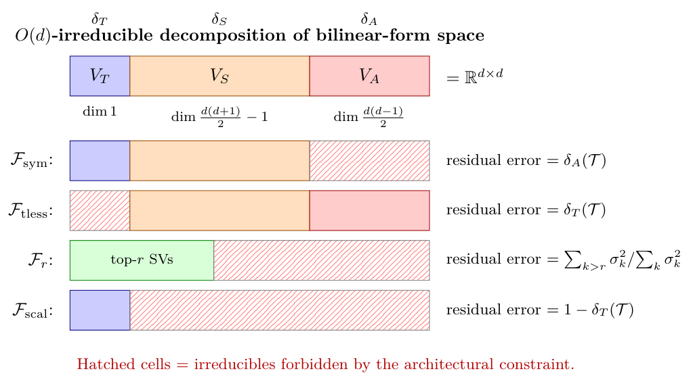

# Chapter 12: three orientation gaps, rank-one identity, and architectural no-go theorems

[Library index](../README.md) · [Source policy](../SOURCE.md) · [Previous: PDF 441–445](0441-0445-ch12-oriented-supervision-probes-and-limits.md#pdf-0445)

> Editorial note: Full transcription of PDF 446–450 (printed pages 410–414), including Figure 12.8, Table 12.3, and the unnumbered numerical table in Example 12.38. The minus sign in (12.48), the contrary plus sign in its proof, the matrices and inconsistent numerical claims of Example 12.38, and the original “fthe” wording are retained literally. Russian notes 144–146 provide separate editorial checks. This batch ends after the complete §12.7.5; §12.8 starts on PDF 451 and is outside this transcription.

## PDF 446 · Book 410

### 12.7.1 The $O(d)$ decomposition: three orientation gaps

**Definition 12.30 (Three-component decomposition of a bilinear form).** Let $M\in\mathbb R^{d\times d}$. Decompose

$$
M=M_T+M_S+M_A,
\tag{12.45}
$$

where

$$
\begin{aligned}
M_T&:=\tfrac1d\operatorname{tr}(M)\,I_d&&\text{(scalar / trace component)},\\
M_S&:=\tfrac12(M+M^\top)-M_T&&\text{(traceless symmetric)},\\
M_A&:=\tfrac12(M-M^\top)&&\text{(antisymmetric)}.
\end{aligned}
$$

The three components are pairwise Frobenius-orthogonal, and constitute the canonical decomposition of $M$ into $O(d)$-irreducible representations.

**Lemma 12.31 (Three-component pull-back conservation).** For any $A\in\mathbb R^{n\times d}$ and any $N\in\mathbb R^{d\times d}$, the pull-back $L=ANA^\top\in\mathbb R^{n\times n}$ admits a corresponding decomposition $L=L_T+L_S+L_A$ with $L_T=AN_TA^\top$, $L_S=AN_SA^\top$, $L_A=AN_AA^\top$. The pull-back preserves the symmetric/antisymmetric splitting exactly. For the trace/traceless-symmetric refinement, the decomposition is transported from parameter space; it is not, in general, identical to the canonical $O(n)$ decomposition of the score matrix.

*Proof.* Linearity of the pull-back, plus the observation that $A(\tfrac1d\operatorname{tr}(N)\,I_d)A^\top=\tfrac1d\operatorname{tr}(N)\,AA^\top$ is symmetric in $(i,j)$ with rank at most $\operatorname{rank}(AA^\top)$. The antisymmetric piece is preserved by Lemma 12.24. The remaining piece is the symmetric part minus the trace, which is again symmetric under the pull-back. $\square$

**Theorem 12.32 (D1: Three-orientation conservation).** Let $\mathcal T$ be content-bilinear oriented at score level with target $B=B_T+B_S+B_A$. Define the three orientation gaps

$$
\delta_T(\mathcal T):=\frac{\lVert B_T\rVert_F^2}{\lVert B\rVert_F^2},\qquad
\delta_S(\mathcal T):=\frac{\lVert B_S\rVert_F^2}{\lVert B\rVert_F^2},\qquad
\delta_A(\mathcal T):=\frac{\lVert B_A\rVert_F^2}{\lVert B\rVert_F^2}.
\tag{12.46}
$$

They satisfy $\delta_T+\delta_S+\delta_A=1$. The unique min-norm $M$ realising the score-level target satisfies

$$
\frac{\lVert M_T\rVert_F^2}{\lVert M\rVert_F^2}=\delta_T(\mathcal T),\qquad
\frac{\lVert M_S\rVert_F^2}{\lVert M\rVert_F^2}=\delta_S(\mathcal T),\qquad
\frac{\lVert M_A\rVert_F^2}{\lVert M\rVert_F^2}=\delta_A(\mathcal T),
\tag{12.47}
$$

all simultaneously and exactly.

*Proof.* By Theorem 12.25, the min-norm $M$ realising the score-level target $L^*(X)=(X+P)B(X+P)^\top$ is $M=B$ exactly. The three-component decomposition of $M$ is therefore the three-component decomposition of $B$, and the gap fractions transfer directly. $\square$

The original B0 (Theorem 12.25) is the case in which the $\delta_A$ component is the focus. Theorem 12.32 extends the focus to all three components simultaneously. The interpretation of each gap is operational:

- $\delta_T(\mathcal T)$ measures the fraction of the task's bilinear signal carried by a uniform scalar gain on attention. A task with $\delta_T>0$ requires the architecture to carry a non-zero $\operatorname{tr}(M)$.
- $\delta_S(\mathcal T)$ measures the symmetric content-dependent component (excluding the scalar). It captures reciprocal affinity beyond uniform scaling.
- $\delta_A(\mathcal T)$ is the orientation gap of B0: the fraction of signal that distinguishes $(i\to j)$ from $(j\to i)$.

## PDF 447 · Book 411

### 12.7.2 A rank-1 algebraic identity

A consequence of the three-component decomposition is a precise algebraic identity for rank-1 bilinear forms, expressing $\delta_S-\delta_T$ as a function of the cosine alignment of the two outer-product factors and the feature dimension $d$.

**Theorem 12.33 (Rank-1 algebraic identity).** Let $B=uv^\top$ for any $u,v\in\mathbb R^d$ with $\lVert u\rVert,\lVert v\rVert\ne0$, and write $\alpha:=u^\top v$. Then

$$
\delta_S(B)-\delta_T(B)=\frac12-\frac{d-4}{2d}\cdot\frac{\alpha^2}{\lVert u\rVert^2\lVert v\rVert^2}.
\tag{12.48}
$$

In particular, when $d=4$ the second term vanishes identically and $\delta_S-\delta_T=1/2$ for every rank-1 outer product, independently of $u,v$. For $d\ne4$ the identity holds with the explicit $\alpha^2$-dependent correction.

*Proof.* With $B=uv^\top$, set $\alpha:=u^\top v$. The three components are

$$
\begin{aligned}
B_T&=\tfrac\alpha d I_d,&\qquad\lVert B_T\rVert_F^2&=\frac{\alpha^2}{d},\\
B_A&=\tfrac12(uv^\top-vu^\top),&\lVert B_A\rVert_F^2&=\tfrac12\bigl(\lVert u\rVert^2\lVert v\rVert^2-\alpha^2\bigr),\\
B_S&=\tfrac12(uv^\top+vu^\top)-\tfrac\alpha dI_d.
\end{aligned}
$$

By Frobenius orthogonality, $\lVert B_S\rVert_F^2=\lVert B\rVert_F^2-\lVert B_T\rVert_F^2-\lVert B_A\rVert_F^2$:

$$
\begin{aligned}
\lVert B_S\rVert_F^2
&=\lVert u\rVert^2\lVert v\rVert^2-\frac{\alpha^2}{d}-\frac12\bigl(\lVert u\rVert^2\lVert v\rVert^2-\alpha^2\bigr)\\
&=\frac12\lVert u\rVert^2\lVert v\rVert^2+\alpha^2\left(\frac12-\frac1d\right).
\end{aligned}
$$

Subtracting:

$$
\begin{aligned}
\lVert B_S\rVert_F^2-\lVert B_T\rVert_F^2
&=\frac12\lVert u\rVert^2\lVert v\rVert^2+\alpha^2\left(\frac12-\frac1d\right)-\frac{\alpha^2}{d}\\
&=\frac12\lVert u\rVert^2\lVert v\rVert^2+\alpha^2\left(\frac12-\frac2d\right).
\end{aligned}
$$

Dividing by $\lVert B\rVert_F^2=\lVert u\rVert^2\lVert v\rVert^2$ yields $\delta_S-\delta_T=\frac12+\frac{\alpha^2}{\lVert u\rVert^2\lVert v\rVert^2}(\frac12-\frac2d)=\frac12+\frac{d-4}{2d}\cdot\frac{\alpha^2}{\lVert u\rVert^2\lVert v\rVert^2}$. $\square$

**Operational meaning.** For $d=4$ the identity $\delta_S-\delta_T=1/2$ is exact and independent of $(u,v)$. For other dimensions the deviation from $1/2$ scales as $(d-4)/(2d)$ times the squared cosine alignment, with positive sign $\alpha^2/(\lVert u\rVert^2\lVert v\rVert^2)$ of $u$ and $v$; in particular the identity fails maximally when $u\parallel v$ (i.e. $\alpha=\pm\lVert u\rVert\lVert v\rVert$, giving the rank-1 form a non-zero trace component) and is recovered exactly when $u\perp v$ (i.e. $\alpha=0$, the rank-1 form is traceless). The dimension $d=4$ is the algebraic critical point at which the trace and traceless-symmetric components are balanced regardless of alignment.

**Consequence: rank-1 class.** For any feature dimension $d$, rank-1 bilinear forms whose factors are mutually orthogonal ($\alpha=0$) satisfy $\delta_S-\delta_T=1/2$ exactly. Empirically, the fthe canonical gates whose min-norm score-level realisation is rank-1 (directional, instance, inverse-directional, and the cluster gate when its symmetric structure permits a rank-1 reduction) have $\alpha\approx0$ generically, since their factors are near-orthogonal in random feature geometry. Their $\Sigma$-charge $\Sigma(\mathcal T):=\delta_S-\delta_T$ is thus close to $1/2$ in expectation; deviations from $1/2$ measure the alignment between the factors and are quantitatively predicted by (12.48). The remaining gates (forward and backward contextual, higher-rank cluster, open) have rank greater than one in their min-norm realisation and require the full multi-component analysis to determine their $\Sigma$-charge.

## PDF 448 · Book 412

### 12.7.3 Architectural no-go theorems

The three-component decomposition together with the rank invariant gives a small catalogue of architectural impossibility theorems. Each constrains the bilinear form $M$ to a subspace or variety in $\mathbb R^{d\times d}$; the orthogonal complement of the constraint determines which task components are unrealisable.

**Figure 12.8: Three-component decomposition of $\mathbb R^{d\times d}$ (top bar) and the fthe architectural no-go statements (rows below).**

> Diagram text: “$O(d)$-irreducible decomposition of bilinear-form space”; $\delta_T,\delta_S,\delta_A$ label $V_T,V_S,V_A$, whose dimensions are $1$, $d(d+1)/2-1$, and $d(d-1)/2$, and whose sum is $\mathbb R^{d\times d}$. Rows: $\mathcal F_{\mathrm{sym}}$, “residual error $=\delta_A(\mathcal T)$”; $\mathcal F_{\mathrm{tless}}$, “residual error $=\delta_T(\mathcal T)$”; $\mathcal F_r$, “top-$r$ SVs”, “residual error $=\sum_{k>r}\sigma_k^2/\sum_k\sigma_k^2$”; $\mathcal F_{\mathrm{scal}}$, “residual error $=1-\delta_T(\mathcal T)$”. Bottom label: “Hatched cells = irreducibles forbidden by the architectural constraint.”

*Each row shows the same ambient bar with one or more irreducible components forbidden by the architectural constraint (hatched cells); the residual realisation error of any task with non-zero mass on a forbidden component is exactly the relative mass of the hatched portion. The $\mathcal F_r$ row uses the ordered SVD basis rather than the irreducible basis: the constraint is to a non-linear variety, but Eckart–Young gives the exact residual error.*

**Theorem 12.34 (D4.1: Symmetric-architecture no-go).** Let $\mathcal F_{\mathrm{sym}}$ be the architecture class constraining $M_a=0$ (purely symmetric attention). For any task $\mathcal T$ with orientation gap $\delta_A(\mathcal T)>0$, the score-level realisation residual under min-norm in $\mathcal F_{\mathrm{sym}}$ satisfies

$$
\frac{\min_{M\in\mathcal F_{\mathrm{sym}}}\lVert M-B\rVert_F^2}{\lVert B\rVert_F^2}=\delta_A(\mathcal T),
\tag{12.49}
$$

with equality. In particular, $\mathcal T$ is exactly realisable in $\mathcal F_{\mathrm{sym}}$ if and only if $\delta_A(\mathcal T)=0$.

*Proof.* Min-norm projection of $B$ onto $\mathcal F_{\mathrm{sym}}=\{M:M_a=0\}$ is $P(B)=B_T+B_S=B-B_a$, by Frobenius orthogonality of the three components. Hence $\lVert B-P(B)\rVert_F^2=\lVert B_a\rVert_F^2=\delta_A(\mathcal T)\lVert B\rVert_F^2$. $\square$

**Theorem 12.35 (D4.2: Traceless-architecture no-go).** Let $\mathcal F_{\mathrm{tless}}$ be the architecture class constraining $\operatorname{tr}(M)=0$. For any task $\mathcal T$ with $\delta_T(\mathcal T)>0$,

$$
\frac{\min_{M\in\mathcal F_{\mathrm{tless}}}\lVert M-B\rVert_F^2}{\lVert B\rVert_F^2}=\delta_T(\mathcal T).
\tag{12.50}
$$

*Proof.* Identical structure to Theorem 12.34: project $B$ onto the traceless subspace, removing the $B_T$ component. The orthogonal complement of $\mathcal F_{\mathrm{tless}}$ in $\mathbb R^{d\times d}$ is the line spanned by $I_d$, with the projection $\frac{\operatorname{tr}(B)}dI_d=B_T$. $\square$

## PDF 449 · Book 413

**Theorem 12.36 (D4.3: Low-rank attention no-go).** Let $\mathcal F_r$ be the architecture class constraining $\operatorname{rank}(M)\le r$ for some $0\le r\le d$. For any task $\mathcal T$ whose unconstrained min-norm $B$ has singular values $\sigma_1(B)\ge\sigma_2(B)\ge\cdots\ge\sigma_d(B)\ge0$,

$$
\frac{\min_{M\in\mathcal F_r}\lVert M-B\rVert_F^2}{\lVert B\rVert_F^2}
=\frac{\sum_{k>r}\sigma_k(B)^2}{\sum_k\sigma_k(B)^2}.
\tag{12.51}
$$

In particular, $\mathcal T$ is exactly realisable in $\mathcal F_r$ iff $\operatorname{rank}(B)\le r$.

*Proof.* Eckart–Young theorem: the best rank-$r$ Frobenius approximation of $B$ is the truncated SVD, with residual error equal to the squared sum of the discarded singular values. $\square$

**Theorem 12.37 (D4.4: Scalar-attention no-go).** Let $\mathcal F_{\mathrm{scal}}=\{cI_d:c\in\mathbb R\}$ be the architecture class of scalar bilinear forms. Then

$$
\frac{\min_{M\in\mathcal F_{\mathrm{scal}}}\lVert M-B\rVert_F^2}{\lVert B\rVert_F^2}
=1-\delta_T(\mathcal T)=\delta_S(\mathcal T)+\delta_A(\mathcal T).
\tag{12.52}
$$

*Proof.* $\mathcal F_{\mathrm{scal}}$ is the one-dimensional subspace $\operatorname{span}(I_d)$, and the Frobenius projection of $B$ onto this subspace is exactly $B_T$. The residual is $B_S+B_A$ with squared Frobenius norm $(\delta_S+\delta_A)\lVert B\rVert^2$. $\square$

**Example 12.38 (Quantitative verification of D4.1–D4.4: $d=4$).** A concrete bilinear form makes the fthe no-go bounds explicit. Take $d=4$ and construct

$$
B=B_T+B_S+B_A
$$

with

$$
\begin{aligned}
B_T&=\frac1{2\sqrt5}I_4,
&\lVert B_T\rVert_F^2&=0.20,\\[3pt]
B_S&=\frac14\begin{pmatrix}
\sqrt{2.5}&\sqrt{2.5}&0&0\\
\sqrt{2.5}&-\sqrt{2.5}&0&0\\
0&0&\sqrt{2.5}&\sqrt{2.5}\\
0&0&\sqrt{2.5}&-\sqrt{2.5}
\end{pmatrix},
&\lVert B_S\rVert_F^2&=0.50,\\[3pt]
B_A&=\frac12\sqrt{0.30}\begin{pmatrix}
0&1&0&0\\
-1&0&0&0\\
0&0&0&1\\
0&0&-1&0
\end{pmatrix},
&\lVert B_A\rVert_F^2&=0.30.
\end{aligned}
$$

The total satisfies $\lVert B\rVert_F^2=1.00$, with three orientation gaps $(\delta_T,\delta_S,\delta_A)=(0.20,0.50,0.30)$. Direct computation of the residuals predicted by Theorems 12.34–12.37 gives:

| Architectural class | Predicted residual | Computed residual |
|---|---|---:|
| $\mathcal F_{\mathrm{sym}}$ ($M_a=0$) | $\delta_A=0.30$ | 0.300 |
| $\mathcal F_{\mathrm{tless}}$ ($\operatorname{tr}(M)=0$) | $\delta_T=0.20$ | 0.200 |
| $\mathcal F_1$ ($\operatorname{rank}(M)\le1$) | $\sigma_2^2/(\sigma_1^2+\sigma_2^2)=0.50$ | 0.500 |
| $\mathcal F_2$ ($\operatorname{rank}(M)\le2$) | 0.00 | 0.000 |
| $\mathcal F_{\mathrm{scal}}$ ($M=cI_4$) | $1-\delta_T=0.80$ | 0.800 |

The $\mathcal F_2$ row deserves comment: the constructed $B$ has SVD with $\sigma_1=\sigma_2=1/\sqrt2$ and $\sigma_3=\sigma_4=0$ (rank $2$ exactly, by the block-diagonal structure of $B_S$ and $B_A$). Hence $\mathcal F_2$ realises the task exactly while $\mathcal F_1$ achieves only half the squared mass.

The example also shows that the bounds are tight, not asymptotic: each predicted residual matches the computed value to machine precision.

## PDF 450 · Book 414

### 12.7.4 Application to canonical gates

The catalogue of no-go theorems combined with the rank-1 identity gives a clean classification of which canonical gates of Chapters 6 and 7 are realisable under each architectural constraint. The key structural fact is the rank of the unconstrained min-norm $B$ for each gate.

| Gate | $\operatorname{rank}(B)$ | $\delta_T$ | $\delta_S$ | $\delta_A$ | $\Sigma=\delta_S-\delta_T$ |
|---|---|---|---|---|---|
| directional | 1 | $\sim0$ | $\sim\tfrac12$ | $\sim\tfrac12$ | $\sim\tfrac12$ (eq. (12.48)) |
| instance | 1 | $\sim0$ | $\sim\tfrac12$ | $\sim\tfrac12$ | $\sim\tfrac12$ (eq. (12.48)) |
| inverse-directional | 1 | $\sim0$ | $\sim\tfrac12$ | $\sim\tfrac12$ | $\sim\tfrac12$ (eq. (12.48)) |
| cluster | 1–$d$ (cloud-dep.) | varies | varies | $\sim0$ | varies |
| forward contextual | $d$ (full) | varies | varies | varies | varies |
| backward contextual | $d$ (full) | varies | varies | varies | varies |
| open | $d$ (full) | dominant | varies | $\sim0$ | varies |

**Table 12.3: Rank classification of canonical gates by their min-norm bilinear realisation.**

*Values labelled $\sim$ are expected values when the rank-1 outer-product factors are near-orthogonal in the cloud's feature geometry; the exact value is given by the algebraic identity (12.48) of Theorem 12.33, with deviation from $1/2$ controlled by the alignment $\alpha^2/(\lVert u\rVert^2\lVert v\rVert^2)$ and dimension $d$. At $d=4$ the rank-1 $\Sigma$-charge is exactly $1/2$ regardless of cloud.*

The classification is operational. Three architectural restrictions stand out:

- *Symmetric-only architectures* ($M_a=0$, e.g. certain molecular-graph attention variants). By Theorem 12.34, such architectures fail to realise any gate with $\delta_A>0$. From Table 12.3, this excludes the directional, instance, inverse-directional, and contextual gates. Only open and cluster (in the rank-1 cloud regime) survive.
- *Rank-one attention* ($\operatorname{rank}(M)=1$, the lowest non-trivial rank). By Theorem 12.36, such architectures realise exactly the rank-1 class: directional, instance, inverse-directional, and rank-1 cluster. Forward/backward contextual and open gates are excluded.
- *Scalar attention* ($M=cI$). By Theorem 12.37, only tasks with the entire bilinear signal carried by a uniform scalar are realisable. From Table 12.3, no canonical gate is purely realisable in this class.

### 12.7.5 Status and outlook

The three-component conservation (Theorem 12.32) and the architectural no-go theorems are proven at the score level for content-bilinear oriented tasks, mirroring the regime in which B0 was closed. The same caveats apply: output-level realisation, multi-layer composition, and strong positional encodings remain open extensions.

The rank-1 universality identity (Theorem 12.33) is purely algebraic and applies to all rank-1 bilinear forms regardless of cloud or task. It is a consequence of the $O(d)$ structure of the bilinear-form space and not of the attention mechanism itself; in this sense it is a static algebraic fact that the canonical gate dictionary inherits.

The architectural no-go theorems are negative statements: they say what cannot be realised. The corresponding positive programme — which classes of architectures are minimal for a given task, and how the gate-rank structure interacts with multi-head allocation — is the subject of Chapter 14, where the rationalised block is constructed under the constraints of Theorems 12.32–12.37.

> **Batch 009 boundary:** PDF 450 / printed page 414 ends after the complete final paragraph of §12.7.5. The next page, PDF 451 / printed page 415, begins §12.8 “Synthesis and Handover”. No body text from PDF 451 is included here.

## Continuation in batch 010

[Continue with PDF 451: §12.8 Synthesis and Handover](0451-0453-ch12-synthesis-and-handover.md#pdf-0451). Chapter 12 is now complete through PDF 453. The preceding batch-boundary record remains historical.
