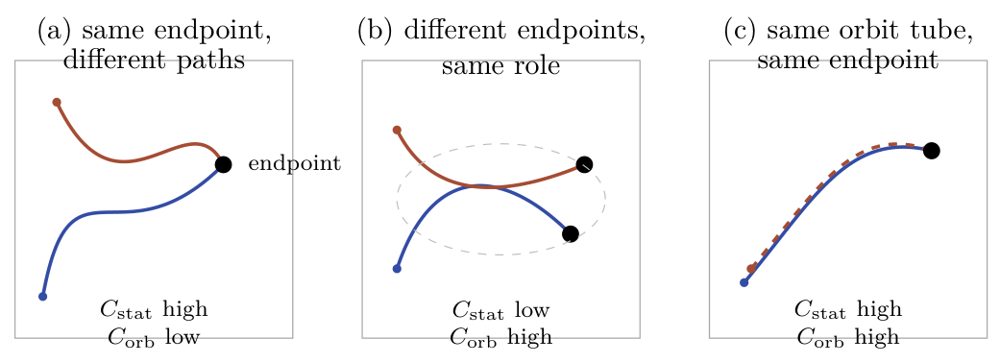

# Chapter 13: orbit crowding and the family of marginal-value functionals

[Library index](../README.md) · [Source policy](../SOURCE.md) · [Previous: PDF 454–460](0454-0460-ch13-redundancy-notions-and-silence.md#pdf-0460) · [Next: PDF 468–471](0468-0471-ch13-marginal-signs-and-independence.md#pdf-0468)

> Editorial note: Full transcription of PDF 461–467 (printed pages 425–431), including the completion of §13.3.4, Figure 13.1, Table 13.2, equations (13.6)–(13.16), and the assumptions of Proposition 13.12. Original ordered-pair normalisations, architectural prescriptions, negative structural functionals, and dimensionally incomplete ablation expressions are retained. Notes 151–154 contain separate qualifications. Proposition 13.12 continues on PDF 468.

## PDF 461 · Book 425

head's specific contribution. A head that introduces a small amount of new cloud-direction coverage may have non-trivial $\mathcal V_{\mathrm{Cov}}(h)$ but negligible $\mathcal V_L(h)$ or $\mathcal V_\Gamma(h)$.

The diagnostic is therefore strictly more refined than either silence or redundancy. The cost of detecting marginality is correspondingly higher: silence requires only the cloud, redundancy requires the layer's joint coverage, marginality requires a leave-one-out evaluation against a chosen functional.

#### 13.3.5 The schematic protection rule

The eight-way classification of Table 13.1 reduces to a schematic protection rule that §13.10 uses for pruning decisions.

- A head is *safely prunable* if it is silent on a representative cloud distribution, redundant relative to the joint coverage of the layer, and non-marginal for every functional in the family of §13.5.
- A head is *conditionally compressible* if it is active and redundant but non-marginal: compression by averaging with another redundant head is admissible, with a small loss in coverage that can be quantified by $\mathcal V_{\mathrm{Cov}}$.
- A head is *protected* if it is marginal for any functional, regardless of its silence or redundancy status. The protection includes the directional-tail regime (silent or active) and the dormant-reserve regime (silent and non-redundant).

The rule is conservative: protection is granted by any positive marginal value, while pruning requires the absence of all three operational signals. This conservatism is intentional. The cost of pruning a marginal head — losing capacity that downstream tasks may rely on — is asymmetric with the cost of preserving a truly redundant one — a small parameter overhead. The training criterion of §13.10 formalises the asymmetry into explicit pruning thresholds.

**Preview.** *The following section quantifies orbit crowding, which provides the geometric counterpart of functional redundancy at the trajectory level rather than the endpoint level.*

### 13.4 Orbit crowding

The dynamic redundancy index $r_{\mathrm{dyn}}^{(\ell)}(\delta)$ of §13.2 counts pairs of heads whose orbits are close in a chosen metric. The count is a binary verdict: either the pair falls below the threshold or it does not. The question of *how* two orbits crowd is left open. The present section refines the picture by separating two crowding regimes that $r_{\mathrm{dyn}}$ does not distinguish: the crowding of orbit *endpoints* and the crowding of orbit *trajectories*. The two have different operational consequences and require different diagnostic tools.

#### 13.4.1 Static and orbital crowding

Two complementary functionals capture the two crowding regimes. Both are kernel-density quantities on the space of head signatures, with a temperature parameter $\tau>0$ controlling the resolution.

**Definition 13.5 (Static crowding).** Let $\sigma_h^{(\ell)}\in\Sigma$ denote the signature of head $h$ at layer $\ell$ at the trained endpoint, and let $d_\Sigma$ be the working metric on signature space (§13.2). The

## PDF 462 · Book 426

*static crowding* of layer $\ell$ at temperature $\tau$ is

$$
C_{\mathrm{stat}}^{(\ell)}(\tau):=\sum_{h\ne h'}\exp\left(-\frac{d_\Sigma(\sigma_h^{(\ell)},\sigma_{h'}^{(\ell)})^2}{\tau^2}\right).
\tag{13.6}
$$

The functional grows when many head signatures lie within distance $\tau$ of each other at the trained endpoint.

**Definition 13.6 (Orbital crowding).** Let $\mathcal O_h^{(\ell)}\subset\Sigma$ denote the training-time orbit of head $h$, with empirical measure $\mu_h^{(\ell)}$. Let $d_{\mathrm{orb}}$ denote the working orbit distance from the family of admissible metrics (§13.2). The *orbital crowding* of layer $\ell$ at temperature $\tau$ is

$$
C_{\mathrm{orb}}^{(\ell)}(\tau):=\sum_{h\ne h'}\exp\left(-\frac{d_{\mathrm{orb}}(\mathcal O_h^{(\ell)},\mathcal O_{h'}^{(\ell)})^2}{\tau^2}\right).
\tag{13.7}
$$

The functional grows when many head orbits, considered as distributions on $\Sigma$, are close in the chosen orbit distance.

**The choice of $\tau$.** The temperature $\tau$ sets the resolution at which crowding is measured. A small $\tau$ counts only very close pairs and produces a sharp diagnostic; a large $\tau$ counts all pairs and produces a smooth global estimate. For diagnostic use throughout the chapter, $\tau$ is set to the median pairwise distance, which makes $C_{\mathrm{stat}}$ and $C_{\mathrm{orb}}$ scale-free quantities of the order $\binom H2e^{-1}\approx0.37\binom H2$ in the absence of redundancy.

**Relation to the dynamic redundancy index.** The orbit-redundancy count $r_{\mathrm{dyn}}^{(\ell)}(\delta)$ is recovered as a hard-threshold version of $C_{\mathrm{orb}}$: replacing the Gaussian kernel with the indicator $\mathbf1[d_{\mathrm{orb}}\le\delta]$ and normalising by $\binom H2$ gives the index of Definition 13.4. The functional $C_{\mathrm{orb}}$ is a smooth surrogate, more amenable to gradient-based monitoring during training.

#### 13.4.2 Three crowding regimes

The pair $(C_{\mathrm{stat}},C_{\mathrm{orb}})$ separates three qualitatively different crowding regimes. The three are illustrated schematically in Figure 13.1 and discussed below.

Each panel shows two head orbits (solid and dashed lines) in $\Sigma$, with their initial points (small dots) and trained endpoints (large dots). Panel (a): the two orbits arrive at the same endpoint via different paths, giving high static and low orbital crowding. Panel (b): the orbits visit the same region of signature space but end at different points, giving low static and high orbital crowding. Panel (c): the orbits coincide along their full path, giving high static and high orbital crowding.

**Regime A: same endpoint, different paths.** The two heads arrive at the same trained signature $\sigma_h\approx\sigma_{h'}$ along disjoint orbits. Static crowding is high; orbital crowding is low. The two heads have covered different regions of signature space during training, even though their endpoint configurations coincide. Pruning one of the two on endpoint grounds alone discards the orbit-level coverage that the discarded head provided, and may degrade the model on input distributions slightly different from the training one. The diagnosis prescribes *caution against endpoint-based pruning*: the heads are functionally redundant at the endpoint, but not redundant in the orbit-coverage sense.

## PDF 463 · Book 427

**Figure 13.1:** The three crowding regimes in signature space.

> Diagram text, transcribed for search: (a) same endpoint, different paths; endpoint; $C_{\mathrm{stat}}$ high, $C_{\mathrm{orb}}$ low. (b) different endpoints, same role; $C_{\mathrm{stat}}$ low, $C_{\mathrm{orb}}$ high. (c) same orbit tube, same endpoint; $C_{\mathrm{stat}}$ high, $C_{\mathrm{orb}}$ high.

| Regime | $C_{\mathrm{stat}}$ | $C_{\mathrm{orb}}$ | Architectural diagnosis |
|---|---|---|---|
| (a) same endpoint, different paths | high | low | avoid endpoint-based pruning |
| (b) different endpoints, same role | low | high | compress by averaging |
| (c) same orbit tube | high | high | safe pruning |

**Table 13.2:** Architectural prescriptions associated to the three crowding regimes.

**Regime B: different endpoints, same role.** The two heads end at distinct points in signature space but visited the same region during training. Static crowding is low; orbital crowding is high. The two heads played the same role during training even though their endpoint signatures differ; they are *hidden duplicates* in the sense that their effective contribution to the model is the same role, instantiated at two different specialisations. The diagnosis prescribes *compression by averaging*: the two heads can be replaced by a single head whose signature is the centroid of the two endpoint signatures, with negligible loss in orbit coverage.

**Regime C: same orbit tube, same endpoint.** The two heads have followed nearly identical orbits throughout training and ended at nearly identical signatures. Both static and orbital crowding are high. The two heads are *strongly redundant*: removing one of them changes neither the endpoint configuration nor the orbit-level coverage of the model. The diagnosis prescribes *safe pruning*: removing either head is admissible, with negligible loss in any of the three redundancy notions.

The three regimes correspond to qualitatively different architectural prescriptions, summarised in Table 13.2.

#### 13.4.3 Crowding and the directional tail

The orbit-crowding analysis interacts with the directional-tail classification of Chapter 11 (Definition ??) in a way that needs to be made explicit, because confusing the two diagnostics produces serious architectural mistakes.

A head on the directional tail has a large S–A balance $\alpha_h\approx1$ and carries antisymmetric mass essential for the task by the orientation conservation analysis of Chapter 12. Its signature is therefore located in a narrow region of $\Sigma$ corresponding to high $\alpha_h$. If a layer carries several directional-tail heads, their signatures will be mutually close — the directional-tail region is small — and the static crowding $C_{\mathrm{stat}}$ will register them as crowded. This is not redundancy. The crowded heads are all carrying directional content of the same type, but the orientations they carry, indexed by which eigenplane of $M_a^{(h)}$ dominates, may be distinct, and their joint

## PDF 464 · Book 428

contribution covers a directional cone that no single head can cover.

The diagnostic distinction is captured by the orbit-level intervention analysis of Chapter 11, in particular *Trace A* (the symmetric-trace intervention) and *Trace B* (the directional-trace intervention). Two crowded heads are truly redundant only if their Trace A and Trace B responses coincide; if their Trace B responses differ, they are crowded but non-redundant, and the directional-tail criterion protects them from compression.

**Schematic protection rule.** The combination of static crowding and intervention diagnosis gives a three-way classification useful in practice:

- *Crowded with same Trace B*: truly redundant directional heads. Compression is admissible.
- *Crowded with different Trace B*: directional-tail heads carrying complementary orientations. Protected from compression even if $C_{\mathrm{stat}}$ is high.
- *Not crowded*: no redundancy verdict on geometric grounds; the marginal-value analysis of §13.5 applies.

The rule prevents the most common architectural mistake suggested by static-crowding analysis alone: the simultaneous removal of several directional-tail heads on the grounds that their endpoint signatures are mutually close.

#### 13.4.4 Crowding under training: a working observation

The two crowding functionals evolve during training with qualitatively different rates. The static crowding $C_{\mathrm{stat}}$ tends to be high at initialisation, when all heads are random and their signatures cluster in the centre of $\Sigma$; it decreases monotonically as specialisation develops, by the gap-opening transition of Chapter 11 (Theorem ??). The orbital crowding $C_{\mathrm{orb}}$ is small at initialisation (the orbits have not yet started) and grows during training, peaking at the moment of maximum specialisation diversity, then decreases as the specialisation distribution stabilises.

The crossover between the two — the training step at which $C_{\mathrm{stat}}$ becomes lower than $C_{\mathrm{orb}}$ — provides an empirical marker of the transition from endpoint-driven to orbit-driven redundancy. Below the crossover, endpoint-based pruning would discard a still-developing specialisation; above it, endpoint-based pruning becomes representative of the trained model. This is offered as a *working observation* rather than a theorem: it has the structure of an outlook statement (§13.12) and is recorded here only because it has direct operational use.

**Preview.** *The next section formalises the marginal value of a head as a family of functionals that complement the crowding diagnostics introduced here.*

### 13.5 Marginal value of a head

The redundancy and crowding diagnostics of the previous sections quantify what a head shares with the rest of the block. The complementary question — what a head contributes that nothing else contributes — is the question of marginal value. The answer is not a single number. A head can be marginally valuable in several distinct senses, each with its own functional and its own diagnostic role. The present section formalises marginal value as a family of functionals, indexed by the structural property against which the head's contribution is measured.

## PDF 465 · Book 429

#### 13.5.1 Marginal value as a family of functionals

The general form of marginal value subtracts the contribution of one head from the joint contribution of the multi-head block.

**Definition 13.7 (Marginal value: general form).** Fix a layer $\ell$ and a structural functional $\Phi:2^{\{1,\ldots,H\}}\to\mathbb R_{\ge0}$ defined on sub-collections of heads at that layer. The *marginal value* of head $h$ relative to $\Phi$ is

$$
\mathcal V_\Phi(h\mid\mathcal H\setminus\{h\}):=\Phi(\mathcal H)-\Phi(\mathcal H\setminus\{h\}).
\tag{13.8}
$$

The general form is a leave-one-out difference. Its sign is determined by the structural meaning of $\Phi$: a positive value indicates that removing the head decreases $\Phi$, that is, the head contributes positively to the structural property; a negative value (rare in practice, but possible) indicates that the head's presence decreases the property, as can occur for parasitic heads in under-trained regimes.

**Why a family rather than a single index.** A head can be valuable along distinct axes that do not reduce to each other. A head that lowers the task loss substantially may contribute little to signature coverage; a head that covers a unique region of signature space may have negligible direct effect on $\Gamma_{\mathrm{res}}$. Combining the axes into a single index introduces choices of weight that are task-dependent and not intrinsic to the architecture. The family formulation keeps the distinct axes distinct, and treats their combination as a separate operational decision (§13.5.5 below).

#### 13.5.2 Four canonical functionals

The chapter focuses on four choices of $\Phi$, each capturing a different structural property. The four are not exhaustive but cover the operational decisions that §13.10 uses for pruning and growth.

##### Loss-based marginal value

The most direct functional measures the head's effect on the task loss.

**Definition 13.8 (Loss-based marginal value).** For a task loss $L_{\mathrm{task}}:\mathrm{models}\to\mathbb R_{\ge0}$ and a model $\mathcal M$ with the head set $\mathcal H$ at layer $\ell$, define

$$
\Phi_L(\mathcal H):=-L_{\mathrm{task}}(\mathcal M_{\mathcal H}),
\tag{13.9}
$$

where $\mathcal M_{\mathcal H}$ denotes the model with the heads at layer $\ell$ restricted to the sub-collection $\mathcal H$. The loss-based marginal value of head $h$ is

$$
\mathcal V_L(h):=L_{\mathrm{task}}(\mathcal M_{\mathcal H\setminus\{h\}})-L_{\mathrm{task}}(\mathcal M_{\mathcal H}).
\tag{13.10}
$$

The convention of subtracting $L$ to define $\Phi_L$ is chosen to align the sign of the marginal value with intuition: positive $\mathcal V_L(h)$ means removing $h$ increases the loss, that is, $h$ is contributing to performance. The functional is the most operationally familiar, but also the most task-specific and the most sensitive to the choice of evaluation distribution.

**Limitations.** The loss-based marginal value depends on the input distribution $\mu_X$ at evaluation, on the loss head's calibration, and on training-time dynamics that are not part of the inference path. It is the most informative functional for finetuning decisions but the least informative for pre-training architectural choices.

## PDF 466 · Book 430

##### Coverage-based marginal value

The second functional measures the head's contribution to the joint coverage of the cloud directions.

**Definition 13.9 (Coverage-based marginal value).** For the activation operators $\mathcal A^{(\ell,h)}$ of Chapter 12 (Definition 12.8), define

$$
\Phi_{\mathrm{Cov}}(\mathcal H):=\mathbb E_{X\sim\mu_X}\left[\dim\left(\sum_{h\in\mathcal H}\operatorname{range}\mathcal A^{(\ell,h)}(X)\right)\right].
\tag{13.11}
$$

The coverage-based marginal value is

$$
\mathcal V_{\mathrm{Cov}}(h):=\Phi_{\mathrm{Cov}}(\mathcal H)-\Phi_{\mathrm{Cov}}(\mathcal H\setminus\{h\}),
\tag{13.12}
$$

the expected number of cloud directions that head $h$ covers exclusively at layer $\ell$.

The functional inherits its data-dependence from $\mathcal A^{(\ell,h)}$ but is task-agnostic at inference. It detects heads whose action on the cloud is not duplicated by other heads at the same layer; a head with $\mathcal V_{\mathrm{Cov}}(h)=0$ adds no new cloud direction to the joint coverage and is functionally redundant in the sense of §13.2.

##### Residual-energy marginal value

The third functional measures the head's contribution to closing the residual directional energy.

**Definition 13.10 (Residual-energy marginal value).** Let $\Gamma_{\mathrm{res}}^{(\ell)}(\mathcal H)$ be the residual directional energy at layer $\ell$ (Chapter 11, Definition ??) computed with the heads restricted to $\mathcal H$. Define

$$
\Phi_\Gamma(\mathcal H):=-\Gamma_{\mathrm{res}}^{(\ell)}(\mathcal H).
\tag{13.13}
$$

The residual-energy marginal value is

$$
\mathcal V_\Gamma(h):=\Gamma_{\mathrm{res}}^{(\ell)}(\mathcal H\setminus\{h\})-\Gamma_{\mathrm{res}}^{(\ell)}(\mathcal H).
\tag{13.14}
$$

By the monotone-decay property of $\Gamma_{\mathrm{res}}$ (Chapter 11, Proposition ??), $\mathcal V_\Gamma(h)\ge0$ for every head, with equality if and only if removing $h$ leaves the residual directional energy unchanged. The functional is therefore non-negative and additive on disjoint head subsets at first order: it gives the directional amplification that $h$ provides exclusively. A head with $\mathcal V_\Gamma(h)=0$ is silent in the directional sense even when it is active in the activation-operator sense, and is the natural target of growth-aware compression.

##### Intervention-based marginal value

The fourth functional measures the head's response under a controlled intervention. Two interventions are particularly informative: Trace A, which sets the symmetric sector $M_s^{(\ell,h)}$ to zero, and Trace B, which sets the antisymmetric sector $M_a^{(\ell,h)}$ to zero (Chapter 11, Definition ??).

**Definition 13.11 (Intervention-based marginal value).** Let $L_{\mathrm{task}}^{(\mathrm{TrA},h)}$ and $L_{\mathrm{task}}^{(\mathrm{TrB},h)}$ denote the task loss of the model with the symmetric, respectively antisymmetric, sector of head $h$ ablated. Define the *symmetric* and *antisymmetric* intervention marginal values as

$$
\mathcal V_I^s(h):=L_{\mathrm{task}}^{(\mathrm{TrA},h)}-L_{\mathrm{task}},
\tag{13.15}
$$

$$
\mathcal V_I^a(h):=L_{\mathrm{task}}^{(\mathrm{TrB},h)}-L_{\mathrm{task}}.
\tag{13.16}
$$

The total intervention-based marginal value is $\mathcal V_I(h):=\mathcal V_I^s(h)+\mathcal V_I^a(h)$.

## PDF 467 · Book 431

The two components give complementary information. A head with $\mathcal V_I^a(h)\gg\mathcal V_I^s(h)$ relies primarily on its antisymmetric sector and is a directional-tail head in the sense of Chapter 11 (Definition ??). Conversely, a head with $\mathcal V_I^s(h)\gg\mathcal V_I^a(h)$ relies primarily on its symmetric sector and operates as a reciprocal attention head. The ratio $\mathcal V_I^a(h)/\mathcal V_I(h)$ is an alternative measure of the head's directional content, complementary to the S–A balance $\alpha_h^{(\ell)}$.

#### 13.5.3 Structural relations among the four functionals

The four functionals are not independent. The relations between them, however, are subtler than a single chain of inequalities would suggest. The non-linearity of the softmax destroys any direct algebraic identity that one might hope to derive linearly from the construction; in particular, ablating both the symmetric and the antisymmetric sectors of a head does not reproduce the effect of removing the head, because zero score induces uniform attention rather than zero output. The structural relations that do hold are therefore of two kinds: non-negativity properties, which follow from convexity of the loss at the trained configuration, and geometric inclusions, which follow from the structure of the activation operator.

The present subsection records what holds rigorously, distinguishes it from what holds only under additional hypotheses, and identifies explicitly the conjectural claims that previous expositions sometimes promote prematurely to theorems.

##### What ablation produces: a clarification

Four ablation modes for a single head $h$ at layer $\ell$ have been used in the chapter. They produce four distinct head outputs, and these are not related by linear identities.

- *Removal.* The head is deleted from the architecture: $u_h^{\mathrm{rem}}=0$. The resulting model has $H-1$ heads at layer $\ell$.
- *Trace A ($M_s=0$).* The score is purely antisymmetric: $u_h^{\mathrm{TrA}}=\operatorname{softmax}(M_a^{(h)}/\sqrt{d_k})XW_V^{(h)}W_O^{(h)}$.
- *Trace B ($M_a=0$).* The score is purely symmetric: $u_h^{\mathrm{TrB}}=\operatorname{softmax}(M_s^{(h)}/\sqrt{d_k})XW_V^{(h)}W_O^{(h)}$.
- *Both sectors ablated ($M=0$).* The score is zero, the softmax is uniform: $u_h^{\mathrm{both}}=\frac1n\mathbf1\mathbf1^\top XW_V^{(h)}W_O^{(h)}$, which is the average-pooled value-projected token, not zero.

In particular, $u_h^{\mathrm{both}}\ne u_h^{\mathrm{rem}}=0$, and consequently $\mathcal V_I^{\mathrm{both}}(h)\ne\mathcal V_L(h)$ in general. This has a concrete numerical signature: empirically, the strict inequality $\mathcal V_L(h)>\mathcal V_I^{\mathrm{both}}(h)$ fails on a substantial fraction of trained configurations, even when the loss is quadratic at the trained minimum. Any proposition that asserts the inequality unconditionally is therefore false.

The chapter records this failure mode explicitly because earlier expositions of the same material have been tempted to assert the inequality as a structural fact. It is not.

##### Non-negativity under loss convexity

The single rigorous chain of relations available in this volume concerns the sign of the four functionals.

**Proposition 13.12 (Non-negativity of marginal-value functionals).** Assume that $L_{\mathrm{task}}$ is convex in the joint multi-head output $\operatorname{MHA}^{(\ell)}(X)$, viewed as a function of $\mathbb R^{n\times d_{\mathrm{model}}}$, and that the trained model is at a stationary point with respect to the ablation directions used.

> Editorial continuation: The conclusion and proof of Proposition 13.12 begin on [PDF 468](0468-0471-ch13-marginal-signs-and-independence.md#pdf-0468). The assumptions above are not the complete proposition.
