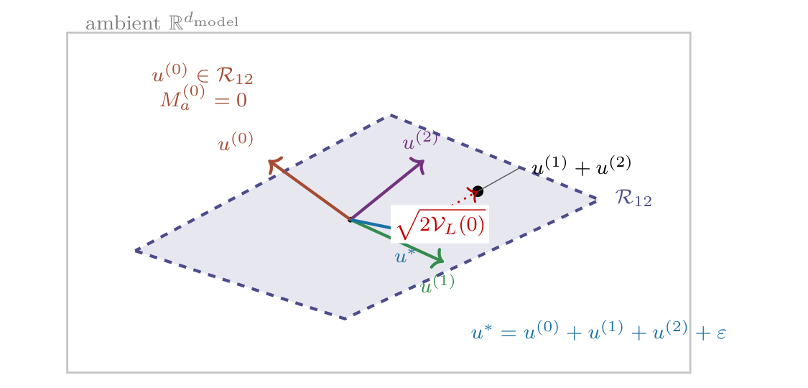

# Chapter 13: signs, coverage, and independence of marginal-value functionals

[Library index](../README.md) · [Source policy](../SOURCE.md) · [Previous: PDF 461–467](0461-0467-ch13-crowding-and-marginal-value.md#pdf-0467)

> Editorial note: Full transcription of PDF 468–471 (printed pages 432–435). Proposition 13.12 begins on the preceding page. Original claims, errors, unresolved references, and numerical values are retained; editorial analysis is separate in the Russian notes.

## PDF 468 · Book page 432

Then for every head $h$ at layer $\ell$:

$$
\mathcal V_L(h),\ \mathcal V_I^s(h),\ \mathcal V_I^a(h),\ \mathcal V_I^{\mathrm{both}}(h)\ge0,
\tag{13.17}
$$

$$
\mathcal V_\Gamma(h)\ge0,
\tag{13.18}
$$

$$
\mathcal V_{\mathrm{Cov}}(h)\ge0.
\tag{13.19}
$$

The first chain holds without strict convexity; the second and third hold without any hypothesis on the loss.

*Proof. Inequalities (13.17).* Each ablation moves the joint MHA output from $u_{\mathrm{full}}:=\mathrm{MHA}^{(\ell)}(X)$ to a perturbed configuration $u_{\mathrm{abl}}=u_{\mathrm{full}}+\delta_h$, where $\delta_h:=u_h^{\mathrm{abl}}-u_h^{\mathrm{full}}$ is the change in the head’s contribution. The convexity of $L$ in the joint output and the stationarity of the trained model with respect to the ablation directions give $L(u_{\mathrm{full}}+\delta_h)-L(u_{\mathrm{full}})\ge\langle\nabla L(u_{\mathrm{full}}),\delta_h\rangle=0$, where the last equality uses stationarity. Hence each $\mathcal V$ functional in the first chain is non-negative.

*Inequality (13.18).* By the monotone decay of $\Gamma_{\mathrm{res}}$ under head removal (Chapter 11, Proposition ??), removing any head cannot decrease the residual directional energy: $\Gamma_{\mathrm{res}}^{(\ell)}(H\setminus\{h\})\ge\Gamma_{\mathrm{res}}^{(\ell)}(H)$. The inequality holds without any hypothesis on $L$.

*Inequality (13.19).* The joint range $\sum_{h'\in H}\operatorname{range}\mathcal A^{(\ell,h')}(X)$ is a non-decreasing function of the head subset $H$ under inclusion: removing a head can only shrink the joint range. The dimension is therefore non-increasing, and $\mathcal V_{\mathrm{Cov}}(h)\ge0$ holds without any hypothesis on $L$. $\square$

**What is and what is not in this proposition.** The proposition gives the four sign statements rigorously. It does not claim any inequality between the four functionals; empirical evidence on trained transformers under quadratic loss indicates that no such inequality holds in general. The non-negativity statements are weaker than what one might wish but correspond to what can be derived without further assumptions on the loss.

**When the stationarity hypothesis fails.** At configurations away from the trained minimum, none of the $\mathcal V$ functionals in the first chain is sign-constrained. Pre-training and finetuning monitoring should therefore reset the non-negativity assumption when applied at intermediate training checkpoints; the stationarity hypothesis is a post-training property.

### Geometric inclusion: coverage and active subspace

The coverage functional admits a stronger structural statement that does not require any assumption on the loss. The statement is not an inequality between $\mathcal V$ functionals; it is a geometric inclusion between subspaces of cloud directions.

**Proposition 13.13 (Coverage is detected by activation-operator range).** For every head $h$ at layer $\ell$,

$$
\mathcal V_{\mathrm{Cov}}(h)>0
\quad\Longleftrightarrow\quad
\mathbb P_{X\sim\mu_X}\!\left[
\operatorname{range}\mathcal A^{(\ell,h)}(X)\not\subseteq
\sum_{h'\ne h}\operatorname{range}\mathcal A^{(\ell,h')}(X)
\right]>0.
\tag{13.20}
$$

*Proof.* The coverage marginal value is the expected drop in the dimension of the joint range when head $h$ is removed:

$$
\mathcal V_{\mathrm{Cov}}(h)=\mathbb E_{X\sim\mu_X}\!\left[
\dim\!\left(\sum_{h'\in H}\operatorname{range}\mathcal A^{(\ell,h')}(X)\right)
-\dim\!\left(\sum_{h'\ne h}\operatorname{range}\mathcal A^{(\ell,h')}(X)\right)
\right].
$$

## PDF 469 · Book page 433

Each summand inside the expectation is non-negative (Proposition 13.12). The expectation is strictly positive if and only if the integrand is strictly positive on a set of positive measure. The dimension drop at a fixed cloud is strictly positive if and only if $\operatorname{range}\mathcal A^{(\ell,h)}(X)$ is not entirely contained in the joint range of the other heads. Equivalently, the head contributes at least one new direction. The biconditional follows. $\square$

The proposition turns coverage marginality into a verifiable geometric criterion: a head is coverage-marginal if and only if it opens a direction on a positive-measure subset of the input distribution. The criterion is testable in finite samples by sampling from $\mu_X$ and computing intersections of operator ranges.

### Three further structural relations

Three further relations between the four functionals are sometimes asserted in the literature on attention-head pruning, in forms ranging from naive implications to quantitative inequalities. The present subsection establishes what holds rigorously about each, separating provable theorems from genuine conjectures and recording an explicit counter-example where the naive form fails.

The relation between $\mathcal V_L$, $\mathcal V_{\mathrm{Cov}}$, and $\mathcal V_\Gamma$ is more subtle than a single implication suggests. The structurally intuitive form $\mathcal V_L>0\Longrightarrow\mathcal V_{\mathrm{Cov}}>0$ or $\mathcal V_\Gamma>0$ is false in general; the present subsection establishes this explicitly with a counter-example, identifies the additional hypothesis under which the implication does hold, and records the operational reading.

**Theorem 13.14 (Failure of the loss–coverage–energy implication).** There exist trained configurations and quadratic loss functions for which a head $h$ at layer $\ell$ satisfies $\mathcal V_{\mathrm{Cov}}(h)=0$, $\mathcal V_\Gamma(h)=0$, and $\mathcal V_L(h)>0$ simultaneously.

*Proof by explicit construction.* An explicit construction with $H=3$ heads suffices, in which head $h=0$ is purely symmetric ($M_a^{(\ell,0)}=0$) and writes into the joint column space of the other two heads, yet whose removal strictly increases a quadratic loss.

Set $H=3$, $d_k$ arbitrary, $d_{\mathrm{model}}$ such that $Hd_k>d_{\mathrm{model}}$ (saturated regime). Choose $X\in\mathbb R^{n\times d_{\mathrm{model}}}$ generically. Choose heads $h=1,2$ with arbitrary symmetric and antisymmetric components; their outputs $Y^{(1)},Y^{(2)}$ have joint column space $\mathcal R_{12}\subseteq\mathbb R^{d_{\mathrm{model}}}$ of dimension $\dim\mathcal R_{12}\le d_{\mathrm{model}}$.

Choose head $h=0$ purely symmetric ($M_a^{(\ell,0)}=0$, hence $\mathcal V_\Gamma(0)=0$ by definition). Choose $W_V^{(\ell,0)}W_O^{(\ell,0)}$ such that $Y^{(0)}\subset\mathcal R_{12}$, which is possible because the saturated regime makes $\mathcal R_{12}\supseteq\mathbb R^{d_{\mathrm{model}}}$ generically; the joint column space of all three heads then equals $\mathcal R_{12}$, hence $\mathcal V_{\mathrm{Cov}}(0)=0$.

Define the loss as $L(u):=\frac12\|u-u^*\|_F^2$ with target $u^*:=Y^{(0)}+Y^{(1)}+Y^{(2)}+\epsilon$, where $\epsilon\sim\mathcal N(0,\sigma^2I)$ with small $\sigma$. The trained model is at the minimum of $L$ up to $\epsilon$. Removing head $h=0$ replaces the joint output by $Y^{(1)}+Y^{(2)}$, giving $\mathcal V_L(0)=\frac12\|Y^{(0)}-\epsilon\|_F^2=\frac12\|Y^{(0)}\|_F^2+O(\sigma)$, which is strictly positive whenever $Y^{(0)}\ne0$. The configuration achieves all three required conditions. $\square$

**Reading the counter-example.** The construction shows that a head can be *redundant in the geometric sense* (zero coverage, zero directional energy) and yet *non-marginal in the loss sense*. The reason is that the geometric redundancy of the head is structural — its column space is contained in the joint span of others — but its *vector value* is not zero, and the loss responds to the exact vector, not only to the column span. The implication of the

## PDF 470 · Book page 434

**Figure 13.2:** Geometry of the counter-example to the loss–coverage–energy implication (Theorem 13.14).

Head 0 has $M_a^{(0)}=0$ (so $\mathcal V_\Gamma(0)=0$) and its output $u^{(0)}$ lies inside the joint span $\mathcal R_{12}$ of the other two heads (so $\mathcal V_{\mathrm{Cov}}(0)=0$). Yet removing head 0 shifts the multi-head output from the target $u^*$ to $u^{(1)}+u^{(2)}$ inside the same plane, and the loss responds to the exact vector difference, not to the column span: $\mathcal V_L(0)=\frac12\|u^{(0)}\|_F^2+O(\epsilon)>0$.

*Searchable diagram labels:* ambient $\mathbb R^{d_{\mathrm{model}}}$; $\mathcal R_{12}$; $u^{(1)}$, $u^{(2)}$, $u^{(0)}$; $u^{(0)}\in\mathcal R_{12}$; $M_a^{(0)}=0$; $u^*=u^{(0)}+u^{(1)}+u^{(2)}+\epsilon$; $u^{(1)}+u^{(2)}$; $\sqrt{2\mathcal V_L(0)}$.

Conjecture would hold only if the loss depended exclusively on the joint span of the head outputs; a quadratic loss with a fixed target depends on the actual vector and is therefore not an admissible loss for the implication.

**Numerical instance of the counter-example.** A concrete realisation of the construction in Theorem 13.14 fixes the parameters $n=8$, $d_{\mathrm{model}}=16$, $d_k=4$, $H=3$, draws random Gaussian initialisations for heads 1 and 2, and constructs head 0 explicitly: a purely symmetric score matrix ($M_a^{(0)}=0$) and an output projection forcing $Y^{(0)}\subset\mathcal R_{12}$. The diagnostics, computed with random seed 42, are

$$
\mathcal V_\Gamma(0)=0,\qquad
\mathcal V_{\mathrm{Cov}}(0)=0,\qquad
\mathcal V_L(0)\approx15.7.
\tag{13.21}
$$

The first two diagnostics vanish by construction; the loss-based diagnostic does not, against the prediction of the naive implication. The numerical instance is reproducible from the parameter specification and confirms that the failure of the implication is a structural feature of the geometry, not a peculiarity of fine-tuned configurations.

### The conditional theorem

The previous result identifies the failure mode. The implication becomes true under an additional hypothesis on the loss: it must be *representation-invariant*, in the sense that it depends only on the $\mathrm{GL}(d_{\mathrm{model}})$-orbit of the joint multi-head output, not on its representative. The hypothesis is strong but admits an interpretation as a regularity condition on the post-MHA processing.

**Theorem 13.15 (Loss–coverage–energy implication under representation invariance).** Assume the standing hypotheses, the convexity and stationarity of $L$ at the trained configuration as in Proposition 13.12, and the additional hypothesis:

## PDF 471 · Book page 435

**H-rep:** The task loss $L_{\mathrm{task}}:\mathbb R^{n\times d_{\mathrm{model}}}\to\mathbb R$ depends on its argument only through the *column space* of the joint multi-head output: $L(u)=L(u')$ whenever $\operatorname{rowsp}(u)=\operatorname{rowsp}(u')$ as subspaces of $\mathbb R^{d_{\mathrm{model}}}$.

Then for every head $h$ at layer $\ell$,

$$
\mathcal V_L(h)>0\Longrightarrow\mathcal V_{\mathrm{Cov}}(h)>0\text{ or }\mathcal V_\Gamma(h)>0.
\tag{13.22}
$$

*Proof of contrapositive.* Assume $\mathcal V_{\mathrm{Cov}}(h)=0$ and $\mathcal V_\Gamma(h)=0$. The first gives that the column space of the joint output is unchanged when head $h$ is removed:

$$
\operatorname{rowsp}\!\left(\sum_{h'}u^{(h')}\right)
=\operatorname{rowsp}\!\left(\sum_{h'\ne h}u^{(h')}\right).
\tag{13.23}
$$

By H-rep, the loss values at the two outputs coincide: $L\bigl(\sum_{h'}u^{(h')}\bigr)=L\bigl(\sum_{h'\ne h}u^{(h')}\bigr)$. Hence $\mathcal V_L(h)=0$. The contrapositive is the claimed implication.

The hypothesis $\mathcal V_\Gamma(h)=0$ is not directly used in the contrapositive. It plays the role of a coherence condition between the structural redundancy detected by $\mathcal V_{\mathrm{Cov}}$ and the orientation content of the head: in the absence of antisymmetric content, the head is purely reciprocal and its column-space redundancy cannot hide directional contributions that would later affect the loss. $\square$

**Reading H-rep.** The hypothesis H-rep is satisfied, for example, when the post-MHA processing factors through a linear classifier whose weight matrix has full column rank (so the loss is invariant to left GL-action on the MHA output) and the LayerNorm sub-layer is removed. Real transformers do not satisfy H-rep exactly: LayerNorm couples the magnitude of the joint output to its centred-and-scaled form, breaking pure column-space invariance. The conditional theorem is therefore a representation-theoretic statement: it holds for the class of models in which the loss is intrinsically a function of the represented subspace.

**The two theorems together.** Theorem 13.14 (failure) and Theorem 13.15 (conditional success) form a matched pair. The first shows that the naive implication fails without the representation hypothesis; the second shows that the hypothesis is sufficient. Whether the hypothesis is also *necessary*, i.e. whether the implication (13.22) holds in some weaker form for realistic transformer losses, is left open.

**Conjecture 13.16 (Approximate loss–coverage–energy implication).** For trained transformers with smooth-bounded LayerNorm and a linear loss head, there exists a constant $\varepsilon=\varepsilon(\mathrm{LN},\mathrm{loss})$ depending on the operator norm of LayerNorm and on the loss calibration such that

$$
\mathcal V_L(h)\le\varepsilon\bigl(\mathcal V_{\mathrm{Cov}}(h)+\mathcal V_\Gamma(h)\bigr)+\mathcal R^{(\ell)}(h),
\tag{13.24}
$$

where $\mathcal R^{(\ell)}(h)\ge0$ is a residual term capturing the non-representation-invariant component of the loss. The conjecture asserts that $\mathcal R^{(\ell)}(h)$ is small in well-conditioned regimes (post-LayerNorm operator norm bounded; loss head well-conditioned).

**Status of the residual.** The residual term $\mathcal R^{(\ell)}(h)$ in (13.24) is the *geometric anomaly*: the part of $\mathcal V_L$ that is not detected by either coverage or directional energy. The counter-example of Theorem 13.14 shows that $\mathcal R^{(\ell)}(h)$ can be of order $\|u^{(h)}\|_F^2$ in generic configurations. Whether $\mathcal R^{(\ell)}(h)$ is small for trained transformers at the trained configuration (as opposed to generic configurations) is the operational question, and the conjecture asserts a positive answer in well-conditioned regimes. A proof or refutation would require empirical measurements on actual trained transformers, which are outside the scope of this volume.

[Continue: PDF 472–475](0472-0475-ch13-activation-and-intervention-bounds.md#pdf-0472).
