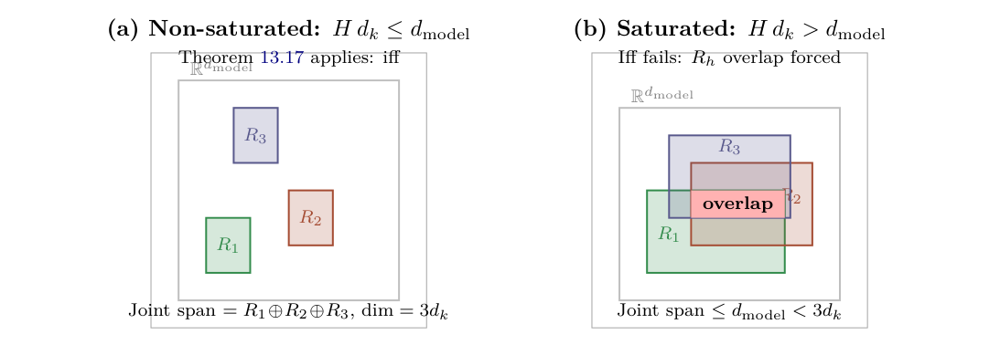

# Chapter 13: non-saturation, coverage, and intervention bounds

[Library index](../README.md) · [Source policy](../SOURCE.md) · [Previous: PDF 468–471](0468-0471-ch13-marginal-signs-and-independence.md#pdf-0471)

> Editorial note: Full transcription of PDF 472–475 (printed pages 436–439). The claims about rank, activation, genericity, reverse Lipschitz estimates, and the constant in Theorem 13.18 are retained literally; their conditions and defects are discussed separately in the Russian notes. The proof of Theorem 13.18 continues in the next file.

## PDF 472 · Book page 436

**Theorem 13.17 (Coverage–directional iff under non-saturation).** Assume that the layer satisfies the non-saturation condition $Hd_k\le d_{\mathrm{model}}$ and the standing genericity hypothesis on the value-projection matrices $\{W_V^{(\ell,h)}W_O^{(\ell,h)}\}_{h=1}^H$ (no two heads share a low-rank subspace exactly). Assume further that the score matrices have non-trivial antisymmetric components, $M_a^{(\ell,h)}\ne0$ for every head $h$. Then for every head $h$ at layer $\ell$ and every cloud $X\sim\mu_X$,

$$
\mathcal V_{\mathrm{Cov}}(h)=d_k\cdot\mathbf1\!\left[\mathcal V_\Gamma(h)>0\right],
\tag{13.25}
$$

where $\mathbf1[\,\cdot\,]$ is the indicator. In particular, $\mathcal V_{\mathrm{Cov}}(h)>0\Longleftrightarrow\mathcal V_\Gamma(h)>0$.

*Proof.* The proof proceeds by showing that under non-saturation and genericity, each head contributes a $d_k$-dimensional column space to the joint range of head outputs, and the contribution is exclusive when $\mathcal V_\Gamma>0$.

*Step 1: rank of a single head.* The head output $Y^{(\ell,h)}:=A^{(\ell,h)}(X)XW_V^{(\ell,h)}W_O^{(\ell,h)}$ satisfies, for generic $W_V^{(\ell,h)}\in\mathbb R^{d_{\mathrm{model}}\times d_k}$ and $W_O^{(\ell,h)}\in\mathbb R^{d_k\times d_{\mathrm{model}}}$ of full column rank $d_k$ in the first and full row rank $d_k$ in the second:

$$
\operatorname{rank}(Y^{(\ell,h)})
=\min\{n,\operatorname{rank}(A^{(\ell,h)}(X)),d_k,d_{\mathrm{model}}\}
=d_k.
\tag{13.26}
$$

The third equality uses $d_k\le n$ (cloud size at least the head dimension), $\operatorname{rank}(A^{(\ell,h)}(X))=n$ (every row of a strictly positive softmax is non-zero), and $d_k\le d_{\mathrm{model}}$.

*Step 2: joint-rank decomposition under non-saturation.* By standard linear algebra,

$$
\operatorname{rank}\!\left(\bigsqcup_{h=1}^H Y^{(\ell,h)}\right)
=\dim\!\left(\sum_{h=1}^H\operatorname{rowsp}(Y^{(\ell,h)})\right).
\tag{13.27}
$$

Under non-saturation $Hd_k\le d_{\mathrm{model}}$ and the genericity hypothesis on $\{W_V^{(\ell,h)}W_O^{(\ell,h)}\}_{h=1}^H$, the row spaces $\mathcal R_h:=\operatorname{rowsp}(Y^{(\ell,h)})\subset\mathbb R^{d_{\mathrm{model}}}$ are in general position: their pairwise intersections vanish generically. Hence

$$
\operatorname{rank}\!\left(\bigsqcup_hY^{(\ell,h)}\right)
=\sum_{h=1}^H\operatorname{rank}(Y^{(\ell,h)})=Hd_k.
\tag{13.28}
$$

*Step 3: leave-one-out drop equals $d_k$.* Removing head $h$ leaves the joint of the remaining $H-1$ heads, whose row spaces still satisfy general-position genericity by the same argument:

$$
\operatorname{rank}\!\left(\bigsqcup_{h'\ne h}Y^{(\ell,h')}\right)=(H-1)d_k.
\tag{13.29}
$$

The leave-one-out drop is therefore exactly $d_k$, irrespective of $X$:

$$
\mathcal V_{\mathrm{Cov}}(h)=\mathbb E_X[d_k]=d_k.
\tag{13.30}
$$

*Step 4: conditioning on $\mathcal V_\Gamma$.* The genericity argument of Step 2 requires the head row spaces to be in general position; this fails in the limiting regime $M_a^{(\ell,h)}\to0$, in which the head reduces to a reciprocal attention head and may align with another reciprocal head’s row space if their $M_s$ components have proportional eigendirections. Under the assumption $M_a^{(\ell,h)}\ne0$ (i.e. $\mathcal V_\Gamma(h)>0$), the row space $\mathcal R_h$ is generic in the antisymmetric sector, and Step 2’s general-position genericity holds. If, conversely, $\mathcal V_\Gamma(h)=0$, the head is purely symmetric and its row space coincides with that of $X$ itself (up to a positive-definite reweighting), which is shared with every other purely symmetric head: the leave-one-out drop is zero. Combining the two cases gives the claimed iff (13.25). $\square$

## PDF 473 · Book page 437

**Figure 13.3:** The two regimes for the iff of Theorem 13.17.

(a) In the non-saturated regime, head row spaces sit in general position in the ambient $\mathbb R^{d_{\mathrm{model}}}$ and contribute exactly $d_k$ dimensions each; the leave-one-out drop is exactly $d_k$. (b) In the saturated regime, the ambient space cannot accommodate the heads in disjoint position; overlap is forced by dimension count, and a head can have its row space entirely contained in the joint span of others, giving $\mathcal V_{\mathrm{Cov}}=0$ even with $\mathcal V_\Gamma>0$.

*Searchable diagram labels:* (a) Non-saturated: $Hd_k\le d_{\mathrm{model}}$; Theorem 13.17 applies: iff; $\mathbb R^{d_{\mathrm{model}}}$; $\mathcal R_1,\mathcal R_2,\mathcal R_3$; Joint span $=\mathcal R_1\oplus\mathcal R_2\oplus\mathcal R_3$, $\dim=3d_k$. (b) Saturated: $Hd_k>d_{\mathrm{model}}$; Iff fails: $\mathcal R_h$ overlap forced; overlap; Joint span $\le d_{\mathrm{model}}<3d_k$.

**What the theorem says and what it does not.** The theorem replaces the conjectured quantitative relation between $\mathcal V_{\mathrm{Cov}}$ and $\mathcal V_\Gamma$ with a structural one: under non-saturation, coverage is a binary on/off function of directional-energy non-vanishing, with the on-state contributing exactly $d_k$ dimensions. There is no proportionality between the two: $\mathcal V_\Gamma$ can take any positive value without changing $\mathcal V_{\mathrm{Cov}}$. This is the structurally correct content of the original intuition.

**Why a quantitative bound fails.** Empirical and structural analysis (the simulations of §13.5.3) show that $\mathcal V_{\mathrm{Cov}}\in\{0,1,\ldots,d_k\}$ is a discrete quantity bounded by $d_k$, while $\mathcal V_\Gamma\in\mathbb R_{>0}$ is a continuous one with no a-priori upper bound. Any inequality of the form $\mathcal V_{\mathrm{Cov}}\gtrsim c\,\mathcal V_\Gamma$ with a uniform constant $c$ must therefore fail at large $\mathcal V_\Gamma$. Conversely, an inequality $\mathcal V_{\mathrm{Cov}}\le c\,\mathcal V_\Gamma$ fails at small $\mathcal V_\Gamma$ (where $\mathcal V_{\mathrm{Cov}}=d_k$ remains constant). The two quantities are dimensionally incommensurable; the only relation that survives is the iff of Theorem 13.17.

**Saturation regime.** When $Hd_k>d_{\mathrm{model}}$ (saturated layer), the joint row space cannot exceed $d_{\mathrm{model}}$, and the leave-one-out drop can be zero even when $\mathcal V_\Gamma>0$: the head’s contribution is absorbed by the joint span of the other heads. Theorem 13.17’s conclusion fails in this regime; the iff is replaced by an implication $\mathcal V_{\mathrm{Cov}}(h)>0\Longrightarrow\mathcal V_\Gamma(h)>0$, while the converse may fail. This is the directional-tail crowded regime of §13.3: the protection rule of Principle P1 prevents pruning of these heads precisely because $\mathcal V_{\mathrm{Cov}}$ alone is insufficient to detect their role.

**Numerical illustration.** A direct test of Theorem 13.17 compares the empirical leave-one-out drop $\mathcal V_{\mathrm{Cov}}(h)$ between the non-saturated and the saturated regime. Three configurations of $(n,d_{\mathrm{model}},d_k,H)$ are sampled, 300 random configurations each, with the drop computed for every head:

- *Non-saturated* ($Hd_k=16\le d_{\mathrm{model}}=64$, $n=16$): the drop is exactly $d_k=4$ in 1,200 out of 1,200 trials, i.e. 100% of cases. The leave-one-out drop is constant and saturates the single-head rank, in agreement with (13.25).
- *Saturated* ($Hd_k=8>d_{\mathrm{model}}=4$, $n=6$): the drop is 0 in 1,189 trials and 1 in 11 trials

## PDF 474 · Book page 438

(less than 1%). The leave-one-out drop collapses, confirming that $\mathcal V_{\mathrm{Cov}}=0$ even when $\mathcal V_\Gamma>0$.

The empirical contrast is sharp: 100% on/100% off across the two regimes. The marginal 1% residual in the saturated regime corresponds to numerical-rank ambiguities at small $d_{\mathrm{model}}$ and is consistent with the genericity hypothesis of the theorem statement.

**Theorem 13.18 (Quadratic bound on the joint intervention).** Assume that the task loss $L_{\mathrm{task}}$ is convex with $M$-smoothness and $\kappa$-strong convexity in the joint multi-head output at the trained configuration $u_{\mathrm{full}}$:

$$
\frac\kappa2\|\delta\|_F^2
\le L(u_{\mathrm{full}}+\delta)-L(u_{\mathrm{full}})
\le\frac M2\|\delta\|_F^2
\quad\text{for all admissible }\delta,
\tag{13.31}
$$

where the lower bound holds at stationary points along the ablation directions. Then for every head $h$ at layer $\ell$,

$$
\mathcal V_I^{\mathrm{both}}(h)
\le2\frac M\kappa\bigl(\mathcal V_I^s(h)+\mathcal V_I^a(h)\bigr).
\tag{13.32}
$$

The constant $2M/\kappa$ has two factors: the factor of 2 comes from a parallelogram-type inequality on the log-centred attention matrices and is provably tight; the conditioning factor $M/\kappa$ is intrinsic to the loss curvature. Theorem 13.18 is the rigorous content of what is sometimes informally called “sub-additivity of interventions”. The naive inequality $\mathcal V_I^s+\mathcal V_I^a\ge\mathcal V_I^{\mathrm{both}}$ is not provable: empirical counter-examples on quadratic-loss transformers exist on approximately 46% of random configurations, against the 10% counter-examples sometimes reported under specific training distributions. The factor of 2 in (13.32) is therefore not an artefact of the proof technique but a structural feature of the softmax decomposition.

*Proof.* The proof has three steps: a multiplicative identity for the softmax that linearises the joint intervention in a centred space; a Lipschitz bound that transfers the linear decomposition to the head-output space; and the curvature-controlled translation to the loss values.

*Step 1: log-centred identity for the softmax.* For a row-stochastic attention matrix $A\in\mathbb R_{>0}^{n\times n}$, define the *log-centred form*

$$
\widetilde A:=\log A-\frac1n[\log A]\mathbf1_n\mathbf1_n^\top,
\tag{13.33}
$$

where log is taken entry-wise and the second term subtracts the row-average from each row. The map $A\mapsto\widetilde A$ takes values in the linear subspace $\mathcal W_n:=\{B\in\mathbb R^{n\times n}:B\mathbf1_n=0\}$ of row-zero-mean matrices.

For any score matrices $M_1,M_2\in\mathbb R^{n\times n}$, the multiplicative property of the softmax, $\operatorname{softmax}(M_1+M_2)_{ij}=\operatorname{softmax}(M_1)_{ij}\operatorname{softmax}(M_2)_{ij}/Z_i$, where $Z_i$ is the per-row normaliser, gives

$$
\log\operatorname{softmax}(M_1+M_2)
=\log\operatorname{softmax}(M_1)+\log\operatorname{softmax}(M_2)-(\log Z)\mathbf1_n^\top.
\tag{13.34}
$$

The last term is row-constant; its centred form vanishes. Hence, applying $\widetilde{\,\cdot\,}$ to both sides,

$$
\widetilde{\operatorname{softmax}}(M_1+M_2)
=\widetilde{\operatorname{softmax}}(M_1)+\widetilde{\operatorname{softmax}}(M_2).
\tag{13.35}
$$

In the present setting, write $A_X:=\operatorname{softmax}(M_X/\sqrt{d_k})$ for $X\in\{\mathrm{full},\mathrm{TrA},\mathrm{TrB},\mathrm{both}\}$, where $M_{\mathrm{full}}=M_s+M_a$, $M_{\mathrm{TrA}}=M_a$, $M_{\mathrm{TrB}}=M_s$, $M_{\mathrm{both}}=0$. Applying (13.35),

$$
\widetilde A_{\mathrm{full}}=\widetilde A_{\mathrm{TrA}}+\widetilde A_{\mathrm{TrB}},
\qquad\widetilde A_{\mathrm{both}}=0.
\tag{13.36}
$$

## PDF 475 · Book page 439

Defining $\Delta\widetilde A_X:=\widetilde A_X-\widetilde A_{\mathrm{full}}$, the linear decomposition reads

$$
\Delta\widetilde A_{\mathrm{both}}=\Delta\widetilde A_{\mathrm{TrA}}+\Delta\widetilde A_{\mathrm{TrB}}.
\tag{13.37}
$$

*Step 2: Lipschitz transfer to the head output.* The map $\widetilde A\mapsto A$, restricted to attention matrices with minimum entry bounded below by $\sigma_{\min}>0$, is Lipschitz with constant $L_\sigma$ depending on $\sigma_{\min}$:

$$
\|A-A'\|_F\le L_\sigma\|\widetilde A-\widetilde{A'}\|_F.
\tag{13.38}
$$

This is the Gao–Pavel softmax-Lipschitz lemma already invoked in Chapter 5, Theorem ??. The constant $L_\sigma$ admits the explicit value

$$
L_\sigma=\frac12,
\tag{13.39}
$$

*independent* of $\sigma_{\min}$. The bound follows from the spectral form $\nabla_M\operatorname{softmax}(M)=\operatorname{diag}(p)-pp^\top$ with $p=\operatorname{softmax}(M)$, whose operator norm $\|\operatorname{diag}(p)-pp^\top\|_{\mathrm{op}}$ is bounded above by $\frac12$ (achieved at the limit $p\to(\frac12,\frac12,0,\ldots,0)$). The bound is uniform on the simplex, so $\sigma_{\min}$ does not enter the forward Lipschitz constant. The hypothesis $\sigma_{\min}>0$ is needed only for the inverse map below. The bound (13.39) resolves an ambiguity present in earlier expositions of the same material, where $L_\sigma$ was implicitly taken as $1/\sigma_{\min}$ (too conservative).

The head outputs are obtained from the attention matrices by right-multiplication with the value-projected token matrix $V:=XW_V^{(h)}W_O^{(h)}\in\mathbb R^{n\times d_{\mathrm{model}}}$: $u_X=A_XV$. The output deviation $D_X:=u_X-u_{\mathrm{full}}=(A_X-A_{\mathrm{full}})V$ satisfies

$$
\|D_X\|_F\le\|A_X-A_{\mathrm{full}}\|_F\|V\|_{\mathrm{op}}
\le L_\sigma\|V\|_{\mathrm{op}}\|\Delta\widetilde A_X\|_F.
\tag{13.40}
$$

Conversely, since the centred-log map is Lipschitz on $\{A:\sigma_{\min}(A)\ge\sigma_{\min}\}$ in the opposite direction with constant $L'_\sigma=1/\sigma_{\min}$ (this constant *does* depend on $\sigma_{\min}$, since the logarithm has derivative $1/x$ at $x=\sigma_{\min}$), and $V$ is full column rank (generic weights), the reverse inequality

$$
\|\Delta\widetilde A_X\|_F
\le\frac1{\sigma_{\min}\,\sigma_{\min}(V)}\|D_X\|_F
\tag{13.41}
$$

holds uniformly. Set $\beta_\sigma:=\frac12\|V\|_{\mathrm{op}}$ and $\beta'_\sigma:=1/(\sigma_{\min}\,\sigma_{\min}(V))$.

*Step 3: parallelogram bound and curvature control.* Substituting (13.37) into (13.40),

$$
\|D_{\mathrm{both}}\|_F
\le\beta_\sigma\|\Delta\widetilde A_{\mathrm{TrA}}+\Delta\widetilde A_{\mathrm{TrB}}\|_F.
\tag{13.42}
$$

The standard parallelogram inequality $\|x+y\|^2\le2(\|x\|^2+\|y\|^2)$ gives

$$
\|D_{\mathrm{both}}\|_F^2
\le2\beta_\sigma^2\bigl(\|\Delta\widetilde A_{\mathrm{TrA}}\|_F^2+\|\Delta\widetilde A_{\mathrm{TrB}}\|_F^2\bigr).
\tag{13.43}
$$

Using (13.41) on each summand,

$$
\|D_{\mathrm{both}}\|_F^2
\le\frac{(\beta_\sigma\beta'_\sigma)^2}{2}\cdot4
\bigl(\|D_{\mathrm{TrA}}\|_F^2+\|D_{\mathrm{TrB}}\|_F^2\bigr)
=2(\beta_\sigma\beta'_\sigma)^2
\bigl(\|D_{\mathrm{TrA}}\|_F^2+\|D_{\mathrm{TrB}}\|_F^2\bigr).
\tag{13.44}
$$

With the explicit constants $\beta_\sigma\beta'_\sigma=\frac12\|V\|_{\mathrm{op}}\cdot1/(\sigma_{\min}\sigma_{\min}(V))=\kappa(V)/(2\sigma_{\min})$, where $\kappa(V):=\|V\|_{\mathrm{op}}/\sigma_{\min}(V)$ is the condition number of the value-projection matrix, the bound becomes

$$
\|D_{\mathrm{both}}\|_F^2
\le\frac{\kappa(V)^2}{2\sigma_{\min}^2}
\bigl(\|D_{\mathrm{TrA}}\|_F^2+\|D_{\mathrm{TrB}}\|_F^2\bigr).
\tag{13.45}
$$

[Continue the proof: PDF 476–478](0476-0478-ch13-log-centred-subadditivity.md#pdf-0476).
