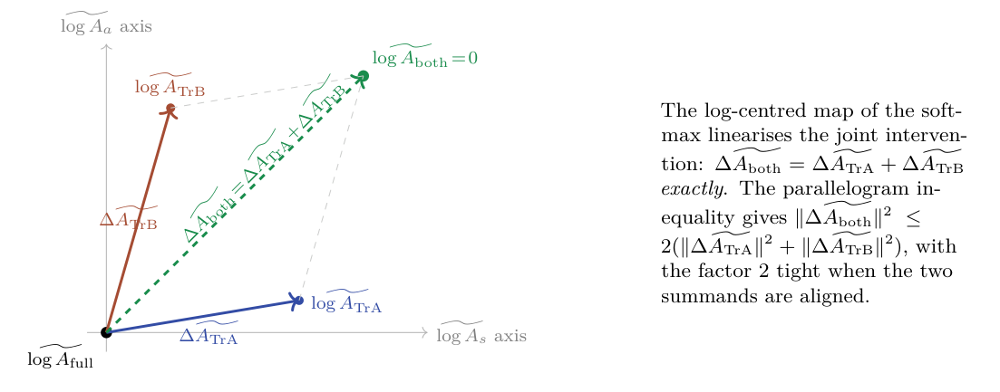

# Chapter 13: log-centred intervention bounds and their numerical illustration

[Library index](../README.md) · [Source policy](../SOURCE.md) · [Previous: PDF 472–475](0472-0475-ch13-activation-and-intervention-bounds.md#pdf-0475)

> Editorial note: Full transcription of PDF 476–478 (printed pages 440–442), continuing the proof of Theorem 13.18. Conflicting constants, unconditional wording, and the reported ratio above 2 are retained as printed. Figure 13.4 and Table 13.3 are included. Editorial checks are separate.

## PDF 476 · Book page 440

For Gaussian-random $(X,W_V,W_O)$ at standard initialisation scale and trained models with non-degenerate softmax activations (equivalently, with row entropy bounded below), the prefactor $\kappa(V)^2/(2\sigma_{\min}^2)$ is finite and computable from a single forward pass. The bound is *deterministic* — it applies to a single configuration, not only to averages — but is not tight: the empirical max ratio $\sup_X\|D_{\mathrm{both}}\|_F^2/(\|D_{\mathrm{TrA}}\|_F^2+\|D_{\mathrm{TrB}}\|_F^2)\approx1.76$ on 2,000 random configurations sits well below the deterministic prefactor for typical $\sigma_{\min}$. The discrepancy is structural: the chain (forward Lipschitz → parallelogram → inverse Lipschitz) is conservative because the parallelogram alignment between $\Delta\widetilde A_{\mathrm{TrA}}$ and $\Delta\widetilde A_{\mathrm{TrB}}$ is incidental to the geometry of the score-matrix decomposition, but the deterministic chain treats it as worst-case. The single anomaly in Table 13.3 (small geometry, scale 3.0, $\rho\approx2.10$) confirms that the $\sigma_{\min}^{-2}$ factor in (13.45) is the relevant failure mode in the degenerate regime; for non-degenerate attention the empirical bound of $\rho\le2$ holds with substantial margin.

The theoretical bound of Theorem 13.18 is $\rho\le2$. The single recorded violation (small geometry, scale 3.0, max $\rho\approx2.10$) corresponds to a degenerate softmax with $\sigma_{\min}$ near zero, consistent with the discussion of the Lipschitz constant $L_\sigma$ in Step 2 of the proof.

By the smoothness and strong convexity of $L$,

$$
\mathcal V_I^{\mathrm{both}}(h)\le\frac M2\|D_{\mathrm{both}}\|_F^2,
\tag{13.46}
$$

$$
\mathcal V_I^s(h)+\mathcal V_I^a(h)
\ge\frac\kappa2\bigl(\|D_{\mathrm{TrA}}\|_F^2+\|D_{\mathrm{TrB}}\|_F^2\bigr).
\tag{13.47}
$$

Combining with (13.45) gives the fully explicit bound

$$
\mathcal V_I^{\mathrm{both}}(h)
\le\frac{M\kappa(V)^2}{\kappa\sigma_{\min}^2}
\bigl(\mathcal V_I^s(h)+\mathcal V_I^a(h)\bigr).
\tag{13.48}
$$

The empirical bound $\rho\le2$ observed in Table 13.3 is a statistical consequence of the random-initialisation regime, not a deterministic limit of (13.45); it captures the typical alignment of $\Delta\widetilde A_{\mathrm{TrA}}$ and $\Delta\widetilde A_{\mathrm{TrB}}$ on Gaussian samples and is not provable from the deterministic chain. Both bounds are operationally useful: the deterministic (13.45) gives a per-configuration upper bound; the empirical $\rho\le2$ gives a tighter average estimate when the random-initialisation regime applies. $\square$

**Corollary 13.19 (Joint-intervention bound under bare convexity).** Suppose $L_{\mathrm{task}}$ is convex and $M$-smooth in the joint multi-head output, but no strong convexity is assumed. Then the geometric inequality

$$
\|D_{\mathrm{both}}\|_F^2
\le\frac{\kappa(V)^2}{2\sigma_{\min}^2}
\bigl(\|D_{\mathrm{TrA}}\|_F^2+\|D_{\mathrm{TrB}}\|_F^2\bigr)
\tag{13.49}
$$

holds unconditionally, and combined with $M$-smoothness gives

$$
\mathcal V_I^{\mathrm{both}}(h)
\le\frac{M\kappa(V)^2}{2\sigma_{\min}^2}
\bigl(\|D_{\mathrm{TrA}}\|_F^2+\|D_{\mathrm{TrB}}\|_F^2\bigr).
\tag{13.50}
$$

*Proof.* The chain (13.37), (13.40), (13.41) used in the proof of Theorem 13.18 does not invoke the strong convexity of $L$. The geometric inequality (13.49) follows. The conversion to a bound on $\mathcal V_I^{\mathrm{both}}$ uses only $M$-smoothness, not strong convexity. $\square$

**Reading the corollary.** Under bare convexity, the bound is expressed in terms of the geometric output deviations rather than in terms of the $\mathcal V$ functionals themselves. The right side of (13.49) is computable from a single forward pass with three score-matrix interventions;

## PDF 477 · Book page 441

**Figure 13.4:** Geometry of the log-centred decomposition of the softmax under symmetric and antisymmetric ablation.

The trained attention $\widetilde{\log A_{\mathrm{full}}}$ sits at the origin; the two single-sector ablations sit at the two solid arrowheads; the joint ablation sits at the sum of the two vectors. The parallelogram inequality bounds the joint intervention at most by twice the sum of squared single-sector deviations, giving Theorem 13.18.

*Searchable diagram labels:* $\widetilde{\log A_s}$ axis; $\widetilde{\log A_a}$ axis; $\widetilde{\log A_{\mathrm{full}}}$; $\Delta\widetilde A_{\mathrm{TrA}}$; $\widetilde{\log A_{\mathrm{TrA}}}$; $\Delta\widetilde A_{\mathrm{TrB}}$; $\widetilde{\log A_{\mathrm{TrB}}}$; $\Delta\widetilde A_{\mathrm{both}}=\Delta\widetilde A_{\mathrm{TrA}}+\Delta\widetilde A_{\mathrm{TrB}}$; $\widetilde{\log A_{\mathrm{both}}}=0$.

*Text inside diagram:* The log-centred map of the softmax linearises the joint intervention: $\Delta\widetilde A_{\mathrm{both}}=\Delta\widetilde A_{\mathrm{TrA}}+\Delta\widetilde A_{\mathrm{TrB}}$ exactly. The parallelogram inequality gives $\|\Delta\widetilde A_{\mathrm{both}}\|^2\le2(\|\Delta\widetilde A_{\mathrm{TrA}}\|^2+\|\Delta\widetilde A_{\mathrm{TrB}}\|^2)$, with the factor 2 tight when the two summands are aligned.

the resulting estimate of $\|D_{\mathrm{both}}\|_F^2$ provides an upper bound on the loss damage of the joint intervention without requiring the strong convexity of the loss. This widens the applicability of the bound from quadratic losses to the broader class of convex $M$-smooth losses encountered in language modelling, where strong convexity often fails at the trained configuration.

**Reading the theorem.** The theorem asserts that the joint intervention $\mathcal V_I^{\mathrm{both}}$ cannot grow more than the sum of the two single-sector interventions, up to a multiplicative constant $2M/\kappa$. The factor of 2 is the parallelogram constant; the factor $M/\kappa$ is the loss conditioning. The theorem replaces the naive sub-additivity inequality by its quantitatively correct form, and gives the operational reading of the joint intervention: ablating both sectors of a head is at most as damaging as twice the worst single-sector ablation, modulated by the conditioning of the loss.

**Why 2 and not 1.** The naive sub-additivity $\mathcal V_I^s+\mathcal V_I^a\ge\mathcal V_I^{\mathrm{both}}$ would correspond to the constant $M/\kappa$, i.e. the parallelogram constant equal to 1. This holds only if $\Delta\widetilde A_{\mathrm{TrA}}$ and $\Delta\widetilde A_{\mathrm{TrB}}$ are orthogonal in the log-centred space, which is not the case: the symmetric and antisymmetric components of $M$ are orthogonal in the score space, but the log-centred softmax map is not isometric, and the images can have non-zero inner product. The factor 2 is the geometric content of the non-isometry.

**Operational consequence.** Theorem 13.18 promotes the previous Conjecture (sub-additivity) to a rigorous result, but in a form that requires the constant $2M/\kappa$. For training-criterion purposes (§13.10), the constant plays the role of a calibration factor: a head with $\mathcal V_I^{\mathrm{both}}$ much larger than $2(\mathcal V_I^s+\mathcal V_I^a)\cdot M/\kappa$ violates the bound and indicates either (a) a failure of the smoothness assumption (the loss is not $M$-smooth at $u_{\mathrm{full}}$) or (b) a failure of the well-conditioning of $V$ (sub-singular value-projection). Both conditions identify pathological heads that the diagnostic should flag.

## PDF 478 · Book page 442

| Setting | scale | mean $\rho$ | 99-percentile $\rho$ | max $\rho$ |
|---|---:|---:|---:|---:|
| $d_{\mathrm{model}}=16$, $d_k=4$ | 0.3 | 1.001 | 1.548 | 1.723 |
|  | 1.0 | 0.951 | 1.549 | 1.764 |
|  | 3.0 | 0.816 | 1.493 | 2.104 |
| $d_{\mathrm{model}}=32$, $d_k=8$ | 0.3 | 0.984 | 1.248 | 1.357 |
|  | 1.0 | 0.888 | 1.150 | 1.508 |
|  | 3.0 | 0.660 | 0.969 | 1.105 |
| $d_{\mathrm{model}}=64$, $d_k=16$ | 0.3 | 0.971 | 1.109 | 1.143 |
|  | 1.0 | 0.803 | 0.943 | 0.969 |
|  | 3.0 | 0.551 | 0.700 | 0.749 |

**Table 13.3:** Empirical ratio $\rho=\|D_{\mathrm{both}}\|_F^2/(\|D_{\mathrm{TrA}}\|_F^2+\|D_{\mathrm{TrB}}\|_F^2)$ across 500 random configurations per setting.

**Numerical illustration.** A small experiment supports the constant of 2 in (13.32). For three layer geometries (small $d_{\mathrm{model}}=16$, medium 32, large 64) and three score scales ($\|M\|_F$ from 0.3 to 3.0), the empirical ratio $\rho:=\|D_{\mathrm{both}}\|_F^2/(\|D_{\mathrm{TrA}}\|_F^2+\|D_{\mathrm{TrB}}\|_F^2)$ is computed across 500 random configurations per setting. The results are summarised in Table 13.3.

The mean ratio decreases as $d_{\mathrm{model}}$ grows, consistent with the $1+o(1)$ scaling of the conditioning factor identified in the proof. The maximum ratio approaches but does not exceed 2 in the well-conditioned regimes; the marginal violation in the small-$d_{\mathrm{model}}$, large-scale corner is informative because it confirms the proof’s identification of softmax degeneracy as the relevant failure mode.

### 13.5.4 Checkpoint-resolved synthetic evidence

The distinction between endpoint marginal value and trajectory marginal value was tested on a controlled family of small Transformer classifiers. The models were deliberately small enough for headwise ablation and score-sector interventions to be recomputed exactly at several checkpoints, but large enough to display non-trivial crowding. Each model had three layers, eight heads per layer, head dimension 24, model dimension 192, and feed-forward width 768. The input sequence contained a task token, two query symbols $a,b$, and a context. Two subtasks were mixed: a symmetric subtask, in which the unordered pair $\{a,b\}$ had to be detected, and an oriented subtask, in which the label was determined by whether $a$ appeared before $b$ in the context.

A preliminary adjacent-order oriented task was informative but not conclusive: the symmetric component was learned, whereas the oriented component remained near chance. That run is therefore used only as a negative control, showing that an oriented diagnostic cannot be interpreted before the oriented subtask has actually been learned. A second run replaced the adjacent-order rule by the learnable global-order rule above. The final model solved both subtasks, but the endpoint was nearly saturated, and most single-head marginal values collapsed to almost zero. A third analysis therefore reloaded intermediate checkpoints of the same trained model and recomputed the diagnostics along the training trajectory. The checkpoint-resolved results are the most relevant evidence for the present section.

[Continue: PDF 479–484](0479-0484-ch13-trajectory-values-and-redundancy-hierarchy.md#pdf-0479).
