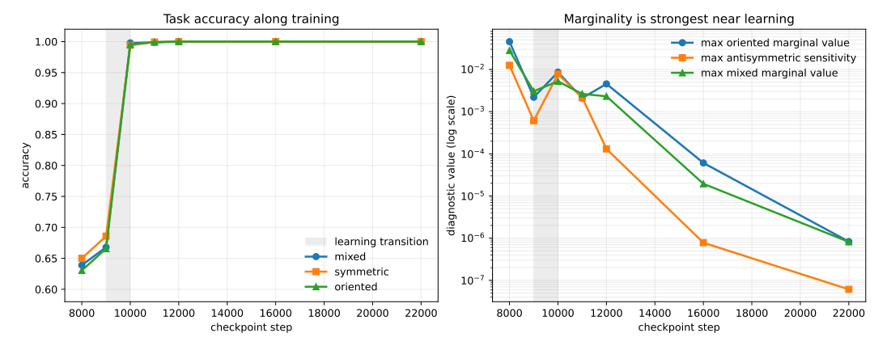
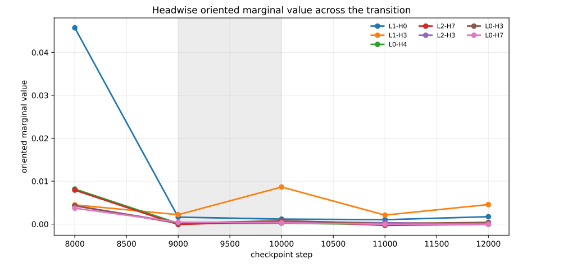
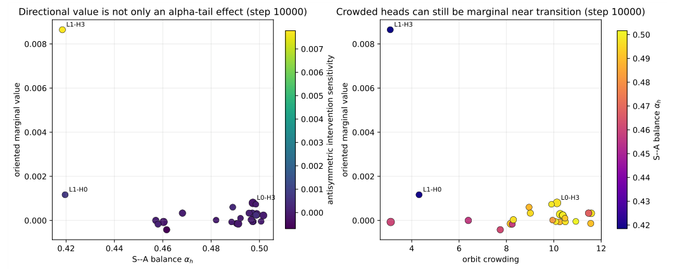
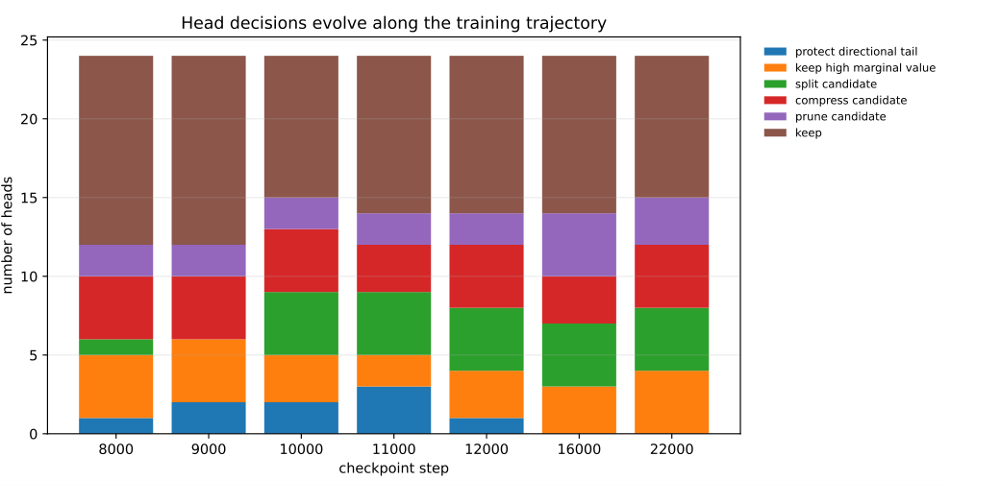
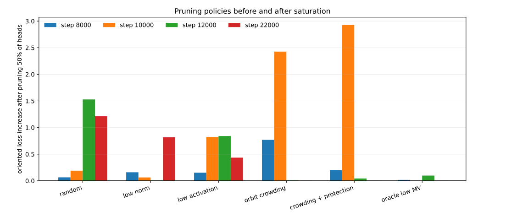

# Chapter 13: checkpoint marginality, composite diagnostics, and the redundancy hierarchy

[Library index](../README.md) · [Source policy](../SOURCE.md) · [Previous: PDF 476–478](0476-0478-ch13-log-centred-subadditivity.md#pdf-0478)

> Editorial note: Full transcription of PDF 479–484 (printed pages 443–448), including Table 13.4 and Figures 13.5–13.9. The text reports the author's experiments. Theorem 13.24 and its strict-inclusion discussion continue on PDF 485. The source's logical and definitional issues remain literal and are analysed separately.

## PDF 479 · Book page 443

| Step | mixed acc. | sym. acc. | orient. acc. | max $\mathcal V_L^{\mathrm{ori}}$ | max $\mathcal V_I^a$ | protected tails |
|---|---:|---:|---:|---:|---:|---:|
| 8000 | 0.639 | 0.650 | 0.631 | $4.57\cdot10^{-2}$ | $1.25\cdot10^{-2}$ | 1 |
| 9000 | 0.668 | 0.686 | 0.666 | $2.20\cdot10^{-3}$ | $6.10\cdot10^{-4}$ | 2 |
| 10000 | 0.998 | 0.994 | 0.995 | $8.64\cdot10^{-3}$ | $7.78\cdot10^{-3}$ | 2 |
| 11000 | 0.999 | 0.999 | 0.999 | $2.10\cdot10^{-3}$ | $2.15\cdot10^{-3}$ | 3 |
| 12000 | 1.000 | 1.000 | 1.000 | $4.56\cdot10^{-3}$ | $1.31\cdot10^{-4}$ | 1 |
| 16000 | 1.000 | 1.000 | 1.000 | $6.09\cdot10^{-5}$ | $7.81\cdot10^{-7}$ | 0 |
| 22000 | 1.000 | 1.000 | 1.000 | $8.30\cdot10^{-7}$ | $6.12\cdot10^{-8}$ | 0 |

**Table 13.4:** Checkpoint-resolved diagnostics on the learnable mixed symmetric–oriented synthetic task. The oriented subtask becomes learnable between steps 9000 and 10000. Oriented marginal value and antisymmetric intervention sensitivity are largest near this transition and nearly vanish at the saturated endpoint.

**Figure 13.5:** Checkpoint-resolved learning and marginality. The shaded band marks the transition in which the oriented subtask becomes almost perfectly learned. Marginal value is not an endpoint-only quantity: the strongest oriented and antisymmetric signals occur near the transition, whereas the saturated endpoint has almost zero single-head marginal values.

*Searchable plot labels:* Task accuracy along training; accuracy; checkpoint step; learning transition; mixed; symmetric; oriented. Marginality is strongest near learning; diagnostic value (log scale); max oriented marginal value; max antisymmetric sensitivity; max mixed marginal value.

Table 13.4 and Figure 13.5 show that the oriented subtask is not gradually polished at the endpoint. Instead, a transition occurs between steps 9000 and 10000: the oriented accuracy jumps from approximately 0.666 to approximately 0.995. At the same time, the largest oriented marginal value is still visible, and the largest antisymmetric intervention sensitivity reaches approximately $7.78\cdot10^{-3}$. At the final endpoint, by contrast, both values are smaller than $10^{-6}$. The conclusion is not that orientation has disappeared. It is that the oriented solution has become redundant or distributed enough that a single-head endpoint ablation no longer reveals the head’s earlier role.

This motivates a second marginal-value functional. For an interval $I$ of training times, define the *trajectory marginal value*

$$
\mathcal V_{\mathrm{traj}}(h;I):=\max_{t\in I}
\left[L_{\mathrm{task}}\!\left(M_t^{H\setminus\{h\}}\right)-L_{\mathrm{task}}(M_t)\right],
\tag{13.51}
$$

with the analogous sector-intervention version obtained by replacing head removal with the symmetric or antisymmetric score-sector ablation. The endpoint value $\mathcal V_{\mathrm{end}}(h)$ is recovered by taking $I=\{T\}$, but the experiment shows that this can miss heads that were marginal during formation.

## PDF 480 · Book page 444

**Definition 13.20 (Endpoint and trajectory marginal value).** For a training trajectory $(M_t)_{t\in I}$ and a head $h$, the *endpoint marginal value* is

$$
\mathcal V_{\mathrm{end}}(h):=L_{\mathrm{task}}\!\left(M_T^{H\setminus\{h\}}\right)-L_{\mathrm{task}}(M_T),
\tag{13.52}
$$

where $T$ is the final checkpoint. The *trajectory marginal value* on the interval $I$ is the maximum in (13.51). An integral variant may also be used,

$$
\mathcal V_{\mathrm{traj}}^{\mathrm{int}}(h;I):=
\int_Iw(t)\left[L_{\mathrm{task}}\!\left(M_t^{H\setminus\{h\}}\right)-L_{\mathrm{task}}(M_t)\right]dt,
\tag{13.53}
$$

for a non-negative weight $w(t)$ concentrated near learning transitions.

The headwise analysis also separates directional marginality from the raw S–A balance. The head with the clearest oriented marginal role was the head at layer 1, index 3. At step 10000 it had oriented marginal value approximately $8.64\cdot10^{-3}$ and antisymmetric intervention sensitivity approximately $7.78\cdot10^{-3}$, but its S–A balance was only about 0.418. Thus a head can be directionally marginal without being an extreme $\alpha_h$-tail head. Conversely, the heads classified as protected directional tails by the stricter rule were transient: one such head appears around step 8000, two around steps 9000 and 10000, three around step 11000, one around step 12000, and none at the saturated checkpoints 16000 and 22000.

**Figure 13.6:** Headwise oriented marginal value across the transition. The most persistent directionally marginal head is not the head with the largest S–A balance. Directional-tail protection therefore has to be combined with loss-based marginal value and antisymmetric intervention sensitivity.

*Searchable plot labels:* Headwise oriented marginal value across the transition; checkpoint step; oriented marginal value; L1-H0, L1-H3, L0-H4, L2-H7, L2-H3, L0-H3, L0-H7.

## PDF 481 · Book page 445

**Figure 13.7:** Head diagnostics at the transition checkpoint 10000.

The left panel plots oriented marginal value against the S–A balance $\alpha_h$; the right panel plots the same marginal value against orbit crowding. The labelled heads show that directional relevance is not exhausted by the extreme $\alpha_h$ tail: heads with moderate S–A balance may still carry high oriented marginal value or high antisymmetric intervention sensitivity.

*Searchable plot labels:* Directional value is not only an alpha-tail effect (step 10000); S--A balance $\alpha_h$; oriented marginal value; antisymmetric intervention sensitivity; Crowded heads can still be marginal near transition (step 10000); orbit crowding; L0-H3, L1-H0, L1-H3.

**Figure 13.8:** Evolution of head-level decisions along the checkpoint-resolved run. Protected directional tails are present during the learning transition and vanish at the saturated endpoint, whereas compression and pruning candidates become more stable once the oriented solution has become distributed.

*Searchable plot labels:* Head decisions evolve along the training trajectory; checkpoint step; number of heads; protect directional tail; keep high marginal value; split candidate; compress candidate; prune candidate; keep.

The pruning experiment confirms that no single static score is sufficient at all training stages. At the saturated endpoint, orbit-crowding pruning can remove half the heads with negligible degradation, while norm-based and activation-based pruning are much more destructive. During the transition, however, crowding must be read together with marginal value and intervention sensitivity: highly crowded heads can still be part of the forming oriented solution. This is why the operational rule in §13.10 protects heads by a conjunction of low marginal value, low residual value, and absence of directional intervention sensitivity, rather than by crowding alone.

## PDF 482 · Book page 446

**Figure 13.9:** Oriented loss increase after pruning 50% of the heads at different checkpoints. Endpoint pruning and transition-time pruning have different failure modes. This supports a trajectory-aware pruning rule: crowding is a strong compression signal after saturation, but it must be combined with marginal-value protection during the learning transition.

*Searchable plot labels:* Pruning policies before and after saturation; oriented loss increase after pruning 50% of heads; random; low norm; low activation; orbit crowding; crowding + protection; oracle low MV; step 8000, step 10000, step 12000, step 22000.

The experimental lesson can be summarised as follows. Activation is absolute, whereas marginal value is relative; endpoint marginal value is only one member of a larger family. A head may be endpoint-redundant after a solution has become redundant, while still having been trajectory-marginal during the formation of that solution. Directional-tail protection is therefore necessary but not sufficient: a complete rule must also protect heads with high oriented marginal value or high antisymmetric intervention sensitivity, even when their $\alpha_h$ value is not extreme.

### 13.5.5 The composite functional as a working choice

For operational use it is sometimes convenient to combine the four functionals into a single index. The most natural combination is a non-negative linear one.

**Definition 13.21 (Composite marginal value: an example).** For non-negative weights $(\lambda_L,\lambda_{\mathrm{Cov}},\lambda_\Gamma,\lambda_I)$, the *composite marginal value* is

$$
\mathcal V(h):=\lambda_L\mathcal V_L(h)+\lambda_{\mathrm{Cov}}\mathcal V_{\mathrm{Cov}}(h)+\lambda_\Gamma\mathcal V_\Gamma(h)+\lambda_I\mathcal V_I(h).
\tag{13.54}
$$

The composite is offered as an *example* of a marginal-value functional, not as a canonical definition. The choice of weights is a separate operational decision and depends on three factors:

- *Stage of training.* During pre-training, when the task loss is not yet aligned with downstream tasks, the coverage-based and residual-energy weights should dominate; near convergence, the loss-based weight becomes more informative.
- *Architectural objective.* Pruning decisions favour the loss-based and intervention-based components; growth decisions favour the residual-energy and coverage components. The training criterion of §13.10 makes this asymmetry explicit.
- *Calibration.* The four functionals have different natural units. A meaningful linear combination requires normalisation to a common scale, typically the median across heads at the same layer.

## PDF 483 · Book page 447

The chapter does not prescribe a canonical weight choice. The training criterion of §13.10 uses $\mathcal V_L$ and $\mathcal V_\Gamma$ separately, treating their relation as the diagnostic axis along which pruning and growth decisions are made.

### 13.5.6 Marginal value and the directional-tail constraint

The marginal-value functionals interact with the directional-tail classification in a way that parallels the interaction of crowding with directional tails (§13.4). A directional-tail head $h$ has high $\mathcal V_I^a(h)$ but possibly low $\mathcal V_{\mathrm{Cov}}(h)$, because its antisymmetric content is concentrated on a small number of eigenplanes that contribute little to the cloud-direction coverage. A naive composite functional with high $\lambda_{\mathrm{Cov}}$ may therefore under-value a directional-tail head, with the consequence of admitting it as a pruning target.

The diagnostic that prevents this mistake is the same as in §13.4: the antisymmetric intervention $\mathcal V_I^a(h)$, considered separately from the symmetric component $\mathcal V_I^s(h)$. A head with $\mathcal V_I^a(h)$ above a threshold (typically the median of the antisymmetric interventions across the layer) is on the directional tail and protected from compression independent of its composite marginal value.

**Preview.** *The next section, §13.6, has already used the marginal-value vocabulary in its operational reading. Section 13.7 provides the algebraic counterpart, and §13.10 turns the marginal value and the crowding diagnostics into explicit prune-and-grow rules.*

## 13.6 A hierarchy of redundancies

The three notions of redundancy introduced in §13.2 live in different spaces. The parametric quantity counts directions in parameter space; the functional quantity counts directions in input space; the dynamic quantity counts pairs of orbit-equivalent heads in signature space. A direct numerical comparison $r_{\mathrm{par}}\ge r_{\mathrm{fn}}\ge r_{\mathrm{dyn}}$ requires all three to be normalised by quantities of the same dimension, which they are not. The proper formulation of the hierarchy uses *equivalence classes* of heads, and asserts a partial order of inclusions on those classes. This is the path adopted here.

### 13.6.1 Three equivalence relations

Each redundancy notion induces an equivalence relation on heads at the same layer.

**Definition 13.22 (Three equivalences).** Fix a layer $\ell$ and consider two heads $h,h'$ at that layer.

- *Parametric equivalence* $h\sim_{\mathrm{par}}h'$: the parameter tuples $\Theta_h$ and $\Theta_{h'}$ lie on the same fibre of the union of within-head kernels $K_h^*\cup K_{h'}^*$, so that any difference between them leaves the head input–output map unchanged.
- *Functional equivalence* $h\sim_{\mathrm{fn}}h'$: the activation operators $\mathcal A^{(\ell,h)}(X)=\mathcal A^{(\ell,h')}(X)$ coincide on $\operatorname{span}(X)$ for almost every $X\sim\mu_X$.
- *Orbit equivalence* $h\sim_{\mathrm{orb}}h'$ at level $\delta$: the orbit distance satisfies $d_{\mathrm{orb}}(O_h^{(\ell)},O_{h'}^{(\ell)})\le\delta$.

The corresponding redundancy classes are denoted $\mathcal R_{\mathrm{par}}^{(\ell)},\mathcal R_{\mathrm{fn}}^{(\ell)},\mathcal R_{\mathrm{dyn}}^{(\ell)}(\delta)$, each consisting of pairs of redundant heads at layer $\ell$.

## PDF 484 · Book page 448

### 13.6.2 Nested observability

A direct inclusion among the three classes does not hold without hypotheses, because the three notions distinguish heads at different levels of resolution. The crucial assumption is that finer distinctions imply coarser ones: any two heads that are dynamically distinct must be functionally distinct, and any two heads that are functionally distinct must be parametrically distinct.

**Definition 13.23 (Nested observability).** The multi-head block at layer $\ell$ satisfies *nested observability* if the following implications hold, contrapositively:

- *(NO-1)* Two parametrically equivalent heads are functionally equivalent: their parameter coincidence translates into a coincidence of their input–output maps.
- *(NO-2)* Two functionally equivalent heads are dynamically equivalent in the limit $\delta\to0$: their identical action on every cloud forces their training trajectories to coincide as well.

**Why the implications are not trivial.** The two implications fail in principle in three concrete ways. First, two heads with parameters in distinct fibres of $K_h^*$ may *still* produce the same input–output map if the kernels overlap non-trivially across heads, contradicting (NO-1) at the layer level. Second, two heads with identical activation operators on $\operatorname{span}(X)$ may have different training trajectories if the $\operatorname{span}(X)$ analysis discards directions outside the cloud — the heads agree on what they read, not on what they wrote, contradicting (NO-2). Third, training trajectories can intersect on a measure-zero set without the heads being functionally equivalent there.

The two hypotheses (NO-1) and (NO-2) exclude these three pathologies and yield the partial order below.

### 13.6.3 The hierarchy

**Theorem 13.24 (Redundancy hierarchy under nested observability).** Under the standing hypotheses of §13.1 and the nested observability hypotheses (NO-1) and (NO-2), the three redundancy classes at layer $\ell$ satisfy

$$
\mathcal R_{\mathrm{dyn}}^{(\ell)}(\delta)
\subseteq\mathcal R_{\mathrm{fn}}^{(\ell)}
\subseteq\mathcal R_{\mathrm{par}}^{(\ell)}
\tag{13.55}
$$

in the limit $\delta\to0$. Both inclusions can be strict.

*Proof.* The two inclusions follow from the contrapositive of (NO-1) and (NO-2) respectively.

*Inclusion $\mathcal R_{\mathrm{dyn}}^{(\ell)}(\delta)\subseteq\mathcal R_{\mathrm{fn}}^{(\ell)}$ in the limit $\delta\to0$.* Let $(h,h')$ be a pair in $\mathcal R_{\mathrm{dyn}}^{(\ell)}(\delta)$ for $\delta\to0$: the orbit distance vanishes, so the empirical measures $\mu_h^{(\ell)}$ and $\mu_{h'}^{(\ell)}$ coincide on the support of the training trajectory, and in particular at the trained endpoint. The endpoint coincidence in signature space implies coincidence of the activation operators on $\operatorname{span}(X)$ at the post-training configuration. Hence $h\sim_{\mathrm{fn}}h'$ at the post-training input distribution; the pair belongs to $\mathcal R_{\mathrm{fn}}^{(\ell)}$.

*Inclusion $\mathcal R_{\mathrm{fn}}^{(\ell)}\subseteq\mathcal R_{\mathrm{par}}^{(\ell)}$.* Let $(h,h')$ satisfy $h\sim_{\mathrm{fn}}h'$. By the contrapositive of (NO-1), the parameter tuples $\Theta_h$ and $\Theta_{h'}$ are parametrically equivalent: any small parameter perturbation that preserves the head input–output map must lie in $K_h^*\cup K_{h'}^*$. Hence $h\sim_{\mathrm{par}}h'$.

*Strict inclusions.* For $\mathcal R_{\mathrm{dyn}}\subsetneq\mathcal R_{\mathrm{fn}}$, two heads can have identical activation operators at the trained endpoint yet have followed disjoint training trajectories that visit different regions of $\Sigma$. For $\mathcal R_{\mathrm{fn}}\subsetneq\mathcal R_{\mathrm{par}}$, two heads can have identical parameter tuples (so trivially

[Continue the sentence and discussion: PDF 485](0485-0490-ch13-dictionary-thresholds-and-rank-contraction.md#pdf-0485).
