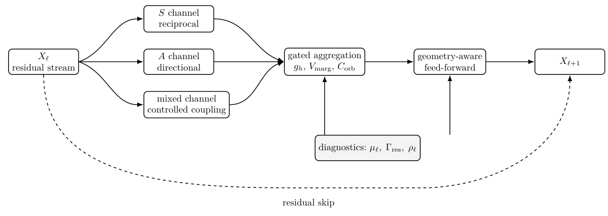

# Chapter 14: motivation, design requirements, and the rationalised block

[Library index](../README.md) · [Source policy](../SOURCE.md) · [Previous pages](0501-0504-ch13-outlook-and-open-problems.md#pdf-0504)

> Faithful English transcription of physical PDF pages 505–511 / printed pages 469–475. Includes §§14.1–14.3, Design Principles 14.1–14.6, Definitions 14.7–14.8, Table 14.1, and the original Figure 14.1. All design claims and the displayed residual/normalisation convention are preserved as printed. Editorial analysis is separate in Russian notes 173–174 and 177.

## PDF 505 · Book 469

# Chapter 14 — The Rationalised Transformer

## 14.1 Why MHA+MLP is not rationalised

The standard Transformer block alternates a multi-head attention sub-layer with a position-wise feed-forward sub-layer, both wrapped in residual connections and normalisation. This block remains the reference object for language modelling and representation learning. It must therefore be stated at the beginning of the chapter that the purpose of the construction below is not to deny the empirical success of the standard block. The purpose is different: once signature geography, symmetric–antisymmetric decomposition, residual amplification, orbit crowding, marginal value, and dictionary coverage have been introduced, the standard block can be examined as an architectural answer to a more precise question. The question is not merely whether the block is expressive. The question is whether its components are allocated according to the quantities that the preceding chapters have identified as structurally relevant.

From this perspective, the standard block is expressive but not rationalised. A block is called rationalised when its architectural degrees of freedom are tied to identifiable geometric or dynamical requirements. A head is then not merely an index in a list of heads; it is a carrier of a signature coordinate, a symmetric or directional component, an orbit through training, a marginal contribution, and a position in a crowding geometry. A feed-forward sub-layer is not merely a large non-linear reservoir; it is a resource that may be allocated where attention leaves residual energy unresolved. A residual connection is not merely a stabilising trick; it is the channel through which unresolved directions persist and may be amplified. Rationalisation therefore means that architectural capacity is no longer uniformly distributed by convention, but is constrained by the measurements that the previous chapters have made meaningful.

### 14.1.1 Uniform heads are a poor default

In the standard block, all heads are parameterised with the same local shape. The projections

$$
W_Q^{(h)},W_K^{(h)},W_V^{(h)}\in\mathbb R^{d_{\mathrm{model}}\times d_k},
\qquad W_O^{(h)}\in\mathbb R^{d_k\times d_{\mathrm{model}}}
$$

are repeated for $h=1,\ldots,H$, and the head outputs are aggregated by summation after the output projection. This gives a clean implementation and a convenient tensor layout. It does not, however, express the distinction between reciprocal and directional operations. Once the bilinear motor of a head is decomposed as

$$
M_h=M_{s,h}+M_{a,h},
\qquad M_{s,h}=\frac{M_h+M_h^\top}{2},
\qquad M_{a,h}=\frac{M_h-M_h^\top}{2},
$$

## PDF 506 · Book 470

there is no reason to assume that every head should spend the same capacity on $M_s$ and $M_a$. Some heads may primarily aggregate, average, bind, or stabilise local reciprocal structures. Others may primarily encode direction, order, displacement, role asymmetry, or causal orientation. A uniform parameter budget forces both types of behaviour to emerge through training accidents rather than through architectural allocation.

The issue is not that uniform heads cannot specialise. They can. The issue is that the architecture provides no explicit protection for the specialisation after it appears. Directional heads may be merged by the output projection with symmetric heads. Symmetric crowding may consume head slots that should have been assigned to directional tails. Two heads may have nearly identical functional effects but different training histories, or different functional effects but nearly indistinguishable parameter norms. Uniform heads therefore blur exactly the distinctions that Chapters ??–13 have made measurable.

### 14.1.2 The feed-forward sub-layer is geometry-blind

The position-wise feed-forward sub-layer acts on each residual vector after attention has already mixed head contributions. Its standard form,

$$
\operatorname{FFN}(z)=\phi(zW_1)W_2,
$$

allocates width by convention, most often through a fixed expansion factor. This design is powerful, but it is blind to the signature geography. It does not know which heads are crowded, which directions remain unresolved, which atoms of the local dictionary are uncovered, or which residual channels carry a large value of $\Gamma_{\mathrm{res}}$. The same feed-forward width is assigned to layers with different orbit diversity, different residual amplification, and different directional complexity.

This uniform allocation is especially unsatisfactory after the marginal value analysis of Chapter 13. If a head has low marginal value because its orbit is crowded, then the subsequent feed-forward block should not amplify that redundancy. If a head has high marginal value because it covers a rare directional atom, then the subsequent non-linear map should preserve and possibly expand that direction. The standard block contains no such routing. It can learn a useful non-linear transformation, but it is not designed to spend non-linear capacity where the attention geometry says that capacity is needed.

### 14.1.3 Crowding is detected only after the fact

Orbit crowding is a dynamic form of redundancy. It is not captured by parameter counts alone and it is not fully captured by final attention maps alone. Two heads may end near similar signatures but have different paths, different transition times, different residual effects, and different marginal values. Conversely, two heads may look different in parameter space while being redundant in the observable signature geometry. The standard Transformer does not monitor this distinction. It permits heads to collapse into crowded regions, and it relies on optimisation and scale to compensate.

The preceding chapter turned crowding into a design object. Crowded symmetric regions may be compressed; overloaded heads may be split; high $\Gamma_{\mathrm{res}}$ may justify growth; low marginal value may justify pruning. The standard block, by contrast, has no architectural primitive corresponding to any of these actions. It has a fixed $H$, a fixed $d_k$, a fixed feed-forward width, and no intrinsic distinction between a necessary head and a redundant head. The standard block can therefore only be audited, not rationally allocated.

## PDF 507 · Book 471

### 14.1.4 Head identity is partially destroyed by summation

A further defect is algebraic. Multi-head attention computes head outputs and then aggregates them into the residual stream. After aggregation, a downstream linear map cannot in general recover the individual head contributions. The loss of head identity is not merely a practical inconvenience for interpretability. It has architectural consequences. If a later component cannot access the head responsible for a given signature atom, then it cannot selectively reinforce that atom, suppress a redundant neighbouring atom, or gate the corresponding directional tail. The standard output projection therefore destroys part of the information that a rationalised block would need for controlled allocation.

This observation motivates a conservative conclusion. It is not necessary to replace the Transformer by an unrelated architecture. It is enough to make explicit the structure that the standard block leaves implicit: differentiated heads, separate symmetric and antisymmetric channels, geometry-aware non-linear capacity, residual gates, and marginality-aware allocation. This produces the static Rationalised Transformer.

### 14.1.5 Design objective of the chapter

The chapter constructs a block satisfying the following requirements.

1. Symmetric and directional operations should be represented as distinct update channels, rather than as accidental mixtures inside identical heads.
2. Head capacity should be allocated according to dictionary coverage, orbit diversity, and residual directional energy.
3. The feed-forward sub-layer should be interpreted as non-linear completion of unresolved residual directions, not as a uniform reservoir.
4. Redundant heads should be identifiable through marginal value and crowding diagnostics.
5. The resulting architecture should remain a static block: no growth rule is introduced here. Growth and termination belong to the incremental chapter.

**Takeaway.** *The standard Transformer is not rejected. It is used as the baseline to be rationalised. The rationalised block keeps the residual-attention-feed-forward template, but constrains its degrees of freedom by the geometric and dynamical quantities developed earlier.*

## 14.2 Design requirements

A rationalised block should not introduce new notation merely for architectural decoration. Each component must be inherited from a previous diagnostic or theoretical object. This section records the required inheritance. It also fixes the level of mathematical commitment used in the rest of the chapter. Statements are separated into definitions, lemmas, propositions, and implementable design resolutions. The aim is not to list unresolved issues, but to close the architectural degrees of freedom at the level appropriate for a static chapter.

### 14.2.1 The variables that must survive the transition to architecture

The following quantities are carried forward.

**$M_s$ and $M_a$.** These are the symmetric and antisymmetric parts of the motor associated with an attention head. They encode reciprocal and directional components of the head operation.

## PDF 508 · Book 472

**$\alpha_h$.** This scalar records the relative antisymmetric weight of a head. It is used as a compact coordinate for the symmetric–directional balance.

**$\Sigma_{\ell,h}$.** This denotes the signature associated with head $h$ at layer $\ell$, or with an appropriate local diagnostic extracted from that head.

**$\mathcal O_{\ell,h}$.** This denotes the orbit of the signature through training. It is needed because redundancy may be dynamic rather than purely static.

**$\Gamma_{\mathrm{res}}^{(\ell)}$.** This measures residual energy that remains after the current layer has performed its update. In the rationalised block it becomes a signal for allocation and, later, for growth.

**$C_{\mathrm{orb}}^{(\ell)}$.** This is an orbit crowding score. Its exact implementation may vary, but its role is fixed: it detects concentration of heads in the same region of signature space.

**$V_{\mathrm{marg}}^{(\ell,h)}$.** This is the marginal value of a head. It combines loss sensitivity, signature coverage, residual effect, and intervention response.

The point of listing these variables is architectural. If a block cannot expose them or approximate them during training, then the block cannot implement the design principles of Chapter 13. A purely standard block exposes some of them only retrospectively, after diagnostic analysis. A rationalised block is designed so that they appear as quantities to be monitored or gated.

### 14.2.2 Six design principles in architectural form

The six design principles of the redundancy chapter become the following architectural constraints.

**Design Principle 14.1 (Preserve directional tails).** *Directional heads with high $\alpha_h$ and non-negligible marginal value should not be merged indiscriminately with crowded symmetric heads. They require a protected update channel.*

**Design Principle 14.2 (Compress symmetric crowding).** *When several heads occupy the same reciprocal region of signature space and have similar marginal effect, the block should permit compression or shared representation.*

**Design Principle 14.3 (Split overloaded heads).** *When a single head carries several distant signature atoms, or when its intervention response is multimodal, the block should treat this as evidence for insufficient allocation.*

**Design Principle 14.4 (Allocate where residual energy persists).** *A large value of $\Gamma_{\mathrm{res}}^{(\ell)}$ indicates that the layer leaves relevant directions unresolved. Static allocation should favour the corresponding channel; dynamic allocation will later be handled by INCRT.*

**Design Principle 14.5 (Avoid uniformity as a prior).** *Uniform heads are acceptable as an implementation baseline but not as a design principle. The rationalised block must allow non-uniform head types, non-uniform gates, and non-uniform feed-forward routing.*

**Design Principle 14.6 (Monitor orbit diversity).** *Diversity should be measured in signature-orbit space, not only in parameter space or final attention maps. The block must therefore expose head-level observables before full aggregation.*

### 14.2.3 Minimal commitments

The rationalised block is defined under three minimal commitments.

## PDF 509 · Book 473

First, global uniqueness is not required. The relevant claim is relative minimality inside the class of residual attention blocks that commit to coverage, S–A separation, crowding control, marginal value, and residual amplification control. This relative minimality is proved later in the chapter (Section 14.14).

Second, the dictionary threshold used for choosing atoms or head slots is defined as an empirical covering number of the layer signature geography. The notation $K^\star$ therefore denotes a computable static threshold at a prescribed tolerance, not an informal target.

Third, the expressive relation with the standard Transformer is algebraic. When gates are set to identity and the symmetric–antisymmetric separation is recombined, the standard block is recovered as a degenerate case of the rationalised template. The precise statement of subsumption is given in Section 14.6.

### 14.2.4 Design matrix

The inheritance from theory to architecture is summarised in Table 14.1.

| Diagnostic quantity | Architectural response | Reason |
|---|---|---|
| $M_s,M_a$ | separate update channels | reciprocal and directional operations should not compete for the same undifferentiated budget |
| $\alpha_h$ | head-type coordinate and gate input | directional tails require protection and monitoring |
| $\Sigma_{\ell,h}$ | dictionary assignment | coverage can be measured only if heads are mapped to signature atoms |
| $\mathcal O_{\ell,h}$ | orbit-diversity diagnostic | redundancy is dynamic, not only terminal |
| $\Gamma_{\mathrm{res}}^{(\ell)}$ | residual allocation signal | persistent residual energy identifies under-served directions |
| $C_{\mathrm{orb}}^{(\ell)}$ | crowding penalty or pruning signal | crowded regions should be compressed |
| $V_{\mathrm{marg}}^{(\ell,h)}$ | marginality-aware retention | low-value heads should not be protected by uniformity |

**Table 14.1:** Quantities inherited by the rationalised block. The table is intentionally operational: each diagnostic is attached to an architectural response.

**Takeaway.** *The Rationalised Transformer is not introduced as an arbitrary new block. It is the static block obtained when the diagnostics of symmetric–antisymmetric decomposition, signature orbits, residual energy, crowding, and marginal value are made architectural.*

## 14.3 The Rationalised Transformer block

The rationalised block modifies the standard Transformer block at three points: head organisation, residual aggregation, and feed-forward allocation. The residual skeleton is preserved. This is important because the preceding theory does not require abandoning residual attention. It requires making its internal allocation explicit.

**Definition 14.7 (Rationalised Transformer block).** *Let $X_\ell\in\mathbb R^{n\times d}$ be the residual stream at layer $\ell$. A Rationalised Transformer block is a map*

$$
X_{\ell+1}=\operatorname{LN}\!\left(
X_\ell+G_{\mathrm{att}}^{(\ell)}R_{\mathrm{att}}^{(\ell)}(X_\ell)
+G_{\mathrm{ff}}^{(\ell)}R_{\mathrm{ff}}^{(\ell)}(X_\ell)
\right),
$$

## PDF 510 · Book 474

*where*

$$
R_{\mathrm{att}}^{(\ell)}=R_S^{(\ell)}+R_A^{(\ell)}+R_{\mathrm{mix}}^{(\ell)}.
$$

*The symmetric channel $R_S^{(\ell)}$ aggregates reciprocal signatures, the antisymmetric channel $R_A^{(\ell)}$ aggregates directional signatures, the mixed channel $R_{\mathrm{mix}}^{(\ell)}$ represents controlled interaction between the two, and the gates $G_{\mathrm{att}}^{(\ell)},G_{\mathrm{ff}}^{(\ell)}$ may depend on marginal value, signature coverage, and residual diagnostics.*

The definition is deliberately broad. It specifies the structural constraints, not a single implementation. Different implementations may use hard head partitions, soft gates, low-rank factors, grouped output projections, or adapter-like residual channels. The common feature is that the block exposes the quantities needed to control the signature geography.

### 14.3.1 Head partition and soft allocation

A static rationalised layer may use a partition

$$
\mathcal H_\ell=\mathcal H_{S,\ell}\cup\mathcal H_{A,\ell}\cup\mathcal H_{M,\ell},
\qquad\mathcal H_{S,\ell}\cap\mathcal H_{A,\ell}=\varnothing,
$$

where $S$ denotes primarily symmetric heads, $A$ primarily directional heads, and $M$ mixed heads. A hard partition is not required. A soft assignment may be used instead:

$$
\pi_h=(\pi_{S,h},\pi_{A,h},\pi_{M,h}),
\qquad\pi_{S,h}+\pi_{A,h}+\pi_{M,h}=1.
$$

The scalar $\alpha_h$ may initialise or regularise this assignment. For example, a head with large antisymmetric ratio should have larger $\pi_{A,h}$ unless its measured marginal value contradicts this assignment.

The layer output may then be written as

$$
R_{\mathrm{att}}^{(\ell)}(X)
=\sum_{h\in\mathcal H_\ell}g_h^{(\ell)}(X)\,Y_h(X)\,W_O^{(h)},
$$

where the gate $g_h^{(\ell)}$ is no longer merely a learned scalar. It may depend on quantities such as

$$
g_h^{(\ell)}=g\!\left(\alpha_h,\operatorname{cov}_h,C_{\mathrm{orb},h},V_{\mathrm{marg},h},\Gamma_{\mathrm{res},h}\right).
$$

This formula should be read as a design template. A practical model may use moving averages of these diagnostics, differentiable proxies, or checkpoint-level estimates.

### 14.3.2 Dictionary assignment

Let $\mathcal D_\ell=\{a_{\ell,1},\ldots,a_{\ell,K_\ell}\}$ denote a local dictionary of signature atoms. A head $h$ induces a signature $\Sigma_{\ell,h}$ and hence a distance profile

$$
d_{h,k}=\operatorname{dist}(\Sigma_{\ell,h},a_{\ell,k}).
$$

The coverage residual of the layer may be written abstractly as

$$
\rho_\ell=\int\min_{h\in\mathcal H_\ell}\operatorname{dist}(\sigma,\Sigma_{\ell,h})^2\,d\mu_\ell(\sigma),
$$

where $\mu_\ell$ is the empirical signature geography. This quantity is the static counterpart of the growth signal used later by INCRT. In a fixed rationalised block, it does not automatically add heads; it only determines whether the current allocation is sufficient.

## PDF 511 · Book 475

**Definition 14.8 (Static sufficiency).** *A rationalised layer is called statically sufficient at tolerance $\rho^\star$ when*

$$
\rho_\ell\le\rho^\star,
\qquad C_{\mathrm{orb}}^{(\ell)}\le C^\star,
\qquad\Gamma_{\mathrm{res}}^{(\ell)}\le\Gamma^\star,
$$

*for preassigned tolerances $\rho^\star,C^\star,\Gamma^\star$.*

Static sufficiency is not the same as optimality. It is a condition saying that the block has enough head diversity, limited crowding, and controlled residual energy for the chosen diagnostic resolution.

### 14.3.3 Residual gates

The gates in Definition 14.7 serve two functions. First, they control the amount of attention and feed-forward update entering the residual stream. Second, they make allocation measurable. A head with high marginal value should have a gate that remains active; a crowded low-value head should be suppressible. A possible static gate has the form

$$
g_h=\sigma\!\left(b_0+b_1V_{\mathrm{marg},h}-b_2C_{\mathrm{orb},h}+b_3\Gamma_{\mathrm{res},h}+b_4\alpha_h\right),
$$

with coefficients learned or fixed by a calibration procedure. This equation is not proposed as the only gate. Its role is explanatory: it shows how the diagnostics may enter the block without changing the residual skeleton.

### 14.3.4 A block diagram

Figure 14.1 gives a schematic view. The input residual stream is analysed into symmetric and directional update channels. Their outputs are recombined through gates that also receive dictionary and marginality diagnostics. The feed-forward sub-layer is then interpreted as non-linear completion of the residual directions that attention has left unresolved.

**Figure 14.1:** Schematic of the Rationalised Transformer block. The diagram is structural rather than implementation-specific. The standard residual skeleton is retained (dashed skip, routed below the diagnostics for clarity); the attention update is decomposed into symmetric, directional, and mixed components, and aggregation is controlled by diagnostics inherited from the previous chapters.

**Original labels inside Figure 14.1:** $X_\ell$; residual stream; $S$ channel; reciprocal; $A$ channel; directional; mixed channel; controlled coupling; gated aggregation; $g_h,V_{\mathrm{marg}},C_{\mathrm{orb}}$; geometry-aware feed-forward; $X_{\ell+1}$; diagnostics: $\mu_\ell,\Gamma_{\mathrm{res}},\rho_\ell$; residual skip.

**Takeaway.** *The rationalised block is a static Transformer block with explicit head differentiation, symmetric–antisymmetric channels, diagnostic gates, and geometry-aware feed-forward allocation. It is not yet incremental: it monitors insufficiency but does not create new heads.*

---

[Next pages](0512-0515-ch14-sa-channels-and-cost-accounting.md#pdf-0512) · [Russian note 173](../notes/173-rationalisation-requirements-and-head-recoverability.md) · [Russian note 174](../notes/174-block-template-dictionary-coverage-and-gates.md)
