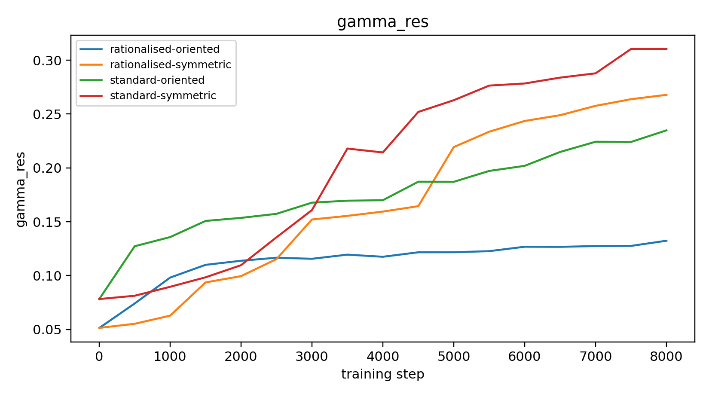
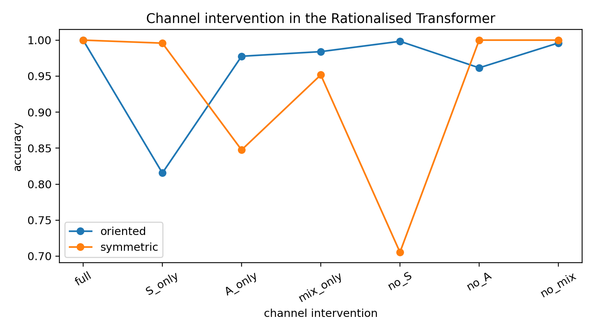
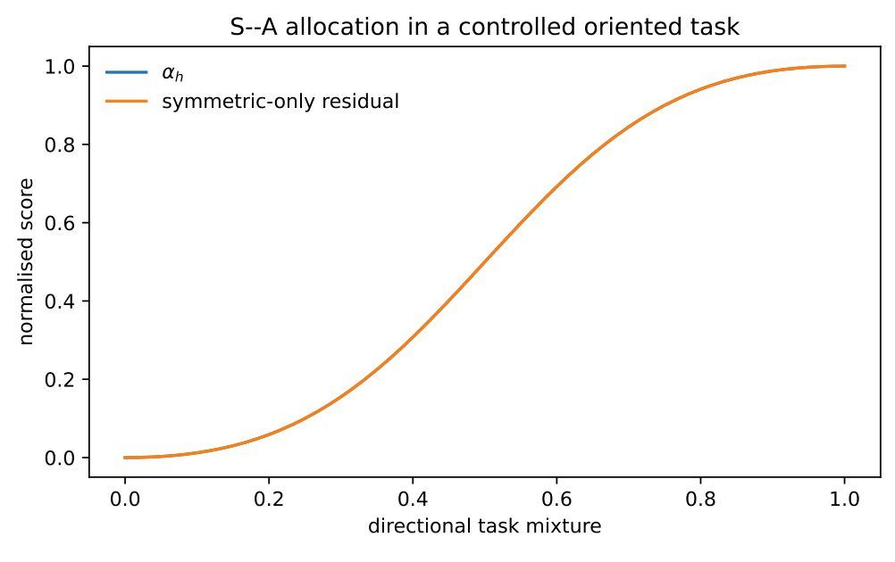

# Chapter 14: fixed-position channel interventions and toy geometry illustrations

[Library index](../README.md) · [Source policy](../SOURCE.md) · [Previous: PDF 527–529](0527-0529-ch14-decision-tables-and-procedures.md#pdf-0529) · [Next: PDF 535–540](0535-0540-ch14-illustrations-implementations-and-boundaries.md#pdf-0535)

> Editorial note: Full transcription of PDF 530–534 (printed pages 494–498), including Tables 14.7–14.10 and original Figures 14.2–14.4. The opening completes the sentence on PDF 529. Printed numerical precision, the malformed `extlowerresidualamplification` / `extdirectchannelintervention` display, and claims about supplied experiment scripts are retained literally. Notes 185–186 distinguish the reported evidence from editorial analysis. Experiment 2 continues on PDF 535.

## PDF 530 · Book 494

Transformer on a benchmark. The question is whether the explicit S/A/mix decomposition gives programmable components that can be measured, disabled, preserved, and compared.

The experiment is deliberately simple. A standard Transformer encoder and an iso-dimensional rationalised encoder are trained on two relational sequence tasks. In both cases the relevant variables are placed in fixed positions,

$$
[\mathrm{CLS},M_1,a,M_2,b,\ldots].
$$

The symmetric task is

$$
y_{\mathrm{sym}}=\mathbf1[a\bmod4=b\bmod4],
$$

and the oriented task is

$$
y_{\mathrm{ori}}=\mathbf1[a<b].
$$

The fixed layout is intentional. It removes the confound of marker search and makes the experiment a direct test of channel use. If the model fails, the failure cannot be attributed to difficulty in locating the relevant pair. If it succeeds, interventions on the rationalised channels become interpretable.

#### 14.11.1 Experimental protocol

Both encoders use the same width, the same number of layers, and the same number of heads. The rationalised block replaces the single attention injection by three exposed channels,

$$
R_h(X)=g_{S,h}R_{S,h}(X)+g_{A,h}R_{A,h}(X)+g_{\mathrm{mix},h}R_{\mathrm{mix},h}(X),
$$

where $R_{S,h}$ is obtained from the symmetric part of the empirical attention operator, $R_{A,h}$ from the antisymmetric part, and $R_{\mathrm{mix},h}$ from the unseparated attention operator. After training, the same rationalised block is evaluated under the following channel interventions:

$$
\text{full},\qquad S\text{-only},\qquad A\text{-only},\qquad\text{mix-only},\qquad\text{no-}S,\qquad\text{no-}A,\qquad\text{no-mix}.
$$

Thus a channel is treated as an implementation variable, not only as a diagnostic label.

A weak channel-alignment bias is used during training: the symmetric task mildly favours the S gate and the oriented task mildly favours the A gate. This should be stated explicitly. The experiment is not intended to show that the S/A specialisation emerges without any inductive bias. Its purpose is to show that, once such a rationalising bias is present, the resulting block becomes cleanly intervenable. This is precisely the programmer-facing use case of the static interface: a desired geometric organisation is encouraged and then audited by validation interventions.

#### 14.11.2 Performance and residual control

Table 14.7 reports the final performance over three random seeds. Both architectures solve both tasks. Accuracy is therefore not the discriminating variable. The relevant difference is residual control. The rationalised block preserves task performance while reducing the residual amplification $\Gamma_{\mathrm{res}}$, especially on the oriented task.

## PDF 531 · Book 495

| Model | Task | Accuracy | Loss | Coverage | $\Gamma_{\mathrm{res}}$ |
|---|---|---|---|---|---|
| standard | symmetric | $1.000\pm0.000$ | $0.000\pm0.000$ | $0.127\pm0.004$ | $0.310\pm0.030$ |
| rationalised | symmetric | $1.000\pm0.000$ | $0.000\pm0.000$ | $0.170\pm0.015$ | $0.268\pm0.045$ |
| standard | oriented | $1.000\pm0.000$ | $0.001\pm0.001$ | $0.110\pm0.018$ | $0.234\pm0.114$ |
| rationalised | oriented | $1.000\pm0.000$ | $0.001\pm0.001$ | $0.163\pm0.007$ | $0.132\pm0.028$ |

**Table 14.7:** Fixed-position relational experiment. Both architectures solve the tasks, but the rationalised block obtains comparable accuracy with lower residual amplification and higher signature coverage. Values are mean $\pm$ standard deviation over three seeds.

This result should be read as a static-control result. The rationalised block is not introduced because the standard block lacks expressivity on this toy task. The standard block is already expressive enough. The point is that the rationalised block exposes where the computation is injected and keeps this injection under more explicit control.

**Figure 14.2:** Residual amplification during the fixed-position experiment. The rationalised block preserves task performance while reducing the magnitude of residual injection, especially in the oriented regime.

> Figure text, transcribed for search: title `gamma_res`; vertical axis `gamma_res`; horizontal axis `training step`; legend `rationalised-oriented`, `rationalised-symmetric`, `standard-oriented`, `standard-symmetric`. Training-step ticks: 0, 1000, 2000, 3000, 4000, 5000, 6000, 7000, 8000; residual ticks: 0.05, 0.10, 0.15, 0.20, 0.25, 0.30.

#### 14.11.3 Channel interventions

The decisive test is the intervention table. Table 14.8 evaluates the trained rationalised block after selectively enabling or disabling channels. The full block reaches essentially perfect accuracy on both tasks. The interventions reveal which channels carry the useful computation.

## PDF 532 · Book 496

| Task | Intervention | Accuracy | Accuracy drop | $\Gamma_{\mathrm{res}}$ |
|---|---|---:|---:|---:|
| symmetric | full | 1.000 | 0.000 | 0.268 |
| symmetric | S-only | 0.996 | 0.004 | 0.279 |
| symmetric | A-only | 0.848 | 0.152 | 0.157 |
| symmetric | mix-only | 0.952 | 0.048 | 0.360 |
| symmetric | no-S | 0.705 | 0.295 | 0.039 |
| symmetric | no-A | 1.000 | 0.000 | 0.265 |
| symmetric | no-mix | 1.000 | 0.000 | 0.236 |
| oriented | full | 1.000 | 0.000 | 0.133 |
| oriented | S-only | 0.815 | 0.184 | 0.231 |
| oriented | A-only | 0.978 | 0.022 | 0.107 |
| oriented | mix-only | 0.984 | 0.016 | 0.261 |
| oriented | no-S | 0.998 | 0.002 | 0.103 |
| oriented | no-A | 0.962 | 0.038 | 0.098 |
| oriented | no-mix | 0.996 | 0.004 | 0.074 |

**Table 14.8:** Channel intervention in the trained rationalised block. Accuracy drops are measured relative to the full rationalised block. The symmetric task is most damaged by removing the S channel; the oriented task is much better preserved by A-only than by S-only.

The symmetric task gives the cleanest interpretation. Removing the S channel lowers accuracy from 1.000 to approximately 0.705, whereas removing the A channel leaves the task unchanged. Conversely, the oriented task is much better preserved by the A-only intervention than by the S-only intervention:

$$
A\text{-only}:0.978,\qquad S\text{-only}:0.815.
$$

The result is not a theorem about all tasks. It is an operational demonstration that the decomposition can be used as a programming interface: channels can be disabled and their validation contribution can be measured.

**Figure 14.3:** Accuracy under channel interventions. The symmetric task depends strongly on the S channel, while the oriented task is much better supported by the A channel than by the S channel alone.

> Figure text, transcribed for search: title `Channel intervention in the Rationalised Transformer`; vertical axis `accuracy`; horizontal axis `channel intervention`; legend `oriented`, `symmetric`; intervention labels `full`, `S_only`, `A_only`, `mix_only`, `no_S`, `no_A`, `no_mix`; accuracy ticks: 0.70, 0.75, 0.80, 0.85, 0.90, 0.95, 1.00.

## PDF 533 · Book 497

#### 14.11.4 Gate specialisation

The intervention results are consistent with the learned gates. Table 14.9 reports the mean gate allocation. In the symmetric task, all heads become S-dominant across the two layers and three seeds. In the oriented task, all heads become A-dominant. This sharp separation is partly induced by the weak channel-alignment bias described above, but this is not a defect of the experiment. It illustrates the static design principle: if a programmer wants a block with interpretable S and A roles, the rationalised parameterisation supplies direct variables with which to impose, inspect, and validate that organisation.

| Task | $g_S$ | $g_A$ | $g_{\mathrm{mix}}$ | S-dominant heads | A-dominant heads |
|---|---|---|---|---:|---:|
| symmetric | $0.864\pm0.099$ | $0.069\pm0.050$ | $0.067\pm0.052$ | 48 | 0 |
| oriented | $0.150\pm0.081$ | $0.680\pm0.171$ | $0.170\pm0.094$ | 0 | 48 |

**Table 14.9:** Gate specialisation in the fixed-position experiment. Counts are over 3 seeds, 2 layers, and 8 heads per layer. The gates align with the expected static roles of the two tasks.

#### 14.11.5 What the experiment proves and what it does not prove

The experiment proves a limited but important point. It shows that, in a controlled setting, rationalisation can preserve predictive performance while turning the internal channels of the block into programmable objects. The standard Transformer also solves the tasks, but it does not expose an S gate, an A gate, and a mixed gate that can be selectively disabled and audited. The rationalised block does.

The experiment does not prove benchmark superiority, language-model superiority, or universal emergence of S/A specialisation without bias. It is better read as an engineering validation of the static interface. Its conclusion is:

$$
\begin{gathered}
\text{same predictive capacity on the controlled task}\\
+\;extlowerresidualamplification\\
+\;extdirectchannelintervention.
\end{gathered}
$$

This is exactly the practical value claimed in Section 14.10. The rationalised block gives a programmer not merely a different computation, but a different set of handles on the computation.

**Takeaway.** *The fixed-position experiment supports the static programming interpretation of the Rationalised Transformer. The S/A/mix decomposition is not merely a notation: it defines channels that can be trained, inspected, disabled, preserved, and validated.*

### 14.12 Minimal empirical illustrations

The experiments in this section are intentionally small. Their purpose is not to establish a benchmark result. Their purpose is to make the architectural concepts measurable and reproducible. Each experiment isolates one idea: symmetric–antisymmetric allocation, signature coverage, and marginality-aware pruning. The simulations are included with the chapter sources and can be regenerated from the provided script.

## PDF 534 · Book 498

#### 14.12.1 Experiment 1: S–A allocation in an oriented toy task

The first experiment considers a synthetic motor

$$
M(\lambda)=S+\lambda A,
$$

where $S$ is symmetric, $A$ is antisymmetric, and $\lambda\in[0,1]$ controls the directional component. A symmetric-only approximation is compared with a full S–A approximation. The scalar $\alpha_h$ increases monotonically with $\lambda$, while the symmetric-only relative error increases as the directional component becomes dominant.

**Figure 14.4:** Toy S–A allocation experiment. As the directional component increases, the antisymmetric coordinate $\alpha_h$ increases and a symmetric-only approximation becomes insufficient. The full S–A representation remains accurate by construction.

> Figure text, transcribed for search: title `S--A allocation in a controlled oriented task`; legend $\alpha_h$, `symmetric-only residual`; vertical axis `normalised score`; horizontal axis `directional task mixture`; both axes display ticks 0.0, 0.2, 0.4, 0.6, 0.8, 1.0.

The point is simple but important. A head can represent a mixture of reciprocal and directional structure, but a block that monitors only total norm cannot know whether the error comes from the symmetric or antisymmetric component. The $\alpha_h$ coordinate provides the missing accounting.

#### 14.12.2 Experiment 2: uniform versus rationalised signature coverage

The second experiment generates a two-dimensional signature geography with a crowded reciprocal cluster and a sparse directional tail. A uniform allocation places representatives roughly uniformly over the high-density region. A rationalised allocation reserves representatives for the tail and penalises crowding. The resulting diagnostic values are shown in Table 14.10.

| Policy | coverage residual | crowding | directional tail residual |
|---|---:|---:|---:|
| uniform | 0.578 | 0.255 | 1.103 |
| rationalised | 0.098 | 0.102 | 0.129 |

**Table 14.10:** Toy coverage experiment. The rationalised allocation is not uniformly spread; it deliberately reserves capacity for the sparse directional tail. Numbers are illustrative and reproducible from the supplied script.

> Editorial continuation: Experiment 2 continues with [Figure 14.5 on PDF 535](0535-0540-ch14-illustrations-implementations-and-boundaries.md#pdf-0535).
