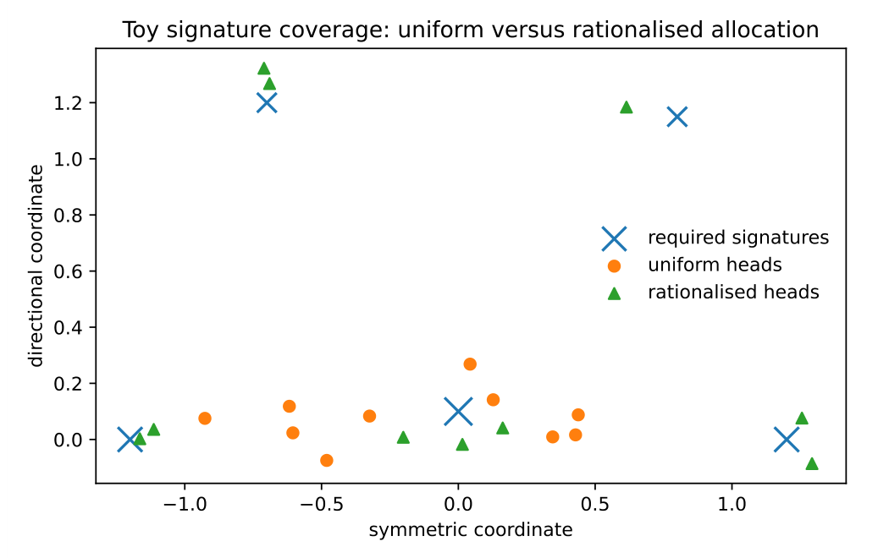
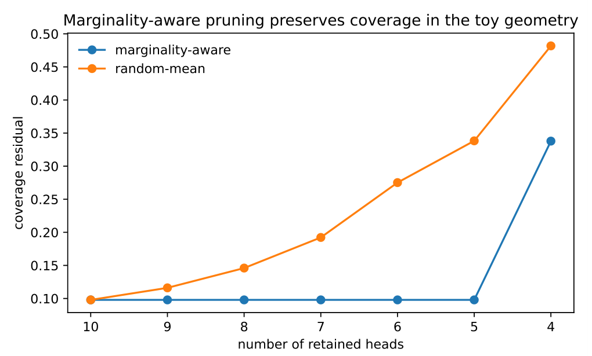

# Chapter 14: toy illustrations, implementation variants, and calibrated defaults

[Library index](../README.md) · [Source policy](../SOURCE.md) · [Previous: PDF 530–534](0530-0534-ch14-channel-interventions-and-toy-illustrations.md#pdf-0534)

> Editorial note: Full transcription of PDF 535–540 (printed pages 499–504). PDF 535 continues §14.12.2 with Figure 14.5. Figures 14.5–14.6 are direct crops of the original PDF. Unresolved references, numerical claims, and the source's qualifications are retained literally; editorial analysis is separate.

## PDF 535 · Book page 499

**Figure 14.5:** Uniform versus rationalised coverage in a synthetic signature geography. The rationalised representatives reduce tail residual and crowding by allocating capacity to rare but structured regions.

*Searchable plot labels:* Toy signature coverage: uniform versus rationalised allocation; symmetric coordinate; directional coordinate; required signatures; uniform heads; rationalised heads. Horizontal ticks: −1.0, −0.5, 0.0, 0.5, 1.0. Vertical ticks: 0.0, 0.2, 0.4, 0.6, 0.8, 1.0, 1.2.

This experiment illustrates why parameter count alone is an inadequate measure. Both policies may use the same number of representatives, but the allocation determines whether the directional tail is covered.

### 14.12.3 Experiment 3: marginality-aware pruning

The third experiment begins with the rationalised representatives of the previous experiment and removes them according to two policies. A random policy removes representatives without using marginality. A marginality-aware policy first removes representatives whose removal least increases the coverage residual. Figure 14.6 shows that the marginality-aware policy preserves coverage longer.

## PDF 536 · Book page 500

**Figure 14.6:** Marginality-aware pruning in the toy geography. Coverage remains stable when low-marginality representatives are removed first, while random pruning degrades coverage earlier.

*Searchable plot labels:* Marginality-aware pruning preserves coverage in the toy geometry; marginality-aware; random-mean; coverage residual; number of retained heads. Horizontal ticks: 10, 9, 8, 7, 6, 5, 4. Vertical ticks: 0.10, 0.15, 0.20, 0.25, 0.30, 0.35, 0.40, 0.45, 0.50.

The result should not be overinterpreted. It is a toy model, not a trained language model. Its value is conceptual: it demonstrates that marginality can be operationally different from uniform head retention.

### 14.12.4 How these experiments should be used in the chapter

The experiments support three modest claims.

1. The S–A coordinate detects directional structure that a symmetric-only approximation cannot represent.
2. Coverage and crowding can be improved by allocation even when the number of representatives is unchanged.
3. Marginality-aware pruning can preserve coverage better than uninformed pruning in a controlled setting.

They do not prove superiority of the rationalised Transformer on full-scale language modelling. They justify the diagnostics that a larger experiment should measure: task loss, coverage residual, orbit crowding, residual directional energy, orbit diversity, and marginal value.

### 14.12.5 Minimal full-model protocol

A minimal full-model validation should compare a standard block and an iso-parameter rationalised block on a small masked-language-modelling or sequence-classification task. The evaluation should include not only accuracy or loss, but also the following diagnostics.

1. coverage residual $\rho_\ell$ at selected layers;
2. orbit crowding $C_{\mathrm{orb}}^{(\ell)}$ across checkpoints;
3. residual directional energy $\Gamma_{\mathrm{res}}^{(\ell)}$;
4. marginal value under head ablation;

## PDF 537 · Book page 501

5. persistence of directional tails under pruning.

A result in which the rationalised block obtains similar accuracy but lower crowding and better tail coverage would already be meaningful, because the chapter is primarily about architectural control rather than raw benchmark maximisation.

**Takeaway.** *The small experiments are illustrative and conservative. They demonstrate the measurability of the architectural principles, while leaving large-scale validation to a dedicated experimental chapter or appendix.*

## 14.13 Implementation variants and safeguards

The definition of the rationalised block is intentionally structural. It specifies what must be controlled, not the only way to control it. This is necessary because different scales of model require different compromises. A small experimental model may implement explicit S–A tying and compute diagnostics frequently. A larger model may use approximate gates, delayed checkpoint diagnostics, and frozen inference-time masks. The rationalised block should therefore be read as a family of architectures sharing the same control variables.

### 14.13.1 Hard-channel implementation

The most direct implementation assigns heads to fixed channel types. A subset of heads is constrained or regularised to be symmetric-dominant, a subset is constrained or regularised to be antisymmetric-dominant, and the remaining heads are allowed to mix. The layer update has the form

$$
R_{\mathrm{att}}(X)
=\sum_{h\in\mathcal H_S}Y_h^S(X)W_{O,S}^{(h)}
+\sum_{h\in\mathcal H_A}Y_h^A(X)W_{O,A}^{(h)}
+\sum_{h\in\mathcal H_M}Y_h^M(X)W_{O,M}^{(h)}.
$$

This implementation is easy to audit. It is also easy to ablate: removing the directional channel gives a direct estimate of the value of oriented operations, while removing the symmetric channel gives a direct estimate of reciprocal consolidation.

The disadvantage is rigidity. A head assigned to the symmetric channel may later become useful as a mixed head, and a purely directional head may require reciprocal stabilisation. For this reason, hard-channel implementations are best used as diagnostic baselines or as anchor structures inside a more flexible block.

### 14.13.2 Soft-gated implementation

A softer implementation keeps all heads unconstrained but learns gates that depend on S–A diagnostics. The output is

$$
R_{\mathrm{att}}(X)
=\sum_h\bigl(g_{S,h}Y_{S,h}(X)+g_{A,h}Y_{A,h}(X)+g_{M,h}Y_{M,h}(X)\bigr)W_O^{(h)}.
$$

The gates may be scalar, vector-valued, or token-dependent. Scalar gates are cheaper and more stable. Token-dependent gates are more expressive but risk reintroducing uncontrolled mixing. A conservative design begins with scalar or layer-wise gates and introduces token dependence only after the diagnostic behaviour is stable.

Soft gating is attractive because it preserves the expressive freedom of the standard block while making allocation measurable. It also permits smooth transitions: a head can move from symmetric to mixed to directional dominance during training, and this movement appears as a trajectory in the $\alpha_h$ coordinate rather than as a hidden change in parameters.

## PDF 538 · Book page 502

### 14.13.3 Shared-basis implementation

A third implementation uses shared bases. Instead of giving each head an independent projection space, a layer learns a small set of symmetric bases and antisymmetric bases:

$$
B_S^{(1)},\ldots,B_S^{(r_S)},\qquad
B_A^{(1)},\ldots,B_A^{(r_A)}.
$$

Each head then forms a combination

$$
M_h=\sum_i c_{h,i}^S B_S^{(i)}
+\sum_j c_{h,j}^A B_A^{(j)}+M_{h,\mathrm{free}}.
$$

This design is useful when symmetric crowding is high. Shared bases compress repeated reciprocal operations, while head-specific coefficients preserve diversity. The free component prevents the block from becoming too rigid. In a compression setting, $M_{h,\mathrm{free}}$ may be low-rank or sparsely gated.

The shared-basis implementation clarifies the difference between compression and collapse. Compression is acceptable when repeated heads are represented by a shared subspace without losing coverage. Collapse occurs when distinct high-marginality signatures are forced into the same basis and become unrecoverable. The marginality diagnostic is therefore essential.

### 14.13.4 Training schedule for diagnostics

A practical training schedule need not compute all diagnostics at all times. A three-level schedule is sufficient for most experiments.

**Continuous proxies.** Cheap quantities such as gate entropy, head norms, approximate $\alpha_h$, and local residual norms may be tracked continuously. These are not final diagnostics, but they detect early instability.

**Periodic diagnostics.** Coverage residual, crowding, and marginal value may be computed at checkpoints. This is the natural level for the experiments of Chapter 13, where head decisions are interpreted across training.

**Intervention diagnostics.** Head ablation, channel ablation, and targeted perturbation should be performed less frequently. These diagnostics are expensive but more faithful to marginal value than norm-based proxies.

The schedule separates monitoring from control. A gate may be trained continuously, while the decision to freeze, prune, split, or grow a component may be based only on periodic evidence.

### 14.13.5 Regularisation terms

The rationalised block may use regularisation, but regularisation should be modest. Excessive penalties can force an artificial geometry. Four terms are natural:

$$
\mathcal L_{\mathrm{total}}
=\mathcal L_{\mathrm{task}}+\lambda_\alpha\mathcal L_\alpha
+\lambda_C\mathcal L_{\mathrm{crowd}}+\lambda_R\mathcal L_{\mathrm{res}}
+\lambda_G\mathcal L_{\mathrm{gate}}.
$$

Here $\mathcal L_\alpha$ encourages a non-degenerate spread of S–A coordinates, $\mathcal L_{\mathrm{crowd}}$ discourages redundant orbit concentration, $\mathcal L_{\mathrm{res}}$ penalises persistent unresolved residual energy, and $\mathcal L_{\mathrm{gate}}$ prevents gate collapse. Each term should be treated as a bias, not as a hard law.

## PDF 539 · Book page 503

A useful sanity check is the zero-regularisation limit. When all rationalisation coefficients are set to zero and gates are fixed to identity, the implementation should reduce to a standard or near-standard block. This ensures that any observed effect can be attributed to rationalisation rather than to an unrelated architectural change.

### 14.13.6 Calibrated defaults

The schematic formulas of §14.5.2, §14.3.3, and §14.13.5 contain coefficients whose optimal values are model- and data-dependent. The previous chapters do not fix these coefficients in closed form, but they constrain them enough that a canonical default schedule can be given. The defaults below are intended for a starting configuration; they are not theorems.

**Allocation coefficients $(\lambda_S,\lambda_A,\lambda_R)$.** The width formula

$$
d_{\mathrm{ff}}^{\mathrm{rat}}
=d_{\mathrm{gen}}+\lambda_S r_S^{(\ell)}
+\lambda_A r_A^{(\ell)}+\lambda_R r_{\mathrm{res}}^{(\ell)}
$$

of §14.5.2 requires three positive scalars. A canonical default sets $\lambda_S=\lambda_A=1$ (one feed-forward unit per effective rank dimension contributed by the symmetric or directional channel) and $\lambda_R=1/2$ (the residual-completion budget is granted at half the rate of the channel ranks, since residual completion follows attention). The generic reservoir width is set to $d_{\mathrm{gen}}=d$, so that under the trivial geometry $r_S=r_A=r_{\mathrm{res}}=0$ the formula reduces to $d_{\mathrm{ff}}^{\mathrm{rat}}=d$ rather than to zero. With these defaults, in the directional regime guaranteed by Theorem ?? (where $r_A$ is large and $r_S$ is small), $d_{\mathrm{ff}}^{\mathrm{rat}}$ converges to a value of order $2d$, consistent with the rank-contraction bound of §14.5.2.

**Gate coefficients $(b_0,b_1,b_2,b_3,b_4)$.** The static gate

$$
g_h=\sigma\bigl(b_0+b_1V_{\mathrm{marg},h}-b_2C_{\mathrm{orb},h}
+b_3\Gamma_{\mathrm{res},h}+b_4\alpha_h\bigr)
$$

of §14.3.3 requires five scalars. The defaults $b_0=2$, $b_1=b_2=b_3=1$, $b_4=0$ produce an initial gate value of approximately $\sigma(2)\approx0.88$ when all diagnostics are at their reference scales, slightly below saturation. The asymmetric default $b_4=0$ ensures that the gate does not at initialisation distinguish between symmetric and directional heads; differentiation is left to the diagnostics, not built into the gate. After the warm-up period, $b_4$ may be set to a small positive value if directional preservation needs to be reinforced.

**Regularisation strengths $(\lambda_\alpha,\lambda_C,\lambda_R,\lambda_G)$.** The four penalty terms of the regularised loss require strengths that are small compared with the task gradient. A canonical default schedule sets each coefficient at $\lambda_\bullet=10^{-3}$ during the warm-up phase and ramps them linearly to $\lambda_\bullet=10^{-2}$ over the next 20% of training, then holds them constant. The aggregate regularisation contribution at steady state is therefore at most $4\times10^{-2}$ relative to the task loss scale, well below the threshold at which artificial geometry would be forced.

**Channel split $\eta_\ell$.** The static rule $|\mathcal H_{A,\ell}^{\mathrm{anchor}}|\ge\lceil\eta_\ell H_\ell\rceil$ of §14.4.3 requires a default value of $\eta_\ell$ before any diagnostic has been measured. A safe initial choice is $\eta_\ell=1/2$ at every layer (equal anchor count for the two channels), which is then refined after the first checkpoint by replacing it with the proxy $\Gamma_{\mathrm{res},A}^{(\ell)}/(\Gamma_{\mathrm{res},S}^{(\ell)}+\Gamma_{\mathrm{res},A}^{(\ell)}+\epsilon)$. The initial $\eta_\ell=1/2$ avoids early-training directional starvation (one of the failure modes of §14.13.7) while leaving the layer enough room to specialise.

## PDF 540 · Book page 504

**Status of the defaults.** The choices above are not optimal in general. They are reference values calibrated to give a non-degenerate starting configuration on a small Transformer model. Where the chapter says “with these defaults", the underlying claim is that the diagnostic dynamics are well-defined and observable; not that task performance is optimal. Tuning is empirical and is the topic of companion experimental work.

### 14.13.7 Failure modes

Rationalisation introduces its own risks.

**Diagnostic overfitting.** A model may optimise the diagnostic without improving the task. For example, crowding can be reduced by forcing heads apart even when the task needs repeated reciprocal operations. This is why diagnostics must be interpreted jointly with loss and intervention response.

**Gate collapse.** If gates become too sharp too early, some heads may stop receiving gradient signal. A warm-up period or entropy floor may be required.

**False marginality.** A head may appear low-value under single-head ablation because another head compensates for it, while simultaneous ablation reveals its importance. Marginality should therefore be measured with caution in highly redundant layers.

**Directional starvation.** If the training task initially rewards symmetric aggregation more strongly than directional discrimination, directional heads may be suppressed before their later utility appears. This motivates preserving a small number of directional anchor heads.

**Over-expansion.** In the incremental version, persistent residual energy may trigger too much growth. In the static chapter, this appears only as a warning: high residual energy should be interpreted together with validation loss and orbit diversity.

### 14.13.8 Practical checklist

Before a rationalised block is considered valid in an experiment, the following checklist should be satisfied.

1. The standard block must be recoverable by disabling diagnostic gates and regularisation.
2. The S–A coordinate must be computed in a reproducible way.
3. The head-level outputs used for marginality must be accessible before irreversible aggregation.
4. Coverage and crowding must be measured with a stated distance or proxy.
5. Accuracy or loss must be reported together with geometry diagnostics.
6. Pruning or compression decisions must be justified by marginal value, not only by parameter norm.
7. Directional-tail preservation must be checked on at least one oriented diagnostic.

**Takeaway.** *The rationalised block is an architectural family. Hard channels, soft gates, and shared bases are different implementations of the same principle: head allocation should be governed by signature coverage, S–A balance, residual energy, crowding, and marginal value.*

[Continue: PDF 541–546](0541-0546-ch14-static-closure-and-incrt-handoff.md#pdf-0541).
