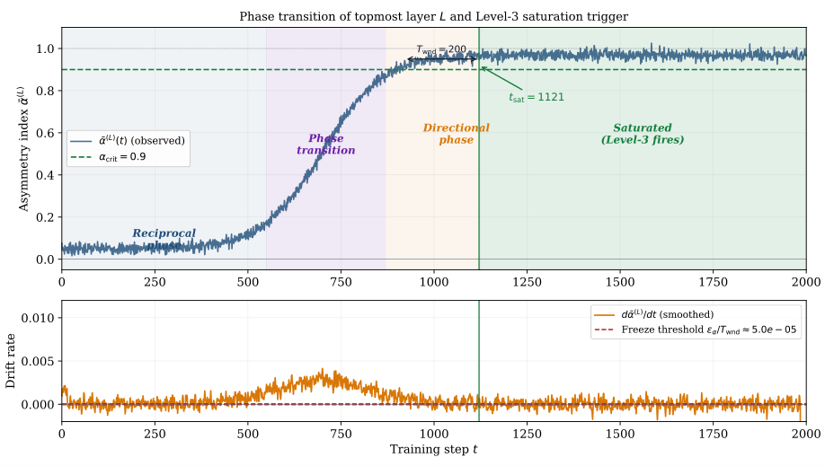
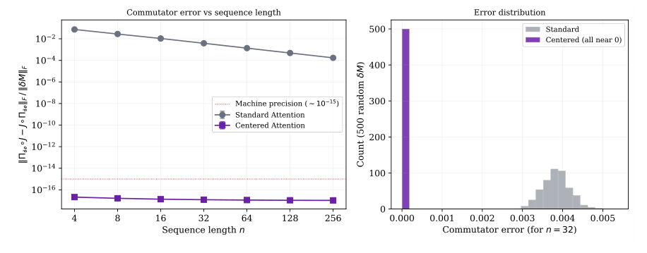
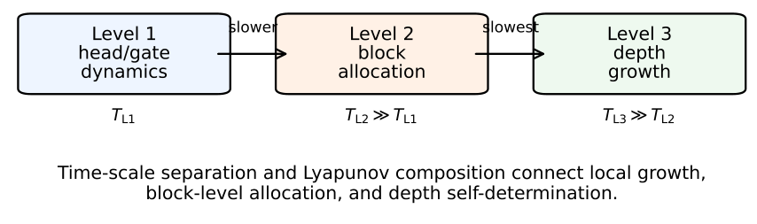

# Chapter 15: controller state, local events, and diagnostic regularity

[Library index](../README.md) · [Source policy](../SOURCE.md) · [Previous: controller introduction](0547-0550-ch15-dynamic-variables-and-controller-introduction.md#pdf-0550) · [Next: dynamic theorem package](0556-0559-ch15-stability-cover-preservation-and-termination.md#pdf-0556)

> Editorial note: Full transcription of PDF 551–555 (printed pages 515–519). Figures 15.1–15.3 are direct renders of the original PDF. Figure 15.2's actual commutator plots and its different conceptual caption are both retained. Algorithms retain their original global numbers 2–5. Source discrepancies are discussed separately in the Russian notes.

## PDF 551 · Book page 515

**Figure 15.1:** Phase-trigger interpretation of INCRT growth. A growth event is not a continuous inflation of the whole model. It is a local architectural event triggered when a diagnostic trajectory enters the growth region and remains there for a stable window.

> Searchable figure labels: “Phase transition of topmost layer $L$ and Level-3 saturation trigger”; asymmetry index $\widetilde\alpha^{(L)}$; $\widetilde\alpha^{(L)}(t)$ (observed); $\alpha_{\mathrm{crit}}=0.9$; “Reciprocal phase”, “Phase transition”, “Directional phase”, “Saturated (Level-3 fires)”; $T_{\mathrm{wnd}}=200$; $t_{\mathrm{sat}}=1121$; drift rate $d\widetilde\alpha^{(L)}/dt$ (smoothed); freeze threshold $\epsilon_\alpha/T_{\mathrm{wnd}}\approx5.0\mathrm e{-05}$; training step $t$, from 0 to 2000.

**Figure 15.2:** Commutativity principle between static rationalisation and dynamic incrementalisation. One may first rationalise the block and then make it grow, or read growth as a dynamic enforcement of the same rationalised constraints. The two views are equivalent at the level of the controller state.

> Searchable figure labels: “Commutator error vs sequence length”; $\|\Pi_{\mathfrak{so}}\circ J-J\circ\Pi_{\mathfrak{so}}\|_F/\|\delta M\|_F$; “Machine precision ($\sim10^{-15}$)”, “Standard Attention”, “Centered Attention”; sequence length $n=4,8,16,32,64,128,256$. Right panel: “Error distribution”; count (500 random $\delta M$); “Standard”, “Centered (all near 0)”; commutator error (for $n=32$).

## 15.5 The INCRT state

At time $t$, an INCRT layer is described by the state

$$
\mathcal S_\ell(t)=\left(H_\ell(t),\mathcal D_\ell(t),\mu_\ell(t),\rho_\ell(t),
C_{\mathrm{orb}}^{(\ell)}(t),\Gamma_{\mathrm{res}}^{(\ell)}(t),
\{V_{\mathrm{marg},h}^{(\ell)}(t),\alpha_h^{(\ell)}(t),g_h^{(\ell)}(t)\}_{h=1}^{H_\ell(t)}\right).
\tag{15.8}
$$

The global state is the collection

$$
\mathcal S(t)=\{\mathcal S_\ell(t):1\le\ell\le L(t)\},
\tag{15.9}
$$

possibly with a time-dependent depth $L(t)$ in the extended theory. In the core version of this chapter, depth is fixed and growth occurs inside existing layers. Depth self-determination is treated as an extension.

The INCRT controller has access only to estimates of these quantities on a finite growth window. If $W_t=\{t-m+1,\ldots,t\}$ is a window of length $m$, the estimates are denoted by

## PDF 552 · Book page 516

**Figure 15.3:** Three-level view of incremental architecture. The present chapter uses only the core level: growth inside a fixed-depth rationalised Transformer. The next chapter develops the larger levels, including depth self-determination, expert counts, and persistent drift.

> Searchable diagram text: Level 1, head/gate dynamics, $T_{\mathrm{L1}}$; slower; Level 2, block allocation, $T_{\mathrm{L2}}\gg T_{\mathrm{L1}}$; slowest; Level 3, depth growth, $T_{\mathrm{L3}}\gg T_{\mathrm{L2}}$. “Time-scale separation and Lyapunov composition connect local growth, block-level allocation, and depth self-determination.”

hats:

$$
\widehat\mu_\ell(t),\qquad
\widehat\rho_\ell(t),\qquad
\widehat\Gamma_{\mathrm{res}}^{(\ell)}(t),\qquad
\widehat V_{\mathrm{marg},h}^{(\ell)}(t).
\tag{15.10}
$$

A growth decision is allowed only when these estimates are stable enough over $W_t$. This prevents the controller from reacting to transient minibatch noise.

## 15.6 From diagnostics to architectural events

The state (15.8) is useful only if it produces concrete architectural events. INCRT therefore uses a four-step controller:

$$
\mathrm{estimate}\longrightarrow\mathrm{classify}\longrightarrow
\mathrm{act}\longrightarrow\mathrm{verify}.
$$

The estimate step computes the moving diagnostics on a window. The classify step decides whether the layer is under-covered, crowded, directionally fragile, or already stable. The act step chooses one of the local architectural events: add a head, split a head, expand a channel, widen a completion path, prune a redundant head, or freeze the current allocation. The verify step checks that the event has improved the validation geometry.

This table is deliberately more operational than the theorem statements. It is what an implementation uses. The theorems later in the chapter justify that the four essential event types—stable estimation, coverage-decreasing growth, anchor preservation, and finite termination—are well defined under explicit hypotheses.

## 15.7 Growth, tracking, preservation, and termination

### 15.7.1 Growth rule

A layer is under-covered when the empirical signature geography contains a region whose distance to the current dictionary remains above tolerance. Let

$$
\sigma_\ell^\star(t)\in\mathop{\arg\max}_{\sigma\in\operatorname{supp}\widehat\mu_\ell(t)}
d\bigl(\sigma,\mathcal D_\ell(t)\bigr).
\tag{15.11}
$$

The growth score is defined by

$$
\mathcal G_\ell(t)=\lambda_\rho\widehat\rho_\ell(t)
+\lambda_\Gamma\widehat\Gamma_{\mathrm{res}}^{(\ell)}(t)
+\lambda_C C_{\mathrm{uncov}}^{(\ell)}(t),
\tag{15.12}
$$

## PDF 553 · Book page 517

| Diagnostic pattern | Architectural event | Reason |
|---|---|---|
| Large $\rho_\ell$, low local crowding | Add a new head near $\sigma_\ell^\star$ | A genuinely uncovered region is present. |
| Large $\rho_\ell$, high local variance around one useful head | Split the overloaded head | One head is carrying several signatures. |
| High $\Gamma_{\mathrm{res}}$, high $V_{\mathrm{marg}}$ | Open or grow the corresponding residual channel | Residual energy is useful and task-relevant. |
| High $\Gamma_{\mathrm{res}}$, low $V_{\mathrm{marg}}$ | Do not grow; monitor or damp gates | Residual energy is not producing useful marginal response. |
| High crowding, low $V_{\mathrm{marg}}$ | Prune or merge | Capacity is redundant. |
| High $\alpha_h$, high $V_{\mathrm{marg}}$ | Preserve as directional anchor | Directional tail should not be destroyed. |
| All improvements below tolerance | Terminate growth | The static architecture has become sufficient. |

**Table 15.3:** Diagnostic-to-event map used by the core INCRT controller.

**Algorithm 2 — INCRT diagnostic update**

**Require:** Layer $B_\ell$, validation window $W_t$, current dictionary $\mathcal D_\ell(t)$.

| Line | Instruction |
|---|---|
| 1 | Compute head signatures $\sigma_h^{(\ell)}(t)$ on $W_t$. |
| 2 | Form the empirical distribution $\widehat\mu_\ell(t)$. |
| 3 | Compute the coverage residual $\widehat\rho_\ell(t)$. |
| 4 | Compute crowding scores $C_h^{(\ell)}(t)$ and $C_{\mathrm{orb}}^{(\ell)}(t)$. |
| 5 | Estimate residual amplification $\widehat\Gamma_{\mathrm{res}}^{(\ell)}(t)$. |
| 6 | **for** each head $h$ **do** |
| 7 | Estimate $V_{\mathrm{marg},h}^{(\ell)}(t)$ by ablation or proxy. |
| 8 | Estimate $\alpha_h^{(\ell)}(t)$ and update the anchor status of $h$. |
| 9 | **end for** |
| 10 | Return the diagnostic state $\widehat{\mathcal S}_\ell(t)$. |

where $C_{\mathrm{uncov}}^{(\ell)}(t)$ measures the local crowding-adjusted distance around $\sigma_\ell^\star(t)$. A growth event is triggered when

$$
\mathcal G_\ell(t)>\theta_{\mathrm{grow}}
\quad\text{and}\quad \widehat\rho_\ell(t)>\epsilon_\rho.
\tag{15.13}
$$

The new head is initialised so that its expected signature lies in a small ball around $\sigma_\ell^\star(t)$:

$$
\mathbb E\,\sigma_{H_\ell(t)+1}^{(\ell)}(t^+)
\in B\bigl(\sigma_\ell^\star(t),r_{\mathrm{init}}\bigr).
\tag{15.14}
$$

When exact signature control is unavailable, the initialisation is performed by matching the nearest implementable parameter template. The mismatch is recorded as an implementation error $\xi_{\mathrm{init}}$.

### 15.7.2 Tracking rule

After each optimisation window, the dictionary is updated by a damped tracking step:

$$
a_j^{(\ell)}(t+1)=(1-\beta_t)a_j^{(\ell)}(t)
+\beta_t\Pi_j\bigl(\widehat\mu_\ell(t)\bigr),
\tag{15.15}
$$

where $\Pi_j(\widehat\mu_\ell)$ is the empirical centroid or medoid of the region assigned to atom $a_j^{(\ell)}$. The step size $\beta_t$ is slower than the parameter learning rate. This is the two-time-scale separation used in the stability theorem below.

## PDF 554 · Book page 518

**Algorithm 3 — INCRT event selector**

**Require:** Diagnostic state $\widehat{\mathcal S}_\ell(t)$ and thresholds.

| Line | Instruction |
|---|---|
| 1 | **if** diagnostic estimates are not stable on $W_t$ **then** |
| 2 | Do not change the architecture; enlarge or refresh the window. |
| 3 | **else if** $\widehat\rho_\ell(t)>\epsilon_\rho$ and local crowding is low **then** |
| 4 | Select AddHead near $\sigma_\ell^\star(t)$. |
| 5 | **else if** $\widehat\rho_\ell(t)>\epsilon_\rho$ and a high-value head is overloaded **then** |
| 6 | Select SplitHead for the overloaded head. |
| 7 | **else if** $\widehat\Gamma_{\mathrm{res}}^{(\ell)}(t)>\epsilon_\Gamma$ and marginal response is high **then** |
| 8 | Select ExpandChannel or WidenCompletion. |
| 9 | **else if** crowding is high and marginal value is low **then** |
| 10 | Select PruneOrMerge, subject to anchor preservation. |
| 11 | **else if** all termination tolerances hold for $q$ windows **then** |
| 12 | Select StopGrowth. |
| 13 | **else** |
| 14 | Continue training without architectural change. |
| 15 | **end if** |

### 15.7.3 Pruning and preservation rule

A head is prunable only when it is both marginally weak and geometrically redundant:

$$
V_{\mathrm{marg},h}^{(\ell)}(t)<\epsilon_V
\quad\text{and}\quad C_h^{(\ell)}(t)>\theta_C.
\tag{15.16}
$$

However, directional anchors are protected. Define the set of directional anchors by

$$
\mathcal H_{A,\ell}^{\mathrm{anchor}}(t)
=\{h:\alpha_h^{(\ell)}(t)\ge\theta_A,\,
V_{\mathrm{marg},h}^{(\ell)}(t)\ge\epsilon_A\}.
\tag{15.17}
$$

The preservation constraint is

$$
\left|\mathcal H_{A,\ell}^{\mathrm{anchor}}(t^+)\right|
\ge\left|\mathcal H_{A,\ell}^{\mathrm{anchor}}(t)\right|,
\tag{15.18}
$$

or, in the weaker fractional form,

$$
\left|\mathcal H_{A,\ell}^{\mathrm{anchor}}(t)\right|
\ge\lceil\eta_\ell H_\ell(t)\rceil.
\tag{15.19}
$$

A directional anchor cannot be pruned unless another head has first acquired a replacement signature with comparable $\alpha_h$ and marginal value.

### 15.7.4 Termination rule

Growth stops when no layer can produce a meaningful improvement. The core termination criterion is

$$
\Delta\widehat\rho_\ell(t)<\epsilon_\rho,\qquad
\Delta\widehat\Gamma_{\mathrm{res}}^{(\ell)}(t)<\epsilon_\Gamma,\qquad
\Delta\widehat V_{\mathrm{marg},h}^{(\ell)}(t)<\epsilon_V
\tag{15.20}
$$

for all layers $\ell$ and active heads $h$, for $q$ consecutive growth windows. The hysteresis parameter $q$ prevents ping-pong oscillations between growth and pruning.

### 15.7.5 Event acceptance and validation

A candidate event is not accepted merely because the trigger fired. It is accepted only if it improves the validation geometry after a short adaptation period. If $E$ is a proposed event, write $t^+$ for the state after its warm-up. The event is accepted when

$$
\Delta\mathcal L_{\mathrm{val}}\le\epsilon_L,\qquad
\Delta\rho_\ell<-\epsilon_\rho^{\mathrm{acc}},\qquad
\Delta C_{\mathrm{orb}}^{(\ell)}\le\epsilon_C^{\mathrm{acc}},\qquad
\Delta\Gamma_{\mathrm{res}}^{(\ell)}\le\epsilon_\Gamma^{\mathrm{inc}},
\tag{15.21}
$$

## PDF 555 · Book page 519

**Algorithm 4 — INCRT event acceptance with rollback**

**Require:** Candidate event $E$, current state $\mathcal S_\ell(t)$, validation window $W_t$.

| Line | Instruction |
|---|---|
| 1 | Save a checkpoint of the layer and dictionary. |
| 2 | Apply $E$ with gate warm-up or split conservation. |
| 3 | Fine-tune for a short adaptation window. |
| 4 | Recompute $\widehat\rho_\ell$, $C_{\mathrm{orb}}^{(\ell)}$, $\widehat\Gamma_{\mathrm{res}}^{(\ell)}$, and validation loss. |
| 5 | **if** acceptance rule (15.21) holds **then** |
| 6 | Commit the event and update the dictionary. |
| 7 | **else** |
| 8 | Roll back the layer and dictionary checkpoint. |
| 9 | **end if** |

**Algorithm 5 — Core INCRT controller**

**Require:** Rationalised Transformer block, growth window length $m$, thresholds $\theta_{\mathrm{grow}},\epsilon_\rho,\epsilon_\Gamma,\epsilon_V$.

| Line | Instruction |
|---|---|
| 1 | Initialise a minimal rationalised block and its dictionary $\mathcal D_\ell(0)$. |
| 2 | **for** training window $W_t$ **do** |
| 3 | Estimate $\widehat\mu_\ell(t)$, $\widehat\rho_\ell(t)$, $\widehat\Gamma_{\mathrm{res}}^{(\ell)}(t)$, and $\widehat V_{\mathrm{marg},h}^{(\ell)}(t)$. |
| 4 | Track the dictionary by the slow update (15.15). |
| 5 | **for** each layer $\ell$ **do** |
| 6 | **if** $\mathcal G_\ell(t)>\theta_{\mathrm{grow}}$ and stability holds on $W_t$ **then** |
| 7 | Add or split a head near $\sigma_\ell^\star(t)$. |
| 8 | **end if** |
| 9 | Prune only heads satisfying (15.16) and not protected by (15.18). |
| 10 | **end for** |
| 11 | **if** criterion (15.20) holds for $q$ consecutive windows **then** |
| 12 | Stop growing and continue ordinary fine-tuning. |
| 13 | **end if** |
| 14 | **end for** |

with the convention that a small increase in validation loss is tolerated only when the geometric improvement is large and stable. This rule prevents the controller from accepting events that merely overfit the current minibatch.

If the event is rejected, the new component is removed or its gate is returned to the floor value. The dictionary update is then rolled back to the last accepted state. This rollback mechanism is not a theoretical luxury: it is what turns the controller into a safe model-surgery procedure.

## 15.8 Stability of diagnostic estimates

The first dynamic requirement is that the diagnostics used by the controller do not drift faster than the controller updates them. This is a two-time-scale condition: model parameters move on the fast scale, whereas dictionary tracking and growth decisions move on the slow scale.

**Assumption 15.1 (Two-time-scale diagnostic regularity).** Let $\eta_t$ be the optimiser step size and $\beta_t$ the controller step size, with $\beta_t/\eta_t\to0$. Assume that, on every growth window $W_t$ of length $m$, the maps

$$
\theta\mapsto\mu_\ell(\theta),\qquad
\theta\mapsto\Gamma_{\mathrm{res}}^{(\ell)}(\theta),\qquad
\theta\mapsto V_{\mathrm{marg},h}^{(\ell)}(\theta)
$$

are locally Lipschitz with constants bounded by $L_\mu,L_\Gamma,L_V$, and that the stochastic estimation noise is sub-Gaussian with variance proxy $\sigma^2/m$.

[Continue with Theorem 15.2 on PDF 556](0556-0559-ch15-stability-cover-preservation-and-termination.md#pdf-0556).
