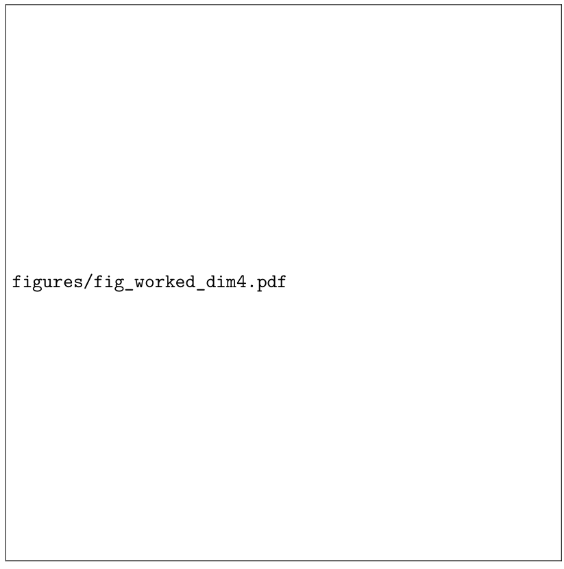

# Chapter 15: stationary convergence, safe growth, preservation, and the complete core algorithm

[Library index](../README.md) · [Source policy](../SOURCE.md) · [Previous: diagnostic minimality](0560-0563-ch15-gates-growth-criteria-and-budget.md#pdf-0563) · [Next: Lyapunov sketch and monitoring](0568-0570-ch15-lyapunov-events-and-monitoring.md#pdf-0568)

> Editorial note: Full transcription of PDF 564–567 (printed pages 528–531). Figure 15.4 is an original missing-graphic placeholder: its frame and printed filename are preserved as an image, with the author's caption. No diagram has been reconstructed or invented. Algorithm 6 retains its original global number.

## PDF 564 · Book page 528

diagnostics and accepted-improvement thresholds, the controller either terminates or enters a homeostatic regime in which growth and pruning balance under task drift.

For the stationary case, define the Lyapunov-like residual functional

$$
\mathcal V(t)=a_\rho\rho_\ell(t)
+a_\Gamma\Gamma_{\mathrm{res}}^{(\ell)}(t)
+a_C C_{\mathrm{orb}}^{(\ell)}(t)
-a_V\sum_{h\in\mathcal H_\ell(t)}V_{\mathrm{marg},h}(t),
\tag{15.39}
$$

with positive coefficients chosen so that accepted events reduce the first two terms more than they increase the complexity and crowding penalties. This is not a loss function used for backpropagation. It is an accounting device for the architectural controller.

**Theorem 15.18 (Controller convergence in the stationary case).** Assume stable diagnostics, a finite useful cover of the signature geography, an accepted-improvement floor, anchor-preserving pruning, and bounded event perturbations. Then the INCRT controller performs only finitely many accepted growth events. After the last accepted growth event, either pruning reduces the architecture to a diagnostically minimal form or all remaining events fail the validation thresholds. In both cases the controller terminates.

**Proof sketch.** By H2, every accepted growth event decreases the monitored coverage or residual component by at least a positive amount after validation, up to the tolerance absorbed in the acceptance rule. The residual terms in $\mathcal V$ are non-negative and bounded below. Therefore infinitely many accepted improvements of fixed size are impossible. Anchor preservation prevents the pruning rule from removing the very directional components needed to keep the residual decrease valid. Hysteresis prevents immediate reversal of a recent event. Once no accepted growth remains, the pruning rule can remove only finitely many components because the architecture is finite. The controller then reaches a state in which all events are below threshold or forbidden by preservation. This is termination in the sense of Definition 15.17.

### 15.17.1 Homeostasis under slow drift

If the task distribution drifts, the same argument gives homeostasis rather than termination. Let $\mu_\ell(t)$ vary slowly and suppose that the drift over one controller window satisfies

$$
W_1\bigl(\mu_\ell(t+W),\mu_\ell(t)\bigr)\le\nu W,
$$

where $W_1$ is a Wasserstein distance on signature space. Then the coverage residual may regenerate after it has been reduced. The correct target is no longer finite stopping but bounded tracking lag:

$$
\rho_\ell(t)\le\rho_\ell^\star(t)
+O(\nu W)+O(m^{-1/2})+O(\eta W).
\tag{15.40}
$$

Here $\rho_\ell^\star(t)$ is the residual that would be achieved by an ideal instantaneous controller using the same event family. Persistent drift belongs to INCRT II, but the core chapter should state this boundary clearly: termination is the stationary special case of a broader homeostatic tracking principle.

## 15.18 Initialisation and knowledge preservation

A growth rule is incomplete unless it specifies how a new component enters the network. Adding a randomly initialised head with full residual strength may destroy a representation that the previous architecture had already learned. The original INCRT formulation therefore included identity or near-identity initialisation. This remains a core mechanism.

## PDF 565 · Book page 529

### 15.18.1 Safe initialisation of a new head

When a new head is added near an uncovered signature $\sigma^\star$, its query and key motor should be initialised to express the intended geometric direction, but its value and output contribution should be gated. A schematic safe initialisation is

$$
M_{h_{\mathrm{new}}}(0)=M(\sigma^\star)+\xi Z,\qquad
W_{O,h_{\mathrm{new}}}(0)=\epsilon_O\widetilde W_O,\qquad
g_{h_{\mathrm{new}}}(0)=g_{\min},
\tag{15.41}
$$

where $\xi$ and $\epsilon_O$ are small and $g_{\min}$ is a non-zero floor. The head is geometrically present but functionally quiet. It becomes active only if training increases its marginal value.

**Proposition 15.19 (Small perturbation at birth).** Assume the attention block is locally Lipschitz in the output projection and the new head is inserted with $\|W_{O,h_{\mathrm{new}}}(0)\|\le\epsilon_O$ and $g_{h_{\mathrm{new}}}(0)\le g_{\min}$. Then the instantaneous perturbation of the layer output is bounded by

$$
\|\Delta X_{\ell+1}\|_F
\le Cg_{\min}\epsilon_O\|X_\ell\|_F+O(\xi),
$$

for a local constant $C$. Thus the new head can be inserted without disrupting the current computation, provided the gate and output projection are introduced below the validation scale.

The harmless typographical constant in the display should be read as part of the $O(\xi)$ perturbation scale: the essential point is that both the gate and the output projection control the birth perturbation. In implementation the bound is enforced by starting the output projection near zero and allowing the gate to open only after the validation window.

### 15.18.2 Knowledge preservation during splitting

Splitting is different from adding. A split occurs when a head has high marginal value but also high internal dispersion: it owns too much of the signature geography. The safe split copies the parent computation and perturbs the two children in opposite directions:

$$
M_{h_1}=M_h+\epsilon\Delta M,\qquad
M_{h_2}=M_h-\epsilon\Delta M,\qquad
W_{O,h_1}=W_{O,h_2}=\tfrac12W_{O,h}.
\tag{15.42}
$$

At birth, the two children approximately reproduce the parent. Training then specialises them. This is the architectural analogue of splitting a cluster in a vector quantisation algorithm without moving its centre of mass abruptly.

**Remark 15.20 (Why safe initialisation belongs to the core chapter).** Initialisation and preservation are not optional engineering details. They are required for the validity of the diagnostic argument. If growth itself produces a large loss spike, then the measured marginal value after the event mixes two phenomena: the usefulness of the new component and the damage caused by its insertion. Safe initialisation separates the two.

## 15.19 A complete core algorithm

The previous sections can be collected into a single algorithmic box. This is the operational form of Cap. 15. It is the piece that should be implementable by a programmer without reading the full theoretical development.

Algorithm 6 is intentionally conservative. It contains more safeguards than a minimal growth rule because the purpose of INCRT is not simply to grow. It is to grow without losing the geometry already captured by the current architecture.

## PDF 566 · Book page 530

**Algorithm 6 — INCRT core controller with safe growth and preservation**

**Require:** Initial rationalised block $\mathcal A(0)$; diagnostic window $W$; thresholds $(\epsilon_\rho,\epsilon_\Gamma,\epsilon_V)$; anchor thresholds $(\alpha_0,V_0)$; event family $\mathcal E$.

| Line | Instruction |
|---|---|
| 1 | **for** $t=1,2,\ldots$ **do** |
| 2 | Estimate $\widehat\mu_\ell(t)$, $\widehat\rho_\ell(t)$, $\widehat\Gamma_{\mathrm{res}}^{(\ell)}(t)$, $\widehat V_{\mathrm{marg},h}(t)$, $\widehat C_{\mathrm{orb}}^{(\ell)}(t)$, and $\widehat\alpha_h(t)$ on the window. |
| 3 | Update the protected set $\mathcal H_A^{\mathrm{anchor}}(t)=\{h:\alpha_h(t)\ge\alpha_0,V_{\mathrm{marg},h}(t)\ge V_0\}$. |
| 4 | Form candidate events: add near $\sigma^\star$, split overloaded head, widen residual completion, neutralise or prune crowded low-value components. |
| 5 | **for** candidate event $e\in\mathcal E$ **do** |
| 6 | Reject $e$ if it removes a protected directional anchor without a replacement. |
| 7 | Initialise growth events safely: small output projection, gate floor, and validation window. |
| 8 | Estimate the validated changes $(\Delta_e\rho,\Delta_e\Gamma_{\mathrm{res}},\Delta_e V_{\mathrm{marg}},\Delta_e C_{\mathrm{orb}})$. |
| 9 | **end for** |
| 10 | Accept the best event whose validated improvement exceeds threshold and whose crowding penalty is admissible. |
| 11 | Apply hysteresis: recently added components cannot be pruned immediately; closing gates are neutralised before deletion. |
| 12 | **if** no event exceeds threshold for $q$ consecutive windows **then** |
| 13 | **return** terminal diagnostically minimal architecture. |
| 14 | **end if** |
| 15 | **end for** |

## 15.20 Worked four-dimensional example

A small worked example helps clarify the interaction between the three growth criteria. Consider a layer whose signature geography can be projected onto four orthogonal diagnostic directions

$$
e_1,\qquad e_2,\qquad e_3,\qquad e_4.
$$

Assume the current dictionary contains atoms near $e_1$ and $e_2$, while the task distribution has significant mass near $e_3$ and a smaller directional tail near $e_4$. The coverage residual decomposes schematically as

$$
\rho=\lambda_3d(e_3,\mathcal D)^2+\lambda_4d(e_4,\mathcal D)^2+\text{covered terms}.
\tag{15.43}
$$

If $\lambda_3$ is large, the geometric criterion selects $e_3$. If the unresolved gradient is concentrated on the directional tail, the training-aware criterion may instead select $e_4$. If both candidates are tested, the marginal value criterion decides which event is accepted.

This example shows why INCRT uses a controller rather than a single scalar criterion. Geometry identifies missing regions. Training dynamics identifies which missing regions matter. Marginal value validates that the architectural action was useful. Directional-anchor preservation then prevents the selected $e_4$ component from being pruned merely because it occupies a narrow tail.

## 15.21 What INCRT is not

The strengthened core chapter should also state what INCRT is not. This avoids several common misunderstandings.

## PDF 567 · Book page 531

**Figure 15.4:** Worked four-dimensional illustration inherited from the original INCRT formulation. The example is not a benchmark. It explains how a geometric hole, a training-relevant residual direction, and a marginal-value test can select the same growth event under stable-window assumptions.

> Editorial source observation: the PDF contains a framed empty graphic with the literal text “figures/fig_worked_dim4.pdf”. The image above preserves that placeholder. The caption is transcribed as printed; a completed illustration is not present on this page.

First, INCRT is not a neural architecture search procedure in the usual sense. It does not sample architectures from a search space and compare them by external validation. It performs local architectural actions driven by the measured geometry of the current representation. The event family can be small. The point is not search breadth, but diagnostic specificity.

Second, INCRT is not merely pruning plus occasional expansion. Pruning and expansion are consequences of the same residual accounting. Growth represents uncovered useful structure; pruning removes crowded low-value structure; preservation protects directional tails; termination states that the current architecture is diagnostically sufficient.

Third, INCRT is not a claim that larger models are unnecessary. It is a claim that capacity should be placed where the task geometry requires it. A difficult task may still lead to a large terminal architecture. The difference is that large capacity is derived rather than fixed in advance.

Fourth, INCRT is not a universal guarantee that full Transformer optimisation is convex or globally convergent. The theory concerns the architecture controller under explicit stability and validation assumptions. This narrower claim is the one that can be made precise.

Finally, INCRT is not a rejection of the original application-driven formulation. The original formulation supplied the operational insight. The present chapter supplies the rationalised explanation.
