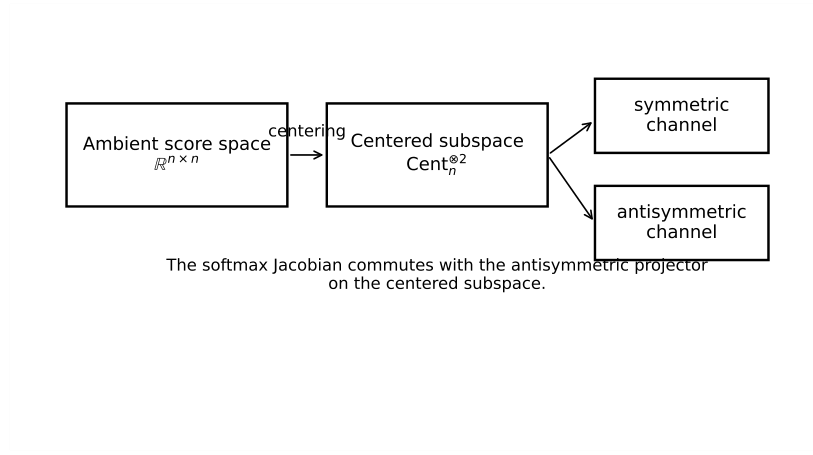
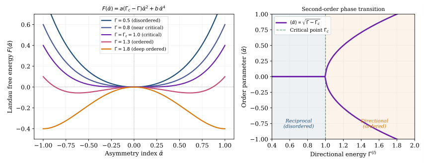

# Chapter 15: failure cases, trajectory phases, the core block, and empirical interface

[Library index](../README.md) · [Source policy](../SOURCE.md)

> Editorial note: Full transcription of PDF 571–575 (printed pages 535–539). Original claims, formulae, captions, contradictions, and missing-image placeholders are retained. Editorial observations are identified explicitly. Running page headers are represented by the page markers below.

## PDF 571 · Book page 535

## 15.26 Failure-mode case studies

The safeguards of INCRT are easier to understand through failure modes. Four case studies are particularly important.

### 15.26.1 Case I: noisy residual spikes

A residual spike may appear because of mini-batch noise, a transient optimiser oscillation, or a temporary mismatch between heads. A growth-only controller would add a head. INCRT waits for window stability. If the spike disappears, no event is accepted. This is H1 in operational form.

### 15.26.2 Case II: uncovered but irrelevant geometry

A region of signature space may be geometrically uncovered but irrelevant to the loss. Pure coverage minimisation would add a head. INCRT checks unresolved gradient mass and marginal value. If the region has little effect on the task, the event is rejected. This prevents geometry from becoming an end in itself.

### 15.26.3 Case III: short-term pruning of a directional tail

A directional tail may contribute little to the immediate validation loss but remain necessary for asymmetric or order-sensitive behaviour. A myopic pruning rule may delete it because doing so reduces size and perhaps even improves short term residual averages. INCRT protects the tail when $\alpha_h$ and $V_{\mathrm{marg},h}$ pass the anchor thresholds. The H3 mini-run illustrates this case: the unprotected variant can reduce residual slightly while losing the anchor, whereas the protected controller preserves the directional channel.

### 15.26.4 Case IV: endless growth under drift

A drifting task can regenerate residual demand forever. A controller designed only for stationary termination would continue to grow. INCRT distinguishes the stationary theorem from the slow-drift homeostatic regime. In the latter, the proper target is bounded tracking lag and balanced growth/pruning, not finite termination. The detailed persistent-drift theory is deferred to INCRT II, but the boundary is already visible here.

## 15.27 Balance with INCRT II

The expanded core chapter now contains the mechanisms without which INCRT would not be implementable: gates, event templates, safe initialisation, growth criteria, preservation, convergence accounting, and minimal empirical checks. It still deliberately stops before the broader theory. This boundary is important for the final shape of the book.

The following material belongs to INCRT II because it studies what happens after the core controller has been defined:

1. compressed-sensing interpretations of residual deflation;
2. PAC guarantees for architecture selection;
3. persistent task drift beyond the slow-drift sketch;
4. expert-count formulae and input-conditional routing;
5. architectural transfer between related tasks;

## PDF 572 · Book page 536

**Figure 15.5:** Geometric view of the INCRT cycle inherited from the original formulation. The controller does not add capacity in parameter space blindly; it adds, splits, preserves, or prunes components according to the geometry of the represented signature atoms.

> Editorial transcription of diagram labels: “Ambient score space” $\mathbb R^{n\times n}$; “centering”; “Centered subspace” $\mathrm{Cent}_n^{\otimes 2}$; “symmetric channel”; “antisymmetric channel”; “The softmax Jacobian commutes with the antisymmetric projector on the centered subspace.” The diagram and its original caption are retained separately: the diagram shows projections and a commutativity claim, rather than an incremental event cycle. The diagram's claim is not established by this caption.

6. optimiser-specific acceleration and preconditioning;
7. beyond-Transformer formulations, including GH-EXIN, Oja-type and MCA-EXIN connections;
8. large-scale applications and comparison against external baselines.

The present chapter therefore has a balanced role. It is no longer a short bridge, but it also does not absorb the entire quadrittico. It closes the core logic of the volume: static rationalisation becomes dynamic self-determination.

## 15.28 Geometric picture of the incremental cycle

The original INCRT material contained several diagrams whose role was not merely illustrative. They fixed the mental picture of the incremental cycle. The rationalised version should keep that picture. A layer is viewed as a moving geometric system with three objects: the task-induced signature distribution, the dictionary of represented atoms, and the residual field that remains between them. Training moves all three objects. INCRT observes their relative motion and intervenes only when the residual field becomes stable enough to be treated as architectural information.

The figure should be read together with the static programming interface of Chapter 14. The static chapter asks whether a fixed architecture covers the relevant signature geography. The present chapter asks how the architecture should move when the answer is no. The dictionary can move continuously through training, but the architecture changes discretely through events. INCRT is the rule that couples these two motions.

This viewpoint also explains why the controller is not reducible to a single threshold on the loss. A loss plateau may occur because the optimiser has not yet converged, because the learning rate is wrong, because the architecture is missing a direction, or because a useful direction is present but muted by a small gate. The geometric diagnostics distinguish these cases. Growth is appropriate only in the third case. Gate opening or calibration is appropriate in the fourth. No architectural action is justified in the first two without additional evidence.

## PDF 573 · Book page 537

**Figure 15.6:** Phase interpretation of the INCRT controller. The early regime is dominated by residual demand, the middle regime by differentiation and specialisation, and the final regime by pruning, preservation, and termination.

> Editorial transcription of plot labels: $F(\tilde\alpha)=a(\Gamma_c-\Gamma)\tilde\alpha^2+b\tilde\alpha^4$; “Landau free energy” $F(\tilde\alpha)$; “Asymmetry index” $\tilde\alpha$; $\Gamma=0.5$ (disordered), $\Gamma=0.8$ (near critical), $\Gamma=\Gamma_c=1.0$ (critical), $\Gamma=1.3$ (ordered), $\Gamma=1.8$ (deep ordered). The right panel is titled “Second-order phase transition”, with “Order parameter” $\langle\tilde\alpha\rangle$, legend $\langle\tilde\alpha\rangle\propto\sqrt{\Gamma-\Gamma_c}$, “Directional energy” $\Gamma^{(\ell)}$, “Critical point” $\Gamma_c$, and “Reciprocal (disordered)” / “Directional (ordered)”. This is the original Landau-style plot, not a time series of controller events. Its caption has not been rewritten to fit the image.

## 15.29 Phases of an INCRT trajectory

A typical INCRT run has phases. The first phase is under-coverage: the model is small, the coverage residual is high, and growth events are frequent. The second phase is differentiation: newly added components specialise, crowding becomes visible, and splitting may be more useful than adding. The third phase is consolidation: marginal values separate useful from redundant components. The fourth phase is termination or homeostasis: no event produces a validated improvement above threshold.

The phase description is useful because it prevents a common misreading of the algorithm. The same numerical value of a diagnostic can have different meanings in different phases. A moderately high residual at the beginning of training is expected and does not necessarily justify immediate expansion before the window is stable. The same residual after the dictionary has stabilised may signal a missing component. A low marginal value immediately after birth may simply mean that the new component is still gated. The same low marginal value after several validation windows may justify neutralisation or pruning.

For this reason the controller should store not only the current diagnostics, but also their event history. A minimal implementation keeps the following state:

$$
(\text{birth time},\ \text{last event time},\ \text{gate history},\ \text{marginal-value history},\ \text{anchor status})
$$

for every component. This state is small, but it is essential. Without it, hysteresis, safe pruning, and anchor preservation cannot be implemented reliably.

## 15.30 Synthesis of the core chapter

At this point the chapter contains all elements that should remain in INCRT I. The old application-driven formulation is preserved as the historical and operational root. The Rationalised Transformer supplies the static variables. The dynamic state turns those variables into time-dependent diagnostics. The bidirectional gate acts as the local actuator. The three growth criteria align geometry, training dynamics, and marginal value. Directional anchors prevent antisymmetric starvation. Safe initialisation and neutralisation preserve knowledge. The Lyapunov accounting proves that accepted events cannot continue indefinitely in the stationary regime. The minimal experiments show the controller in action.

Thus Cap. 15 is neither the entire old quadrittico nor a short bridge. It is the core dynamic theory. It should be long enough to contain the operational identity of INCRT, but narrow

## PDF 574 · Book page 538

enough that the next chapter can develop the extensions without repeating the foundations. The division between the two chapters is therefore structural:

$$
\text{INCRT I: how the architecture grows, preserves, and stops,}
$$
$$
\text{INCRT II: how this principle extends, generalises, and transfers.}
$$

This balance is the reason for keeping the recovered mechanisms above while leaving the broader guarantees and applications for the following chapter.

## 15.31 The core INCRT block

The dynamic controller acts on the Rationalised Transformer block. Each head has the decomposition

$$
M_h(t)=M_{s,h}(t)+M_{a,h}(t),
\tag{15.45}
$$

with residual injection

$$
R_h(t)=g_{S,h}(t)R_{S,h}(t)+g_{A,h}(t)R_{A,h}(t)+g_{M,h}(t)R_{M,h}(t).
\tag{15.46}
$$

The gates may use the explanatory form inherited from the static chapter,

$$
g_h(t)=\sigma\!\left(b_0+b_1V_{\mathrm{marg},h}(t)-b_2C_{\mathrm{orb},h}(t)+b_3\Gamma_{\mathrm{res},h}(t)+b_4\alpha_h(t)\right),
\tag{15.47}
$$

but this formula is not a universal law. It is a canonical default. In implementation, the coefficients are calibrated on validation windows, and gate floors are used to avoid starvation.

**Task operator.** When a positive operator is needed for spectral reasoning, the core chapter uses an explicitly positive form such as

$$
\mathcal B=(XM_a)^\top(XM_a),
\tag{15.48}
$$

or an empirical covariance of directional responses. The expression $\operatorname{sym}(X^\top XM_a)$ may be symmetric, but it is not necessarily positive semidefinite. Therefore spectral lower-bound arguments should be applied to (15.48) or to $|\mathcal B|$, not to an unqualified symmetrisation.

## 15.32 The dynamic programming interface

Chapter 14 closed the static part of the construction by turning theoretical variables into implementation diagnostics. INCRT turns the same variables into commands. The resulting programming interface is small:

**Diagnose – AddHead – SplitHead – ExpandChannel – PruneOrMerge – PreserveAnchor – Terminate.**

Each command has a geometric precondition and a validation postcondition. This is the practical reason for introducing the rationalised state variables. They are not only explanatory labels; they are the arguments of the controller.

This interface is also the point at which the core chapter and the extension chapter separate. The present chapter defines the commands and proves their basic stability. The next chapter studies richer command families: continual homeostatic tracking, expert creation, architectural transfer, adaptive preconditioning, and statistical guarantees.

## PDF 575 · Book page 539

| Command | Precondition | Postcondition |
|---|---|---|
| AddHead | Stable uncovered region with low local crowding | $\rho_\ell$ decreases after warm-up. |
| SplitHead | High-value head with high local variance | Child heads reduce crowding without increasing $\Gamma_{\mathrm{res}}$ too much. |
| ExpandChannel | Useful residual in an existing $S$, $A$, or mixed channel | Marginal value increases or residual amplification decreases. |
| PruneOrMerge | Low marginal value and high crowding | Loss and coverage remain within tolerance. |
| PreserveAnchor | High $\alpha_h$ and high marginal value | Directional anchor count is not reduced. |
| Terminate | Improvements below tolerance for $q$ windows | Architecture is frozen and ordinary fine-tuning continues. |

**Table 15.5:** Dynamic programming interface implemented by the core INCRT controller.

| Observation | Expected INCRT response | Interpretation |
|---|---|---|
| High $\rho_\ell$ and stable estimates | Add or split near $\sigma_\ell^\star$ | Missing signature region. |
| High crowding and low marginal value | Prune or merge | Redundant capacity. |
| High $\alpha_h$ and high marginal value | Preserve | Directional tail anchor. |
| High $\Gamma_{\mathrm{res}}$ but no marginal gain | Do not grow indefinitely | Task-irrelevant residual energy. |
| All improvements below tolerance for $q$ windows | Terminate | Architecture has stabilised. |

**Table 15.6:** Minimal empirical checks for the core INCRT controller.

## 15.33 Minimal empirical illustration

The empirical role of this core chapter is modest. It does not need to prove that every rationalised architecture beats a standard Transformer at equal compute. That benchmark question belongs to a larger experimental study. What is needed here is an illustration of the dynamic loop:

$$
\text{under-covered region}\longrightarrow\text{growth event}\longrightarrow
\text{coverage decrease}\longrightarrow\text{termination}.
$$

A minimal experiment should therefore report, at each growth window,

$$
\rho_\ell(t),\qquad\Gamma_{\mathrm{res}}^{(\ell)}(t),\qquad
C_{\mathrm{orb}}^{(\ell)}(t),\qquad V_{\mathrm{marg},h}^{(\ell)}(t),\qquad H_\ell(t).
\tag{15.49}
$$

The experiment is successful if growth events occur only when the diagnostics are unstable or under-covered, if $\rho_\ell$ decreases after accepted growth, if directional anchors are not pruned, and if the controller terminates.

> Editorial note: The source says “unstable or under-covered”. This wording is retained literally; it conflicts with the stability precondition of §15.24 and the “stable estimates” row of Table 15.6.

### 15.33.1 Executed minimal controller checks

The protocol above was executed on a deliberately small synthetic signature geography. The experiment is not a benchmark and it is not meant to establish superiority over a standard

---

[Previous source file](0568-0570-ch15-lyapunov-events-and-monitoring.md#pdf-0570) · [Continue with PDF 576](0576-0580-ch15-controller-checks-growth-and-safeguards.md#pdf-0576)
