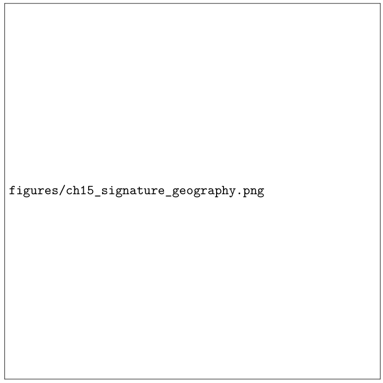
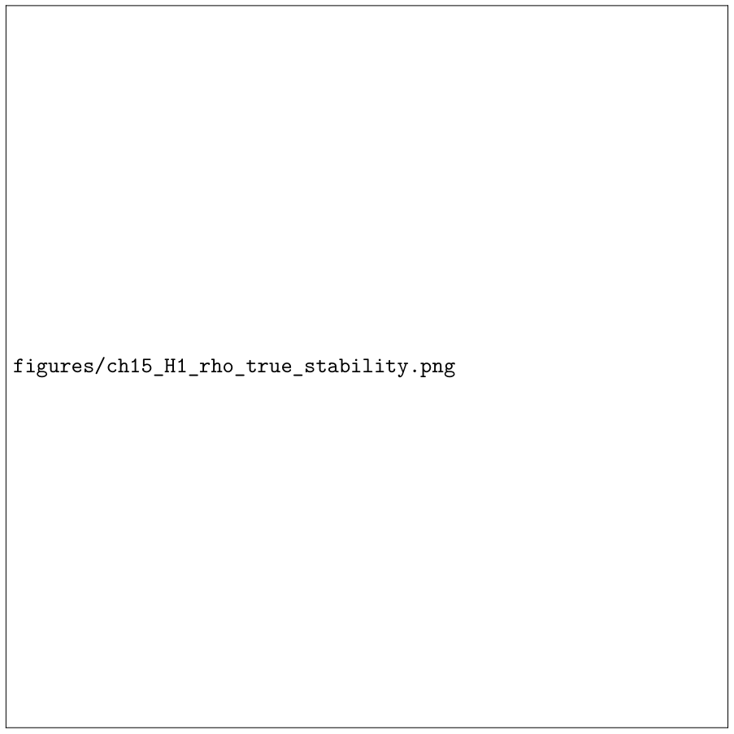
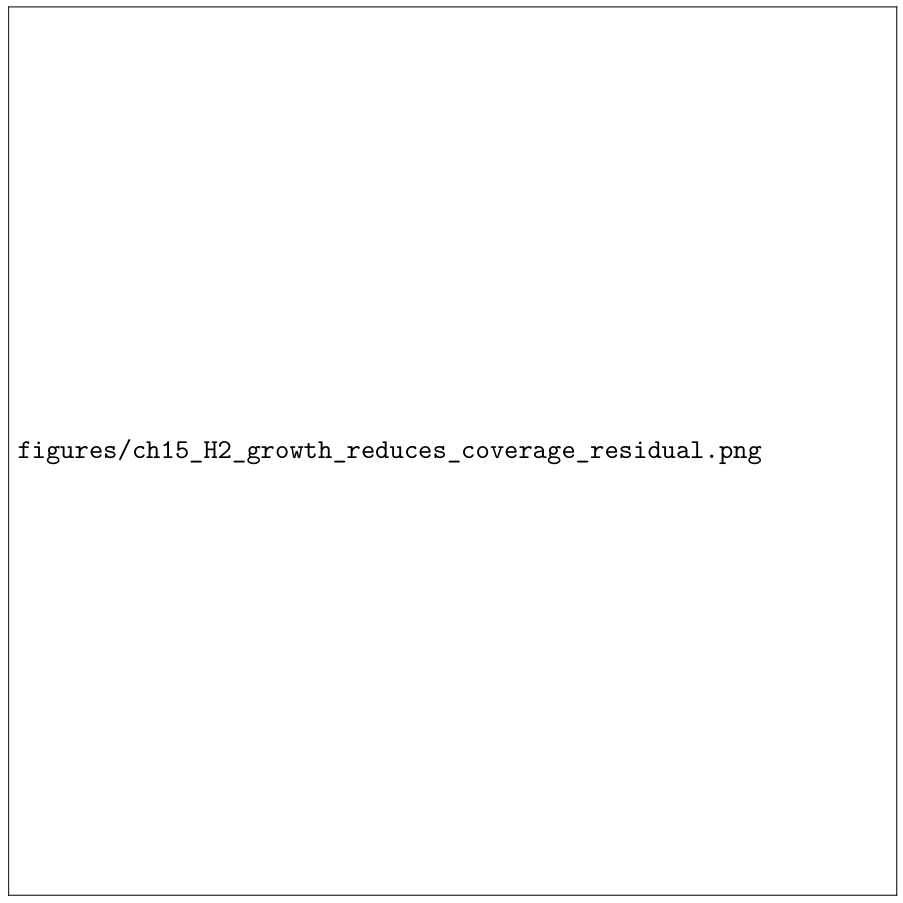
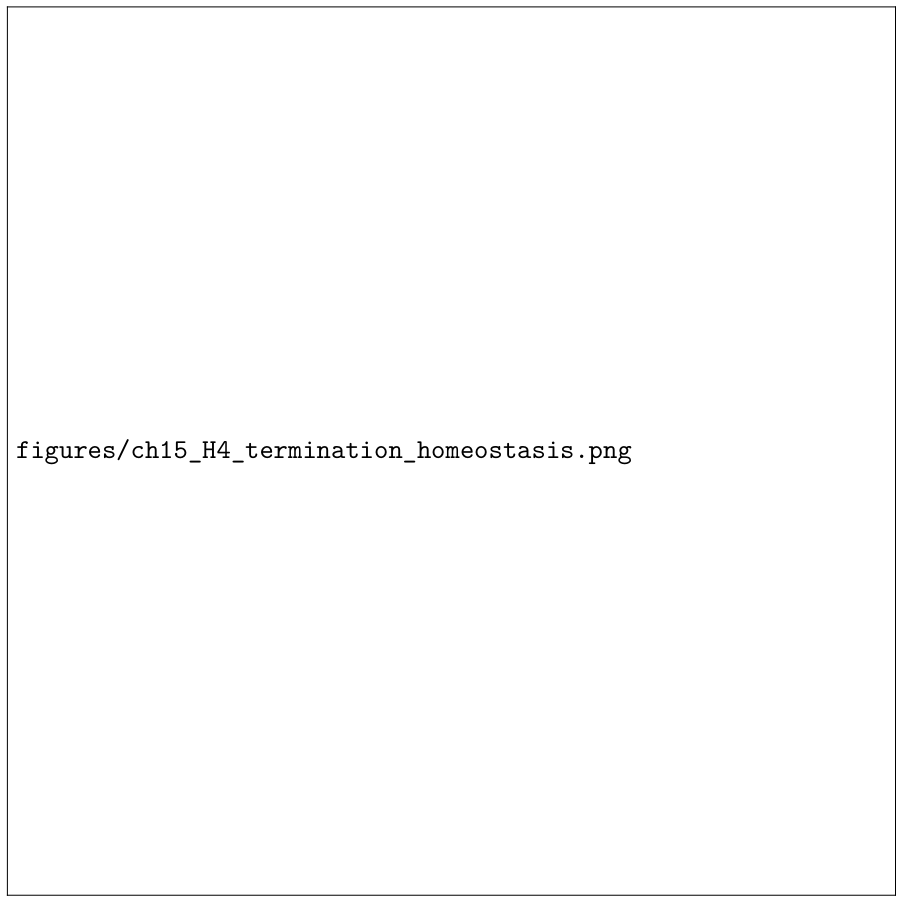

# Chapter 15: reported controller checks, growth implementation, and safeguards

[Library index](../README.md) · [Source policy](../SOURCE.md)

> Editorial note: Full transcription of PDF 576–580 (printed pages 540–544). Original claims, formulae, captions, contradictions, and missing-image placeholders are retained. Editorial observations are identified explicitly. Running page headers are represented by the page markers below.

## PDF 576 · Book page 540

**Figure 15.7:** Synthetic signature geography used for the minimal controller checks. The horizontal coordinate is a generic signature coordinate and the vertical coordinate is the directional ratio $\alpha$. The experiment is intentionally small: it is designed to visualise the INCRT loop rather than to report a competitive benchmark.

> Editorial note: The original PDF contains an empty framed placeholder labelled `figures/ch15_signature_geography.png`. The image above is a direct rendering of that original placeholder. The plot described by the caption is absent from this PDF; it has not been reconstructed.

Transformer. Its purpose is narrower: it checks that the controller variables introduced in this chapter behave as the theory requires. The target geography contains a symmetric cluster, a mixed cluster, and a directional region; the controller begins below the required covering capacity and is allowed to add dictionary heads when the measured residual coverage remains above tolerance.

The first run checks H1, H2, and H4. The initial dictionary contains only one head and is therefore under-covered. Seven accepted growth events are produced before termination. The coverage residual decreases from

$$
0.2045\quad\text{to}\quad0.0097,
$$

and the residual-amplification proxy decreases from approximately

$$
0.0609\quad\text{to}\quad0.0283.
$$

The head count increases from 1 to 8 and then the controller terminates. The numbers should be read as diagnostic values of the synthetic controller, not as task accuracy.

A second, dedicated run checks H3. In this run a visible high-$\alpha$ directional tail is present from the start and one initial head is an anchor in that region. A pruning pressure is then applied. The anchor-preserving rule blocks the removal of the directional anchor, whereas the unprotected pruning variant removes it. The final anchor counts are therefore

$$
1\to1\quad\text{with anchor preservation},\qquad
1\to0\quad\text{without protection}.
$$

## PDF 577 · Book page 541

| Growth step | $\rho$ before | $\rho$ after | Decrease | Heads after |
|---:|---:|---:|---:|---:|
| 0 | 0.2045 | 0.0745 | 0.1299 | 2 |
| 1 | 0.0745 | 0.0197 | 0.0549 | 3 |
| 2 | 0.0197 | 0.0147 | 0.0050 | 4 |
| 3 | 0.0147 | 0.0129 | 0.0018 | 5 |
| 4 | 0.0129 | 0.0121 | 0.0008 | 6 |
| 5 | 0.0121 | 0.0119 | 0.0002 | 7 |
| 6 | 0.0119 | 0.0095 | 0.0024 | 8 |

**Table 15.7:** Before–after effect of accepted growth events in the minimal INCRT controller run. The first events remove the large uncovered regions; later events have smaller marginal effect, which is precisely the regime in which the termination criterion becomes active.

The preserving run ends with $\rho\simeq0.0047$ and the unprotected variant with $\rho\simeq0.0485$ in this controlled construction. The important point is not the absolute value of $\rho$, but the qualitative safeguard: a controller that only optimises immediate redundancy can eliminate a rare directional tail, whereas H3 enforces preservation or replacement of directional anchors.

These checks close the empirical role of the core chapter. They illustrate the controller logic at the same scale at which the theory is stated: stable measurement, accepted growth, protection of directional anchors, and finite termination. Larger comparisons, including full-scale equal-compute studies, are deliberately deferred to INCRT II.

## 15.34 Implementation of growth events

A growth event is not a single operation. In practice, the controller chooses among three local modifications of the Rationalised Transformer block. The choice depends on whether the uncovered region is genuinely new, whether it is near an overloaded head, or whether the residual is better explained by the feed-forward completion path.

### 15.34.1 Adding a new head

The simplest event adds a head to layer $\ell$. It is used when the uncovered signature $\sigma_\ell^\star(t)$ is far from every current head and the local crowding score is low. The new head receives a small residual gate and is initialised near the implementable template closest to $\sigma_\ell^\star(t)$:

$$
\theta_{\mathrm{new}}=\operatorname*{argmin}_{\theta\in\Theta_{\mathrm{templates}}}
\|\sigma(\theta)-\sigma_\ell^\star(t)\|^2.
\tag{15.50}
$$

The residual gate is not opened abruptly. A warm-up schedule is used:

$$
g_{\mathrm{new}}(t+s)=g_{\min}+(g_{\mathrm{target}}-g_{\min})\left(1-e^{-s/\tau_g}\right).
\tag{15.51}
$$

This prevents a new head from creating a large residual perturbation before its value and output maps have adapted.

### 15.34.2 Splitting an overloaded head

If $\sigma_\ell^\star(t)$ lies near an existing high-marginality head but that head exhibits high local crowding or high within-cluster variance, the correct action is not to add an unrelated head. It is to

## PDF 578 · Book page 542

**Figure 15.8:** H1 check. The true coverage residual is tracked over controller steps, together with a moving-window variability band. The diagnostic is not used as an instantaneous noisy signal; it is interpreted through a growth window, as required by the two-time-scale argument.

> Editorial note: The original PDF contains an empty framed placeholder labelled `figures/ch15_H1_rho_true_stability.png`. The original placeholder is preserved above; the claimed curve and variability band are absent from this PDF.

split the overloaded head into two children. Let $h$ be the parent. The children are initialised as

$$
\theta_{h_1}=\theta_h+\epsilon u,\qquad\theta_{h_2}=\theta_h-\epsilon u,
\tag{15.52}
$$

where $u$ is a tangent direction aligned with the principal local signature variance. Their gates are initialised so that the total residual injection is approximately conserved:

$$
g_{h_1}+g_{h_2}\approx g_h.
\tag{15.53}
$$

Splitting is therefore a local refinement of an existing computation, not an increase of residual energy.

### 15.34.3 Expanding the residual completion path

Some residuals are not best handled by adding attention heads. If the uncovered region is already covered by attention signatures but the residual completion error remains high, INCRT expands the rationalised feed-forward completion path. The static allocation formula of Chapter 14,

$$
d_{\mathrm{ff}}^{\mathrm{rat}}(t)=d+\mathit{lambda}_S r_S^{(\ell)}(t)+\lambda_A r_A^{(\ell)}(t)+\lambda_R r_{\mathrm{res}}^{(\ell)}(t),
\tag{15.54}
$$

> Editorial note: The source prints the letters `lambda` for the coefficient of $r_S^{(\ell)}$, rather than the Greek $\lambda$ used for the other two coefficients. This typographical inconsistency is retained.

## PDF 579 · Book page 543

**Figure 15.9:** H2 check. Vertical lines mark accepted growth events. Each accepted event adds capacity near an uncovered region of signature space and is followed by a reduction of the coverage residual $\rho(t)$, with diminishing marginal gains as the dictionary becomes saturated.

> Editorial note: The original PDF contains an empty framed placeholder labelled `figures/ch15_H2_growth_reduces_coverage_residual.png`. The original placeholder is preserved above; the plotted events and curve described by the caption are absent.

becomes a dynamic target width. Width is increased only when the measured completion residual remains above tolerance for several windows and when head growth would not reduce $\rho_\ell(t)$.

## 15.35 Safeguards against dynamic failure modes

A dynamic architecture can fail in ways that a static architecture cannot. The controller therefore includes safeguards. These safeguards are not optional engineering details; they are the mechanisms that make the termination theorem credible in an implementable system.

### 15.35.1 Over-expansion

Over-expansion occurs when a residual remains high even though new heads do not improve coverage or marginal value. The safeguard is the joint termination criterion (15.20): residual energy alone is not enough to trigger indefinite growth. A growth event must produce an expected decrease in $\rho_\ell$ or a measurable improvement in marginal value. Otherwise the residual is treated as task-irrelevant or as noise.

## PDF 580 · Book page 544

**Figure 15.10:** H4 check. The controller increases the scaled head count only through discrete events. Once residual improvements have saturated, the termination flag is activated and the architecture is no longer expanded.

> Editorial note: The original PDF contains an empty framed placeholder labelled `figures/ch15_H4_termination_homeostasis.png`. The original placeholder is preserved above; the head-count and termination curves are absent.

### 15.35.2 Ping-pong oscillation

Ping-pong oscillation occurs when the controller adds a head, prunes it soon after, and then adds a similar head again. INCRT avoids this by hysteresis. A head must remain below the pruning threshold for $q_{\mathrm{prune}}$ windows before it can be removed, while growth requires $q_{\mathrm{grow}}$ stable windows above the growth threshold. The two thresholds are separated:

$$
\theta_{\mathrm{grow}}>\theta_{\mathrm{prune}}+\Delta_{\mathrm{hyst}}.
\tag{15.55}
$$

### 15.35.3 Directional starvation

Directional starvation occurs when growth allocates capacity to symmetric aggregation because it is easier to optimise, while directional tails remain uncovered. The anchor rule (15.18) prevents this failure. In implementation, every layer maintains a minimum number of directional anchors and an explicit replacement rule for any anchor that is split or pruned.

---

[Previous source file](0571-0575-ch15-failure-cases-block-and-empirical-interface.md#pdf-0575) · [Continue with PDF 581](0581-0584-ch15-calibration-hysteresis-and-single-layer-growth.md#pdf-0581)
