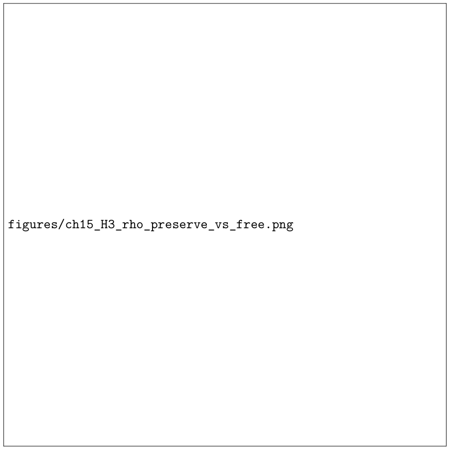

# Chapter 15: calibration schedules, hysteresis, and a single-layer growth calculation

[Library index](../README.md) · [Source policy](../SOURCE.md)

> Editorial note: Full transcription of PDF 581–584 (printed pages 545–548). Original claims, formulae, captions, contradictions, and missing-image placeholders are retained. Editorial observations are identified explicitly. Running page headers are represented by the page markers below.

## PDF 581 · Book page 545

**Figure 15.11:** H3 check. Under pruning pressure, the anchor-preserving controller keeps the high-$\alpha$ directional anchor, while the unprotected variant can remove it. This is the experimental analogue of the directional-tail preservation proposition.

> Editorial note: The original PDF contains an empty framed placeholder labelled `figures/ch15_H3_anchor_preservation_comparison.png`. The original placeholder is preserved above; the comparison graph is absent.

### 15.35.4 Premature freezing

Premature freezing occurs when the controller terminates before the architecture has seen enough of the task distribution. This is controlled by the stability window of Theorem 15.2 and by the requirement that the termination criterion hold for $q$ consecutive windows. For non-stationary data, the extended theory of the next chapter replaces termination by homeostatic tracking.

## 15.36 Calibration of the dynamic controller

The controller contains thresholds and coefficients. They are not universal constants. They are calibration parameters whose role is to turn the theoretical criteria into a stable implementation. The static chapter already emphasised that coefficients such as $(\lambda_\alpha,\lambda_C,\lambda_R,\lambda_G)$ and gate parameters should be treated as biases, not as hard laws. The same rule applies dynamically.

## PDF 582 · Book page 546

**Figure 15.12:** Coverage residual in the H3 directional-tail run. The safeguard is not introduced to minimise one scalar at one instant; it is introduced to prevent directional starvation during growth and pruning.

> Editorial note: The original PDF contains an empty framed placeholder labelled `figures/ch15_H3_rho_preserve_vs_free.png`. The original placeholder is preserved above; the coverage comparison graph is absent.

### 15.36.1 Default schedules

A robust default schedule is:

$$
\theta_{\mathrm{grow}}(t)=\theta_0(1+\tau/t)^{-1/2},
\tag{15.56}
$$

$$
\theta_{\mathrm{prune}}(t)=\theta_{\mathrm{grow}}(t)-\Delta_{\mathrm{hyst}},
\tag{15.57}
$$

$$
\beta_t=\beta_0(1+t/t_0)^{-1},
\tag{15.58}
$$

$$
g_{\min}(t)=g_{\min}^{(0)}.
\tag{15.59}
$$

The growth threshold decays slowly as the diagnostics become less noisy. The tracking step size decays faster than the optimiser step size, preserving the two-time-scale separation. The gate floor remains positive so that dormant heads can recover if their marginal value increases.

> Editorial note: Formula (15.56) and the following sentence are retained literally. For positive $\theta_0,\tau,t$, the printed threshold increases with $t$; it does not decay. Formula (15.57) also gives equality of the threshold gap to $\Delta_{\mathrm{hyst}}$, whereas (15.55) uses a strict inequality.

### 15.36.2 Validation-based adjustment

Thresholds are adjusted by validation, not by training loss alone. If growth improves training loss but worsens validation coverage or increases crowding, the event is rejected. A useful

## PDF 583 · Book page 547

| Measured condition | Growth event | Reason |
|---|---|---|
| Large uncovered distance, low crowding | Add new head | A missing signature region is present. |
| Large local variance around useful head | Split head | One head is carrying several regimes. |
| Low coverage residual, high completion residual | Expand residual completion | Attention covers the region, but the residual map is under-parameterised. |
| High crowding, low marginal value | Prune or merge | Capacity is redundant rather than insufficient. |
| High directional value | Preserve or add directional anchor | Directional tail must not be starved. |

**Table 15.8:** Local architecture events in the core INCRT controller.

| Failure mode | Symptom | Safeguard |
|---|---|---|
| Over-expansion | Persistent $\Gamma_{\mathrm{res}}$ without coverage decrease | Require improvement in $\rho_\ell$ or $V_{\mathrm{marg}}$. |
| Ping-pong oscillation | Repeated add-prune cycles | Growth/pruning hysteresis. |
| Directional starvation | Loss of high-$\alpha_h$ anchors | Anchor preservation constraint. |
| Premature freezing | Early termination under sparse task exposure | Stability windows and repeated termination checks. |
| Crowding after growth | New heads collapse near old heads | Anti-crowding penalty and split-vs-add decision. |
| Gate collapse | All residual gates close or open together | Gate floors, entropy control, and validation-based calibration. |

**Table 15.9:** Dynamic failure modes introduced by incremental growth and the corresponding safeguards.

acceptance rule is

$$
\Delta\mathcal L_{\mathrm{val}}<0,\qquad\Delta\rho_\ell<0,\qquad
\Delta C_{\mathrm{orb}}^{(\ell)}\le\varepsilon_C,\qquad
\Delta\Gamma_{\mathrm{res}}^{(\ell)}\le\varepsilon_\Gamma^{\mathrm{inc}}.
\tag{15.60}
$$

This rule encodes the philosophy of the chapter: growth is not accepted merely because it adds capacity. It is accepted when it improves the geometry of the block.

## 15.37 A toy trajectory

It is useful to imagine a single layer whose signature distribution has two regions: a broad symmetric cluster and a thin directional tail. A fixed Transformer with too few heads tends to allocate most heads to the broad cluster because that region produces larger early gradients. The directional tail is not absent, but it is under-covered. The coverage residual therefore remains large near the tail, and the directional ratio of the available heads is too low.

INCRT reacts in three stages. First, the dictionary tracks the broad symmetric cluster and reduces crowding there. Second, the uncovered tail produces a stable local maximum of $d(\sigma,\mathcal D_\ell(t))$, triggering growth near $\sigma_\ell^\star(t)$. Third, once the new head becomes a directional anchor, the preservation rule prevents later pruning from destroying it. The process terminates only after both the symmetric cluster and the directional tail are covered to tolerance.

This toy trajectory explains why residual directional energy alone is not enough. A high residual may mean that the model needs a new directional anchor, but it may also mean

## PDF 584 · Book page 548

| Quantity | Single-layer meaning | Controller consequence |
|---|---|---|
| $p$ | Mass of symmetric cluster | Large $p$ favours compression of symmetric crowding. |
| $1-p$ | Mass of directional tail | Small but nonzero mass can still require an anchor. |
| $r_A$ | Distance from tail to dictionary | Large $r_A$ triggers directional growth. |
| $\xi$ | Implementability error | If too large, growth is rejected or replaced by splitting. |
| $\varepsilon_S$ | Symmetric cover radius | Determines whether symmetric cluster is already resolved. |

**Table 15.10:** Single-layer interpretation of the coverage-decrease theorem.

that an existing region is crowded or that the residual is irrelevant. The dynamic state of INCRT disambiguates these cases.

## 15.38 A worked single-layer growth calculation

The coverage theorem can be made concrete in a single-layer example. Suppose that the current signature distribution in layer $\ell$ has two components:

$$
\mu_\ell(t)=p\mu_S+(1-p)\mu_A,
$$

where $\mu_S$ is a broad symmetric cluster and $\mu_A$ is a thin directional tail. Assume that the current dictionary contains atoms covering the symmetric cluster but no atom within radius $r_A$ of the directional tail. Then

$$
\rho_\ell(t)=\int d\bigl(\sigma,\mathcal D_\ell(t)\bigr)^2\,d\mu_\ell(t)(\sigma)\ge(1-p)r_A^2.
$$

If the growth rule selects $\sigma_\ell^\star$ in the tail and the new head is implemented with error at most $\xi$, the post-growth residual satisfies

$$
\rho_\ell(t^+)\le p\varepsilon_S^2+(1-p)\xi^2,
$$

where $\varepsilon_S$ is the existing cover radius of the symmetric cluster. Therefore the gain is at least

$$
\rho_\ell(t)-\rho_\ell(t^+)\ge(1-p)(r_A^2-\xi^2)-p\varepsilon_S^2.
\tag{15.61}
$$

The growth event is useful whenever the right-hand side is positive. This small calculation is the geometric analogue of the older residual-deflation intuition: a new head is useful when it captures a region whose uncovered mass is larger than the implementation error needed to reach it.

The same example shows why preservation is necessary. Once the new head has become a directional anchor, pruning it would restore the lower bound $(1-p)r_A^2$. Thus a pruning rule based only on short-term loss could destroy a rare but important tail. INCRT prevents this by combining marginal value, $\alpha_h$, and anchor status.

This example is intentionally elementary. It is included because it provides a mental model for the full controller. The model does not grow because a component has large norm. It grows when an uncovered region has enough mass, value, and implementability to justify a new architectural degree of freedom.

---

[Previous source file](0576-0580-ch15-controller-checks-growth-and-safeguards.md#pdf-0580)
