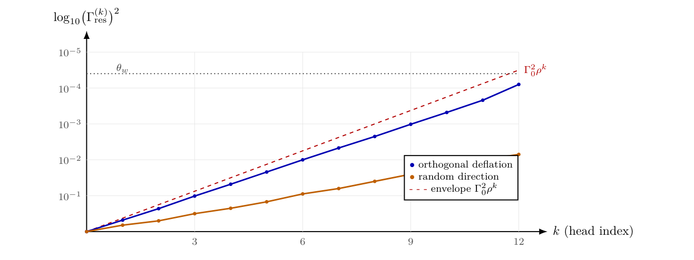

# Chapter 16: moving task operators, block growth, and Centered Attention

[Library index](../README.md) · [Source policy](../SOURCE.md) · [Previous: exact deflation](0593-0597-ch16-extension-status-and-exact-deflation.md)

> Editorial note: Full transcription of PDF 598–600 (printed pages 562–564). Figure 16.1 is a direct render of the original PDF's vector artwork; the numerical and graphical inconsistencies are preserved. Theorem 16.4's update sign, trailing-eigenspace conclusion, proof placeholder, and the source's softmax Jacobian formulas are retained literally; mathematical checks are separate in the Russian notes. The range ends immediately after the final unnumbered Jacobian display on PDF 600, partway through §16.4.3.

## PDF 598 · Book page 562

random directions decays much more slowly — as the chapter will show in this part of the construction, that regime obeys a different and weaker law.

**Figure 16.1:** Squared residual energy across growth events, on a synthetic task with $\kappa_A=3$.

*Orthogonal deflation (blue) tracks the predicted envelope $\Gamma_0^2\rho^k$ with $\rho=1-1/\kappa_A^2$ and reaches the threshold $\theta_w$ at the predicted $K^*\approx27$. A baseline that places new heads in random directions (orange) follows a slower decay, governed by the bound of the theorem.*

> Editorial transcription of labels visible in the original figure: vertical label $\log_{10}(\Gamma_{\mathrm{res}}^{(k)})^2$; vertical tick labels $10^{-1}$, $10^{-2}$, $10^{-3}$, $10^{-4}$, $10^{-5}$; horizontal label $k$ (head index), ticks 3, 6, 9, 12; threshold $\theta_w$; envelope $\Gamma_0^2\rho^k$; legend “orthogonal deflation”, “random direction”, “envelope $\Gamma_0^2\rho^k$”. This is label transcription, not reconstructed numeric data.

## 16.4 The three-level framework

The core theory of the previous sections operates within a single layer: a growth event adds one head, a pruning event removes one, and the Lyapunov functional governs the dynamics until the residual is below threshold. This section develops three extensions that complete the framework: the tracking of non-stationary task operators (this part of the construction), the simultaneous allocation of multiple heads via Block MCA EXIN (this part of the construction), a new attention mechanism called Centered Attention (this part of the construction), the depth self-determination mechanism (this part of the construction), the three-level convergence theorem (this part of the construction), and the regime-dynamics theorem connecting depth to width (this part of the construction). Together, these extensions upgrade INCRT from a single-layer width allocator to a fully self-architecting system that determines its own depth, per-layer width, and per-head eigenspace dimension.

### 16.4.1 Moving task operators

In practice, the task operator $\mathcal B(t)$ evolves during training as the weights of the network are updated. The following theorem provides the correct generalisation of the homeostatic convergence result to this regime.

**Theorem 16.3 (Moving-target convergence).** Let $\mathcal B(t)$ be a sequence of task operators satisfying

$$
\|\mathcal B(t+1)-\mathcal B(t)\|_F\le\beta_t,
\qquad\sum_t\beta_t<\infty.
\tag{16.7}
$$

Then the Lyapunov functional $V_t=\Gamma_{\mathrm{res}}(t)^2$ satisfies

$$
V_t\le V_0(1-4c_0\eta^+)^t+R_\infty,
\qquad R_\infty=\frac{\sum_s\beta_s^2}{4c_0\eta^+},
\tag{16.8}
$$

where $c_0=\delta_0^2/\Gamma_0^2$. The architecture converges to a ball of radius $R_\infty$ around the instantaneous optimum.

## PDF 599 · Book page 563

The interpretation is precise: if the task operator drifts slowly (small $\beta_t$), the architecture tracks it closely; if it drifts rapidly, the architecture lags by a controlled amount $R_\infty$. The pruning mechanism handles large drift by removing heads whose energy has fallen below $\phi_g$ due to the shift, and replacing them with heads aligned to the new dominant directions. The multi-layer extension appears in the three-level convergence theorem (this part of the construction).

### 16.4.2 Level-2: Block MCA EXIN on the Stiefel manifold

When the leading eigenvalue of $A_{\mathrm{res}}$ has multiplicity greater than one — or more precisely, when the spectral gap $\lambda_m/\lambda_1>1-\gamma$ for a tolerance $\gamma\in(0,1)$ — a single Oja step does not uniquely determine the direction of the new head. The Level-2 mechanism handles this by growing the *dimension* of the head's eigenspace rather than its count, allocating $m$ heads simultaneously on the dominant $m$-eigenspace of $A_{\mathrm{res}}$.

The $m$-dimensional eigenspace is estimated by a matrix generalisation of MCA EXIN called *Block MCA EXIN*. Let $W\in\operatorname{St}(m,d)=\{W\in\mathbb R^{d\times m}:W^\top W=I_m\}$ be a semi-orthogonal frame. Block MCA EXIN performs the iteration

$$
W_{t+1}=\operatorname{qr}\bigl(W_t+\eta_t A_{\mathrm{res}}W_t
-\eta_tW_t(W_t^\top A_{\mathrm{res}}W_t)\bigr),
\tag{16.9}
$$

where $\operatorname{qr}(\cdot)$ extracts the Q-factor of a thin QR decomposition, projecting the iterate back onto the Stiefel manifold.

**Identification with Stiefel gradient flow.** The QR-retraction iteration is the QR-retraction-based discretisation of the Riemannian gradient flow of $f_{\mathcal B}(W)=\operatorname{tr}(W^\top A_{\mathrm{res}}W)$ on $\operatorname{St}(m,d)$. Since $f_{\mathcal B}$ is invariant under right multiplication by $O\in\operatorname{O}(m)$ (the orthogonal group on the column space of $W$), the flow descends to the Grassmann quotient $\operatorname{Gr}(m,d)=\operatorname{St}(m,d)/\operatorname{O}(m)$. On the Grassmannian, $f_{\mathcal B}$ has a unique global minimum at the $m$-dimensional subspace spanned by the $m$ trailing eigenvectors of $A_{\mathrm{res}}$ (i.e., the $m$ most negative eigenvectors), which is the target subspace for MCA EXIN.

**Theorem 16.4 (Block MCA EXIN convergence on Stiefel).** Let $A_{\mathrm{res}}\in\operatorname{Sym}(\mathbb R^d)$ with distinct eigenvalues $\lambda_1>\cdots>\lambda_d$. Let $W(t)$ evolve under the QR-retraction update with step sizes satisfying $\sum_t\eta_t=\infty$, $\sum_t\eta_t^p<\infty$ for some $p>1$. Then:

- (i) $\operatorname{span}W(t)$ converges almost surely to the $m$-dimensional eigenspace of $A_{\mathrm{res}}$ spanned by the trailing eigenvectors $\{v_{d-m+1},\ldots,v_d\}$.
- (ii) The rate of convergence is exponential in the spectral gap $\Delta_m=\lambda_{d-m}-\lambda_{d-m+1}$.

*Proof sketch.* The proof uses [citation] (Theorem 3.1, hypotheses H1–H5 on Riemannian manifolds). **H1** (manifold): $\operatorname{Gr}(m,d)$ is a compact Riemannian manifold. **H2** (Lipschitz gradient): $\nabla_{\operatorname{Gr}}f_{\mathcal B}$ is $C^\infty$ on $\operatorname{Gr}(m,d)$, hence globally Lipschitz by compactness. **H3** (noise bound): in the deterministic gate setting, $\sigma_t=0$. **H4** (step sizes): by hypothesis. **H5** (isolated critical points): the critical points of $f_{\mathcal B}$ on $\operatorname{Gr}(m,d)$ are the $\binom dm$ coordinate $m$-subspaces; the trailing $m$-subspace is the unique global minimiser with Hessian gap $\Delta_m>0$; all other critical points are saddles with at least one negative Hessian eigenvalue. By LaSalle's invariance principle on $\operatorname{Gr}(m,d)$ and the stable manifold theorem, convergence to saddle points has measure zero. The full proof is in the technical appendix.

**Theorem 16.5 (Level-2 CS bound).** Let $r=\operatorname{rank}(A_{\mathrm{res}}^{(k-1)})$ and suppose that a Level-2 event adds the leading $m$ residual eigenvectors with eigenvalues $\lambda_1\ge\cdots\ge\lambda_m$. The resulting

## PDF 600 · Book page 564

residual energy satisfies

$$
\bigl(\Gamma_{\mathrm{res}}^{(k)}\bigr)^2
=\bigl(\Gamma_{\mathrm{res}}^{(k-1)}\bigr)^2-\sum_{i=1}^m\lambda_i^2.
\tag{16.10}
$$

If the leading eigenvalue has exact multiplicity $m$, this decrement is $m\lambda_1^2$; if it is an approximate cluster with $\lambda_i\ge(1-\gamma)\lambda_1$ for $i\le m$, the decrement is at least $m(1-\gamma)^2\lambda_1^2$. In the exact-cluster case, the number of growth events is $K_{\mathrm{block}}^*=\lceil K^*/m\rceil$, while the total number of added dimensions remains invariant up to the final rounding event.

This is the dimensional invariance result: the number of structural units (dimensions) needed to represent the task is fixed, independent of whether they are added one at a time or in blocks. Batching reduces the number of growth events but not the number of dimensions.

### 16.4.3 Centered Attention

The dNTK–motor bridge of INCRT I asserts that the antisymmetric component of the differential NTK equals the antisymmetric motor gradient flow. The original derivation closes the bridge at initialisation and in the perturbative regime $\|\delta M_a\|_F=O(\varepsilon)$. A natural question is whether this perturbative closure can be upgraded to an exact theorem. The answer is affirmative, provided a minimal modification of the attention mechanism is made.

**Definition 16.6 (Centered Attention).** Given a score matrix $M^{(\mathrm{score})}\in\mathbb R^{n\times n}$, the *centered score matrix* is

$$
\widetilde M^{(\mathrm{score})}:=CM^{(\mathrm{score})}C,
\qquad C=I_n-\frac1n\mathbf1\mathbf1^\top,
\tag{16.11}
$$

where $\mathbf1=(1,\ldots,1)^\top\in\mathbb R^n$. Centered Attention replaces $M^{(\mathrm{score})}$ with $\widetilde M^{(\mathrm{score})}$ in the softmax computation.

The centering operator $C$ is the orthogonal projector onto the hyperplane $\mathbf1^\perp=\{x\in\mathbb R^n:\sum_i x_i=0\}$. The centered score matrix lives in the doubly centered subspace

$$
\operatorname{Cent}_n^{\otimes2}
:=\{M\in\mathbb R^{n\times n}:\mathbf1^\top M=0\text{ and }M\mathbf1=0\},
$$

which has dimension $(n-1)^2$. The cost of the modification is $O(n^2)$ per head, well below the cost of the softmax itself.

The key algebraic property of the centered subspace is the following.

**Lemma 16.7 (Commutativity on the centered subspace).** Let $\Pi_{\mathfrak{so}(n)}$ denote the antisymmetric projector $M\mapsto(M-M^\top)/2$, and let $J_{\mathrm{softmax}}$ denote the Jacobian of the softmax at the uniform point $\bar S=n^{-1}\mathbf1\mathbf1^\top$. Then

$$
\Pi_{\mathfrak{so}(n)}\circ J_{\mathrm{softmax}}
=J_{\mathrm{softmax}}\circ\Pi_{\mathfrak{so}(n)}
\qquad\text{on }\operatorname{Cent}_n^{\otimes2}.
\tag{16.12}
$$

*Proof.* At the uniform point, $J_{\mathrm{softmax}}(\delta M)=n^{-1}(\delta M-n^{-1}\mathbf1\mathbf1^\top\delta M)$. On $\operatorname{Cent}_n^{\otimes2}$, $\mathbf1^\top\delta M=0$ (row sum zero), so $J_{\mathrm{softmax}}(\delta M)=n^{-1}\delta M$. Both sides of the claimed identity reduce to $n^{-1}\Pi_{\mathfrak{so}(n)}(\delta M)$ since $\Pi_{\mathfrak{so}(n)}$ is linear and $n^{-1}$ commutes with it. $\square$

**The softmax Jacobian in detail.** At a general softmax output $S$ (not necessarily uniform), the Jacobian applied to a perturbation $\delta M$ is

$$
J_{\mathrm{softmax}}\big|_S(\delta M)
=S\odot\delta M-S\operatorname{diag}(S\mathbin{\cdot}\delta M),
\tag{16.13}
$$

where $\odot$ is the Hadamard product and $S\mathbin{\cdot}\delta M$ denotes row-wise dot products. At the uniform point $S=n^{-1}\mathbf1\mathbf1^\top$:

$$
J\big|_{\bar S}(\delta M)
=\frac1n\delta M-\frac1{n^2}\mathbf1\mathbf1^\top\delta M.
$$

> Editorial boundary: Batch 012 ends immediately after this unnumbered display on PDF 600 / printed page 564. §16.4.3 remains incomplete. PDF 601 begins “The second term vanishes on” the doubly centered subspace and continues the discussion. No prose, formulas, figures, or claims from PDF 601 are transcribed or counted in this batch.

> Continuation published in batch 013: [PDF 601, continuation of §16.4.3](0601-0603-ch16-centered-commutators-and-universality.md#pdf-0601). The boundary note above records the original scope of batch 012. Chapter 16 is now available through PDF 650; Lemma 16.57 continues on PDF 651.
