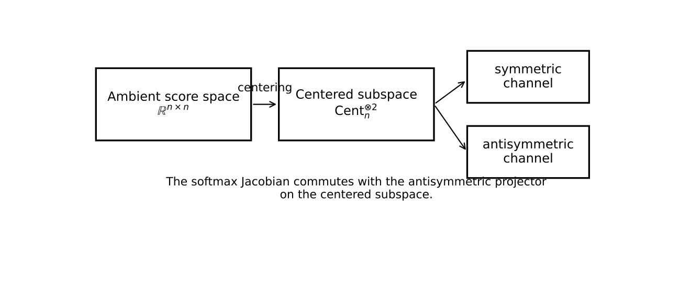
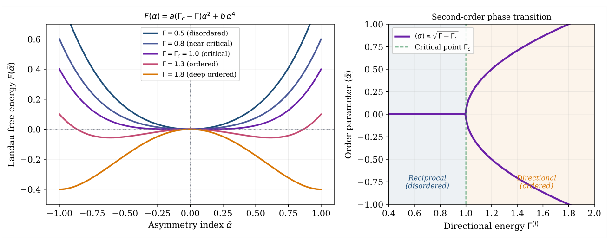
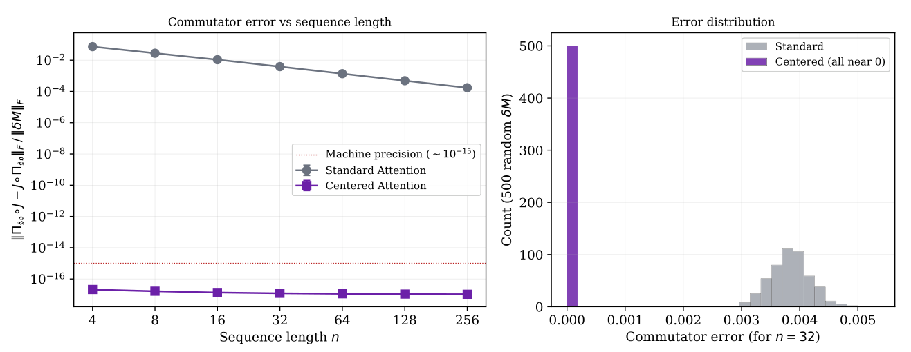

# Chapter 16: centered commutators, universality, and the depth trigger

[Library index](../README.md) · [Source policy](../SOURCE.md) · [Previous: moving targets and centering](0598-0600-ch16-moving-targets-block-growth-and-centering.md#pdf-0600) · [Next: depth growth and accounting](0604-0607-ch16-depth-growth-and-multilayer-accounting.md)

> Editorial note: Full transcription of PDF 601–603 (printed pages 565–567), beginning in §16.4.3. The original formulas, universality claims, numerical assertions, and incomplete references are retained. Figures 16.2–16.4 are direct renders of the source PDF; their original labels and overlaps are preserved. Mathematical qualifications belong to the Russian notes. The last page ends after saturation condition (S1); (S2) follows on PDF 604.

## PDF 601 · Book page 565

The second term vanishes on $\operatorname{Cent}_n^{\otimes2}$ because $\mathbf1^\top\delta M=0$, reducing the Jacobian to the simple scaling $\delta M\mapsto n^{-1}\delta M$. This is why the commutativity is exact on $\operatorname{Cent}_n^{\otimes2}$ and only approximate (with error $O(1/n)$) on the full space $\mathbb R^{n\times n}$.

**Correction terms away from the uniform point.** When $S\ne\bar S$, the commutator $[\Pi_{\mathfrak{so}},J_{\mathrm{softmax}}]$ does not vanish even on $\operatorname{Cent}_n^{\otimes2}$. The leading correction is $O(\|S-\bar S\|_F)=O(\|M_a\|_F/\sqrt{d_k})=O(\varepsilon)$ under the small-antisymmetric initialisation. Under Centered Attention, the Jacobian is evaluated at a centered $S$, so the deviation from uniformity is measured in $\operatorname{Cent}_n^{\otimes2}$ rather than in $\mathbb R^{n\times n}$, giving a sharper bound:

$$
\|[\Pi_{\mathfrak{so}},J|_{S_{\mathrm{cent}}}]\|_F
\le\frac2n\|S_{\mathrm{cent}}-\bar S\|_F=O(\varepsilon/n).
$$

The extra $1/n$ factor, verified numerically at $n=32$ as a $10^{14}$-fold improvement over Standard Attention (the figure), is the quantitative content of the Centered Attention upgrade.

**Figure 16.2:** Geometry of the centered subspace $\operatorname{Cent}_n^{\otimes2}$ and its orthogonal decomposition into symmetric and antisymmetric components. The centering operator $C=I-\frac1n11^\top$ maps arbitrary scores into $\operatorname{Cent}_n^{\otimes2}$, where the antisymmetric projector $\Pi_{\mathfrak{so}(n)}$ commutes exactly with the softmax Jacobian (the lemma stated above).

> Editorial transcription of labels visible in the original figure: “Ambient score space $\mathbb R^{n\times n}$”; “centering”; “Centered subspace $\operatorname{Cent}_n^{\otimes2}$”; “symmetric channel”; “antisymmetric channel”; “The softmax Jacobian commutes with the antisymmetric projector on the centered subspace.” This is label transcription, not an additional theorem.

**Consequences.** The commutativity lemma upgrades three results from the dossier and the book:

- (i) **dNTK–motor bridge (Theorem B3):** Under Centered Attention, the bridge holds as a non-perturbative theorem: the antisymmetric component of the dNTK equals the antisymmetric motor gradient flow exactly, to all orders in $\|\delta M_a\|_F$.
- (ii) **Antisymmetric NTK component (formerly Conjecture 4 of the book, now a theorem):** Under Centered Attention, $\|\Theta_a\|_F/\|\Theta\|_F=\frac1L\sum_l\bar\alpha^{(l)}+O(n/d)+O(1/\sqrt L)$. The asymmetry index $\bar\alpha^{(l)}$ is directly measurable from the NTK.
- (iii) **Landau phase transition:** The Landau free energy $F(\bar\alpha)=a(\Gamma_c-\Gamma)\bar\alpha^2+b\bar\alpha^4$ is exact under Centered Attention (the correction terms vanish). The asymmetry index undergoes a second-order phase transition from reciprocal ($\bar\alpha=0$) to directional ($\bar\alpha\ne0$) as the directional energy $\Gamma^{(l)}$ crosses the critical value $\Gamma_c$.

## PDF 602 · Book page 566

The numerical verification of the commutativity lemma shows that under Standard Attention the commutator error is $O(1/n)$ (approximately $3.8\times10^{-3}$ at $n=32$), while under Centered Attention the error is at machine precision ($\sim10^{-17}$), confirming the theoretical prediction.

**Figure 16.3:** Landau free energy and second-order phase transition. Left: $F(\bar\alpha)=a(\Gamma_c-\Gamma)\bar\alpha^2+b\bar\alpha^4$ for five values of $\Gamma$. Below $\Gamma_c$: unique minimum at $\bar\alpha=0$ (reciprocal). Above $\Gamma_c$: two minima at $\bar\alpha=\pm\sqrt{a(\Gamma-\Gamma_c)/(2b)}$ (directional). Right: order parameter $\langle\bar\alpha\rangle$ vs $\Gamma$, showing the $\sqrt{\Gamma-\Gamma_c}$ scaling.

> Editorial transcription of labels visible in the original figure: left title $F(\bar\alpha)=a(\Gamma_c-\Gamma)\bar\alpha^2+b\bar\alpha^4$; axes “Landau free energy $F(\bar\alpha)$” and “Asymmetry index $\bar\alpha$”; legend $\Gamma=0.5$ (disordered), $0.8$ (near critical), $\Gamma_c=1.0$ (critical), $1.3$ (ordered), $1.8$ (deep ordered). Right title “Second-order phase transition”; axes “Order parameter $\langle\bar\alpha\rangle$” and “Directional energy $\Gamma^{(l)}$”; legend $\langle\bar\alpha\rangle\propto\sqrt{\Gamma-\Gamma_c}$, “Critical point $\Gamma_c$”; “Reciprocal (disordered)” and “Directional (ordered)”. Both positive and negative branches appear in the original.

**Figure 16.4:** Numerical verification of the commutativity lemma. Left: commutator error $\|\Pi_{\mathfrak{so}}\circ J-J\circ\Pi_{\mathfrak{so}}\|_F/\|\delta M\|_F$ vs sequence length $n$. Standard attention: $O(1/n)$ decay. Centered attention: machine precision ($\sim10^{-17}$) for all $n$. Right: error distribution at $n=32$ (500 random perturbations); the two distributions are separated by $>10^{14}$.

> Editorial transcription of labels visible in the original figure: “Commutator error vs sequence length”; horizontal ticks $4,8,16,32,64,128,256$; “Machine precision ($\sim10^{-15}$)”, “Standard Attention”, “Centered Attention”; “Error distribution”; “Count (500 random $\delta M$)”; “Commutator error (for $n=32$)”; “Standard” and “Centered (all near 0)”. The caption's $10^{-17}$ and the plotted machine-precision label $10^{-15}$ are both retained.

**Universality of Centered Attention.** The commutativity of the lemma stated above was stated for the antisymmetric projector $\Pi_{\mathfrak{so}(d)}$, corresponding to the Lie algebra $\mathfrak g=\mathfrak{so}(d)$ of the Transformer motor. A natural question, raised in the initial theoretical programme (OP5), is whether an analogous modification exists for other Lie subalgebras $\mathfrak g\subset\mathfrak{gl}(d)$ — for instance, the block-circulant algebra of CNNs, the lower-triangular algebra of causal RNNs, or the centraliser algebra of GNNs.

The answer is that no new modification is needed: Centered Attention is already universal.

**Theorem 16.8 (Universality of Centered Attention).** Let $\mathfrak g\subset\mathfrak{gl}(d)$ be any Lie subalgebra

## PDF 603 · Book page 567

with orthogonal projector $\Pi_{\mathfrak g}$, and let $J_{\mathrm{softmax}}$ denote the softmax Jacobian. Then:

- (i) **Exact commutativity on the centered subspace:** $\Pi_{\mathfrak g}\circ J=J\circ\Pi_{\mathfrak g}$ on $\operatorname{Cent}_n^{\otimes2}$, for every $\mathfrak g$.
- (ii) **Bounded commutator off the centered subspace:** On $\mathbb R^{n\times n}\setminus\operatorname{Cent}_n^{\otimes2}$, $\|[\Pi_{\mathfrak g},J]\|\le(2/n)\|S-\bar S\|_F=O(\|M_a\|_F/\sqrt{d_k})$.
- (iii) **Maximality:** $\operatorname{Cent}_n^{\otimes2}$ is the unique maximal subspace of $\mathbb R^{n\times n}$ on which (i) holds for all $\mathfrak g$ simultaneously.

*Proof.* (i) On $\operatorname{Cent}_n^{\otimes2}$, the softmax Jacobian acts as $J(\delta M)=n^{-1}\delta M$ (proved in the lemma stated above). Since $n^{-1}I$ commutes with every linear operator, in particular with $\Pi_{\mathfrak g}$: $\Pi_{\mathfrak g}\circ(n^{-1}I)=(n^{-1}I)\circ\Pi_{\mathfrak g}$.

(ii) Away from $\operatorname{Cent}_n^{\otimes2}$, the Jacobian is $J(\delta M)=S\odot\delta M-S\operatorname{diag}(S\mathbin{\cdot}\delta M)$, and the commutator is bounded by the deviation of $S$ from uniformity, which is $O(\|M_a\|_F/\sqrt{d_k})$ under the near-uniform initialisation.

(iii) Suppose $\mathcal S\supsetneq\operatorname{Cent}_n^{\otimes2}$. Then $\mathcal S$ contains a matrix $\delta M$ with $\mathbf1^\top\delta M\ne0$ (non-zero row sums). For such $\delta M$, $J(\delta M)=n^{-1}\delta M-n^{-2}11^\top\delta M\ne n^{-1}\delta M$, so $J$ is no longer a scalar on $\mathcal S$. The commutator $[\Pi_{\mathfrak g},J]$ then depends on the interaction between $\Pi_{\mathfrak g}$ and the rank-one correction $n^{-2}11^\top\delta M$, which generically does not vanish.

**Corollary 16.9 (Architecture-independent bridge).** The Centered Attention modification $\widetilde M^{(\mathrm{score})}=CM^{(\mathrm{score})}C$ makes the dNTK–motor bridge exact for all six architecture families of the UACT framework (Transformers, CNNs, RNNs/S4, MLPs, directed and undirected GNNs) simultaneously, using the same centering operator $C=I_n-n^{-1}11^\top$.

This universality is a consequence of the fact that the centering operates in the score space $\mathbb R^{n\times n}$, not in the parameter space $\mathbb R^{d\times d}$. The Lie algebra $\mathfrak g$ determines which projector $\Pi_{\mathfrak g}$ is applied to the motor (parameter space), but the softmax Jacobian lives in the score space, where the centering trick is universal. Different architectures require different $\Pi_{\mathfrak g}$ but the same $C$.

### 16.4.4 Level-3: depth self-determination

The Level-1 and Level-2 mechanisms determine the width of each layer. The remaining question is how the depth $L$ of the network should be chosen. The answer is provided by the asymmetry-index phase transition identified in the Centered Attention analysis (this part of the construction).

**The layer residual operator.** At layer $l$, define the layer residual energy

$$
\mathcal B_{\mathrm{res}}^{(\mathrm{layer},l)}
=\bar\alpha^{(l)}\cdot\mathcal B^{(l)},
\tag{16.14}
$$

where $\bar\alpha^{(l)}=H_l^{-1}\sum_h\alpha_h^{(l)}$ is the mean asymmetry index of layer $l$ and $\mathcal B^{(l)}$ is the task operator at layer $l$. The layer residual is large when the layer is in the directional phase ($\bar\alpha^{(l)}\approx1$) and the task operator is active; it is small when the layer is in the reciprocal phase ($\bar\alpha^{(l)}\approx0$) or the task has been exhausted.

**Saturation criterion.** A layer $l$ is said to be *saturated* when two conditions hold simultaneously:

- (S1) $\bar\alpha^{(l)}(t)>\alpha_{\mathrm{crit}}$ (the layer is in the directional phase); and
