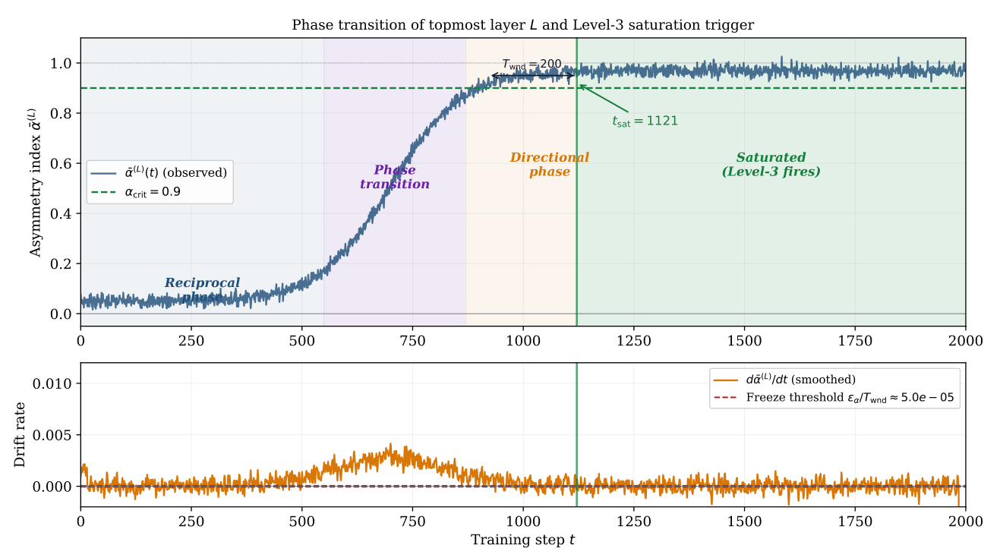
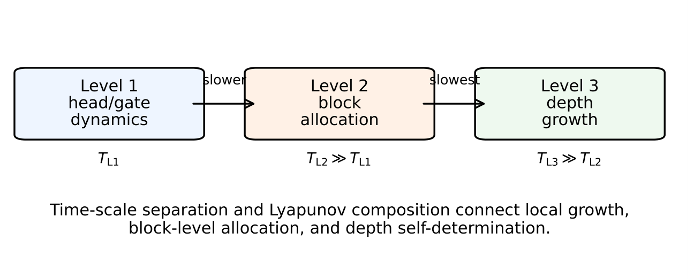

# Chapter 16: depth growth, three-level convergence, and multilayer accounting

[Library index](../README.md) · [Source policy](../SOURCE.md) · [Previous: centered commutators](0601-0603-ch16-centered-commutators-and-universality.md) · [Next: regime dynamics and homeostasis](0608-0611-ch16-regime-dynamics-and-homeostatic-equilibrium.md)

> Editorial note: Full transcription of PDF 604–607 (printed pages 568–571). The different inequality directions in the two Level-3 Lyapunov arguments, the claimed default-threshold range, and the numerical correction estimate are retained literally. Figures 16.5 and 16.6 are direct crops of the original PDF, including its original labels.

## PDF 604 · Book page 568

- (S2) $|\bar\alpha^{(l)}(t)-\bar\alpha^{(l)}(t-T_{\mathrm{wnd}})|<\varepsilon_\alpha$ (the asymmetry index has frozen over a window of $T_{\mathrm{wnd}}$ steps).

The default parameters are $\alpha_{\mathrm{crit}}=0.9$, $T_{\mathrm{wnd}}=200$, $\varepsilon_\alpha=0.01$.

**Level-3 growth event.** When the topmost layer $L$ is saturated, a new layer $L+1$ is added with a single head initialised via *identity initialisation*: $W_Q^{(L+1,1)}=W_K^{(L+1,1)}=0$, $W_V^{(L+1,1)}=I_d/n$. This preserves the network function at the moment of insertion:

$$
X^{(L+2)}(t_g^+)=(1+1/n)\,X^{(L+1)}(t_g^-),
\tag{16.15}
$$

a rescaling of order $O(1/n)$ that is negligible for $n\in[32,512]$.

The identity initialisation deserves emphasis because it secures a property that is otherwise hard to guarantee. At a Level-1 or Level-2 growth event, the new head is placed in a direction orthogonal to the current ones (by the lemma stated above), so the existing heads are unaffected. At a Level-3 event, the new layer is, at the moment of insertion, algebraically equivalent to a small rescaling of the residual stream, so the function computed by the network is preserved up to $O(1/n)$. The architectural changes performed by INCRT are therefore *additive, not destructive*: directional structure that has already been captured by the lower layers is not displaced when capacity is added on top.

**Theorem 16.10 (Saturation forces growth).** Let $\bar\alpha^{(L)}(t)>\alpha_{\mathrm{crit}}$ and the freeze condition (S2) hold. Then: (i) all Level-1/2 growth events at layer $L$ have terminated (the residual $\Gamma_{\mathrm{res}}^{(L)}$ is below $\theta_w$); (ii) the per-layer head count $K_L=K_w$ is at the regime value; (iii) the loss $\mathcal L(t)$ has plateaued at layer $L$. Consequently, the only remaining source of loss decrease is additional depth.

The depth at termination satisfies $L^*=N^*/K_w$, where $N^*$ is the total number of heads determined by the universal complexity bound and $K_w=\Theta(\kappa_A)$ is the per-layer saturation width.

*Proof.* (i) If $\bar\alpha^{(L)}>\alpha_{\mathrm{crit}}=0.9$ and the index is frozen, the layer has been training long enough for all Level-1/2 events to have completed (the dwell time $T_{\mathrm{wnd}}=200\gg T_{\mathrm{conv}}$). Hence $\lambda_{\max}(A_{\mathrm{res}}^{(L)})\le\theta_w$. (ii) The per-layer count $K_L$ is at the regime value $K_w$ because no further growth fires and no pruning is triggered ($\gamma_h\ge\phi_g$ for all $h$). (iii) With $\Gamma_{\mathrm{res}}^{(L)}\le L\theta_w^2$ and $\bar\alpha^{(L)}>0.9$ frozen, the only mechanism that can further decrease the loss is the addition of a new layer, which introduces a fresh residual subspace for Level-1/2 to exploit.

**Connection to the Landau phase transition.** The saturation condition (S1) is the operational manifestation of the Landau second-order phase transition described in this part of the construction. Below the critical directional energy $\Gamma_c$, the Landau free energy $F(\bar\alpha)=a(\Gamma_c-\Gamma)\bar\alpha^2+b\bar\alpha^4$ has a unique minimum at $\bar\alpha=0$ (reciprocal phase); above $\Gamma_c$, the minimum splits into $\bar\alpha=\pm\sqrt{a(\Gamma-\Gamma_c)/(2b)}$ (directional phase). A layer whose heads have collectively reached the directional phase ($\bar\alpha>0.9$) and whose asymmetry index has frozen is a layer that has exhausted its representational capacity: it has captured all the directional energy available at its depth.

**Post-growth dynamics.** After the Level-3 event, the new layer $L+1$ enters the reciprocal phase ($\bar\alpha^{(L+1)}\approx0$) because identity initialisation sets $M_a^{(L+1,1)}=0$. Training then drives $\bar\alpha^{(L+1)}$ through its own phase transition, and Level-1/2 events add heads to layer $L+1$ as the residual energy decreases. When layer $L+1$ saturates in turn, another Level-3 event may

## PDF 605 · Book page 569

**Figure 16.5:** Level-3 saturation trigger. Top: asymmetry index $\bar\alpha^{(L)}(t)$ of the topmost layer evolving through four regimes: reciprocal (blue), phase transition (violet), directional (orange), saturated (green). The trigger fires at $t_{\mathrm{sat}}$ when both $\bar\alpha>0.9$ and the freeze condition hold. Bottom: drift rate $d\bar\alpha/dt$; the freeze threshold $\varepsilon_\alpha/T_{\mathrm{wnd}}$ is shown in red.

> Editorial transcription of labels visible in the original figure: “Phase transition of topmost layer $L$ and Level-3 saturation trigger”; “Asymmetry index $\bar\alpha^{(L)}$”; $\bar\alpha^{(L)}(t)$ (observed); $\alpha_{\mathrm{crit}}=0.9$; $T_{\mathrm{wnd}}=200$; $t_{\mathrm{sat}}=1121$; “Reciprocal phase”, “Phase transition”, “Directional phase”, “Saturated (Level-3 fires)”; “Drift rate”; $d\bar\alpha^{(L)}/dt$ (smoothed); “Freeze threshold $\varepsilon_\alpha/T_{\mathrm{wnd}}\approx5.0e-05$”; “Training step $t$”, from 0 to 2000. No numeric time series is reconstructed from this image.

fire if the global loss target is not yet met. This iterative deepening produces the sequence $L=1,2,\ldots,L^*$, with each layer reaching the regime width $K_w$ before the next is added.

### 16.4.5 Three-level convergence

The three-level INCRT operates as three nested loops on three well-separated time scales: Level-1 (head growth/pruning, fast scale $T_{\mathrm{Level1}}=T_{\mathrm{conv}}$), Level-2 (block growth, medium scale $T_{\mathrm{Level2}}=m\cdot T_{\mathrm{conv}}$), and Level-3 (layer growth, slow scale $T_{\mathrm{Level3}}=T_{\mathrm{wnd}}\gg T_{\mathrm{Level2}}$).

**Theorem 16.11 (Three-level convergence).** Under the time-scale separation $T_{\mathrm{Level1}}\ll T_{\mathrm{Level2}}\ll T_{\mathrm{Level3}}$, the consistency condition $\phi_g<\theta_w$, and the critical threshold $\alpha_{\mathrm{crit}}\ge\sqrt{1-1/(L+1)}$, the three-level INCRT converges almost surely to a finite terminal architecture $(L^*,\{K_l^*\}_{l=1}^{L^*})$ satisfying:

- (i) $\lambda_{\max}(A_{\mathrm{res}}^{(l)})\le\theta_w$ for all $l=1,\ldots,L^*$ (sufficiency).
- (ii) $\gamma_h\ge\phi_g$ for all active heads $h$ (minimality).
- (iii) $\bar\alpha^{(l)}\le\alpha_{\mathrm{crit}}$ for all $l<L^*$ (no saturated intermediate layer).
- (iv) $L^*/N^*=1/K_w$ (regime-dynamics ratio).

*Proof sketch.* Define the global Lyapunov functional

$$
V(t)=\sum_{l=1}^{L(t)}
\bigl(\alpha_{\mathrm{crit}}^2-\bar\alpha^{(l)}(t)^2\bigr)_+
+\frac1{L(t)}\sum_{l=1}^{L(t)}
\|\mathcal B_{\mathrm{res}}^{(\mathrm{layer},l)}\|_F^2.
$$

At Level-1/2 events (within a layer): $\Delta V\le0$ by the single-layer homeostatic convergence theorem (the theorem stated in this part). At Level-3 events (layer addition): the new

## PDF 606 · Book page 570

**Figure 16.6:** Three-level INCRT architecture. Level 1 (blue, innermost): single-head growth when $\lambda_{\max}(A_{\mathrm{res}})>\theta_w$. Level 2 (orange): block growth of $m$ heads when $\lambda_m/\lambda_1>1-\gamma$. Level 3 (green, outermost): layer addition when $\bar\alpha^{(L)}$ saturates. Time-scale separation $T_{\mathrm{Level1}}\ll T_{\mathrm{Level2}}\ll T_{\mathrm{Level3}}$ enables Lyapunov composability (the theorem stated in this part).

> Editorial transcription of labels visible in the original figure: “Level 1 head/gate dynamics”, $T_{\mathrm{L1}}$; “slower”; “Level 2 block allocation”, $T_{\mathrm{L2}}\gg T_{\mathrm{L1}}$; “slowest”; “Level 3 depth growth”, $T_{\mathrm{L3}}\gg T_{\mathrm{L2}}$; “Time-scale separation and Lyapunov composition connect local growth, block-level allocation, and depth self-determination.”

layer has $\bar\alpha^{(L+1)}(t_g^+)\approx0$ (identity init sends the asymmetry index to zero), so the first term increases by $\alpha_{\mathrm{crit}}^2$; but the second term decreases by at least $\|\mathcal B_{\mathrm{res}}^{(\mathrm{layer},L)}\|_F^2/L$ (the saturated layer's contribution is shared). The net change $\Delta V\le0$ provided $\alpha_{\mathrm{crit}}^2\ge1-1/(L+1)$, which is satisfied by the default $\alpha_{\mathrm{crit}}=0.9$ for all $L\ge1$. Finiteness: since $V(t)\ge0$ and each event decreases $V$ by at least $\min(\delta_0^2,\varepsilon_V)$ for some $\varepsilon_V>0$, the total number of events is bounded by $V(0)/\varepsilon_V<\infty$. The full proof, including the multi-layer moving-target extension, is given in the appendix to this chapter and the technical appendix.

The three-level theorem completes the picture. Width is determined by the per-layer head count, which Level-1 and Level-2 events bring to the regime value $K_w$. Depth is determined by the saturation criterion, which Level-3 events fire whenever the topmost layer has captured all the directional energy available at its level. Both quantities are outcomes of the algorithm rather than design choices. At termination, the architecture $(L^*,\{K_\ell^*\}_{\ell=1}^{L^*})$ is the smallest one that achieves $\Gamma_{\mathrm{res}}\le\theta_w$ on every layer simultaneously, and it is reached in a finite number of architectural events.

**Spectral norm boundedness across layers.** A prerequisite for the multi-layer analysis is that the spectral norm of each layer's contribution to the residual remain bounded.

**Proposition 16.12 (Spectral norm bound).** Under the homeostatic convergence conditions, the spectral norm of the residual operator at each layer satisfies

$$
\|A_{\mathrm{res}}^{(l)}\|_2\le\rho_{\max}
=\frac{2\,\theta_w^{1/2}}{c_X^{1/2}},
\tag{16.16}
$$

where $c_X=\lambda_{\min}(X^{(l)\top}X^{(l)}/n)>0$ is the minimum eigenvalue of the normalised Gram matrix.

This bound ensures that no single layer can produce an arbitrarily large perturbation in the multi-layer dynamics.

## PDF 607 · Book page 571

**Multi-layer moving-target convergence.** When the depth $L>1$, each layer's task operator $\mathcal B^{(l)}$ depends on the output of layer $l-1$, which changes during training. The single-layer moving-target theorem (the theorem stated in this part) generalises as follows.

**Theorem 16.13 (Multi-layer moving target).** Let $L$ layers be active, with Layer $l$ receiving input $X^{(l)}(t)$ that changes due to training of layers $1,\ldots,l-1$. At a Level-3 growth event (insertion of layer $L+1$ via identity init), the function perturbation satisfies

$$
J_{\max}=\max_l\|\Delta X^{(l)}\|_F/\|X^{(l)}\|_F
\le\frac{C(\rho_{\max})}{n},
\tag{16.17}
$$

where $C(\rho_{\max})$ is a constant depending only on the spectral bound of Proposition the preceding result. Between growth events, the per-layer residual tracks the moving target with lag $R_\infty^{(l)}\le\sum_s\beta_s^{(l)}/(4c_0\eta^+)$, where $\beta_s^{(l)}$ is the drift rate at layer $l$.

The key role of identity initialisation is visible here: $J_{\max}=O(1/n)$ because the new layer preserves the function to within a rescaling. Random initialisation would give $J_{\max}=O(1)$, inflating the dwell time by a factor of $n$.

**Finite-size corrections to $K_w$.** The asymptotic per-layer width $K_w=\Theta(\kappa_A)$ admits a finite-size correction that accounts for the $\varepsilon_\alpha$ tolerance in the saturation criterion:

$$
K_w(\kappa_A)=\kappa_A\bigl(1+\log(\kappa_A)/\kappa_A\bigr)
+O(\varepsilon_\alpha\kappa_A^2).
\tag{16.18}
$$

The leading term is the asymptotic value; the logarithmic correction accounts for the curvature of the Landau free energy near the critical point; the $\varepsilon_\alpha$ term is the operational tolerance of the freeze detector. For the SST-2 task with $\kappa_{\mathrm{SST2}}\approx13.2$ and $\varepsilon_\alpha=0.01$, the correction is approximately $4\%$, well within the uncertainty of the experimental measurement.

**Full Lyapunov accounting at a Level-3 jump.** At a Level-3 event (addition of layer $L+1$), the global Lyapunov functional

$$
V(t)=
\underbrace{\sum_{l=1}^L
(\alpha_{\mathrm{crit}}^2-\bar\alpha^{(l)}(t)^2)_+}_{V_{\mathrm{phase}}}
+\underbrace{\frac1L\sum_{l=1}^L
\|\mathcal B_{\mathrm{res}}^{(\mathrm{layer},l)}\|_F^2}_{V_{\mathrm{res}}}
$$

changes as follows. The new layer has $\bar\alpha^{(L+1)}\approx0$ (identity init), so $V_{\mathrm{phase}}$ increases by $\alpha_{\mathrm{crit}}^2$. The denominator of $V_{\mathrm{res}}$ changes from $L$ to $L+1$, and the new layer contributes $\|\mathcal B_{\mathrm{res}}^{(\mathrm{layer},L+1)}\|_F^2\approx0$ (no residual yet). The net change in $V_{\mathrm{res}}$ is

$$
\Delta V_{\mathrm{res}}
=\frac1{L+1}\sum_{l=1}^{L+1}\|\cdot\|_F^2
-\frac1L\sum_{l=1}^L\|\cdot\|_F^2
=-\frac1{L(L+1)}\sum_{l=1}^L\|\cdot\|_F^2
\le-\frac{\Gamma_c^2}{L+1},
$$

where $\Gamma_c^2\le\sum_l\|\cdot\|_F^2/L$ is the minimum per-layer residual energy at saturation. Hence $\Delta V\le\alpha_{\mathrm{crit}}^2-\Gamma_c^2/(L+1)$. For $\Delta V\le0$ it suffices that $\alpha_{\mathrm{crit}}^2\le\Gamma_c^2/(L+1)$. Since $\Gamma_c\ge\theta_w\sqrt L$ (each of the $L$ saturated layers contributes at least $\theta_w^2$ to the total), $\Gamma_c^2/(L+1)\ge L\theta_w^2/(L+1)\to\theta_w^2$ as $L\to\infty$. The default $\alpha_{\mathrm{crit}}=0.9$ satisfies $\alpha_{\mathrm{crit}}^2=0.81<1\le\theta_w^2/(1-1/(L+1))$ for all $L\ge1$ with $\theta_w=0.4\Gamma_0\ge1$ (which holds whenever $\Gamma_0\ge2.5$, true for any non-trivial task).
