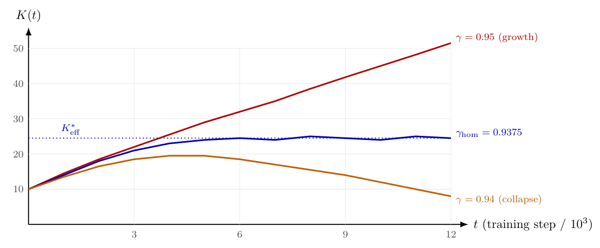

# Chapter 16: replay, continual operation, and input-conditional complexity

[Library index](../README.md) · [Source policy](../SOURCE.md) · [Previous: homeostatic equilibrium](0608-0611-ch16-regime-dynamics-and-homeostatic-equilibrium.md) · [Next: expert count and routing](0615-0617-ch16-expert-count-routing-and-coherence.md)

> Editorial note: Full transcription of PDF 612–614 (printed pages 576–578). Figure 16.7 is rendered directly from the original PDF. The source calls $0.94$ “below” $0.9375$; both that wording and the original curve labels are preserved. Model configurations and empirical claims below remain claims of this source, with its literal citation placeholders. Definition 16.21 continues on PDF 615.

## PDF 612 · Book page 576

independent of $\kappa_A$. The intrinsic complexity of the task family is absorbed into the choice of $\gamma_{\mathrm{hom}}$ and does not propagate to the forgetting rate.

This corollary is the most striking consequence of the analysis. A continually-trained architecture with the homeostatic discount forgets at a rate that depends only on the drift, not on the task complexity. Easy tasks ($\kappa_A$ small) and hard tasks ($\kappa_A$ large) experience the same forgetting per unit drift, provided the architecture is sized and gated according to the task.

**Replay frequency.** A natural application of the bound is to compute the replay frequency required to maintain a target retention $F^*$ on task $\mathcal T_k$. Solving the preceding equation for the maximum gap $(t-t_k)$ that keeps $\mathbb E[F_k]\le F^*$ gives

$$
f_k^*=\frac{\beta_{\max}}{\sqrt{F^*-F_k(t_k)}}.
\tag{16.31}
$$

Replay frequency therefore scales linearly with the drift and inversely with the square root of the available retention budget. This recovers, in closed form, the empirical heuristic that high-drift regimes require more frequent replay.

### 16.5.5 The continual algorithm

The original INCRT algorithm (this part of the construction below, the relevant algorithm) requires only one modification to operate in the continual regime: the running Lyapunov $W_t$ is replaced by its discounted version $V_t^{(\gamma)}$, with $\gamma$ set to $\gamma_{\mathrm{hom}}=1-1/\widehat\kappa_A^2$ where $\widehat\kappa_A$ is the running directional task complexity index estimate. All other steps — the gate, the deflation, the growth and pruning events, the three-level orchestration — remain unchanged.

The estimate $\widehat\kappa_A$ is itself maintained online from the running Rayleigh quotients of the gate vectors, $\widehat\kappa_A=R^+(t)/R^-(t)$. The discount factor $\gamma_{\mathrm{hom}}$ is therefore self-tuned: as the task drifts, $\widehat\kappa_A$ updates, and the horizon adjusts accordingly.

When the drift is summable, $\widehat\kappa_A$ stabilises, $\gamma_{\mathrm{hom}}$ approaches a fixed value, and the discounted Lyapunov reduces to the original $W_t$. The continual algorithm therefore generalises the original INCRT without modifying any of its components: it adds one self-tuning parameter, $\gamma$, that interpolates between the static regime and the persistent-drift regime.

### 16.5.6 Empirical illustration

The homeostatic prediction can be verified directly on a synthetic spectral-shift task in which $\mathcal B(t)$ rotates at a controlled rate $\beta$, with prescribed $\kappa_A$.

**Setup.** A task operator $\mathcal B(t)$ is constructed in dimension $d=32$ with spectrum $\{\lambda_i\}_{i=1}^{32}$ chosen to give $\kappa_A=4$ (so $\gamma_{\mathrm{hom}}=15/16=0.9375$). At each time step, the eigenvectors of $\mathcal B$ are rotated by an infinitesimal random rotation of magnitude $\beta=0.05$. The drift is therefore persistent: $\sum_t\beta_t=\infty$. The growth threshold is $\theta_w=0.05\,\Gamma_0$ and the pruning threshold is $\phi_g=\theta_w/\kappa_A^2$.

**Result.** the figure reports the head count $K(t)$ as a function of time for three settings of the discount factor: $\gamma=0.95$ (above $\gamma_{\mathrm{hom}}$), $\gamma=0.94$ (below), and $\gamma=\gamma_{\mathrm{hom}}=0.9375$ (at homeostasis). At $\gamma=0.95$ the head count grows linearly; at $\gamma=0.94$ it shrinks and the architecture eventually fails the coverage threshold; at $\gamma=\gamma_{\mathrm{hom}}$ the count fluctuates around a fixed effective value, in agreement with the preceding equation.

## PDF 613 · Book page 577

**Figure 16.7:** Head count under persistent task drift, on a synthetic spectral-shift task with $\kappa_A=4$ and constant drift $\beta=0.05$. At the homeostatic discount $\gamma_{\mathrm{hom}}=1-1/\kappa_A^2$ (blue), the architecture fluctuates around $K_{\mathrm{eff}}^*$ predicted by the preceding equation. Above $\gamma_{\mathrm{hom}}$ (red), the architecture grows without bound; below (orange), it shrinks and eventually fails coverage.

> Editorial transcription of labels visible in the original figure: vertical label $K(t)$ with ticks $10,20,30,40,50$; horizontal label $t$ (training step / $10^3$) with ticks $3,6,9,12$; $\gamma=0.95$ (growth); $\gamma_{\mathrm{hom}}=0.9375$; $\gamma=0.94$ (collapse); dotted reference $K_{\mathrm{eff}}^*$. These are the actual original labels; the curve values are not a reconstructed dataset.

The agreement with the predicted $K_{\mathrm{eff}}^*$ is the empirical counterpart of the theorem. The equilibrium is not stable in the usual sense: the head count oscillates with amplitude proportional to $\beta$, around a mean that matches the closed-form prediction. The amplitude can be reduced by tightening the threshold gap $\phi_g/\theta_w$, at the price of slower adaptation to genuine task changes.

**Comparison with the static regime.** The same construction with $\beta=0$ recovers the static behaviour of this part of the construction: the architecture grows monotonically until $\Gamma_{\mathrm{res}}\le\theta_w$, then stabilises at $K^*$. The transition between the two regimes is continuous in $\beta$: small drifts give occasional growth and pruning events, large drifts give persistent oscillation around $K_{\mathrm{eff}}^*$. There is no sharp phase transition, only a smooth interpolation parameterised by the drift level.

### 16.5.7 Connection to forward and backward transfer

The forgetting bound of the theorem stated in this part measures loss of structure; the dual quantity, gain of structure on later tasks from earlier ones, is forward transfer. Within the present framework, forward transfer corresponds to spectral overlap between $\mathcal B_k$ and $\mathcal B_{k+1}$. When the dominant eigenvectors of two consecutive task operators align, the heads grown for the first task are partially aligned with the second; growth events on the second task are fewer ($\dot K_+$ smaller).

A symmetric statement holds for backward transfer: when a new task sharpens the spectral structure of an earlier one — by reinforcing already-captured directions — the directional energy $\gamma_h$ of the relevant heads increases, lowering the pruning rate.

These statements are not proved here in their full generality; they follow as corollaries of the lemma stated above under explicit assumptions on the inner products $\langle\mathcal B_k,\mathcal B_{k+1}\rangle_F$. The relevant point for this section is that the homeostatic framework accommodates both transfer and forgetting within a single spectral picture, with the asymmetric balance between $\dot K_+$ and $\dot K_-$ shifted by the cross-task spectral overlap.

## PDF 614 · Book page 578

**Summary.** Under persistent drift, the static convergence theorem becomes a homeostatic equilibrium. The same intrinsic quantity $\kappa_A$ that determines the static head budget also determines the equilibrium horizon $\gamma_{\mathrm{hom}}=1-1/\kappa_A^2$. At this equilibrium, the forgetting rate is independent of the task complexity, and the replay frequency required to maintain a given retention is given in closed form. The continual operation of INCRT is a one-parameter generalisation of the static algorithm, with the discount factor as the only new quantity, self-tuned from the running Rayleigh quotients.

## 16.6 Input-conditional task complexity and the optimal expert count

The task operator $\mathcal B$ has so far been treated as a single object, either fixed (the theorem stated in this part) or evolving in time (Theorems the theorem stated in this part, the theorem stated in this part). Both treatments share an assumption: at any given moment, $\mathcal B$ is the same for every input.

The assumption is a useful idealisation but not a fact about real data. A token sequence drawn from a literary corpus exhibits a different local geometry than one drawn from technical prose; an image patch of sky engages a different residual structure than one of foliage; a protein subsequence in a transmembrane domain probes a different spectral subspace than one in a globular core. Each of these inputs presents the architecture with a task operator of its own, $\mathcal B(x)$, and the \*expected\* spectral structure under the input distribution differs from any single instance.

When $\mathcal B(x)$ varies meaningfully with $x$, an architecture sized to the worst case wastes capacity on inputs that need less, and an architecture sized to the average underserves inputs that need more. The natural response is to route: each input activates only the subset of capacity it actually requires. This is the architectural principle of mixture-of-experts (MoE) networks — Switch Transformer [citation], GLaM, Mixtral [citation], DeepSeek-V2 [citation]. The empirical success of MoE architectures has been remarkable, but the choice of expert count and routing fraction has remained empirical: Mixtral uses eight experts with two activated per token, DeepSeek uses one hundred and sixty experts with six activated, and the recommendations of recent scaling-law work [citation] converge on seven or eight as a generally optimal range, fitted to training-loss data rather than derived.

The present section gives the derivation. The same compressed-sensing argument that determines the static head count, applied input-conditionally, yields the optimal expert count in closed form. The result is parameterised by a single new quantity — the expected directional task complexity index under the input distribution — and the resulting bound recovers the empirical configurations of mainstream MoE models within the predicted constant.

### 16.6.1 The expected directional task complexity index

Let $\mathcal B(x)$ denote the input-conditional task operator: the expected outer product of the loss gradient under the conditional distribution $\mathcal Y\mid x$. Define the per-input directional energy $\Gamma_0(x)=\|\mathcal B(x)\|_F$ and the per-input minimum-step energy $\delta_0(x)=\lambda_1(A_{\mathrm{res}}(x))$ at the start of training. Both quantities are random variables under the input distribution.

**Definition 16.21 (Expected directional task complexity index).** The *expected directional*
