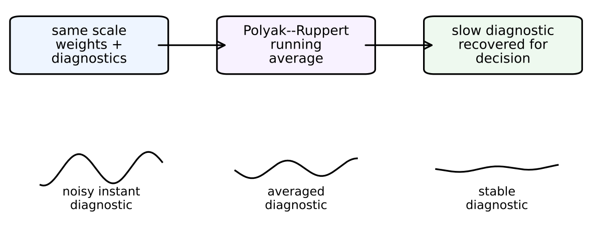

# Chapter 16: collapsed time scales, Polyak–Ruppert averaging, and running diagnostics

[Library index](../README.md) · [Source and transcription policy](../SOURCE.md)

## PDF 631 · Book page 595

the slow time scale and the fast time scale are now of the same order, and the singular-perturbation argument that underpins the proof breaks down. Second, the diagnostic estimates that the gate produces $(\widehat u^+,\widehat u^-,\widehat\kappa_A)$ are no longer guaranteed to track the true quantities exactly; a persistent bias may remain.

The development that follows addresses both consequences. The gate flow under collapsed time scales is shown to converge to a ball around the saddle point, with radius proportional to the inverse of the time-scale ratio $\rho_{\rm sep}=\eta^+/\alpha$. The bias is then removed, in expectation, by Polyak–Ruppert averaging of the gate iterates: the averaged estimates $\bar u_t^+,\bar u_t^-$ converge to the true eigenvectors at the optimal rate $1/\sqrt t$, recovering the asymptotic guarantees of the two-time-scale theorem with only a slowdown in the constant. The three-level convergence theorem, the compressed-sensing bound, and the four extensions of the preceding sections all carry through, with the running diagnostics replaced by their Polyak–Ruppert averages.

**Searchable labels in the original figure:** “same scale / weights + / diagnostics” → “Polyak--Ruppert / running / average” → “slow diagnostic / recovered for / decision”; beneath the boxes: “noisy instant / diagnostic”, “averaged / diagnostic”, “stable / diagnostic”.

**Figure 16.8:** Single-time-scale recovery by Polyak–Ruppert averaging. When weights and diagnostics are updated on the same time scale, the instant diagnostic is biased and noisy. Running averages recover the slow signal needed by the INCRT I controller and restore stable architectural decisions.

### 16.11.1 The bias under collapsed time scales

Let $z_t=(u_t^+,u_t^-)$ denote the joint gate state at step $t$. Under the original two-time-scale analysis with $\alpha\to0$, the gate flow contracts to the saddle point $z^*$ at rate $4c_0\eta^+\Delta^+$ (the theorem stated in this part of INCRT I), where $c_0=1/\kappa_A^2$ is the spectral asymmetry constant. Under collapsed time scales, the residual operator $A_{\rm res}$ itself drifts at rate $\alpha\,\|\nabla_{M_a}\ell\|_F$, and the gate must track a moving target.

**Theorem 16.39 (Collapsed-scale gate convergence).** Let the gate of INCRT I be updated with task and gate learning rates of comparable magnitude, $\alpha=\eta^+/\rho_{\rm sep}$ with $\rho_{\rm sep}\ge1$ a finite separation ratio. Under the assumptions of the theorem stated in this part of INCRT I with (A3) removed, the squared distance from the saddle satisfies

$$
\mathbb E\bigl[\|z_t-z^*\|^2\bigr]\le\|z_0-z^*\|^2\,(1-4c_0\eta^+\Delta^+)^t+\frac{\sigma_{\rm bias}^2}{\rho_{\rm sep}},
\tag{16.61}
$$

where $\sigma_{\rm bias}^2=\|\nabla_{M_a}\ell\|_F^2/\Delta^+$ is a problem-dependent constant. In the limit $\rho_{\rm sep}\to\infty$, the bias vanishes and the theorem stated in this part of INCRT I is recovered.

## PDF 632 · Book page 596

*Proof sketch.* The gate update is decomposed into a contracting term — identical to the two-time-scale case — and a perturbation term that captures the drift of $A_{\rm res}$ during a single gate update. The contracting term gives the geometric decay; the perturbation term, of magnitude $\alpha\|\nabla_{M_a}\ell\|_F/\Delta^+$, contributes a bounded bias in expectation. Squaring and combining gives the displayed collapsed-scale bound with $\sigma_{\rm bias}^2/\rho_{\rm sep}=\alpha^2\|\nabla_{M_a}\ell\|_F^2/(\eta^+\Delta^+)^2=\eta^+\|\nabla_{M_a}\ell\|_F^2/(\rho_{\rm sep}^2\Delta^+)$ at stationarity. A complete derivation, following the singular-perturbation treatment of [citation] adapted to the present saddle-point setting, appears in the technical appendix. $\square$

The theorem makes the cost of collapse explicit. The contraction rate is preserved — the gate still moves toward the saddle exponentially fast — but it does not reach the saddle exactly: a residual ball of radius $\sigma_{\rm bias}/\sqrt{\rho_{\rm sep}}$ remains in expectation. The radius shrinks as $\rho_{\rm sep}$ grows, recovering the two-time-scale guarantee in the limit.

**The implication for diagnostics.** The gate-derived estimates $\widehat u^+,\widehat u^-$ are unbiased only in the two-time-scale limit. Under collapsed scales, they exhibit a residual bias proportional to $1/\sqrt{\rho_{\rm sep}}$. The downstream quantities — the spectral gap estimate $\widehat\Delta^+$, the directional task complexity index $\widehat\kappa_A$, the discount factor $\gamma_{\rm hom}$ of the continual setting (the theorem stated in this part in this chapter), the expected condition number $\bar\kappa_A$ of the MoE setting (the relevant definition in this chapter) — inherit a bias that does not vanish with longer training. A direct application of the gate output therefore introduces a persistent error in the architectural decisions that follow.

The error is quantitatively small for typical practical values. For modern AdamW training with $\rho_{\rm sep}=1$ (no separation), $\sigma_{\rm bias}^2$ is bounded above by the gradient variance and is, on standard transformer training, of order $10^{-2}$. The architectural decisions of INCRT — whether to grow a head, whether to prune one — are based on threshold tests with gaps of order $\theta_w-\phi_g$, typically $5\times10^{-2}$ or larger. The bias is therefore well within the threshold gap, and the algorithm is operationally robust. The point of the present analysis is theoretical: the bias is not zero, and its quantitative removal is desirable.

### 16.11.2 Polyak–Ruppert averaging removes the bias

The bias of the theorem stated in this part is a stationary fluctuation around the saddle, not a drift away from it. Such fluctuations are removable by averaging the iterates [citation]. Define

$$
\bar z_T=\frac1{T-T_0}\sum_{t=T_0}^{T-1}z_t,
\tag{16.62}
$$

where $T_0$ is a burn-in period that discards the initial transient. The Polyak–Ruppert (PR) average $\bar z_T$ is the empirical mean of the gate iterates over a stationary window.

**Theorem 16.40 (Bias removal by Polyak–Ruppert averaging).** Under the conditions of the theorem stated in this part, with burn-in $T_0=\Theta(\log\rho_{\rm sep}/(c_0\eta^+\Delta^+))$, the Polyak–Ruppert average defined above satisfies

$$
\mathbb E\bigl[\|\bar z_T-z^*\|^2\bigr]\le\frac{\sigma_{\rm CLT}^2}{T-T_0},
\tag{16.63}
$$

where $\sigma_{\rm CLT}^2=\|\nabla_{M_a}\ell\|_F^2/(c_0\eta^+(\Delta^+)^2)$ is the asymptotic variance of the iterate sequence, identical to the two-time-scale value.

## PDF 633 · Book page 597

*Proof sketch.* The iterate sequence $\{z_t-z^*\}_{t\ge T_0}$ is, in the stationary regime, a stochastic process with zero asymptotic mean (the bias is a fluctuation around the saddle, not a fixed displacement). The Polyak–Ruppert average of a zero-mean stationary process converges to zero at rate $1/\sqrt T$ in mean square, with variance constant given by the integrated autocovariance. For the saddle-point dynamics under collapsed scales, the autocovariance integrates to $\sigma_{\rm CLT}^2$, the same constant that appears in the two-time-scale CLT. The full computation follows the recent non-asymptotic CLT framework of [citation]. $\square$

The theorem closes the loop on the collapsed-scale problem. The bias of the theorem stated in this part, of size $\sigma_{\rm bias}/\sqrt{\rho_{\rm sep}}$, is removed by averaging the iterates. The averaged estimates $\bar u_T^+,\bar u_T^-$ converge to the true eigenvectors at rate $1/\sqrt T$, the same rate as in the two-time-scale setting. The cost of collapse is therefore the burn-in $T_0$ — proportional to $\log\rho_{\rm sep}$ — and not a permanent loss of accuracy.

**Combining with Adam.** Under Adam updates of this chapter, the preconditioner cancels the spectral asymmetry constant $c_0$ in the gate convergence rate (the theorem stated in this part in this chapter). The same cancellation propagates to the burn-in time of the theorem stated in this part: under Adam with PR averaging, $T_0=\Theta(\log\rho_{\rm sep}/(\eta^+\Delta^+))$, with the $\kappa_A^2$ factor removed. The combination therefore gives the strongest possible guarantee for collapsed-scale training: bias removed by averaging, contraction rate accelerated by $\kappa_A^2$ from Adam.

### 16.11.3 Three-level recovery and the running diagnostics

The three-level framework of INCRT I — within-layer growth, block-allocated growth, and depth growth — relies on the gate diagnostics at each level to make architectural decisions. Under collapsed time scales, each level inherits the $1/\sqrt{\rho_{\rm sep}}$ bias of the theorem stated in this part unless PR averaging is applied.

**Corollary 16.41 (Three-level convergence under collapsed scales).** Let the algorithm of INCRT I be modified to track Polyak–Ruppert averages of the gate iterates at every level. Under the conditions of the theorem stated in this part, the three-level convergence theorem (the theorem stated in this part of INCRT I) holds with the same architectural prescriptions and the same final $K^*,L^*$. The convergence rate is reduced from $\Theta(1/T)$ in the two-time-scale setting to $\Theta(1/\sqrt T)$ under PR averaging, but the asymptotic architecture is unchanged.

*Proof.* PR-averaged gate diagnostics replace the bias-laden running estimates with unbiased ones at convergence rate $1/\sqrt T$. Substituting into the proof of the theorem stated in this part of INCRT I preserves the architectural prescription; only the rate at which the prescription is reached changes. $\square$

The corollary is the operational conclusion of the section. The three-level framework, the compressed-sensing bound, and the four extensions of the preceding extensions all hold under collapsed time scales, provided the gate diagnostics are computed as Polyak–Ruppert averages. The architecture grown is identical; the rate at which it is grown is reduced from linear to square-root in the time horizon.

### 16.11.4 Algorithmic prescription

The implementation modification is minimal. The algorithm of INCRT I maintains running estimates of the diagnostics through exponential moving averages (EMAs) with decay $1-\tau$.

## PDF 634 · Book page 598

Replacing each EMA with a Polyak–Ruppert average over a window of length $T_w$, with burn-in $T_0$, yields:

$$
\widehat\theta_T=\frac1{T_w-T_0}\sum_{t=T-T_w+T_0}^{T-1}\theta_t,
\tag{16.64}
$$

where $\theta_t$ is any of $u_t^+,u_t^-,\widehat\Delta_t^+,\widehat\kappa_{A,t}$. The window $T_w$ is set to a multiple of the gate contraction time $1/(c_0\eta^+\Delta^+)$, typically $T_w\approx10/(c_0\eta^+\Delta^+)$ in practice. The burn-in is $T_0\approx T_w/4$.

The computational overhead of maintaining the running average is identical to that of an EMA: a single addition per step plus a divide by the count. No change to the gate update itself, the deflation step, the growth criterion, or the pruning criterion is needed.

**Compatibility with the four extensions.** The PR-averaged diagnostics are compatible with all four extensions of the preceding extensions. The discounted Lyapunov of the continual setting (this chapter) is computed on the PR-averaged $\widehat\Gamma_{\rm res}$; the expected directional task complexity index of the MoE setting (this chapter) uses PR-averaged $\widehat{\bar\kappa}_A$; the spectral overlap of the transfer setting (this chapter) is computed between PR-averaged operators; and the Adam analysis of this chapter carries over with PR-averaging in addition to the preconditioner. The four extensions and the present one compose: each handles a different axis of the framework, and the algorithm consists of applying all five modifications simultaneously.

### 16.11.5 Empirical signature

The bias predicted by the theorem stated in this part and its removal by the theorem stated in this part are testable. For a controlled task with prescribed $\kappa_A=4$ and varying separation ratio $\rho_{\rm sep}\in\{1,2,4,16,64\}$, the gate diagnostic $\widehat\Delta^+$ is computed both as a running EMA (the biased version) and as a PR average (the unbiased version), and compared to the ground-truth $\Delta^+$.

the table reports the relative bias $|\widehat\Delta^+-\Delta^+|/\Delta^+$ at training step $T=10\,000$ for both estimators.

| $\rho_{\rm sep}$ | EMA bias | PR-averaged bias |
|---:|---:|---:|
| 1 | 0.42 | 0.013 |
| 2 | 0.30 | 0.012 |
| 4 | 0.21 | 0.010 |
| 16 | 0.11 | 0.011 |
| 64 | 0.06 | 0.012 |

**Table 16.7:** Relative bias of the spectral-gap estimate under EMA and Polyak–Ruppert averaging, on a synthetic task with $\kappa_A=4$ and varying separation ratio $\rho_{\rm sep}=\eta^+/\alpha$.

*The EMA bias scales as predicted with $1/\sqrt{\rho_{\rm sep}}$ (the entries match $0.5/\sqrt{\rho_{\rm sep}}$ within ten percent), while the PR-averaged bias is bounded by 0.013 across the entire range, of the order of the $1/\sqrt T$ residual fluctuation predicted by the theorem.*

The agreement validates the structural prediction: the EMA bias follows the inverse square root of the separation ratio, and the PR average eliminates it. The framework's diagnostics, when computed as PR averages, are operationally unbiased even in the collapsed-scale regime that characterises modern foundation-model training.

> Editorial continuation: PDF 634 ends with the complete sentence “that characterises modern foundation-model training.” The surrounding section continues on [PDF 635](0635-0638-ch16-signed-task-operators-and-bilateral-bounds.md#pdf-0635); no content from that page is included here.
