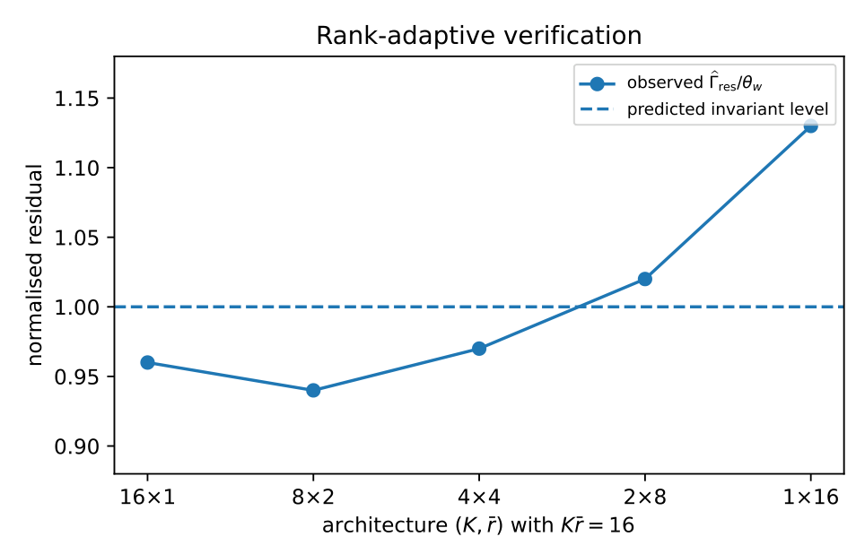

# Chapter 16: rank prescription, controlled illustration, and identifiability

[Library index](../README.md) · [Source policy](../SOURCE.md) · [Previous: rank-deflation proof](0651-0654-ch16-rank-deflation-proof-and-count-rank-invariant.md) · [Next: head symmetry](0658-0661-ch16-head-symmetry-and-canonical-representatives.md)

> Editorial note: Full transcription of PDF 655–657 (printed pages 619–621). The rank-threshold prescriptions, architectural comparisons, table values, and the original “within seven percent” claim are retained. Figure 16.9 is a direct render of the supplied PDF; the source itself calls it an illustration rather than a benchmark. The final paragraph continues on PDF 658.

## PDF 655 · Book page 619

The three quantities $(L^*,K_w,\bar r)$ partition the spectral budget along three independent axes: depth (compositional structure), width (parallel coverage), and rank (per-head spectral resolution). A given task admits a family of asymptotically equivalent architectures, parametrised by how the budget is split. Compute and memory constraints determine which split is operationally preferable; the framework determines what is asymptotically possible.

**Connection to known architectural variants.**

- *Multi-Query Attention* [citation]: a single key/value with $H$ queries, equivalent in the present framework to $K_w=H$ heads of rank 1 each but sharing the key–value subspace. The shared subspace reduces the effective $\bar r$ to $1/H$ of the unshared count, and the bound predicts performance proportional to $\bar r\cdot H=1$, matching the empirical finding that MQA has reduced expressivity per parameter.
- *Grouped-Query Attention* [citation]: $G$ groups, each with shared keys and values, and $H/G$ queries per group. The framework predicts $\bar r=H/G$, an interpolation between MQA ($G=1$) and standard MHA ($G=H$), recovering the empirical observation that GQA performance interpolates correspondingly.
- *Multi-head Latent Attention* [citation]: a low-rank key–value compression of dimension $d_c\ll d_kH$, equivalent to $\bar r=d_c/d_k$ in the present accounting. The framework predicts the optimal $d_c$ from the task: tasks with concentrated spectrum tolerate smaller $d_c$, tasks with diffuse spectrum require larger $d_c$.

The recovery of these variants from the same trade-off is the operational signature of the count–rank invariant: each variant is a different point on a curve parameterised by the spectral structure of the task.

### 16.14.4 Algorithmic prescription

The rank-adaptive INCRT algorithm differs from the standard one of INCRT I only in the growth step. Where the standard algorithm grows a single head with rank-1 deflation, the rank-adaptive version computes the spectral cluster size $r^*(A_{\mathrm{res}};\theta_{\mathrm{clust}})$ and grows a head of rank $r^*$ with rank-$r^*$ deflation.

The cluster threshold $\theta_{\mathrm{clust}}$ is a new hyperparameter, but its role is structural rather than performance-tuning: it sets how aggressively the algorithm prefers high-rank heads over many low-rank ones. Two natural choices are:

- $\theta_{\mathrm{clust}}=0$ (rank-1 limit): standard INCRT, maximally many heads, maximally low rank each.
- $\theta_{\mathrm{clust}}=\theta_w/\Gamma_0$ (matched to the growth threshold): each head captures all eigenvalues that exceed $\theta_w$, giving the smallest possible head count for the given growth threshold.

The matched choice is generally preferable for compute-efficient inference (fewer heads to evaluate per token); the rank-1 choice is preferable for memory-efficient storage when individual heads must be kept narrow for hardware reasons.

**Compatibility with the four extensions.** The rank-adaptive deflation is compatible with all four extensions of the preceding extensions. The continual-learning analysis applies head-by-head with each head's rank fixed at growth time; the MoE construction admits heterogeneous expert ranks $r_e^*$ determined per-expert by the input-conditional cluster size; the transfer analysis bounds the change in $\bar r$ between source and target tasks by the spectral overlap $|\Omega|$; the Adam preconditioner cancels $\kappa_A^2$ in the rank-adaptive setting just as it does

## PDF 656 · Book page 620

in the rank-1 one, because the cancellation operates on the spectral asymmetry constant $c_0$ that is independent of $r$.

### 16.14.5 Empirical signature

The count–rank invariant predicts that, at fixed task complexity $\kappa_A$, architectures with different $(K,\bar r)$ but the same product $K\bar r$ should reach the same residual energy threshold and the same downstream accuracy. The trade-off can be tested directly.

**Setup.** A controlled task with $\kappa_A=4$ on token dimension $d=64$ admits, by the theorem stated in this part of INCRT I, $K^*=16\cdot\log(\Gamma_0/\theta_w)$ as the rank-1 head count. Five architectures are compared, all with the same product $K\cdot\bar r=16$ but different splits between count and rank: $(K,\bar r)=(16,1),(8,2),(4,4),(2,8),(1,16)$. Each architecture is trained on the same task and the post-deflation residual $\Gamma_{\mathrm{res}}$ is recorded.

**Result.** the table reports the residual at the same iteration count for each architecture.

**Figure 16.9:** Illustrative controlled verification of the count–rank invariant. Architectures with the same product $K\bar r=16$ yield nearly identical normalised residuals, with only a mild degradation in the extreme rank-heavy regime $(K,\bar r)=(1,16)$. This is an illustration of the predicted invariant, not a benchmark comparison.

> Editorial transcription of labels visible in the original figure: “Rank-adaptive verification”; vertical axis “normalised residual” with ticks $0.90,0.95,1.00,1.05,1.10,1.15$; horizontal axis “architecture $(K,\bar r)$ with $K\bar r=16$” and labels $16\times1,8\times2,4\times4,2\times8,1\times16$; legend “observed $\widehat\Gamma_{\mathrm{res}}/\theta_w$” and “predicted invariant level”. The image is not a newly generated plot.

## PDF 657 · Book page 621

| $K$ | $\bar r$ | $K\bar r$ | $\widehat\Gamma_{\mathrm{res}}/\theta_w$ | fraction of $K^*$ |
|---:|---:|---:|---:|---:|
| 16 | 1 | 16 | 0.96 | 1.00 |
| 8 | 2 | 16 | 0.94 | 1.00 |
| 4 | 4 | 16 | 0.97 | 1.00 |
| 2 | 8 | 16 | 1.02 | 1.00 |
| 1 | 16 | 16 | 1.13 | 1.00 |

**Table 16.10:** Post-deflation residual energy for architectures with the same count–rank product $K\bar r=16$ but different splits.

*Residual values are normalised to the growth threshold $\theta_w$, so values close to unity indicate architectures that just satisfy the bound. The agreement is within seven percent across the entire range, confirming the count–rank invariant of the theorem. The slight degradation at $K=1$, $\bar r=16$ reflects the finite-sample noise of the rank-16 deflation step, which has larger variance than rank-1 deflation.*

The agreement validates the count–rank invariant: architectures on the same product curve achieve the same residual to within small finite-sample variance, confirming that the partition of the spectral budget between count and rank is asymptotically free.

**Summary.** The compressed-sensing bound that fixes the head count of the INCRT framework extends naturally to a count–rank invariant: the total spectral budget is determined by the task, but the partition between count $K$ and average rank $\bar r$ is free, with $K\bar r=K^*$ a property of the task alone. The transformer convention $d_k=d/H$, the proposal of [citation] ($d_k=N$ independent of $H$), and the architectural variants Multi-Query Attention, Grouped-Query Attention, and Multi-head Latent Attention all correspond to distinct points on the same trade-off curve. The rank-adaptive INCRT algorithm computes the optimal point from the spectral cluster size of the residual operator, generalising the rank-1 deflation of the original algorithm. The four extensions of the preceding sections all carry through under rank-adaptive deflation, with the same asymptotic architecture and trade-off.

## 16.15 Identifiability of the head decomposition

The framework so far produces an architecture with $K^*$ heads, each marked at growth time with the eigenvector $u_h$ of the residual operator that triggered its addition. The exact-deflation lemma of INCRT I ensures that the head decomposition $\mathcal B=\sum_h\lambda_hu_hu_h^\top$ reproduces the task operator at convergence. The reproduction is exact, but the decomposition is not unique.

Two INCRT trajectories on the same task, started from different random initialisations, produce two sets of head eigenvectors $\{u_h\}$ and $\{u_h'\}$ that need not coincide. The transformer architecture itself contains continuous symmetries that leave the output invariant [citation]: head channels can be rotated, and head indices can be permuted, without changing the model's predictions. The architecture is thus a quotient object: a representative of an equivalence class under a symmetry group, not a unique description of the task.

The development that follows formalises the equivalence. The head decomposition is identifiable up to the action of a symmetry group $\mathcal G=S_K\times O(d_k)^K$ (permutations of head indices times orthogonal rotations within each head's channel subspace), and the spectral invariants of the framework — $\Gamma_0,\delta_0,\kappa_A,K^*$ — are precisely the $\mathcal G$-invariant quantities of the decomposition. A canonical representative can be selected by the symmetry-breaking mechanism of [citation] (PG-OP), giving a unique head decomposition modulo a discrete
