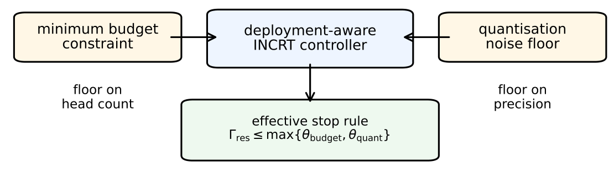

# Chapter 16: minimum-budget dual and the quantisation model

[Library index](../README.md) · [Source policy](../SOURCE.md) · [Previous: canonical representatives](0658-0661-ch16-head-symmetry-and-canonical-representatives.md) · [Next: noise floor and deployment bounds](0665-0667-ch16-noise-floor-and-joint-deployment-bounds.md)

> Editorial note: Full transcription of PDF 662–664 (printed pages 626–628). Theorem 16.69 explicitly assumes an exact matching count law for all thresholds; this assumption is retained. Figure 16.10 is a direct crop, including its original “floor on head count” label. Assumptions (Q1)–(Q3), method claims, and the chain-rule lemma are transcribed without changing their scope. The proof of Lemma 16.71 begins on PDF 665.

## PDF 662 · Book page 626

admits two consistent levels of description: the equivalence class $[\{u_h\}]_{\mathcal G}$, in which the spectral invariants live; and the canonical representative, in which interpretability and reproducibility claims can be anchored. The ten extensions of the preceding sections are all formulated in terms of $\mathcal G$-invariant quantities and are therefore independent of the representative chosen.

## 16.16 Deployment constraints: minimum budget and quantisation

The framework so far has solved the primal problem: given a residual energy threshold $\theta_w$, find the minimum head count $K^*$ that achieves it (the theorem stated in this part of INCRT I). The threshold is interpreted as a target precision; the head count is the architectural cost of reaching it.

Two operational regimes invert this question. The first arises in edge deployment, where the parameter budget is fixed by hardware constraints (memory, latency, power) and the practitioner asks: *given $K\le K_{\max}$ heads, what is the smallest $\theta_w$ achievable?* The second arises in low-precision inference, where weights are quantised to a fixed bit-width $b$ and the precision is bounded below by the quantisation noise floor: *given $b$-bit representations, what is the smallest $\theta_w$ achievable?*

The two regimes are dual to the framework's primal problem in exactly the same sense: each replaces the precision target by an operational constraint and asks for the resulting precision. Mathematically, the two formulations coincide under a single KKT analysis with $\theta_w$ in the role of the Lagrange variable. The development that follows treats them together.

The conclusion is a closed-form expression for the minimum $\theta_w$ achievable under each constraint, plus a composition rule when both constraints are present. The dual problem is solved by inverting the primal CS bound: $\theta_w^*(K_{\max})=\Gamma_0\exp(-K_{\max}/\kappa_A^2)$. The quantisation problem is solved by adding a noise floor $\sigma_q^2=2^{-2b}\Gamma_0^2$ to the residual: the achievable $\theta_w$ saturates at $\sigma_q$, regardless of architectural budget. The composition is the maximum of the two: each constraint binds independently, and the binding regime is determined by which is tighter.

### 16.16.1 The minimum-budget dual

The compressed-sensing bound of the theorem stated in this part of INCRT I expresses the head count as a function of the precision target,

$$
K^*(\theta_w)=\kappa_A^2\log\frac{\Gamma_0}{\theta_w},
\tag{16.99}
$$

where $\kappa_A$ is the directional task complexity index. The minimum-budget problem is the dual question: given an external budget $K_{\max}$, what is the smallest threshold that the architecture can guarantee?

**Theorem 16.69 (Minimum-budget INCRT).** Suppose the assumptions of the INCRT I compressed-sensing bound hold: $\mathcal B$ is symmetric positive semi-definite with directional energy $\Gamma_0=\|\mathcal B\|_F$, and the directional task complexity index is $\kappa_A=\Gamma_0/\delta_0$. Suppose furthermore that the matching lower bound is tight, so that the optimal head count satisfies

$$
K^*(\theta_w)=\kappa_A^2\log\frac{\Gamma_0}{\theta_w}
\qquad\text{for all }\theta_w\in(0,\Gamma_0].
\tag{16.100}
$$

## PDF 663 · Book page 627

**Figure 16.10:** Deployment-aware stopping rule. Minimum-budget constraints impose a floor on the admissible head count, while quantisation imposes a floor on the achievable residual precision. The effective deployment criterion stops growth when the residual demand falls below the maximum of the two induced thresholds.

> Editorial transcription of labels visible in the original figure: “minimum budget constraint”; “floor on head count”; “deployment-aware INCRT controller”; “quantisation noise floor”; “floor on precision”; “effective stop rule $\Gamma_{\mathrm{res}}\le\max\{\theta_{\mathrm{budget}},\theta_{\mathrm{quant}}\}$”. The original floor/ceiling wording is retained.

Then, for every architecture budget $K_{\max}\in\mathbb N$, the smallest residual threshold achievable under $K\le K_{\max}$ is

$$
\theta_w^*(K_{\max})
=\Gamma_0\exp\left(-\frac{K_{\max}}{\kappa_A^2}\right),
\tag{16.101}
$$

and it is achieved by an INCRT trajectory that terminates at exactly $K=K_{\max}$ heads.

*Proof.* The proof has three parts: forward feasibility, converse infeasibility, and the closed-form expression.

**Forward feasibility.** Set

$$
\theta_w:=\Gamma_0\exp(-K_{\max}/\kappa_A^2).
$$

Then $\theta_w\in(0,\Gamma_0]$. Applying (16.100) gives

$$
K^*(\theta_w)
=\kappa_A^2\log\frac{\Gamma_0}{\Gamma_0\exp(-K_{\max}/\kappa_A^2)}
=K_{\max}.
\tag{16.102}
$$

Thus the INCRT I growth trajectory with target threshold $\theta_w$ grows exactly $K_{\max}$ heads and satisfies the budget with equality.

**Converse infeasibility.** Suppose that an architecture with $K\le K_{\max}$ heads achieved a threshold $\theta_w'<\theta_w^*(K_{\max})$. The matching lower bound, in contrapositive form, gives

$$
K\ge K^*(\theta_w')=\kappa_A^2\log\frac{\Gamma_0}{\theta_w'}.
\tag{16.103}
$$

Since $\theta_w'<\Gamma_0\exp(-K_{\max}/\kappa_A^2)$, strict monotonicity of the logarithm gives

$$
\kappa_A^2\log\frac{\Gamma_0}{\theta_w'}>K_{\max},
$$

contradicting $K\le K_{\max}$.

**Closed form.** Forward feasibility gives the upper bound and converse infeasibility gives the lower bound, so (16.101) follows. $\square$

## PDF 664 · Book page 628

**Remark 16.70 (KKT interpretation).** The minimum-threshold problem $\min_{\theta_w}\theta_w$ subject to $K^*(\theta_w)\le K_{\max}$ has Lagrangian

$$
\mathcal L(\theta_w,\mu)
=\theta_w+\mu\bigl(\kappa_A^2\log(\Gamma_0/\theta_w)-K_{\max}\bigr),
\qquad\mu\ge0.
\tag{16.104}
$$

Stationarity yields $\mu^*=\theta_w^*/\kappa_A^2$, and complementary slackness activates the budget constraint. The shadow price therefore decays exponentially with the existing head count, matching the diminishing returns observed in pruning and over-provisioning regimes.

### 16.16.2 The quantisation noise floor

The framework assumes infinite-precision arithmetic. In deployment, weights are quantised: the matrices that define the heads are stored with $b$-bit precision, and arithmetic is performed with the quantised representations. Quantisation introduces a perturbation to the task operator that additional heads cannot remove.

Let $\phi=\{W^{(\ell)}\}_\ell$ denote all weight tensors defining the attention heads, gates, and residual maps, and let $Q_b(\phi)$ be the result of applying $b$-bit uniform quantisation to each tensor. For a tensor $W\in\mathbb R^{m\times n}$ with range parameter $R>0$, the quantisation step is $\Delta=2R/2^b$, and the quantisation error is

$$
\Delta W:=W-Q_b(W),\qquad
(\Delta W)_{ij}\in[-\Delta/2,\Delta/2].
\tag{16.105}
$$

**Standing assumptions.**

**(Q1) Per-tensor calibration.** For each $\ell$, the quantisation range $R^{(\ell)}$ is the maximum absolute entry of $W^{(\ell)}$, with step $\Delta^{(\ell)}=2R^{(\ell)}/2^b$. This is the standard per-tensor scaling used in GPTQ, AWQ, and SmoothQuant.

**(Q2) White-noise hypothesis.** The quantisation errors are treated as independent zero-mean uniform random variables on $[-\Delta^{(\ell)}/2,\Delta^{(\ell)}/2]$, with variance $(\Delta^{(\ell)})^2/12$. This is exact under subtractive uniform dither and is the usual high-resolution approximation for $b\ge4$.

**(Q3) Architecture-dependent gain.** The first-order chain rule propagating weight perturbations to the task operator has a finite non-vanishing gain $\beta^*\in(0,1]$:

$$
\mathbb E[\|\Delta\mathcal B\|_F^2]
\ge(\beta^*)^2\frac{\Gamma_0^2}{3\cdot4^b},
\tag{16.106}
$$

where $\Delta\mathcal B:=\mathcal B(\phi)-\mathcal B(Q_b(\phi))$.

Assumption (Q3) is structural: it asserts that the chain rule from weights to task operator does not collapse the quantisation perturbation. The next lemma gives the explicit first-order form of this gain.

**Lemma 16.71 (Chain-rule gain to first order).** Let the loss function be twice continuously differentiable in the parameters with bounded Hessian on the support of the data. Under (Q1)–(Q2),

$$
\mathbb E[\|\Delta\mathcal B\|_F^2]
=\frac1{3\cdot4^b}\sum_\ell
(R^{(\ell)})^2\|J^{(\ell)}\|_{\mathrm{HS}}^2
\bigl(1+O(2^{-b})\bigr),
\tag{16.107}
$$

where $J^{(\ell)}=\partial\mathcal B/\partial W^{(\ell)}$ is viewed as a linear tensor and $\|\cdot\|_{\mathrm{HS}}$ denotes its Hilbert–Schmidt norm.
