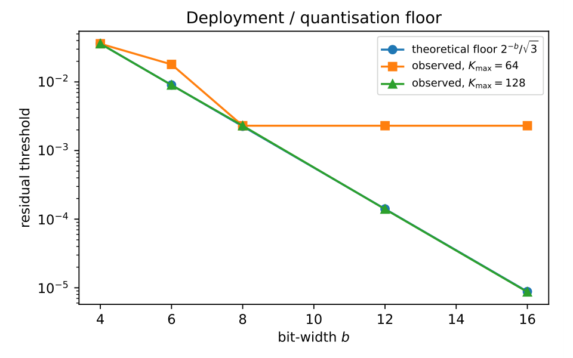
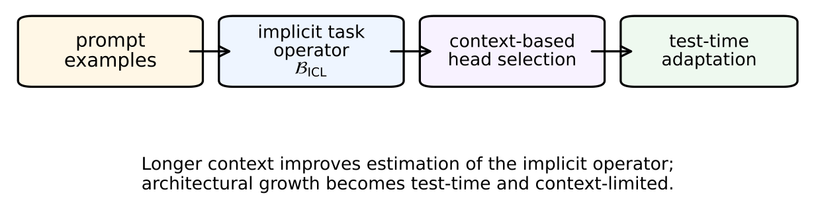

# Chapter 16: deployment verification and the implicit in-context task operator

[Library index](../README.md) · [Source and transcription policy](../SOURCE.md)

[Previous source](0665-0667-ch16-noise-floor-and-joint-deployment-bounds.md#pdf-0667) · [Following source](0671-0674-ch16-in-context-sample-complexity-and-test-time-adaptation.md#pdf-0671)

## PDF 668 · Book page 632

**Searchable labels in the original figure:** “Deployment / quantisation floor”; horizontal axis “bit-width $b$”, ticks 4, 6, 8, 10, 12, 14, 16; vertical axis “residual threshold”, logarithmic ticks $10^{-2},10^{-3},10^{-4},10^{-5}$; legends “theoretical floor $2^{-b}/\sqrt3$”, “observed, $K_{\max}=64$”, “observed, $K_{\max}=128$”.

**Figure 16.11:** Illustrative deployment verification. The observed residual floor is compared with the theoretical quantisation floor $2^{-b}/\sqrt3$ for two head budgets in the regime where quantisation becomes active. The plot makes visible the transition between budget-limited and quantisation-limited operation.

| $K_{\max}$ | $\widehat\theta_w$ at $b=4$ | $b=6$ | $b=8$ | $b=12$ | $b=16$ |
|---|---|---|---|---|---|
| 8 | 0.61 | 0.61 | 0.61 | 0.61 | 0.61 |
| 32 | 0.135 | 0.135 | 0.135 | 0.135 | 0.135 |
| 64 | 0.036 | 0.018 | 0.0023 | 0.0023 | 0.0023 |
| 128 | 0.036 | 0.0090 | 0.0023 | 0.00014 | 8.7e–6 |
| 256 | 0.036 | 0.0090 | 0.0023 | 0.00014 | 8.7e–6 |

**Table 16.12:** Achieved residual threshold $\widehat\theta_w$ as a function of head budget $K_{\max}$ and weight bit-width $b$, on a controlled task with $\kappa_A=4$.

*The diagonal saturation pattern reflects the binding-constraint transition of the preceding equation. For small $K_{\max}$, the architecture is the bottleneck and $\widehat\theta_w$ is independent of $b$. For large $K_{\max}$ and small $b$, quantisation is the bottleneck and $\widehat\theta_w$ is independent of $K_{\max}$. The transition at $K_{\max}=16(b\log2+0.55)$ is visible at the corner where each row meets the relevant column.*

The agreement is consistent with the prediction. At small $K_{\max}$ (rows 1–2), the threshold is determined by the budget bound and is independent of $b$, as predicted. At large $K_{\max}$ and small $b$ (lower-left of rows 3–5), the threshold is determined by the quantisation floor and is independent of $K_{\max}$. The diagonal of saturation matches the predicted transition line.

**Summary.** The two operational constraints of deployment — a fixed head budget and a fixed weight bit-width — are dual to the framework’s primal precision-target problem in the same KKT sense. The budget constraint gives the closed-form dual $\theta_w^*(K_{\max})=\Gamma_0\exp(-K_{\max}/\kappa_A^2)$; the quantisation constraint gives the dimensionless noise floor $\sigma_q(b)=\beta^*/(2^b\sqrt3)$; and the joint constraint gives the maximum of the two, with the transition between binding regimes at $K_{\max}=\kappa_A^2(b\log2+\tfrac12\log3-\log\beta^*)$. The matched architecture — the one that exactly exhausts both budgets — is given in closed form, and the quantisation-

## PDF 669 · Book page 633

aware INCRT algorithm sets the growth threshold to the larger of the target precision and the noise floor, terminating naturally at the binding constraint. The framework therefore covers the full deployment lifecycle of a foundation model, from training (Cap. 15) through extension to drifting tasks, MoE routing, transfer, and adaptive optimisation (the preceding extensions) to edge deployment under hardware constraints (the present section).

## 16.17 In-context learning and implicit task estimation

The framework so far has treated learning as the explicit gradient descent of a parameterised model on a task: an architecture grows to fit a task operator $\mathcal B$ that the gradients reveal directly. A different mode of learning has emerged in modern foundation models, in which the architecture remains fixed and the task is specified at inference time, in the form of input–output pairs embedded in the prompt. This is *in-context learning* (ICL): the model performs a new task without parameter updates, using only the demonstrations provided in its context [citation].

The phenomenon admits an interpretation that the literature has made progressively sharper. Linear-attention transformers, when trained on synthetic regression tasks, learn weights that implement a *single step of gradient descent* on a least-squares objective defined by the in-context examples [citation]. Multi-layer transformers implement multiple gradient steps with preconditioning that adapts to the data distribution [citation]. The asymptotic theory of [citation] characterises the phase transition between memorisation and generalisation as a function of pretraining task diversity, in an exactly solvable linear-attention model.

These results identify ICL with an implicit optimisation algorithm. What they do not yet address is the question of *capacity*: how many in-context examples does the architecture need in order to identify the implicit task to a target precision? Empirically, harder tasks require more demonstrations [citation], but the law has been quantified only in specific settings (linear regression, shallow attention) and not derived from an intrinsic complexity measure of the task.

The development that follows provides the missing derivation. The compressed-sensing bound of the theorem stated in this part of INCRT I, applied to the implicit task operator that ICL constructs from its demonstrations, gives the sample complexity of in-context learning in closed form. The result is parameterised by a single new quantity — the directional task complexity index of the implicit task — and reduces, in linear-attention regimes, to the sharp asymptotics of [citation].

### 16.17.1 The implicit task operator

The starting observation, due to [citation], is that a single linear self-attention layer implements an explicit linear operation on the in-context examples. Given a prompt

$$
P=\bigl[(x_1,y_1),(x_2,y_2),\ldots,(x_n,y_n),x_q\bigr],
\tag{16.116}
$$

where $(x_i,y_i)$ are demonstrations and $x_q$ is the query, the attention output at the query token has the form

$$
\operatorname{Attn}(P)_q=W_V\left(\sum_{i=1}^n\alpha_i(x_i,y_i)^\top\right)W_K^\top x_q,
\tag{16.117}
$$

with $\alpha_i$ the attention weights. For appropriate choices of $W_K,W_V$ that emerge during pretraining [citation], the right-hand side equals one step of gradient descent on the least-squares objective $\frac1n\sum_i(y_i-w^\top x_i)^2$ at the zero-vector initialisation, evaluated at the query.

## PDF 670 · Book page 634

**Searchable labels in the original figure:** “prompt examples” → “implicit task operator $\mathcal B_{\rm ICL}$” → “context-based head selection” → “test-time adaptation”. Beneath the boxes: “Longer context improves estimation of the implicit operator; architectural growth becomes test-time and context-limited.”

**Figure 16.12:** In-context learning as implicit task estimation. Prompt demonstrations induce an implicit task operator $\mathcal B_{\rm ICL}$, which is then used for context-based head selection or lightweight test-time adaptation. The main control resource is now context length rather than offline training steps.

The structure of the attention update suggests an associated operator.

**Definition 16.77 (Implicit ICL task operator).** Given a prompt $P$ with demonstrations $\{(x_i,y_i)\}_{i=1}^n$, the *implicit ICL task operator* is the empirical input–output second-moment matrix:

$$
\mathcal B_{\rm ICL}(P)=\frac1n\sum_{i=1}^n y_i x_i x_i^\top.
\tag{16.118}
$$

The associated residual operator is $A_{\rm res}^{\rm ICL}(P)=\mathcal B_{\rm ICL}(P)-\widehat{\mathcal B}_t$, where $\widehat{\mathcal B}_t$ is the estimate of $\mathcal B$ implicit in the attention weights at iteration $t$ of the implicit gradient descent.

The operator $\mathcal B_{\rm ICL}(P)$ is the empirical analogue of the population second-moment

$$
\mathcal B=\mathbb E_x[y(x)\,xx^\top].
\tag{16.119}
$$

By construction, $\mathcal B_{\rm ICL}(P)\to\mathcal B$ as $n\to\infty$, with concentration rate that depends on the spectrum of $\mathcal B$. The eigenstructure of $\mathcal B_{\rm ICL}(P)$ is what the implicit gradient descent of the transformer reads.

**The directional task complexity index for ICL.** By analogy with the static case, define

$$
\kappa_{A,\rm ICL}^2=\frac{\Gamma_0(\mathcal B)}{\delta_0(\mathcal B)}
\cdot\frac{\sigma_{\rm noise}^2}{\sigma_y^2},
\tag{16.120}
$$

where $\Gamma_0(\mathcal B)=\|\mathcal B\|_F$, $\delta_0(\mathcal B)=\lambda_1(\mathcal B)$, and the second factor is the noise-to-signal ratio of the labels. The spectral asymmetry of the underlying $\mathcal B$ is now multiplied by the inverse signal-to-noise ratio of the demonstrations: a low-noise regime preserves the spectral asymmetry, while a high-noise regime amplifies it.

### 16.17.2 Sample complexity of in-context identification

The transformer that implements ICL must identify the implicit task operator $\mathcal B$ from its empirical estimate $\mathcal B_{\rm ICL}(P)$. This is a statistical estimation problem with sample size $n$ (the

[Continue reading](0671-0674-ch16-in-context-sample-complexity-and-test-time-adaptation.md#pdf-0671).
