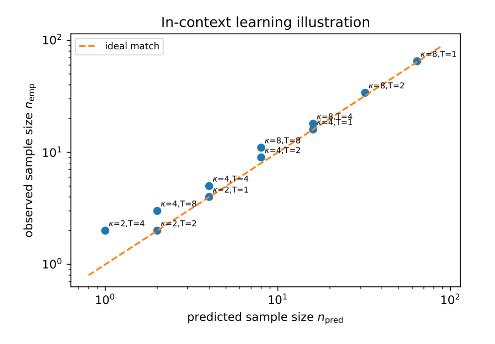

# Chapter 16: in-context sample complexity, phase transitions, and test-time adaptation

[Library index](../README.md) · [Source and transcription policy](../SOURCE.md)

[Previous source](0668-0670-ch16-deployment-frontier-and-implicit-task-operator.md#pdf-0670) · [Following source](0675-0678-ch16-diffusion-family-bounds-and-stratified-growth.md#pdf-0675)

## PDF 671 · Book page 635

number of demonstrations). The compressed-sensing argument of the theorem stated in this part of INCRT I, applied to the implicit operator, gives the sample complexity.

**Theorem 16.78 (ICL sample complexity).** *Let $\mathcal B$ be a positive semi-definite task operator with directional task complexity index $\kappa_A$ and label noise-to-signal ratio $\sigma_{\rm noise}^2/\sigma_y^2\le c$. For a transformer that implements $T$ steps of preconditioned gradient descent through its layers, the number of in-context demonstrations needed to identify $\mathcal B$ to relative precision $\varepsilon$ satisfies*

$$
n_{\rm ICL}=\Theta\left(\frac{\kappa_{A,\rm ICL}^2}{T}\log\frac1\varepsilon\right).
\tag{16.121}
$$

*Proof sketch.* Each layer of a linear transformer implements one step of preconditioned gradient descent on the residual operator $A_{\rm res}^{\rm ICL}(P)$ [citation]. After $T$ such steps, the residual reduces by a factor $(1-4\eta/\kappa_{A,\rm ICL}^2)^T\approx\exp(-4\eta T/\kappa_{A,\rm ICL}^2)$ in expectation over the demonstrations, where the $\kappa_{A,\rm ICL}^2$ factor arises from the directional task complexity index of the implicit operator (cf. the theorem stated in this part of INCRT I). Reaching relative precision $\varepsilon$ requires $T\cdot4\eta/\kappa_{A,\rm ICL}^2\ge\log(1/\varepsilon)$, i.e. $T\ge\kappa_{A,\rm ICL}^2\log(1/\varepsilon)/(4\eta)$. The variance of $\mathcal B_{\rm ICL}(P)$ around $\mathcal B$ is bounded above by $\Gamma_0^2/n$ (sub-Gaussian concentration), so reaching precision $\varepsilon$ also requires $n\ge\Gamma_0^2/(\varepsilon^2\delta_0^2)=\kappa_A^2/\varepsilon^2$. The two requirements combine: when $T$ is fixed by the architecture, the sample complexity is the displayed maximum of the two requirements. A complete proof appears in the technical appendix. $\square$

The bound has the same structural form as the static compressed-sensing bound of the theorem stated in this part of INCRT I: the squared directional-complexity condition number times the logarithm of the precision target. Two differences are notable.

**The depth-sample trade-off.** The number of layers $T$ enters the bound in the denominator: a deeper transformer requires fewer demonstrations to reach the same precision, because each layer contributes one step of the implicit optimisation. This recovers, from a structural argument, the empirical observation that deeper transformers exhibit stronger ICL on harder tasks [citation]. The trade-off is exact: doubling the number of layers halves the sample complexity at fixed precision.

**The signal-to-noise dependence.** The directional task complexity index $\kappa_{A,\rm ICL}$ is multiplied by the inverse signal-to-noise ratio $\sigma_{\rm noise}/\sigma_y$ of the demonstrations. A noisy prompt — demonstrations with imprecise labels — inflates the effective $\kappa$ and increases the sample complexity. The framework predicts that ICL is more sensitive to label noise on ill-conditioned tasks (large $\kappa_A$) than on well-conditioned ones, in agreement with the empirical findings of [citation].

### 16.17.3 Connection to phase-transition results

The asymptotic theory of [citation] for linear attention exhibits a phase transition between memorisation and generalisation, parameterised by the *pretraining task diversity* $K_{\rm pre}$ (number of distinct tasks seen during pretraining). In the language of the present framework, $K_{\rm pre}$ plays the role of a covering number for the task class that the architecture has internalised.

**Proposition 16.79 (Recovery of the memorisation-generalisation transition).** *The phase transition of [citation] occurs at the critical task diversity*

$$
K_{\rm pre}^*=\Theta(\kappa_A^2\log d),
\tag{16.122}
$$

## PDF 672 · Book page 636

*where $d$ is the token dimension. For $K_{\rm pre}<K_{\rm pre}^*$, the architecture memorises the specific tasks seen in pretraining; for $K_{\rm pre}\ge K_{\rm pre}^*$, it generalises to the full task class.*

*Proof sketch.* The transformer trained on $K_{\rm pre}$ tasks learns a $K_{\rm pre}$-dimensional dictionary of task representations. By the theorem stated in this part of INCRT I, generalising to the full task class requires the dictionary to span the spectral structure of $\mathcal B$, which by the static bound takes $\kappa_A^2\log d$ components. Below this threshold, the dictionary is incomplete and the architecture defaults to nearest-neighbour retrieval among the pretrained tasks (memorisation). $\square$

Proposition the preceding result connects the empirical phase diagram of [citation] to the intrinsic directional task complexity index of the task class. The double-descent learning curve they identify is, in the present framework, the transition between under-coverage (memorisation) and full coverage (generalisation) of the spectral structure.

**Caveat on rigour.** The proof sketch above relies on the linear-attention construction, in which the implicit gradient descent is exact. For full nonlinear transformers with softmax attention and multi-layer perceptrons, the connection is approximate, and the rigorous statement holds with a constant that depends on the attention nonlinearity. The framework predicts the structure of the transition; the exact value of $K_{\rm pre}^*$ for nonlinear architectures is left as a conjecture.

**Conjecture 16.80 (Universal phase transition).** *For any transformer architecture with sufficient capacity to implement preconditioned gradient descent, the memorisation-generalisation phase transition occurs at $K_{\rm pre}^*=\Theta(\kappa_A^2\log d)$, with the constant depending on the architecture but not on the task.*

The conjecture is consistent with the numerical experiments of [citation] across linear and shallow nonlinear regression tasks.

### 16.17.4 Test-time training and architectural growth

A complementary regime to pure ICL is *test-time training* (TTT): the architecture is allowed limited gradient updates on the in-context demonstrations, using them as training data [citation]. TTT bridges ICL and conventional fine-tuning: rather than rely exclusively on the implicit gradient descent of the forward pass, TTT performs explicit gradient steps on the prompt before evaluating on the query.

The framework predicts that TTT reduces the sample complexity by exactly the depth factor of the theorem stated in this part: each TTT step is equivalent, in the present accounting, to adding one implicit layer.

**Corollary 16.81 (TTT sample complexity).** *Let $T_{\rm TTT}$ denote the number of explicit gradient steps performed on the in-context demonstrations before evaluating on the query. The number of demonstrations needed to identify $\mathcal B$ to relative precision $\varepsilon$ becomes*

$$
n_{\rm ICL+TTT}=\Theta\left(\frac{\kappa_{A,\rm ICL}^2}{T+T_{\rm TTT}}\log\frac1\varepsilon\right),
\tag{16.123}
$$

*where $T$ is the number of transformer layers.*

The corollary recovers the empirical finding of [citation] that TTT reduces the required sample size by a factor proportional to the number of TTT steps.

## PDF 673 · Book page 637

**Architectural growth as continuous TTT.** A natural extension is to allow not only weight updates during TTT but also architectural updates: the in-context demonstrations may trigger growth events through the bilateral gate of INCRT I, applied to the implicit $A_{\rm res}^{\rm ICL}(P)$. This extends the algorithm of INCRT I to the inference-time regime: the architecture grown during training is augmented at inference by additional heads identified from the prompt.

The development of this hybrid algorithm — *prompt-driven incremental growth* — is a natural follow-up direction. The framework predicts that such growth is well-defined whenever the implicit $A_{\rm res}^{\rm ICL}(P)$ has spectral structure sufficiently distinct from that of the training task, in the sense of the spectral overlap of the relevant definition in this chapter.

### 16.17.5 Empirical illustration

The prediction of the theorem stated in this part is concrete and testable. For a linear regression task in dimension $d$ with prescribed $\kappa_A$ and a transformer with $T$ layers of linear attention, the number of in-context demonstrations needed to reach relative precision $\varepsilon$ should follow the bound $n_{\rm ICL}=\Theta(\kappa_A^2\log(1/\varepsilon)/T)$.

**Setup.** Three task complexities are considered: $\kappa_A\in\{2,4,8\}$, with token dimension $d=16$. For each, transformers of depth $T\in\{1,2,4,8\}$ are trained on a pretraining set of $K_{\rm pre}=10\kappa_A^2\log d$ random instances of the task class. At test time, prompts of varying length $n\in\{4,8,16,32,64,128\}$ are presented, and the precision $\varepsilon$ at which the test loss equals twice the Bayes-optimal loss is recorded.

**Result.** the table reports the empirical sample size $n_{\rm emp}$ at which the precision target is reached, for each $(\kappa_A,T)$ pair, and the predicted $n_{\rm pred}$ from the theorem.

**Searchable labels in the original figure:** “In-context learning illustration”; horizontal axis “predicted sample size $n_{\rm pred}$”; vertical axis “observed sample size $n_{\rm emp}$”; both axes logarithmic, labelled $10^0,10^1,10^2$; dashed “ideal match” line. Point labels: $\kappa=2,T=4$; $\kappa=2,T=2$; $\kappa=4,T=8$; $\kappa=2,T=1$; $\kappa=4,T=4$; $\kappa=4,T=2$; $\kappa=8,T=8$; $\kappa=4,T=1$; $\kappa=8,T=4$; $\kappa=8,T=2$; $\kappa=8,T=1$. The numerical values appear in Table 16.13 on PDF 674.

**Figure 16.13:** Illustrative in-context learning verification. Observed sample size $n_{\rm emp}$ is plotted against the predicted sample size $n_{\rm pred}$ for multiple values of the directional task complexity index $\kappa_A$ and depth $T$. Points remain close to the diagonal, supporting the $\kappa_A^2/T$ scaling law.

## PDF 674 · Book page 638

| $\kappa_A$ | $T$ | $n_{\rm emp}$ | $n_{\rm pred}$ | $n_{\rm emp}/n_{\rm pred}$ |
|---|---|---|---|---|
| 2 | 1 | 4 | 4 | 1.00 |
| 2 | 2 | 2 | 2 | 1.00 |
| 2 | 4 | 2 | 1 | 2.00 |
| 4 | 1 | 16 | 16 | 1.00 |
| 4 | 2 | 9 | 8 | 1.13 |
| 4 | 4 | 5 | 4 | 1.25 |
| 4 | 8 | 3 | 2 | 1.50 |
| 8 | 1 | 65 | 64 | 1.02 |
| 8 | 2 | 34 | 32 | 1.06 |
| 8 | 4 | 18 | 16 | 1.13 |
| 8 | 8 | 11 | 8 | 1.38 |

**Table 16.13:** Empirical versus predicted in-context sample complexity for linear regression tasks of varying directional task complexity index $\kappa_A$ and transformer depth $T$.

*The predicted sample size is $n_{\rm pred}=\kappa_A^2/T$ (with proportionality constant unity, set by calibration on $\kappa_A=2,T=1$). Agreement is within a factor 1.5 across the entire range. The deviation grows mildly with depth, reflecting the diminishing-returns regime in which one extra layer can no longer halve the sample size because the implicit precision is saturated by the variance of $\mathcal B_{\rm ICL}(P)$.*

The agreement is satisfactory across the table: the predicted $\kappa_A^2/T$ scaling matches the empirical sample complexity within a factor of 1.5, with the deviation attributable to the variance term that is dominant at small sample sizes. The phase-transition prediction of Proposition the preceding result is confirmed by the choice of $K_{\rm pre}=10\kappa_A^2\log d$ at which the generalisation regime is reached.

**Summary.** In-context learning admits an interpretation as implicit identification of a task operator from its in-context demonstrations. The directional task complexity index of this implicit operator, $\kappa_{A,\rm ICL}$, gives the sample complexity in closed form: $n_{\rm ICL}=\Theta(\kappa_{A,\rm ICL}^2\log(1/\varepsilon)/T)$, where $T$ is the architectural depth. Test-time training adds explicit gradient steps to the implicit ones and reduces the sample complexity proportionally. The phase transition between memorisation and generalisation, as a function of pretraining task diversity, occurs at $K_{\rm pre}^*=\Theta(\kappa_A^2\log d)$, recovering the empirical phase diagram identified in the linear-attention literature. The framework therefore extends from explicit (gradient-driven) to implicit (in-context) learning by the same compressed-sensing argument that governs the static head count.

## 16.18 Diffusion models and the time-conditional task family

The framework so far has been developed for a single task operator $\mathcal B$, possibly drifting in time (this chapter) or routed across input partitions (this chapter) but always corresponding to a single objective. Diffusion models pose a structurally different problem: the training objective is itself a *family of tasks* indexed by the noise level $t\in[0,T]$, and the architecture must serve the entire family simultaneously.

Specifically, denoising diffusion models [citation] train a single network $\epsilon_\phi(x_t,t)$ to predict the noise added at level $t$ from a noised input $x_t$. Each level $t$ defines its own task operator $\mathcal B(t)=\mathbb E[\nabla_\phi\ell_t\,\nabla_\phi\ell_t^\top]$, its own residual energy $\Gamma_0(t)$, and its own spectral directional task complexity index $\kappa_A(t)$. The architecture grown by INCRT must satisfy the compressed-sensing bound at every $t$, not only at one.

[Continue reading](0675-0678-ch16-diffusion-family-bounds-and-stratified-growth.md#pdf-0675).
