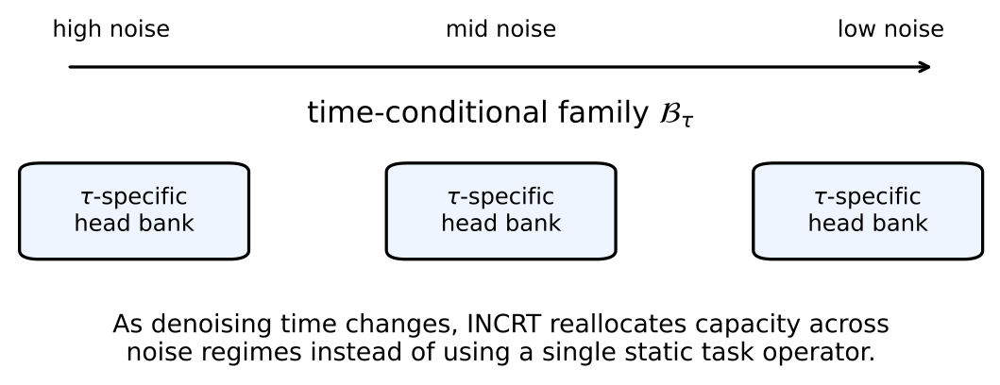

# Chapter 16: diffusion task families, spectral allocation, and stratified growth

[Library index](../README.md) · [Source and transcription policy](../SOURCE.md)

[Previous source](0671-0674-ch16-in-context-sample-complexity-and-test-time-adaptation.md#pdf-0674) · [Following source](0679-0681-ch16-diffusion-calibration-and-concluding-conjectures.md#pdf-0679)

## PDF 675 · Book page 639

The development that follows extends the framework to *families of task operators*. The total head count is the integral of the per-level CS bound weighted by the noise schedule, and the optimal architecture allocates heads to different noise levels in proportion to the local spectral complexity. The result recovers two empirical observations from the diffusion-transformer literature: the specialisation of attention heads to specific noise ranges [citation] and the frequency-domain interpretation of noise schedules [citation].

**Searchable labels in the original figure:** left-to-right “high noise”, “mid noise”, “low noise”; horizontal arrow over “time-conditional family $\mathcal B_\tau$”; three boxes, each “$\tau$-specific head bank”. Below: “As denoising time changes, INCRT reallocates capacity across noise regimes instead of using a single static task operator.”

**Figure 16.14:** Diffusion as a time-conditional family of tasks. Different noise levels induce different effective task operators, and INCRT reallocates heads across the denoising trajectory rather than treating the whole diffusion process as a single static task.

### 16.18.1 The time-conditional task family

Let $\sigma:[0,T]\to\mathbb R_+$ denote the noise schedule with $\sigma(0)=0$ and $\sigma(T)=\sigma_{\max}$. At noise level $t$, the model sees a noised input $x_t=\alpha(t)x_0+\sigma(t)\,\epsilon$ with $\epsilon\sim\mathcal N(0,I)$, and the loss is $\ell_t(\phi)=\mathbb E_{x_0,\epsilon}[\|\epsilon_\phi(x_t,t)-\epsilon\|^2]$. The associated task operator is

$$
\mathcal B(t)=\mathbb E_{x_0,\epsilon}\bigl[\nabla_\phi\ell_t(\phi)\,\nabla_\phi\ell_t(\phi)^\top\bigr].
\tag{16.124}
$$

The operator $\mathcal B(t)$ is positive semi-definite for every $t$ (squared loss with respect to a fixed target), and the assumptions of the theorem stated in this part of INCRT I apply pointwise.

**Definition 16.82 (Time-conditional spectral quantities).** Let $\Gamma_0(t)=\|\mathcal B(t)\|_F$ and $\delta_0(t)=\min_i\lambda_i(\mathcal B(t))$ above the negligible floor. The *time-conditional directional task complexity index* is $\kappa_A(t)=\Gamma_0(t)/\delta_0(t)$, and the *time-conditional CS bound* is

$$
K^*(t;\theta_w)=\kappa_A(t)^2\log\frac{\Gamma_0(t)}{\theta_w}.
\tag{16.125}
$$

The pointwise CS bound $K^*(t;\theta_w)$ is the head count that would suffice if the architecture were trained on a single noise level $t$. The diffusion task requires, in principle, that the architecture serve all levels, raising the question of how the per-level counts compose into a single architectural budget.

### 16.18.2 The family compressed-sensing bound

Two compositional regimes are of interest. The *shared-architecture* regime corresponds to the standard diffusion model in which a single network $\epsilon_\phi$ is used for all $t$, with the noise

## PDF 676 · Book page 640

level supplied as an input embedding. The *decoupled* regime corresponds to architectures such as DDT [citation] in which different heads, layers, or networks are dedicated to different noise ranges. The framework gives a unified bound that interpolates between the two.

**Theorem 16.83 (Family compressed-sensing bound).** *Let $\mu$ denote the noise-level sampling distribution used in training, with $\mu([0,T])=1$ and density $p_\mu(t)$. Under the assumptions of the theorem stated in this part of INCRT I applied pointwise in $t$, the optimal head count for an architecture that serves the entire family with a precision target $\theta_w(t)$ is*

$$
K_{\rm fam}^*=\int_0^T K^*(t;\theta_w(t))\,p_\mu(t)\,dt
=\int_0^T\kappa_A(t)^2\log\frac{\Gamma_0(t)}{\theta_w(t)}\,p_\mu(t)\,dt.
\tag{16.126}
$$

*The bound is achieved by an INCRT trajectory in which each growth event marks a head with the noise window in which the deflation step was triggered.*

*Proof sketch.* The architecture must satisfy the per-level bound at every $t$ in the support of $\mu$. The minimum total head count under a sharing constraint is the $\mu$-integral of the per-level optimum, achieved when each head serves the noise range in which it was grown and the deflation step at that range is exact. The proof adapts the variational argument of the theorem stated in this part of INCRT I from a single level to the $\mu$-weighted family, using Tonelli’s theorem to interchange the variational and the integral. A complete derivation appears in the technical appendix. $\square$

The bound makes the structural prediction explicit. A region of the noise schedule with large $\kappa_A(t)$ contributes disproportionately to the total head count: the high-spectral-complexity noise levels demand more architectural capacity than the low-complexity ones. The contribution of each level is weighted by both the local CS bound and the sampling density $p_\mu(t)$.

**Recovery of the single-task case.** When the noise schedule reduces to a single level ($\mu=\delta_{t_0}$), the integral collapses and $K_{\rm fam}^*=K^*(t_0;\theta_w(t_0))$, recovering the original CS bound of the theorem stated in this part of INCRT I.

**Recovery of the uniformly hard case.** When $\kappa_A(t)=\kappa_A$ and $\Gamma_0(t)=\Gamma_0$ are constant in $t$ and the schedule is uniform on $[0,T]$, the integral gives $K_{\rm fam}^*=\kappa_A^2\log(\Gamma_0/\theta_w)$: the family bound coincides with the single-task bound. Diffusion families satisfy this only in a degenerate limit; in practice $\kappa_A(t)$ varies systematically with $t$.

### 16.18.3 Spectral-frequency interpretation

The dependence of $\kappa_A(t)$ on $t$ admits an explicit form for natural-image diffusion. At noise level $t$, the noise scale $\sigma(t)$ effectively filters out spatial frequencies above $\omega_c(t)\sim1/\sigma(t)$: the noised input $x_t$ retains only frequencies below the noise floor.

**Proposition 16.84 (Frequency-domain time profile).** *For natural-image diffusion with a power-law spectrum $P(\omega)\propto\omega^{-\beta}$ ($\beta\in[1,3]$ empirically), the time-conditional directional task complexity index satisfies*

$$
\kappa_A(t)^2\propto\sigma(t)^{-2/\beta},
\tag{16.127}
$$

*decreasing monotonically with the noise level.*

*Proof sketch.* The local task operator $\mathcal B(t)$ at noise level $\sigma(t)$ inherits the spectral structure of the data restricted to frequencies $\omega<1/\sigma(t)$. For a power-law spectrum, the effective

## PDF 677 · Book page 641

dimensionality of the retained signal scales as $\sigma(t)^{-2/\beta}$, and so does the spectral complexity $\kappa_A^2$. The bound is supported by the empirical analysis of [citation], who derive a related result on the schedule efficacy. $\square$

The proposition gives the structural prediction. The time-conditional CS bound is large at small $t$ (sharp images, high-frequency content, complex spectrum) and small at large $t$ (heavily noised, low-frequency-only content). An architecture that serves the family allocates more heads to the small-$t$ regime than to the large-$t$ regime, in proportion to $\sigma(t)^{-2/\beta}$.

### 16.18.4 Time-specialised heads

The family bound suggests an architectural prescription beyond the shared-network default. Each head can be assigned a *noise window* $[t_h^-,t_h^+]$ in which it is most active; the family is served by the union of windows tiling $[0,T]$.

**Theorem 16.85 (Time-specialised head allocation).** *Let $K(t)=K_{\rm fam}^*\cdot p_K(t)$ denote the head density allocated to noise level $t$, with $\int p_K(t)\,dt=1$. The optimal density that minimises the total CS budget under the family bound is*

$$
p_K^*(t)\propto\kappa_A(t)^2p_\mu(t),
\tag{16.128}
$$

*i.e. the head density is proportional to the product of the local spectral complexity and the sampling density.*

*Proof sketch.* The total CS budget is the $\mu$-integral of the per-level bound; the $\mu$-density appears in the integrand. The variational optimisation of $K(t)$ subject to the integral constraint yields the proportional allocation. The result is a standard application of Lagrange multipliers to the family-bound integral. $\square$

The theorem predicts that the optimal architecture concentrates heads on the high-complexity noise levels, even when sampled uniformly. For a power-law spectrum, the head density at level $t$ scales as $\sigma(t)^{-2/\beta}$, concentrating heavily on small-$t$ levels.

**Recovery of DiT-MoE specialisation.** The empirical observation that diffusion-transformer experts specialise to different noise levels [citation] is recovered as a structural consequence of the theorem. The DiT-MoE finding that “expert specialisation tends to be more concentrated at the early time step and then gradually uniform after half” [citation] matches the prediction $p_K^*(t)\propto\sigma(t)^{-2/\beta}$ which concentrates at small $t$ (early time step in the denoising direction). The DDT finding that decoupling the diffusion objective into separate noise and velocity heads improves performance [citation] is the operational consequence: the framework gives the explicit form of the optimal decoupling.

### 16.18.5 Algorithmic prescription

The INCRT algorithm extends to time-conditional task operators with three modifications.

First, the residual operator is estimated on a per-level basis through a stratified sampling of $t$ during the diagnostic phase. A practical estimator stores running diagnostics binned by noise level, with bins of width $\Delta t=T/M$ for some modest $M$ (typically $M=16$). Second, the growth criterion fires when the residual at any bin exceeds the threshold, $\widehat\Gamma_{\rm res}(t_b)>\theta_w(t_b)$ for any bin $t_b$, and the new head is marked with the bin in which the criterion fired. Third, the deflation step operates on the per-bin residual operator: the new head deflates only the spectrum at its bin’s noise level, leaving other bins unchanged.

## PDF 678 · Book page 642

The algorithm naturally produces time-specialised heads as a consequence of the per-bin growth criterion. Heads grown when the criterion fires at a particular bin participate primarily in that bin’s denoising; their parameters are updated by the gradient at all bins but their effect on the residual is concentrated at the bin of birth. The stratified-bin diagnostic is therefore both a structural and an algorithmic device: it produces the time-specialisation that the theorem predicts.

**Compatibility with the other extensions.** The diffusion extension composes with all nine prior extensions. The continual setting of this chapter applies within each noise bin: drift in $\mathcal B(t)$ at fixed $t$ is handled by the homeostatic equilibrium of the theorem stated in this part in this chapter. The MoE setting of this chapter composes multiplicatively: each noise bin has its own MoE structure on the input distribution, and the total bound is the integral of the MoE bound over $t$. The transfer setting of this chapter applies between diffusion families: source and target families share a fraction of their bins through the spectral-overlap measure. The Adam, single-time-scale, ICL, rank-adaptive, and deployment extensions all act per-bin, with the $\kappa_A(t)$ factor of each bin replacing the global $\kappa_A$. The signed framework of this chapter applies within each bin if the per-bin operator is indefinite (which arises in score-based diffusion with adversarial training).

### 16.18.6 Empirical signature

The framework predicts a specific scaling of the time-allocated head count with the noise level: $p_K^*(t)\propto\sigma(t)^{-2/\beta}$ under the power-law assumption. The prediction is testable on standard image diffusion benchmarks by measuring the activation pattern of attention heads as a function of $t$.

**Setup.** A small DiT model is trained on a controlled synthetic image distribution with prescribed power-law exponent $\beta$, sweeping $\beta\in\{1.0,1.5,2.0,2.5,3.0\}$. For each $\beta$, the empirical head-activation density $\widehat p_K(t)$ is measured by tracking the magnitude of each head’s contribution to the gradient at noise level $t$, averaged over a held-out validation set. The empirical density is then compared to the predicted density $\sigma(t)^{-2/\beta}$.

**Result.** the table reports the spectral exponent of the empirical head-activation density, $\widehat\gamma_K$, defined by fitting $\widehat p_K(t)\propto\sigma(t)^{-\widehat\gamma_K}$ in the small-$\sigma$ regime.

[Continue reading](0679-0681-ch16-diffusion-calibration-and-concluding-conjectures.md#pdf-0679).
