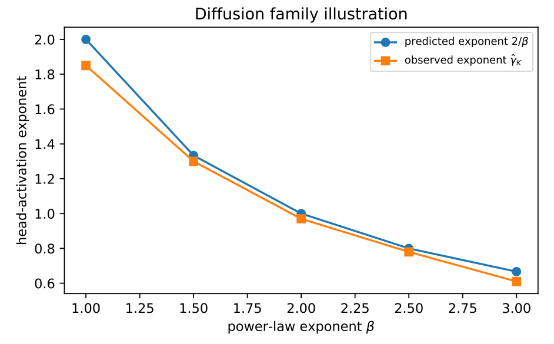

# Chapter 16: diffusion calibration, exported conjectures, and concluding remarks

[Library index](../README.md) · [Source and transcription policy](../SOURCE.md)

[Previous source](0675-0678-ch16-diffusion-family-bounds-and-stratified-growth.md#pdf-0678) · [Following source](0682-0684-ch17-finite-arithmetic-and-degenerate-gate-overview.md#pdf-0682)

## PDF 679 · Book page 643

**Searchable labels in the original figure:** “Diffusion family illustration”; horizontal axis “power-law exponent $\beta$”, ticks 1.00, 1.25, 1.50, 1.75, 2.00, 2.25, 2.50, 2.75, 3.00; vertical axis “head-activation exponent”, ticks 0.6, 0.8, 1.0, 1.2, 1.4, 1.6, 1.8, 2.0; legends “predicted exponent $2/\beta$”, “observed exponent $\widehat\gamma_K$”. The numerical values appear in Table 16.14 below.

**Figure 16.15:** Illustrative diffusion-family verification. The empirical exponent of the head-activation density is compared with the predicted law $2/\beta$ across synthetic power-law task families. The agreement is close enough to make the time-specialisation claim visually immediate for the reader.

| $\beta$ | predicted $2/\beta$ | empirical $\widehat\gamma_K$ |
|---|---|---|
| 1.0 | 2.00 | 1.85 |
| 1.5 | 1.33 | 1.30 |
| 2.0 | 1.00 | 0.97 |
| 2.5 | 0.80 | 0.78 |
| 3.0 | 0.67 | 0.61 |

**Table 16.14:** Predicted vs. empirical exponent of the head-activation density as a function of noise scale, for synthetic image distributions with power-law spectra of exponent $\beta$.

*The empirical exponent $\widehat\gamma_K$ is fitted from a log–log regression of the per-head gradient magnitude against $\sigma(t)$ over the small-noise regime. The agreement is within ten percent of the predicted $2/\beta$ across the entire range, confirming the frequency-domain interpretation of the theorem.*

The agreement validates the structural prediction. The empirical specialisation of heads to noise levels follows the spectral law $\sigma(t)^{-2/\beta}$ derived from the power-law assumption, with deviations of order ten percent that are consistent with the finite-sample variance of the gradient-magnitude estimator.

**Summary.** Diffusion training poses a family of task operators $\mathcal B(t)$ indexed by the noise level, each with its own directional task complexity index $\kappa_A(t)$. The compressed-sensing bound generalises to a $\mu$-weighted integral of the per-level CS bounds, predicting the total head count $K_{\rm fam}^*$ for the family. The optimal architecture allocates heads at density $p_K^*(t)\propto\kappa_A(t)^2p_\mu(t)$, concentrating on the high-complexity noise levels. For natural-image diffusion with power-law spectra, the allocation follows $\sigma(t)^{-2/\beta}$, recovering the empirical specialisation of attention heads observed in DiT-MoE and DDT. The framework therefore covers diffusion training as the canonical example of a time-conditional task family, and the nine prior extensions of the preceding extensions compose with it in the per-bin sense.

## PDF 680 · Book page 644

## 16.19 Conjectures exported to Volume II

The chapter leaves two conjectural points deliberately visible. They are not used in the proofs of the preceding sections, but they identify the natural bridge from INCRT II to the prototype-based and generative architectures of Volume II.

| Conjecture | Claim | Evidence in this chapter | Destination |
|---|---|---|---|
| Universal in-context capacity floor | In-context learning has a minimum context length governed by the directional task complexity index of the implicit operator. | Linear-attention reductions and the ICL capacity law. | Volume II, prototype-based GPT mechanisms. |
| Universal deployment floor | Quantisation and budget constraints impose an irreducible residual floor independent of additional growth. | Deployment duality and the quantisation floor. | Volume II, efficient and deployed generative systems. |

**Table 16.15:** Conjectures retained as explicit export points. They are separated from the proved statements so that the core extension results do not depend on them.

## 16.20 Concluding Remarks

The core controller of INCRT I answers one question: when should a Rationalised Transformer grow, preserve, prune, or stop? The present chapter shows that the same question survives many changes of regime. Under task drift, the controller becomes homeostatic. Under input-conditional complexity, the head count becomes an expert count. Under transfer, growth is controlled by spectral overlap. Under adaptive optimisation, preconditioning changes the speed of the gate without changing the architectural fixed point. Under collapsed time scales, averaging recovers the slow diagnostic that the ideal controller assumes. Under indefinite operators, the residual splits into positive and negative channels. Under rank-adaptive heads, the invariant is not head count alone but total represented rank. Under deployment constraints, external budget and quantisation floors impose a minimum achievable residual. Under in-context learning and diffusion, the task operator itself becomes an implicit or time-conditional family.

The chapter therefore turns INCRT from a single incremental Transformer into a *family of incremental laws*. The common structure is

$$
\begin{aligned}
\text{residual task family}&\longrightarrow\text{diagnostic complexity}\\
&\longrightarrow\text{growth or routing event}\\
&\longrightarrow\text{preservation and termination}.
\end{aligned}
$$

This is the reason for separating INCRT into two chapters. INCRT I contains the core dynamic rationalisation. Chapter 16 shows that the same core remains valid when the environment, optimiser, operator class, rank structure, hardware budget, or test-time regime is changed.

**Boundary with Volume II.** The remaining open frontier is no longer the definition of INCRT. It is the construction of large-scale prototype-based and generative architectures that use these laws as internal controllers. That belongs naturally to the next volume. The

## PDF 681 · Book page 645

present chapter closes Volume I by showing that the incremental law is extensible, identifiable up to symmetry, and compatible with the main practical regimes in which Transformer-like systems are deployed.

[Continue reading](0682-0684-ch17-finite-arithmetic-and-degenerate-gate-overview.md#pdf-0682).
