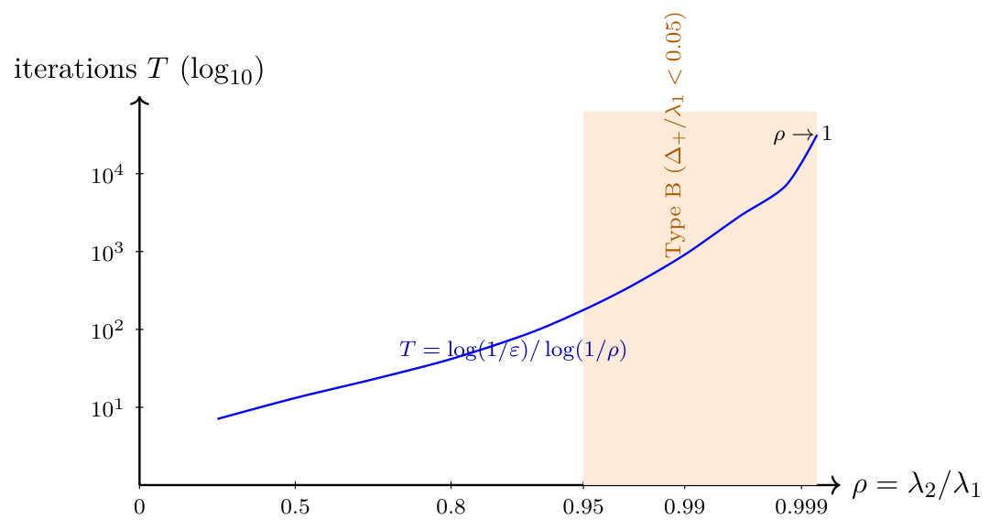
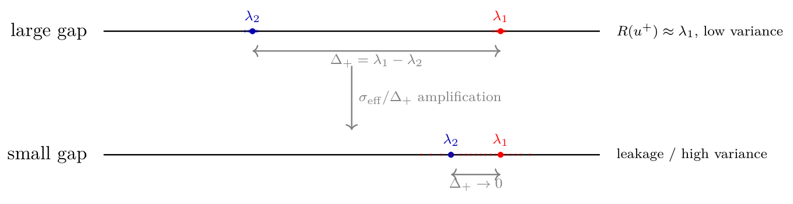

# Chapter 17: gate rates, Rayleigh noise, and orthogonality drift

[Library index](../README.md) · [Source policy](../SOURCE.md) · [Previous: finite arithmetic overview](0682-0684-ch17-finite-arithmetic-and-degenerate-gate-overview.md#pdf-0684) · [Next: dwell time and degeneracy](0689-0692-ch17-dwell-time-and-spectral-degeneracy.md)

> Editorial note: Full transcription of PDF 685–688 (printed pages 649–652). Figures 17.1 and 17.2 are direct crops rendered from the original PDF. Original update formulas, rate ratios, assertions, repeated citation wording, and numerical claims are retained. Their validity and required assumptions are assessed separately in notes 282–284. The discussion of Figure 17.3 continues with the figure on PDF 689.

## PDF 685 · Book page 649

## 17.2 Numerical analysis of the bidirectional gate

The convergence theorems of Chapter 15 are stated under continuous-time gradient-flow assumptions: Robbins-Monro learning rates, smooth dynamics, exact deflation. In floating-point arithmetic on real hardware, each of these idealisations is violated by an error of definite magnitude, and the cumulative effect of these errors determines whether the predicted asymptotic rates are attained in practice. This section traces the four principal sources of numerical error in the bidirectional gate of Chapter 15 and quantifies the regime in which each becomes dominant.

The four sources are: the effective convergence rates of Oja’s rule and MCA EXIN as a function of the spectral gap (§17.2.2); the propagation of the Rayleigh quotient noise to the gate estimate (§17.2.3); the orthogonality drift of the deflation basis under repeated Gram-Schmidt updates (§17.2.4); and the cumulative effect of these errors on the dwell-time condition of the moving-target theorem (§17.2.5). A brief recap of the gate dynamics opens the section (§17.2.1).

### 17.2.1 Recap of the bidirectional gate

The bidirectional gate of Chapter 15 (Cirrincione, 2026c, §3.2) allocates two unit-norm probes per attention head, $u^+\in S^{d-1}$ and $u^-\in S^{d-1}$, learning them online from the residual operator $A_{\mathrm{res}}=P^\perp\mathcal BP^\perp$ via two distinct stochastic gradient flows on the unit sphere:

$$
u_{t+1}^+=\operatorname{normalise}\bigl(u_t^++\eta(t)\,R(u_t^+)\,A_{\mathrm{res}}u_t^+\bigr)
\qquad\text{(Oja’s rule, dominant probe)},
\tag{17.1}
$$

$$
u_{t+1}^-=\operatorname{normalise}\left(u_t^--\eta(t)\frac{\widetilde y_t}{\|u_t^-\|^2}
\left[A_{\mathrm{res}}u_t^--\frac{\widetilde y_t}{\|u_t^-\|^2}u_t^-\right]\right)
\qquad\text{(MCA EXIN, trailing probe)},
\tag{17.2}
$$

where $R(u)=u^\top A_{\mathrm{res}}u/\|u\|^2$ is the Rayleigh quotient, $\widetilde y_t=u_t^{-\top}A_{\mathrm{res}}u_t^-$, and $\eta(t)$ is the Robbins-Monro learning rate. Convergence in continuous time is established in Cirrincione Cirrincione (2026c) (Theorems 5.1 and A.1):

$$
u_t^+\xrightarrow{\mathrm{a.s.}}v_1(A_{\mathrm{res}}),
\qquad u_t^-\xrightarrow{\mathrm{a.s.}}v_d(A_{\mathrm{res}}),
\tag{17.3}
$$

under the spectral gap conditions $\Delta_+=\lambda_1-\lambda_2>0$ (for Oja) and $\Delta_-=\lambda_{d-1}-\lambda_d>0$ (for MCA EXIN). The two probes are then orthogonalised *a posteriori* via classical Gram-Schmidt:

$$
u^-\leftarrow\operatorname{normalise}\bigl(u^--(u^{-\top}u^+)u^+\bigr).
\tag{17.4}
$$

Three sources of numerical error are encoded in (17.1)–(17.4): the rate at which the iterations (17.1) and (17.2) converge in finite time (§17.2.2), the variance of the Rayleigh quotient estimator $R(u_t^+)$ entering (17.1) and of $\widetilde y_t$ entering (17.2) (§17.2.3), and the condition number of the deflation basis $Q$ updated via (17.4) (§17.2.4).

### 17.2.2 Effective convergence rates

The asymptotic convergence rates of (17.1) and (17.2) in continuous time are governed by the spectral gaps (Cirrincione, 2026c, Theorem A.1):

$$
\rho_{\mathrm{Oja}}=\frac{\lambda_2(A_{\mathrm{res}})}{\lambda_1(A_{\mathrm{res}})},
\qquad
\rho_{\mathrm{MCA}}=\frac{\lambda_{d-1}(A_{\mathrm{res}})}{\lambda_d(A_{\mathrm{res}})}.
\tag{17.5}
$$

## PDF 686 · Book page 650

The number of iterations to reach angular precision $\varepsilon$ is then $T(\varepsilon)=\log(1/\varepsilon)/\log(1/\rho)$, which scales as $T\sim1/\Delta_+$ as $\Delta_+\to0$. This degradation is the dominant practical limitation of the gate of Chapter 15 in near-degenerate regimes.

**Visualisation of the rate degradation.** Figure 17.1 illustrates the iteration count $T(\varepsilon)$ as a function of the gap ratio $\rho=\lambda_2/\lambda_1$ for fixed precision $\varepsilon=10^{-4}$, on a logarithmic scale. The orange region marks the Type-B near-degeneracy regime ($\rho>0.95$) of §17.3.2, where the iteration count exceeds $10^{2.25}\approx180$ steps and grows unboundedly as $\rho\to1$. The pathology is the practical motivation for the unified gate of §17.5. The blow-up at $\rho\to1$ is evident, and the shaded region indicates the Type-B regime of §17.3.2 (gap below $\gamma_{\mathrm{near}}=0.05$).

**Figure 17.1:** Iterations $T$ to reach angular precision $\varepsilon=10^{-4}$ as a function of the spectral gap ratio $\rho=\lambda_2/\lambda_1$ in Oja’s rule (17.1).

> Editorial transcription of figure labels: “iterations $T$ ($\log_{10}$)”; vertical ticks $10^1,10^2,10^3,10^4$; horizontal label $\rho=\lambda_2/\lambda_1$ with ticks $0,0.5,0.8,0.95,0.99,0.999$; curve label $T=\log(1/\varepsilon)/\log(1/\rho)$; “Type B ($\Delta_+/\lambda_1<0.05$)” and “$\rho\to1$”. The original schematic curve and axis spacing are preserved.

**Quantitative impact on the dwell time.** The dwell time $T_{\mathrm{conv}}$ in the dwell-time condition of Chapter 15 satisfies $T_{\mathrm{conv}}\ge c_0\Delta_+^{-2}\log(\cdots)$. In the Type-B regime with $\Delta_+=0.01\cdot\lambda_1$, the constant $\Delta_+^{-2}$ inflates by a factor $10^4$ compared with the regular regime ($\Delta_+=\lambda_1$). For a typical INCRT run with $T_{\mathrm{conv}}\sim10^3$ steps in the regular regime, the same task in Type B requires $T_{\mathrm{conv}}\sim10^7$ steps — prohibitive, and explaining why the Chapter 15 algorithm silently extends training time when near-degenerate spectra are encountered.

### 17.2.3 Rayleigh quotient noise

The Rayleigh quotient $R(u)=u^\top A_{\mathrm{res}}u/\|u\|^2$ enters both (17.1) (as the multiplier of the gradient direction) and (17.2) (as $\widetilde y/\|u\|^2$). When $u$ is close to an eigenvector $v_k$, $R(u)$ approximates $\lambda_k$, but the map from the estimated operator (or the noisy gradient) to the recovered eigendirection becomes ill-conditioned as the spectral gap closes. The two phenomena are separated: the algebraic expansion of $R(u)$ in powers of the angular error (Lemma 17.1, exact and unconditional), and the propagation of an operator-level perturbation to the dominant eigenvector (Lemma 17.2, the classical Davis–Kahan bound). The numerical pathology of the gate in near-degeneracy lives in the second lemma, not the first.

**Lemma 17.1 (Rayleigh quotient expansion).** *Let $A\in\operatorname{Sym}(\mathbb R^d)$ with eigenvalues $\lambda_1\ge\cdots\ge$*

## PDF 687 · Book page 651

*$\lambda_d$ and eigenvectors $v_1,\ldots,v_d$, and let $u\in S^{d-1}$ with $\sin\theta=\sin\angle(u,v_1)$. Then*

$$
R(u)=\lambda_1-\sin^2\theta\,\xi,
\qquad\xi=\sum_{k\ge2}(\lambda_1-\lambda_k)|\langle u_\perp,v_k\rangle|^2,
\tag{17.6}
$$

*where $u_\perp$ is the unit vector orthogonal to $v_1$ in the plane $\operatorname{span}\{u,v_1\}$, and $\xi\in[\Delta_+,\lambda_1-\lambda_d]$ is a deterministic functional of $u_\perp$.*

*Proof.* Decompose $u=v_1\cos\theta+u_\perp\sin\theta$. Then $R(u)=\cos^2\theta\,\lambda_1+\sin^2\theta\,R(u_\perp)$, and expanding $R(u_\perp)=\sum_k\lambda_k|\langle u_\perp,v_k\rangle|^2$ together with $\cos^2\theta=1-\sin^2\theta$ gives (17.6). The bounds on $\xi$ follow from $\Delta_+=\lambda_1-\lambda_2\le\lambda_1-\lambda_k\le\lambda_1-\lambda_d$ for $k\ge2$ and from $\sum_k|\langle u_\perp,v_k\rangle|^2=1$. $\square$

**Reading of (17.6).** The Rayleigh quotient itself is a stable scalar functional: even as $\Delta_+\to0$, $R(u)$ remains in $[\lambda_d,\lambda_1]$ and its expansion in $\sin^2\theta$ has bounded second-order coefficient $\xi$. The numerical fragility of the gate in near-degeneracy is therefore not a fragility of $R$ as a value; it is a fragility of the inverse problem “recover the eigendirection from the operator (or its noisy estimate)”, which is the content of the next lemma.

**Lemma 17.2 (Eigenvector sensitivity under operator perturbation; Davis–Kahan).** *Let $A,\widehat A=A+E\in\operatorname{Sym}(\mathbb R^d)$ with $A$ having dominant gap $\Delta_+=\lambda_1-\lambda_2>0$, and let $v_1,\widehat v_1$ be unit dominant eigenvectors of $A$ and $\widehat A$ respectively. If $\|E\|_2\le\Delta_+/2$, then*

$$
\sin\angle(\widehat v_1,v_1)
\le\frac{\|E\|_2}{\Delta_+-\|E\|_2}
\le\frac{2\|E\|_2}{\Delta_+}.
\tag{17.7}
$$

*Proof.* This is the standard Davis–Kahan $\sin\theta$ theorem for a single eigenvector (Stewart and Sun, 1990, Theorem V.3.6), applied with the spectral set $\{\lambda_1\}$ separated from the rest of $\sigma(A)$ by $\Delta_+$ and from $\sigma(\widehat A)$ by $\Delta_+-\|E\|_2$ (Weyl’s inequality). $\square$

**Propagation to the gate estimate.** In the gate dynamics (17.1)–(17.2), the role of $E$ is played by the effective operator-level noise $\sigma_{\mathrm{eff}}$ that aggregates floating-point error in $A_{\mathrm{res}}$, gradient noise from mini-batching, and discretisation error of the continuous-time flow. Lemma 17.2 then gives the angular error of the gate estimate at convergence:

$$
\sin\angle(u_\infty^+,v_1)\le\frac{2\sigma_{\mathrm{eff}}}{\Delta_+}
\qquad\text{whenever }\sigma_{\mathrm{eff}}\le\Delta_+/2.
\tag{17.8}
$$

The bound (17.8) is the analytical content of the visual schematic in Figure 17.2: as the spectral gap closes, even a small operator-level perturbation yields a large angular error in the dominant direction.

*Top:* when the spectral gap $\Delta_+$ is large, Rayleigh quotient estimates $R(u_t^+)$ concentrate tightly around $\lambda_1$ (red dots) and around $\lambda_2$ when the probe drifts (blue dots), with negligible overlap. *Bottom:* when $\Delta_+$ closes, even small operator-level perturbations $\sigma_{\mathrm{eff}}$ (from floating-point error, mini-batch noise, or discretisation) inflate the angular error of the dominant eigendirection by the Davis–Kahan factor $1/\Delta_+$ (Lemma 17.2, Eq. 17.8). The gate update direction in (17.1) inherits this amplification. Sharper scalings (with a higher power of $1/\Delta_+$, e.g. from $\sigma_{\mathrm{eff}}$ itself depending on $\Delta_+$ through the iteration variance) can be derived under specific stochastic models of the gradient noise, but require probabilistic assumptions beyond the scope of this chapter; the deterministic bound (17.8) is the safe form used throughout.

## PDF 688 · Book page 652

**Figure 17.2:** Propagation of operator-level perturbation to the dominant eigendirection.

> Editorial transcription of figure labels: “large gap”; $\lambda_2$, $\lambda_1$; $R(u^+)\approx\lambda_1$, “low variance”; $\Delta_+=\lambda_1-\lambda_2$; $\sigma_{\mathrm{eff}}/\Delta_+$ “amplification”; “small gap”; “leakage / high variance”; $\Delta_+\to0$.

### 17.2.4 Orthogonality drift of the deflation basis

The deflation basis $Q^{(l)}\in\mathbb R^{d\times K}$ accumulates one column per Level-1 growth event (and $m$ per Level-2 event), and is used to form the projector $P^\perp=I-QQ^\top$ at each subsequent residual update. The exact-deflation Lemma 16.1 of Chapter 16 holds in exact arithmetic; in floating-point arithmetic, the orthogonality of $Q$ degrades with each appended column, and the projector $P^\perp$ accumulates a multiplicative error that is invisible to the algorithm but propagates silently to the moving-target convergence theorem.

**The drift mechanism.** When a new column $u_{K+1}$ is appended via classical Gram-Schmidt (17.4) applied to all $K$ existing columns, the orthogonalisation error grows as $O(\kappa(Q^{(K)})^2)$ in the condition number $\kappa(Q^{(K)})$ (Golub and Van Loan, 2013, §5.2). Even when each individual $u_k$ is computed to machine precision, the cumulative error after $K$ growth events satisfies $\|Q^{(K)\top}Q^{(K)}-I\|_2\sim K^2\varepsilon_{\mathrm{mach}}$, growing quadratically with the architecture size.

**Visualisation.** Figure 17.3 shows schematically the drift in two dimensions: each new column is meant to be orthogonal to all previous ones, but the floating-point projection step leaves a residual component of order $\varepsilon_{\mathrm{mach}}$, and these residuals accumulate over multiple growth events.

*Left:* classical Gram-Schmidt orthogonalisation, applied repeatedly to append new columns, accumulates $O(K\varepsilon_{\mathrm{mach}})$ drift per column and $O(K^2\varepsilon_{\mathrm{mach}})$ cumulative orthogonality error. For $K=100$ in double precision, the cumulative error reaches $\sim10^{-12}$, eroding the exact-deflation Lemma 16.1 of Chapter 16. *Right:* incremental Givens QR with twice-is-enough reorthogonalisation maintains $\|Q^\top Q-I\|_2=O(K\varepsilon_{\mathrm{mach}})$, gaining a factor $K$ in stability (§17.4.4). The figure also illustrates the remedy of §17.4.4: incremental Givens QR with twice-is-enough reorthogonalisation reduces the accumulated error from $O(K^2)$ to $O(K)$ in $\varepsilon_{\mathrm{mach}}$.

**Consequence for the moving-target theorem.** The orthogonality drift enters the jump bound $J_{\max}$ of Theorem 16.3 of Chapter 16 as a multiplicative factor proportional to $\|Q^\top Q-I\|_2$. With classical Gram-Schmidt, $J_{\max}$ degrades by a factor $K$ relative to the exact arithmetic prediction; this degradation is the third source of the $T_{\mathrm{conv}}$ inflation observed in practice (in addition to the rate degradation of §17.2.2 and the Rayleigh noise of §17.2.3). The remedy is the incremental Givens QR factorisation of §17.4.4, which restores the exact arithmetic prediction up to $O(\varepsilon_{\mathrm{mach}})$ per column, independent of $K$.
