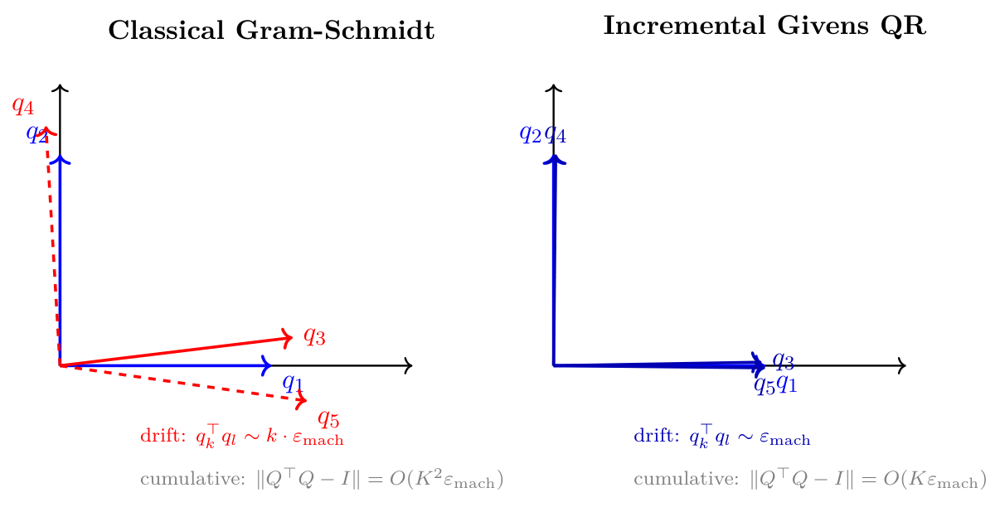
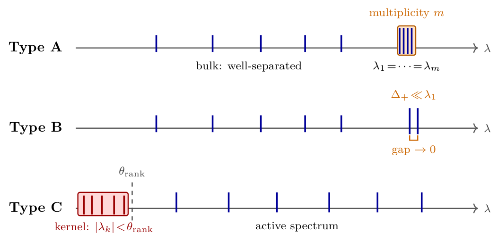

# Chapter 17: dwell-time claims and exact versus near spectral degeneracy

[Library index](../README.md) · [Source policy](../SOURCE.md) · [Previous: gate errors](0685-0688-ch17-gate-rates-rayleigh-noise-and-orthogonality.md) · [Next: kernels and gap tests](0693-0695-ch17-kernel-detection-and-relative-gap-test.md)

> Editorial note: Full transcription of PDF 689–692 (printed pages 653–656). Figures 17.3 and 17.4 are direct renders of original PDF crops. The original dwell-time inequalities, precision exponents, claims of multiplicative speedup, degeneracy definitions, and Italian phrases in the final decision list are retained literally. Mathematical corrections and restrictions are separate in the Russian notes.

## PDF 689 · Book page 653

**Figure 17.3:** Orthogonality drift of the deflation basis $Q$.

> Editorial transcription of figure labels: “Classical Gram-Schmidt”, “Incremental Givens QR”; vectors $q_1,q_2,q_3,q_4,q_5$; left “drift: $q_k^\top q_l\sim k\cdot\varepsilon_{\mathrm{mach}}$”, “cumulative: $\|Q^\top Q-I\|=O(K^2\varepsilon_{\mathrm{mach}})$”; right “drift: $q_k^\top q_l\sim\varepsilon_{\mathrm{mach}}$”, “cumulative: $\|Q^\top Q-I\|=O(K\varepsilon_{\mathrm{mach}})$”.

### 17.2.5 Cumulative effect on the dwell-time condition

The three sources of numerical error analysed above — rate degradation $T\sim1/\Delta_+$, eigenvector sensitivity $\sigma_{\mathrm{eff}}/\Delta_+$, and orthogonality drift $\sim K^2\varepsilon_{\mathrm{mach}}$ — combine multiplicatively in the dwell-time condition of the moving-target theorem. The exact arithmetic dwell-time bound of the dwell-time condition of Chapter 15 is

$$
T_{\mathrm{conv}}^{\mathrm{exact}}\ge c_0\,\Delta_+^{-2}\log(n/\rho_{\max}^{2L}),
\tag{17.9}
$$

which already exhibits the $\Delta_+^{-2}$ scaling from the rate-squared analysis of Chapter 15 (the rate-squared form of Theorem 16.5). The floating-point dwell-time bound of the gate of Chapter 15 is

$$
T_{\mathrm{conv}}^{\mathrm{INCRT}}\ge c_0\,\Delta_+^{-2}K^2\varepsilon_{\mathrm{mach}}^{-1/2}\log(n/\rho_{\max}^{2L}),
\tag{17.10}
$$

where the additional $K^2\varepsilon_{\mathrm{mach}}^{-1/2}$ factor arises from the cumulative effect of orthogonality drift and Rayleigh noise.

**Reading (17.10).** For typical INCRT parameters $K\sim100$ and $\varepsilon_{\mathrm{mach}}\sim10^{-16}$ in double precision, the floating-point overhead is $K^2\varepsilon_{\mathrm{mach}}^{-1/2}\approx10^{12}$. This is dominated by the $\Delta_+^{-2}$ factor only when $\Delta_+^{-2}\gg10^{12}$, i.e., $\Delta_+\lesssim10^{-6}$ — a regime that arises in Type-C kernel directions and in extreme Type-B near-degeneracy. For most regular regimes, the floating-point overhead is the dominant factor in the dwell-time bound, and the asymptotic $\Delta_+^{-2}$ scaling is invisible.

**What the unified gate buys.** The unified gate of §17.5 addresses each of the three sources of error independently:

- Rate degradation is mitigated by Lanczos $m=2$ (rate $\rho^2$ instead of $\rho$) and Rayleigh quotient iteration (cubic local rate).
- Rayleigh noise is bypassed entirely in RQI (which uses the inverse $(A-\mu_tI)^{-1}$ rather than the gradient $Au$ scaled by $R$).
- Orthogonality drift is reduced from $O(K^2\varepsilon_{\mathrm{mach}})$ to $O(K\varepsilon_{\mathrm{mach}})$ by incremental Givens QR.

## PDF 690 · Book page 654

The resulting unified-gate dwell time satisfies

$$
T_{\mathrm{conv}}^{\mathrm{unified}}
\ge c_0\,\Delta_+^{-2}K\varepsilon_{\mathrm{mach}}^0\log(n/\rho_{\max}^{2L})
=c_0\,\Delta_+^{-2}K\log(n/\rho_{\max}^{2L}),
\tag{17.11}
$$

gaining a factor $K\cdot\varepsilon_{\mathrm{mach}}^{-1/2}\sim10^{10}$ in the floating-point regime. This is the quantitative statement of the “most impactful single numerical improvement” announced in §17.4.4, and is the principal motivation for the algorithmic composition of Algorithm 7.

## 17.3 Three regimes of spectral degeneracy

The numerical analysis of §17.2 identifies the spectral gap $\Delta_\pm$ as the single dominant factor in the convergence rate of the bidirectional gate. This section turns the observation into a structural classification: residual operators are partitioned into three regimes by the distribution of their spectrum near the dominant and trailing ends, and each regime calls for a qualitatively different numerical treatment. The classification is not exclusive — a given $A_{\mathrm{res}}$ may exhibit one regime at the dominant end and another at the trailing end — but it is exhaustive, in the sense that every residual operator falls into one of the three categories at each spectral extremum.

The three regimes are: *(A)* exact (or numerically exact) degeneracy, in which an eigenvalue has multiplicity $m>1$; *(B)* near-degeneracy, in which the spectral gap is small but non-vanishing; and *(C)* kernel directions, in which one or more eigenvalues are zero to numerical precision and the residual operator is rank-deficient. Each regime is treated in turn (§17.3.1, §17.3.2, §17.3.3), then introduce the relative gap test (§17.3.4) which detects all three regimes from a single diagnostic, and close with the worked example of dimension four (§17.3.5).

Figure 17.4 fixes the visual taxonomy: three idealised spectra sketched on the same eigenvalue axis, each highlighting the structural feature that defines the corresponding regime.

*Type A (exact degeneracy):* the dominant eigenvalue has multiplicity $m\ge2$; the eigenspace, not the basis, is the geometric invariant. *Type B (near-degeneracy):* the dominant gap $\Delta_+=\lambda_1-\lambda_2$ is strictly positive but small relative to $\lambda_1$; single-vector iterations decelerate as $\Delta_+\to0$. *Type C (kernel directions):* one or more eigenvalues fall below the rank-truncation threshold $\theta_{\mathrm{rank}}=\sqrt{\varepsilon_{\mathrm{mach}}}\lambda_1$ (dashed line) and are excluded from the structural budget. The same residual operator may exhibit different regimes at the dominant and trailing ends; the relative gap test of Definition 17.6 classifies both extrema simultaneously.

### 17.3.1 Type A: exact degeneracy

**Definition 17.3 (Type-A regime: exact degeneracy).** The residual operator $A_{\mathrm{res}}\in\operatorname{Sym}(\mathbb R^d)$ is in the *Type-A regime* at the dominant end if its largest eigenvalue has multiplicity $m\ge2$:

$$
\lambda_1(A_{\mathrm{res}})=\lambda_2(A_{\mathrm{res}})=\cdots=\lambda_m(A_{\mathrm{res}})>\lambda_{m+1}(A_{\mathrm{res}}).
\tag{17.12}
$$

The trailing-end Type-A regime is defined symmetrically with $\lambda_{d-m+1}=\cdots=\lambda_d<\lambda_{d-m}$.

**Geometric content.** In the Type-A regime, the dominant $m$-eigenspace $V_m=\operatorname{span}\{v_1,\ldots,v_m\}$ is a well-defined subspace of $\mathbb R^d$, but no canonical basis is selected by $A_{\mathrm{res}}$ alone: any orthonormal basis of $V_m$ diagonalises $A_{\mathrm{res}}|_{V_m}$ with the same eigenvalue $\lambda_1$. The geometric object that converges under any sensible algorithm is the projection $P_{V_m}$, not the basis itself. This is precisely the situation handled by the Block MCA EXIN mechanism of Theorem 16.5 of Chapter 16: the $m$ heads are allocated as a block, each on one direction of an orthonormal basis of $V_m$, and the deflation step removes the entire $m$-dimensional eigenspace exactly.

## PDF 691 · Book page 655

**Figure 17.4:** The three spectral regimes treated in this chapter, sketched on a common eigenvalue axis.

> Editorial transcription of figure labels: “Type A”, “multiplicity $m$”, “bulk: well-separated”, $\lambda_1=\cdots=\lambda_m$; “Type B”, $\Delta_+\ll\lambda_1$, “gap $\to0$”; “Type C”, $\theta_{\mathrm{rank}}$, “kernel: $|\lambda_k|<\theta_{\mathrm{rank}}$”, “active spectrum”; each axis is labelled $\lambda$.

**Why Type A is the easiest case numerically.** Although the appearance of an exactly degenerate spectrum may seem pathological, Type-A configurations are in fact the *most well-conditioned* of the three regimes for the following reason: the gradient flow of the Block Rayleigh quotient on the Stiefel manifold (Theorem 16.4 of Chapter 16) converges to the projector $P_{V_m}$ regardless of which basis representation is used, and the convergence rate depends on the gap $\lambda_m-\lambda_{m+1}$, which by Definition 17.3 is bounded away from zero. The convergence theorem of Block MCA EXIN (Theorem 16.5 of Chapter 16) applies without modification.

**When Type A occurs in practice.** Exact degeneracy is a measure-zero event under generic perturbations of $A_{\mathrm{res}}$, so it is rarely encountered as $\lambda_1=\lambda_2$ exactly. It does, however, arise structurally in three settings: (i) when the input data $X$ exhibits a group symmetry that commutes with the antisymmetric motor $M_a$, forcing multiple eigenvalues to coincide; (ii) when the embedding dimension $d$ exceeds the intrinsic rank of the task and $A_{\mathrm{res}}$ inherits multiple zero eigenvalues (this is in fact the Type-C regime, see §17.3.3); and (iii) in synthetic benchmarks designed to test the multiplicity-handling capacity of the algorithm, such as the spectral-symmetric task of (Cirrincione, 2026e, Section 6.1). In practice, the most important case is (ii), which is treated separately.

### 17.3.2 Type B: near-degeneracy

**Definition 17.4 (Type-B regime: near-degeneracy).** $A_{\mathrm{res}}$ is in the *Type-B regime* at the dominant end if $\lambda_1,\ldots,\lambda_m$ are well-separated from $\lambda_{m+1},\ldots,\lambda_d$ but the relative gaps within the top cluster are small:

$$
\frac{\lambda_k-\lambda_{k+1}}{\lambda_k}<\gamma_{\mathrm{near}}
\quad\text{for }k=1,\ldots,m-1,
\qquad\frac{\lambda_m-\lambda_{m+1}}{\lambda_m}\ge\gamma_{\mathrm{near}},
\tag{17.13}
$$

where $\gamma_{\mathrm{near}}\in(0,1)$ is a fixed threshold (default $\gamma_{\mathrm{near}}=0.05$, coherent with the Level-2 trigger of Section 3.3 of Chapter 15). In particular, $\Delta_+=\lambda_1-\lambda_2>0$ strictly, so the Type-B regime is distinct from Type A.

**Why Type B is the hardest regime.** The convergence rate of the power method (Oja’s rule) is $\rho_{\mathrm{Oja}}=\lambda_2/\lambda_1$, which under Type-B near-degeneracy approaches 1. The number of

## PDF 692 · Book page 656

iterations needed to reach precision $\varepsilon$ scales as $\log(1/\varepsilon)/\log(1/\rho_{\mathrm{Oja}})\sim1/\Delta_+$, blowing up as $\Delta_+\to0$. Independently of the rate, an operator-level perturbation $\sigma_{\mathrm{eff}}$ propagates to an angular error $\sigma_{\mathrm{eff}}/\Delta_+$ in the dominant eigendirection (Lemma 17.2), so the gate estimate inherits the same $1/\Delta_+$ amplification. The dwell time $T_{\mathrm{conv}}$ in the moving-target theorem of Chapter 16 (Theorem 16.3) inherits the same blow-up.

The numerical pathology of Type B is the genuine motivation for this chapter. The algorithmic strategies for handling it form a hierarchy of three responses (B1, B2, B3 below), each appropriate at a different scale of $\Delta_+$.

**Strategy B1: shift-and-invert with adaptive pole.** When the spectral gap is small but non-pathological ($\sqrt{\varepsilon_{\mathrm{mach}}}\ll\Delta_+<\gamma_{\mathrm{near}}\lambda_1$), the natural acceleration is the shift-and-invert iteration: replace the power iteration on $A_{\mathrm{res}}$ with the inverse iteration on $(A_{\mathrm{res}}-\mu I)^{-1}$ with shift $\mu$ close to (but distinct from) the target eigenvalue $\lambda_1$. The convergence rate becomes $|\lambda_1-\mu|/|\lambda_2-\mu|$, which can be driven arbitrarily close to zero by choosing $\mu$ close to $\lambda_1$. The Rayleigh quotient iteration of §17.4.2 below realises this strategy adaptively, with $\mu_t=R(u_t^+)$ updated online.

**Strategy B2: declare degenerate and fall back to Type A.** When the spectral gap is below the Wilkinson threshold $\Delta_+<\sqrt{\varepsilon_{\mathrm{mach}}}\|A_{\mathrm{res}}\|$, separating the two top eigenvectors to machine precision is impossible (Wilkinson, 1965, Chapter 4): the perturbation theory of Davis-Kahan predicts that the angular error between the computed and true dominant eigenvector is at least $\|\delta A\|/\Delta_+\sim\varepsilon_{\mathrm{mach}}^{1/2}$, and any further refinement is dominated by floating-point noise. The correct response in this regime is to *stop trying to separate* and treat the cluster as a Type-A degeneracy of multiplicity $m$, where $m$ is the number of eigenvalues within the cluster. Block MCA EXIN then takes over, returning the projector $P_{V_m}$ rather than individual eigenvectors.

**Strategy B3: perturbation-and-deflation.** An alternative to B1 and B2, useful in the intermediate regime where one wants both the correctness of B2 and the efficiency of B1, is to add a small symmetric perturbation $\varepsilon_{\mathrm{reg}}R$ (with $R$ a random symmetric matrix orthogonal to the already-allocated subspace) to $A_{\mathrm{res}}$, artificially separating the cluster eigenvalues. The perturbed operator $A_{\mathrm{res}}+\varepsilon_{\mathrm{reg}}R$ has gap $\widetilde\Delta_+=\Theta(\varepsilon_{\mathrm{reg}})$, and its eigenvectors are well-defined to that precision. The key observation, which underlies the regularised Block MCA EXIN of §17.5.2, is that the subspace $V_m$ is recovered with error $O(\varepsilon_{\mathrm{reg}})$ even though individual eigenvectors are unstable. This is consistent with the Grassmannian formulation of the Block MCA EXIN convergence theorem (Theorem 16.5 of Chapter 16): what matters for the deflation step is the projector $P_{V_m}$, not the basis representation.

**Choosing among B1, B2, B3.** The three strategies are complementary and all three feature in the unified gate of §17.5. The choice is made adaptively based on the measured gap $\Delta_+$:

- $\Delta_+\ge\gamma_{\mathrm{near}}\lambda_1$: regime non-degenere, standard gate of Chapter 15.
- $\sqrt{\varepsilon_{\mathrm{mach}}}\cdot\|A_{\mathrm{res}}\|<\Delta_+<\gamma_{\mathrm{near}}\lambda_1$: Type B, applicare B1 (Rayleigh quotient iteration) o B3 (perturbation) a seconda del rumore.
- $\Delta_+\le\sqrt{\varepsilon_{\mathrm{mach}}}\cdot\|A_{\mathrm{res}}\|$: trattare come Type A, applicare B2 (declaration of degeneracy + Block MCA EXIN).
