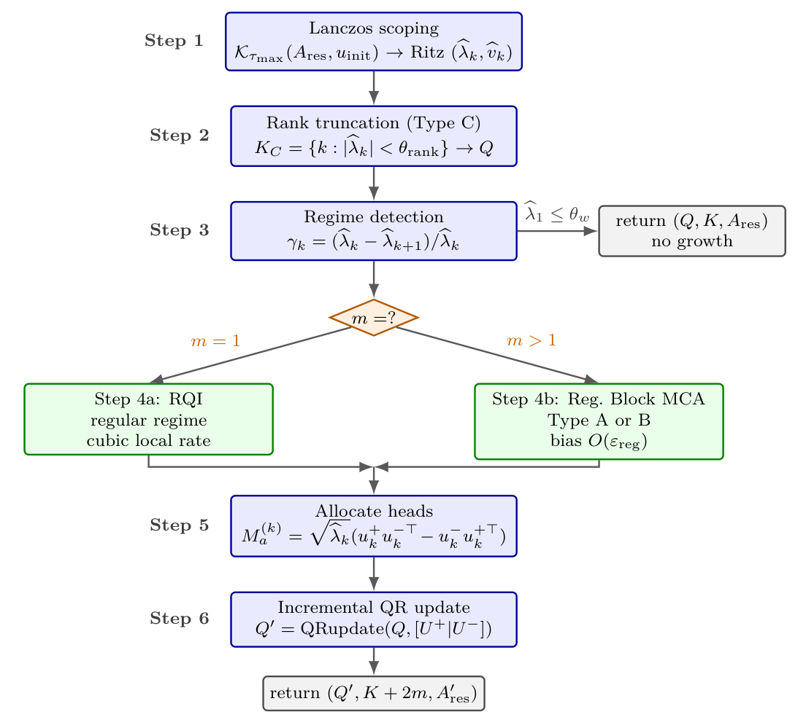

# Chapter 17: unified gate algorithm and regularised block flow

[Library index](../README.md) · [Source policy](../SOURCE.md) · [Previous: method comparison](0701-0702-ch17-incremental-qr-and-spectral-method-comparison.md) · [Next: subspace bias and convergence](0706-0709-ch17-subspace-bias-and-conditional-convergence.md)

> Editorial note: Full transcription of PDF 703–705 (printed pages 667–669). Algorithm 7 is broken into its printed six steps for readability; missing control keywords, the bare conditions, head-count update, costs, “four” thresholds above five rows, and the claim about identity-shift bias are preserved. Figure 17.5 is cropped directly from the PDF. Lemma 17.10 continues on PDF 706.

## PDF 703 · Book page 667

## 17.5 A unified gate

The methods of §17.4 are individually classical and well-understood. What is novel in this chapter is their composition into a single homeostatic algorithm that adapts to the spectral regime detected at each growth event, and that recovers the bidirectional gate of Chapter 15 as a limiting case in the regular regime. This is called composition the *unified gate*. Its specification consists of three elements: an algorithm (§17.5.1) that dispatches the spectral methods according to the regime classification of §17.3; a regularised variant of Block MCA EXIN (§17.5.2) that handles Type-B degeneracy with bounded bias; and a global convergence theorem (§17.5.3) that generalises Theorem 16.5 of Chapter 16 to all three regimes.

### 17.5.1 The unified gate algorithm

At each potential growth event, the unified gate executes the six-step procedure of Algorithm 7. The structure mirrors the block mechanism of Chapter 16 (Theorem 16.5), with the following key differences: a Lanczos scoping phase replaces the random initialisation of Block MCA EXIN; a rank-truncation step extracts kernel directions; the relative gap test dispatches between regular, Type-B, and Type-A regimes; and the deflation basis is maintained in incremental QR form throughout.

**Algorithm 7 Unified gate growth event**

current residual $A_{\mathrm{res}}\in\operatorname{Sym}(\mathbb R^d)$ deflation basis $Q\in\operatorname{St}(K,d)$ in incremental QR form thresholds $\theta_w,\theta_{\mathrm{rank}},\gamma_{\mathrm{near}},\varepsilon_{\mathrm{reg}},\tau_{\max}$ updated $(Q',K',A'_{\mathrm{res}})$ with $K'-K$ new heads

**Step 1 — Lanczos scoping.** Build Krylov basis $\mathcal K_{\tau_{\max}}(A_{\mathrm{res}},u_{\mathrm{init}})$ with random unit-norm $u_{\mathrm{init}}$ Compute Ritz values $\widehat\lambda_1\ge\cdots\ge\widehat\lambda_{\tau_{\max}}$ and Ritz vectors $\widehat V=[\widehat v_1\mid\cdots\mid\widehat v_{\tau_{\max}}]$

**Step 2 — Rank truncation (Type C).** $K_C\leftarrow\{k:|\widehat\lambda_k|<\theta_{\mathrm{rank}}\}$ kernel indices Append $\widehat V[:,K_C]$ to $Q$ as zero-cost kernel directions (incremental QR update) Update $A_{\mathrm{res}}\leftarrow P_Q^\perp A_{\mathrm{res}}P_Q^\perp$

**Step 3 — Regime detection (relative gap test, Definition 17.6).** Compute relative gaps $\gamma_k=(\widehat\lambda_k-\widehat\lambda_{k+1})/\widehat\lambda_k$ for non-kernel indices $m\leftarrow\max\{k:\gamma_j<\gamma_{\mathrm{near}}\text{ for }j<k\}$ $\widehat\lambda_1\le\theta_w$ $(Q,K,A_{\mathrm{res}})$ no growth required

**Step 4 — Refinement (regime-dispatched).** $m=1$ *Regular regime:* Rayleigh quotient iteration (§17.4.2) $u^+\leftarrow\operatorname{RQI}(A_{\mathrm{res}},\widehat v_1,\mathrm{tol})$ $u^-\leftarrow\operatorname{RQI}(A_{\mathrm{res}},\widehat v_{\tau_{\max}},\mathrm{tol})$ *Type-A or Type-B:* regularised Block MCA EXIN (§17.5.2) $U^+\leftarrow\operatorname{RegBlockMCA}(A_{\mathrm{res}},m,\varepsilon_{\mathrm{reg}})$ $U^-\leftarrow\operatorname{RegBlockMCA}(-P_{U^+}^\perp A_{\mathrm{res}}P_{U^+}^\perp,m,\varepsilon_{\mathrm{reg}})$

**Step 5 — Allocate heads.** $k=1,\ldots,m$ $\alpha_k\leftarrow\sqrt{\widehat\lambda_k}$ $M_a^{(k)}\leftarrow\alpha_k(u_k^+u_k^{-\top}-u_k^-u_k^{+\top})$ Factorise $M_a^{(k)}$ into $(W_Q^{(k)},W_K^{(k)})$ via Algorithm 3 of Cap. 15 Initialise $W_V^{(k)}$ along $u_k^+$ with NTK-optimal variance

**Step 6 — Incremental QR update of deflation basis.** $Q'\leftarrow\operatorname{QRupdate}(Q,[U^+\mid U^-])$ via Givens rotations (§17.4.4) $A'_{\mathrm{res}}\leftarrow P_{Q'}^\perp A_{\mathrm{res}}P_{Q'}^\perp$ $(Q',K+2m,A'_{\mathrm{res}})$

**Complexity.** The total cost of one execution of Algorithm 7 is dominated by the four most expensive steps:

- Lanczos scoping (Step 1): $O(\tau_{\max}d^2)$ for $\tau_{\max}$ matrix–vector products.
- Rayleigh quotient iteration (Step 4, regular regime): $O(d^2/\sqrt{\Delta_+}\cdot\log\log(1/\mathrm{tol}))$ via PCG.
- Regularised Block MCA EXIN (Step 4, Type-A/B): $O(Tmd^2)$ for $T$ iterations of the Stiefel flow.
- Incremental QR update (Step 6): $O(dK)$ via Givens rotations.

## PDF 704 · Book page 668

Summing the dominant terms,

$$
C_{\mathrm{unified}}=O\bigl((\tau_{\max}+Tm)d^2+dK\bigr),
\tag{17.36}
$$

matching the asymptotic cost of the Level-2 algorithm of Chapter 15 (Theorem 16.5 of Chapter 16, the corresponding complexity table) while providing strictly stronger guarantees on the three regimes.

**Default thresholds.** The four thresholds of Algorithm 7 are summarised in Table 17.4, with default values motivated by the analysis of §17.3 and the rate bounds of §17.4.

**Table 17.4:** Thresholds of the unified gate. Default values reproduce the behaviour of the Chapter 15 gate in the regular regime while extending coverage to Types A, B, C.

| Threshold | Default | Justification |
|---|---|---|
| $\theta_w$ | $0.40\,\Gamma_0$ | Growth criterion (Cap. 15, Tab. 1) |
| $\theta_{\mathrm{rank}}$ | $\sqrt{\varepsilon_{\mathrm{mach}}}\,\widehat\lambda_1$ | Wilkinson floating-point bound |
| $\gamma_{\mathrm{near}}$ | $0.05$ | Coherent with Level-2 trigger of Cap. 15 |
| $\varepsilon_{\mathrm{reg}}$ | $\sqrt{\varepsilon_{\mathrm{mach}}}\,\|A_{\mathrm{res}}\|$ | Scaling-invariant regularisation |
| $\tau_{\max}$ | $\min(8,K+4)$ | Krylov budget moderate, tighter for small $K$ |

**Reduction to the Chapter 15 gate.** When the spectrum is in the regular regime ($m=1$, no kernel directions), Algorithm 7 reduces as follows:

- Step 2 is a no-op ($K_C=\varnothing$).
- Step 3 returns $m=1$.
- Step 4 invokes RQI starting from the Lanczos Ritz vectors.
- Steps 5–6 are identical to the bidirectional growth step of Algorithm 5 of Chapter 15.

The only persistent difference from the Chapter 15 gate is the use of incremental QR (Step 6), which improves the deflation accuracy without changing the algorithmic logic. RQI replaces Oja’s rule with a method that is faster (cubic vs. linear local rate) but otherwise produces the same fixed point. In this sense, the unified gate is a strict refinement of the Chapter 15 gate: it does not introduce new behaviour in the regular regime, only better numerics.

### 17.5.2 Regularised Block MCA EXIN

The regularised Block MCA EXIN of Step 4 (Type-A/B branch) is a modification of the Block MCA EXIN mechanism of Chapter 16 (Theorem 16.5) that adds a small symmetric perturbation to break near-degeneracies. Given $A\in\operatorname{Sym}(\mathbb R^d)$ and a regularisation amplitude $\varepsilon_{\mathrm{reg}}>0$, the perturbed cost function is

$$
f_{B,\mathrm{reg}}(W)=\operatorname{tr}\bigl(W^\top(A+\varepsilon_{\mathrm{reg}}R)W\bigr),
\qquad W\in\operatorname{St}(m,d),
\tag{17.37}
$$

where $R\in\operatorname{Sym}(\mathbb R^d)$ is a fixed random symmetric matrix constrained to be orthogonal to the active subspace, $R=P_Q^\perp R'P_Q^\perp$ with $R'$ drawn once per growth event from the Gaussian orthogonal ensemble. The Stiefel gradient flow of (17.37) is the regularised Block MCA EXIN iteration; the geometry is otherwise identical to that of Chapter 15 (Theorem 16.4 there).

## PDF 705 · Book page 669

**Figure 17.5:** Flowchart of Algorithm 7.

*The pipeline is linear except for two control points: the early exit when no eigenvalue exceeds the growth threshold $\theta_w$ (Step 3, gray box on the right), and the regime dispatch in Step 4 (orange diamond) which selects between Rayleigh quotient iteration (regular regime, $m=1$) and regularised Block MCA EXIN (Type A or B, $m>1$). The dispatch is the only algorithmic novelty over the Level-2 step of Chapter 15: in the regular regime ($m=1$, $K_C=\varnothing$), the flowchart collapses to RQI followed by head allocation, recovering the bidirectional gate of Chapter 15 with RQI replacing Oja’s rule.*

> Editorial transcription of figure labels: Step 1, “Lanczos scoping”, $\mathcal K_{\tau_{\max}}(A_{\mathrm{res}},u_{\mathrm{init}})\to\operatorname{Ritz}(\widehat\lambda_k,\widehat v_k)$; Step 2, “Rank truncation (Type C)”, $K_C=\{k:|\widehat\lambda_k|<\theta_{\mathrm{rank}}\}\to Q$; Step 3, “Regime detection”, $\gamma_k=(\widehat\lambda_k-\widehat\lambda_{k+1})/\widehat\lambda_k$; exit $\widehat\lambda_1\le\theta_w$, “return $(Q,K,A_{\mathrm{res}})$”, “no growth”; diamond “$m=?$”, branches $m=1$ and $m>1$; “Step 4a: RQI”, “regular regime”, “cubic local rate”; “Step 4b: Reg. Block MCA”, “Type A or B”, “bias $O(\varepsilon_{\mathrm{reg}})$”; Step 5, “Allocate heads”, $M_a^{(k)}=\sqrt{\widehat\lambda_k}(u_k^+u_k^{-\top}-u_k^-u_k^{+\top})$; Step 6, “Incremental QR update”, $Q'=\operatorname{QRupdate}(Q,[U^+\mid U^-])$; “return $(Q',K+2m,A'_{\mathrm{res}})$”.

**Why $\varepsilon_{\mathrm{reg}}R$ and not $\varepsilon_{\mathrm{reg}}I$.** The natural alternative would be Tikhonov regularisation: replace $A$ by $A+\varepsilon_{\mathrm{reg}}I$. This shifts all eigenvalues uniformly by $\varepsilon_{\mathrm{reg}}$, which does not break degeneracy (eigenvalue gaps are unchanged) and introduces a uniform bias to all eigenvectors. The choice $\varepsilon_{\mathrm{reg}}R$ with $R$ random and projected breaks degeneracy in random directions while leaving the already-allocated subspace untouched, providing controlled perturbation exactly where it is needed.

**Lemma 17.10 (Bias of regularised Block MCA EXIN).** *Let $A\in\operatorname{Sym}(\mathbb R^d)$ have a Type-A or Type-B cluster of size $m$ at the dominant end, and write*

$$
\delta_{\mathrm{in}}=\lambda_1-\lambda_m\ge0,\qquad
\delta_{\mathrm{out}}=\lambda_m-\lambda_{m+1}>0,
\tag{17.38}
$$

*for the internal cluster spread and the external separation respectively. In Type A, $\delta_{\mathrm{in}}=0$; in Type B, $0<\delta_{\mathrm{in}}<\gamma_{\mathrm{near}}\lambda_1$. The external separation $\delta_{\mathrm{out}}$ is strictly positive in both regimes (otherwise the cluster of size $m$ was chosen too small and $\lambda_{m+1}$ should have been included). Let $V_m\subseteq\mathbb R^d$ denote the cluster subspace ($m$-eigenspace if Type A, top-$m$ subspace if Type B) and let $\widetilde V_m^*$ denote the limiting subspace of regularised Block MCA EXIN (17.37) with*
