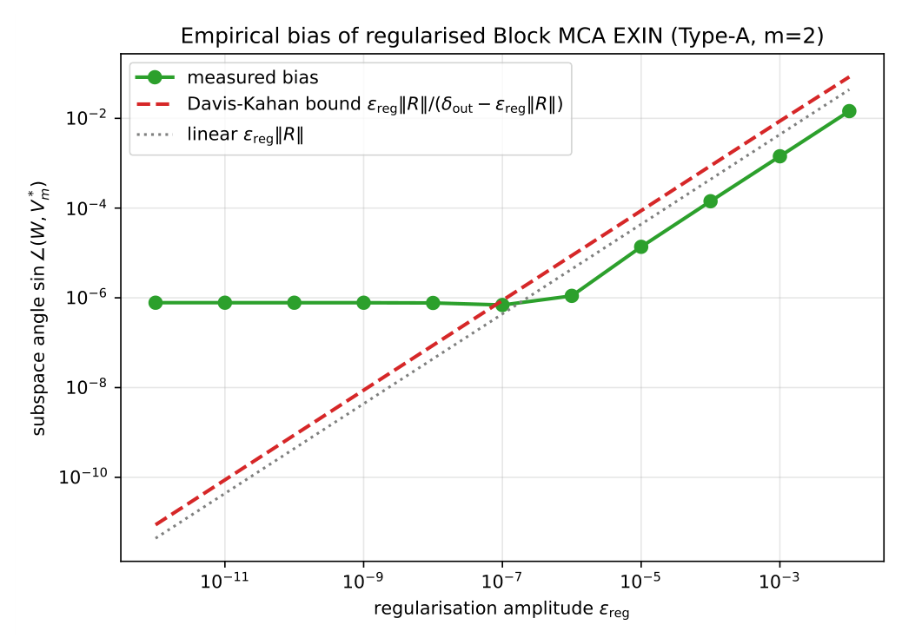

# Chapter 17: subspace bias and conditional convergence of the unified gate

[Library index](../README.md) · [Source policy](../SOURCE.md) · [Previous: regularised block flow](0703-0705-ch17-unified-gate-algorithm-and-regularised-block-flow.md#lemma-17-10) · [Next: tracking and structural accounting](0710-0713-ch17-tracking-complexity-and-kernel-example.md)

> Editorial note: Full transcription of PDF 706–709 (printed pages 670–673). This file completes Lemma 17.10, retains the author-reported bias experiment and hypotheses U1–U4, and preserves the conditional convergence theorem, proof and original claims of uniformity. Figure 17.6 is a direct PDF crop. Corollary 17.12 continues on PDF 710.

## PDF 706 · Book page 670

*regularisation $\varepsilon_{\mathrm{reg}}$. If $\varepsilon_{\mathrm{reg}}\|R\|_2\le\delta_{\mathrm{out}}/2$, the principal angles between $V_m$ and $\widetilde V_m^*$ satisfy*

$$
\sin\angle(V_m,\widetilde V_m^*)
\le\frac{\varepsilon_{\mathrm{reg}}\|R\|_2}
{\delta_{\mathrm{out}}-\varepsilon_{\mathrm{reg}}\|R\|_2}
\le\frac{2\varepsilon_{\mathrm{reg}}\|R\|_2}{\delta_{\mathrm{out}}}.
\tag{17.39}
$$

*Proof.* Apply the Davis–Kahan $\sin\theta$ theorem (Stewart and Sun, 1990, Theorem V.3.6) to the symmetric perturbation $\delta A=\varepsilon_{\mathrm{reg}}R$ with $\|\delta A\|_2=\varepsilon_{\mathrm{reg}}\|R\|_2$. The cluster $V_m$ is associated to the spectral set $\{\lambda_1,\ldots,\lambda_m\}$, separated from the remainder of $\sigma(A)$ by $\delta_{\mathrm{out}}$. By Weyl’s inequality the perturbed cluster is separated from the rest of $\sigma(\widetilde A)$ by at least $\delta_{\mathrm{out}}-\|\delta A\|_2>0$, which is positive by hypothesis. The classical Davis–Kahan $\sin\theta$ bound on subspaces with separated spectral sets then gives

$$
\sin\angle(V_m,\widetilde V_m^*)
\le\frac{\|\delta A\|_2}{\delta_{\mathrm{out}}-\|\delta A\|_2},
\tag{17.40}
$$

and the second inequality in (17.39) follows from $\|\delta A\|_2\le\delta_{\mathrm{out}}/2$. $\square$

**Two roles for the regularisation.** The bound (17.39) controls the bias of the recovered subspace relative to the unperturbed cluster $V_m$. It assumes the iteration converges to $\widetilde V_m^*$, which is itself a non-trivial requirement when $\delta_{\mathrm{in}}=0$: the unregularised flow has a degenerate $m$-fold critical manifold and may not converge to a particular basis. The role of $\varepsilon_{\mathrm{reg}}R$ is precisely to lift this degeneracy: the regularised operator $\widetilde A=A+\varepsilon_{\mathrm{reg}}R$ has internal cluster spread $\delta_{\mathrm{in}}^{\mathrm{reg}}>0$ almost surely with respect to the realisation of $R$, so each direction within the cluster acquires a strict local gap and Theorem 16.5 of Chapter 16 delivers almost-sure convergence to the perturbed basis $\widetilde V_m^*$. The amplitude of the lifted internal gap plays no role in the bias bound (17.39); only the external separation $\delta_{\mathrm{out}}$ does. In particular, in Type B with $\delta_{\mathrm{in}}>0$ already, the regularisation is not strictly needed for convergence; in Type A with $\delta_{\mathrm{in}}=0$, it is.

**Choice of $\varepsilon_{\mathrm{reg}}$.** The default value $\varepsilon_{\mathrm{reg}}=\sqrt{\varepsilon_{\mathrm{mach}}}\|A_{\mathrm{res}}\|$ achieves the smallest bias compatible with strict positivity of the regularised gap in floating-point arithmetic. Smaller values are dominated by floating-point noise; larger values introduce unnecessary bias. Lemma 17.10 predicts a bias of order $\sqrt{\varepsilon_{\mathrm{mach}}}\approx10^{-8}$ in double precision, well below any other source of error in the gate dynamics.

**Empirical verification (linear regime above an iteration floor).** A sweep over six orders of magnitude of $\varepsilon_{\mathrm{reg}}\in[10^{-12},10^{-2}]$ on a Type-A degenerate spectrum of multiplicity $m=2$ in $d=8$ produces the bias trajectory of Figure 17.6.

The measured bias (green dots) exhibits two regimes: an iteration-floor plateau at $\sim8\cdot10^{-7}$ for small $\varepsilon_{\mathrm{reg}}$, and a linear regime with empirical slope $1.0075$ for $\varepsilon_{\mathrm{reg}}\gtrsim10^{-6}$. The Davis-Kahan upper bound of Lemma 17.10 (red dashed) is $\approx5\times$ conservative but captures the slope correctly. Two regimes are visible:

- For $\varepsilon_{\mathrm{reg}}\gtrsim10^{-6}$, the measured bias scales linearly with $\varepsilon_{\mathrm{reg}}$, with empirical slope $1.0075$ in log-log fit (predicted by Lemma 17.10: slope 1). The Davis-Kahan upper bound is approximately $5\times$ conservative but captures the slope correctly.
- For $\varepsilon_{\mathrm{reg}}\lesssim10^{-6}$, the bias plateaus at an iteration floor of $\sim8\cdot10^{-7}$, independent of $\varepsilon_{\mathrm{reg}}$. The floor is the residual error of the Stiefel-flow discretisation itself (here: 300 iterations with learning rate $0.05$); it is unrelated to the regularisation and would shrink under a tighter optimisation budget.

## PDF 707 · Book page 671

The operational consequence is that the default $\varepsilon_{\mathrm{reg}}=\sqrt{\varepsilon_{\mathrm{mach}}}\|A_{\mathrm{res}}\|\sim10^{-8}$ falls below the iteration floor on this benchmark: the bias contribution of the regularisation is in this case dominated by the optimisation residual, not by the perturbation. In operational practice, $\varepsilon_{\mathrm{reg}}$ should be chosen adaptively at one decade above the empirically estimated iteration floor: this preserves the linear-regime guarantee of Lemma 17.10 without the false economy of suboptimal regularisation. The default $\sqrt{\varepsilon_{\mathrm{mach}}}\|A_{\mathrm{res}}\|$ remains valid as a lower bound, but the effective bias may be set by the optimisation budget rather than by the perturbation amplitude.

**Figure 17.6:** Empirical bias of regularised Block MCA EXIN on a Type-A degenerate spectrum ($d=8$, $m=2$), as a function of the regularisation amplitude $\varepsilon_{\mathrm{reg}}$.

> Editorial transcription of figure labels: title “Empirical bias of regularised Block MCA EXIN (Type-A, m=2)”; legend “measured bias”, “Davis-Kahan bound $\varepsilon_{\mathrm{reg}}\|R\|/(\delta_{\mathrm{out}}-\varepsilon_{\mathrm{reg}}\|R\|)$”, “linear $\varepsilon_{\mathrm{reg}}\|R\|$”; vertical axis “subspace angle $\sin\angle(W,V_m^*)$”, ticks $10^{-2},10^{-4},10^{-6},10^{-8},10^{-10}$; horizontal axis “regularisation amplitude $\varepsilon_{\mathrm{reg}}$”, ticks $10^{-11},10^{-9},10^{-7},10^{-5},10^{-3}$.

**Connection to perturbation-and-deflation (Strategy B3).** The regularised Block MCA EXIN realises Strategy B3 of §17.3.2 operationally: the perturbation $\varepsilon_{\mathrm{reg}}R$ artificially separates the cluster, the perturbed iteration converges almost surely, and the recovered subspace $\widetilde V_m^*$ approximates the true cluster subspace $V_m$ with controlled bias. The deflation step in §17.4.4 then proceeds on the unperturbed $A_{\mathrm{res}}$ using the recovered subspace, so the bias of the recovered subspace propagates only to one growth event and does not accumulate.

### 17.5.3 Convergence of the unified gate

The convergence theorem of the unified gate generalises Theorem 16.5 of Chapter 16 (single-pass Block MCA EXIN convergence) to the full algorithmic composition of Algorithm 7, and weakens the spectral gap assumption to allow Type-B near-degeneracy and Type-C kernel directions. The price for the relaxation is a list of four regime-stability hypotheses (U1)–(U4) that play, for the unified gate, the role that the strict gap hypothesis $\Delta_+>0$ played for the bidirectional gate of Chapter 15.

**(U1) Eventually stable regime classification.** There exists $T_0<\infty$ such that, for all growth events at training times $t>T_0$, the regime detected by Algorithm 7 (regular / Type-A/B / Type-C) coincides with the asymptotic regime of the limiting residual operator $A_{\mathrm{res}}^*$.

## PDF 708 · Book page 672

**(U2) External cluster separation.** Every non-kernel cluster of $A_{\mathrm{res}}^*$ recovered as a structural unit has external separation $\delta_{\mathrm{out}}>0$ from the rest of the spectrum, in the sense of (17.38).

**(U3) Sufficient dwell time per branch.** At each growth event, the chosen spectral branch is run for a number of iterations $T_{\mathrm{branch}}$ that meets its branch-specific tolerance (geometric for RQI in the basin of attraction, almost-sure for regularised Block MCA EXIN, polynomial for Lanczos restarts).

**(U4) Rank-preserving regularisation.** The amplitude $\varepsilon_{\mathrm{reg}}$ satisfies $\varepsilon_{\mathrm{reg}}\|R\|_2\le\delta_{\mathrm{out}}/2$ for every cluster recovered, and $\varepsilon_{\mathrm{reg}}\ge\theta_{\mathrm{rank}}$ (so that the regularisation does not push any non-kernel direction into the kernel set $K_C$).

**Theorem 17.11 (Unified gate convergence, conditional).** *Consider an INCRT trained under Centered Attention (§4 of Chapter 15), with the bidirectional gate replaced by the unified gate of Algorithm 7. Assume the standing hypotheses of Chapter 15, namely (i) Robbins–Monro learning rate $\sum_t\eta(t)=\infty$, $\sum_t\eta(t)^2<\infty$; (ii) bounded second moment of the input distribution, $\mathbb E[\|X\|_F^2]<\infty$; (iii) directional task complexity $\kappa_A<\infty$; (iv) dwell time $T_{\mathrm{conv}}$ satisfying the moving-target condition (17.42) below.*

*Assume in addition the regime-stability hypotheses (U1)–(U4) above. Then with probability one the architecture stabilises at finitely many heads $N^*$ distributed across finitely many layers $L^*$, and for each recovered cluster the unified-gate estimate $\widehat V_m^{(t)}$ satisfies*

$$
\sin\angle(\widehat V_m^{(t)},V_m^*)
\le C\frac{\varepsilon_{\mathrm{reg}}\|R\|_2}{\delta_{\mathrm{out}}}
+O\bigl(e^{-c\,t/T_{\mathrm{conv}}}\bigr),
\tag{17.41}
$$

*where $V_m^*$ is the corresponding cluster subspace of the limiting residual operator $A_{\mathrm{res}}^*$ (with kernel directions excluded), $C\le2$ is the Davis–Kahan constant of Lemma 17.10, and $c$ depends on the branch chosen by the dispatch but not on $d$ or $K$.*

*Proof.* The proof composes the three existing convergence results corresponding to the three branches of Algorithm 7 with the regularisation analysis of Lemma 17.10.

**Step 1: dispatch correctness.** The relative gap test (Definition 17.6) classifies $A_{\mathrm{res}}$ at each growth event into one of three regimes (regular, Type-A/B, Type-C). Hypothesis (U1) is exactly the assertion that this classification is asymptotically correct; under it, for $t>T_0$ the dispatch in Algorithm 7 matches the true asymptotic regime of $A_{\mathrm{res}}^*$. Lemma 17.7 provides a sufficient condition for (U1): the moving-target drift of Theorem 16.3 of Chapter 16 is $\beta_t=o(\eta(t))$, which is below the stability threshold of the gap test for sufficiently large $t$. (U1) is treated as a hypothesis because it can fail in pathological cases not covered by Lemma 17.7 alone (e.g., clusters whose external separation is itself drifting toward zero).

**Step 2: branch-wise convergence.** Within each regime, the appropriate spectral method converges to the correct limit:

- *Regular branch.* RQI from a Lanczos starting vector converges cubically locally (Lemma 17.8); the Lanczos rate of Lemma 17.9 guarantees that the starting vector is within the basin of attraction after $O(\log(1/\Delta_+))$ Lanczos restarts. Hypothesis (U3) ensures $T_{\mathrm{branch}}$ is large enough to enter the cubic regime.
- *Type-A/B branch.* Regularised Block MCA EXIN converges almost surely to a limiting subspace $\widetilde V_m^*$ at distance (17.39) from $V_m$, by Lemma 17.10. Hypotheses (U2) and (U4) provide the strictly positive external separation $\delta_{\mathrm{out}}$ and the small-perturbation bound $\varepsilon_{\mathrm{reg}}\|R\|_2\le\delta_{\mathrm{out}}/2$ that the lemma requires.

## PDF 709 · Book page 673

- *Type-C branch.* Kernel directions are appended to the deflation basis without an iterative subroutine; convergence is immediate.

**Step 3: composition.** The exponential decay term in (17.41) arises from the geometric convergence of the chosen branch (with rate dominated by the slowest of RQI, regularised Block MCA EXIN, or Lanczos depending on the regime). The bias term $C\varepsilon_{\mathrm{reg}}\|R\|_2/\delta_{\mathrm{out}}$ is the content of (17.39), applicable in the Type-A/B branch; in the regular branch the regularisation is not invoked and the bias is zero. The dwell-time condition

$$
T_{\mathrm{conv}}\ge c_0\delta_{\mathrm{out}}^{-2}
\log\bigl(n/\rho_{\max}^{2L}\bigr)
\tag{17.42}
$$

matches that of the dwell-time condition of Chapter 15 with the gap $\Delta_+$ replaced by the external cluster separation $\delta_{\mathrm{out}}$. Under (U2), $\delta_{\mathrm{out}}$ is bounded away from zero, so the dwell time is finite uniformly in the regime.

**Step 4: architecture stabilisation.** The remainder of the proof follows Theorem 16.11 of Chapter 16 verbatim: the global Lyapunov functional $V(t)$ of Lemma 15.18 of Chapter 15 is non-increasing along the unified gate dynamics (each step of Algorithm 7 is a special case of the Level-1/2 dynamics for which $V(t)$ was constructed), and finite $\kappa_A$ implies finitely many growth events. $\square$

**Comparison with Theorem 16.5 of Chapter 16.** The previous convergence theorem of Block MCA EXIN required strict internal gap $\lambda_m>\lambda_{m+1}$ at the limit, and provided no treatment of the case where $\lambda_1=\cdots=\lambda_m$. Theorem 17.11 weakens the strict-gap requirement in two ways: (i) it allows $\lambda_1=\cdots=\lambda_m$ at the limit (Type-A clusters), provided the external separation $\delta_{\mathrm{out}}=\lambda_m-\lambda_{m+1}>0$ is positive (hypothesis (U2)); and (ii) it allows arbitrarily small but positive internal spread (Type B), again under the same external separation. The price is the explicit bias term $C\varepsilon_{\mathrm{reg}}\|R\|_2/\delta_{\mathrm{out}}$ in (17.41); for the default $\varepsilon_{\mathrm{reg}}=\sqrt{\varepsilon_{\mathrm{mach}}}\|A_{\mathrm{res}}\|$ and a typical $\delta_{\mathrm{out}}/\|A_{\mathrm{res}}\|\sim10^{-2}$, the bias is $O(10^{-6})$ in double precision, well below the iteration floor identified in Figure 17.6.

### 17.5.4 Implications for the moving-target theorem

The unified gate refines the moving-target theorem of Chapter 16 (Theorem 16.3 there) on two fronts: the jump bound $J_{\max}$ is reduced, and the dwell time $T_{\mathrm{conv}}$ is bounded uniformly in the regime.

**Corollary 17.12 (Refined moving-target bound).** *Under the hypotheses of Theorem 17.11, the moving-target jump bound at Level-3 growth events satisfies*

$$
J_{\max}^{\mathrm{unified}}=O(1/n+\varepsilon_{\mathrm{reg}}),
\tag{17.43}
$$

*and the dwell-time condition becomes*

$$
T_{\mathrm{conv}}^{\mathrm{unified}}
\ge c_0\delta_{\mathrm{out}}^{-2}\log\bigl(n/\rho_{\max}^{2L}\bigr),
\tag{17.44}
$$

*with $\delta_{\mathrm{out}}$ the external cluster separation (17.38) guaranteed by hypothesis (U2).*

*Proof.* The jump bound of Equation **??** in Theorem 16.3 of Chapter 16 contains a factor $\|Q^\top Q-I\|_2$ from the orthogonality drift of the deflation basis. Replacing classical Gram–Schmidt with incremental Givens QR (§17.4.4) reduces this factor from $O(K\varepsilon_{\mathrm{mach}})$ to $O(\varepsilon_{\mathrm{mach}})$, eliminating the dependence on $K$. The remaining $1/n$ factor is unchanged (it arises from the identity initialisation of Definition 15.41 of Chapter 15). The $\varepsilon_{\mathrm{reg}}$ contribution
