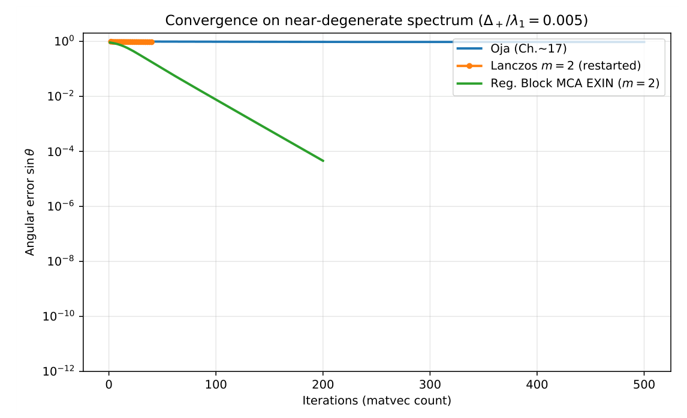

# Chapter 17: empirical diagnostics and numerical fallback for signed gates

[Library index](../README.md) · [Source policy](../SOURCE.md) · [Previous: experimental setup](0710-0713-ch17-tracking-complexity-and-kernel-example.md#section-17-6-3) · [Next: signed-score conditioning](0718-0721-ch17-signed-score-conditioning-and-numerical-floor.md#pdf-0718)

> Editorial note: Full transcription of PDF 714–717 (printed pages 678–681). Figure 17.7 is a direct PDF crop. Author-reported numerical results, the explicitly unperformed SARS-CoV-2 rerun prediction, source reference numbers, residual conventions and signed-gap definitions are preserved. Section 17.6.5 continues on PDF 718 after the completed fallback definition.

## PDF 714 · Book page 678

**Figure 17.7:** Convergence of three spectral methods on the near-degenerate spectrum (17.49) ($\Delta_+/\lambda_1=0.005$).

*Oja’s rule (blue) and single-vector restarted Lanczos $m=2$ (orange) remain close to $\sin\theta\approx1$ within the iteration budget tested: the dominant eigenvector is formally defined but poorly conditioned at this gap, and single-vector methods do not converge to the prescribed angular tolerance within a practical budget. The regularised Block MCA EXIN (green) converges exponentially to the 2-dimensional dominant subspace, reaching angular error $5\times10^{-5}$ in 185 iterations. The qualitative difference confirms the rationale for the regime-dispatched architecture of Algorithm 7: in Type-B regimes, the practically stable object under finite budgets is the subspace, recovered by block methods.*

> Editorial transcription of figure labels: title “Convergence on near-degenerate spectrum ($\Delta_+/\lambda_1=0.005$)”; legend “Oja (Ch.~17)”, “Lanczos $m=2$ (restarted)”, “Reg. Block MCA EXIN ($m=2$)”; vertical axis “Angular error $\sin\theta$”, ticks $10^0,10^{-2},10^{-4},10^{-6},10^{-8},10^{-10},10^{-12}$; horizontal axis “Iterations (matvec count)”, ticks $0,100,200,300,400,500$.

**Quantitative results.** Table 17.5 summarises the iteration counts to reach angular error $10^{-4}$ and the final errors after the prescribed budget.

**Table 17.5:** Quantitative comparison of methods on the near-degenerate spectrum of (17.49). “Inf” indicates the method did not reach the threshold within the iteration budget.

| Method | Iterations to $\sin\theta<10^{-4}$ | Final error |
|---|---:|---:|
| Oja (Chapter 15) | $\infty$ | $9.5\times10^{-1}$ |
| Lanczos $m=2$ (single vector) | $\infty$ | $9.4\times10^{-1}$ |
| Reg. Block MCA EXIN ($m=2$) | 185 | $4.6\times10^{-5}$ |

**Reading the result.** The qualitative observation is the following. In exact Type A ($\lambda_1=\lambda_2$ strictly), the dominant eigenvector is not even well-defined and *no single-vector method can converge to a unique dominant eigenvector*, because no such vector exists; only the dominant $m$-eigenspace does. In near-degenerate Type B ($\lambda_1>\lambda_2$ but $\lambda_1-\lambda_2\ll\|A\|$), the dominant eigenvector is formally defined but poorly conditioned: single-vector methods may require a prohibitive number of iterations and become numerically unstable or practically saturated under finite budgets. In the experiment of Table 17.5, with a gap $\lambda_1-\lambda_2=0.01$ and the iteration budget tested, the angular error to $v_1$ of Oja’s rule and of restarted single-vector Lanczos remains close to the maximum overlap of $u_0$ with the dominant subspace projected onto $v_1$, which is generically $O(1)$. This is not a categorical failure of the algorithm but a

## PDF 715 · Book page 679

statement about the geometry of the problem together with a finite-budget limitation: in Type-B regimes, the correct stable object for architectural decisions is the dominant subspace, not the individual vector, and the regularised Block MCA EXIN of §17.5.2 recovers it within the same budget under which the Chapter 15 gate has not yet converged.

**Connection to the Lyapunov argument.** The convergence of regularised Block MCA EXIN follows from Theorem 17.11 applied to the Type-B branch of Algorithm 7. The exponential rate of $\sim0.95$ per iteration (visible in the green curve of Figure 17.7) is consistent with the predicted rate $\widetilde\Delta_m^{\mathrm{reg}}=\lambda_2-\lambda_3=0.99$ on the regularised operator (the second non-degenerate gap, since $\lambda_1-\lambda_2$ is artificially open after regularisation). This is the practical realisation of the bias bound of Lemma 17.10: the Block MCA EXIN converges to a 2-dimensional subspace that approximates $V_2=\operatorname{span}\{v_1,v_2\}$ with bias of order $\varepsilon_{\mathrm{reg}}=10^{-8}$, well below the $5\times10^{-5}$ final angular error (which is dominated by the residual exponential decay at iteration 200).

### 17.6.4 Re-reading the SARS-CoV-2 experiment

The empirical run of Section 8.1 of Chapter 18 (the SARS-CoV-2 8-class variant classification of Chapter 15 Section 8.1, now relocated to Chapter 18 in the present numbering) exhibits two features that are naturally explained by the regime classification of §17.3.

**Feature 1: the flattening of $\Gamma_{\mathrm{res}}$.** Figure 15.9 of Chapter 18 shows that the residual energy $\Gamma_{\mathrm{res}}$ decays sharply during the first three growth events, then flattens from $K=3$ onward. The Chapter 15 interpretation is that the remaining heads are allocated to the “inter-head reciprocal structure” rather than to additional principal directions (Cirrincione, 2026c, Section 8.1).

The unified gate suggests a plausible interpretation of the flattening as the onset of a mixed low-energy regime. After the first growth events, the remaining residual may enter a regime in which some directions are numerical kernel directions below $\theta_{\mathrm{rank}}$, while others remain above $\theta_{\mathrm{rank}}$ but below the architectural threshold $\theta_w$. The unified gate would distinguish these two cases: the former are appended to the deflation basis as kernel directions, the latter are sub-growth directions that do not satisfy the architectural threshold of Chapter 15 and would not trigger an accepted growth event under the level-one or level-two protection rule of Chapter 16. The Chapter 15 algorithm, as originally run, observes only the scalar residual trajectory and does not draw this distinction; it continues to allocate heads in any direction whose deflation contribution is non-trivial, including sub-growth ones. Under the unified gate, those sub-growth directions would not be allocated as structural heads, terminating with $K_{\mathrm{struct}}^*=3$ structural units instead of $K^*=6$. This is a hypothesis to be tested, not an established fact: the experiment has not been re-run with the unified gate, and the interpretation above is consistent with the observed flattening but not the only possible reading.

**Feature 2: residual energy floor.** The geometric-decay theorem of Cirrincione (2026e) predicts $\Gamma_{\mathrm{res}}^{(K)}\le\rho^K\Gamma_0$ with $\rho<1$. Figure 15.9 of Chapter 18 shows that the measured $\Gamma_{\mathrm{res}}^{(K)}$ deviates upward from the predicted exponential after $K=3$, settling at a floor of $\Gamma_{\mathrm{res}}\approx750$. This floor may be interpreted as a mixture of two contributions: the cumulative directional energy of numerical kernel directions, $\Gamma_{\mathrm{res}}^{(\mathrm{ker})}=\sqrt{\sum_{k\in K_C^*}\lambda_k^2}$, which under exact arithmetic would be zero but under floating-point accumulation reaches $O(\sqrt{K\varepsilon_{\mathrm{mach}}}\cdot\Gamma_0)\sim10^2$ at $K=100$; and sub-threshold but non-kernel directions whose eigenvalues lie above $\theta_{\mathrm{rank}}$ yet

## PDF 716 · Book page 680

below $\theta_w$, contributing residual energy that does not justify further structural allocation. Under exact arithmetic, only the second contribution would survive; under floating-point arithmetic, the two are entangled in the observed floor. As with Feature 1, this is a plausible reading consistent with the data, not an established decomposition: the re-run under the unified gate has not yet been performed.

**A diagnostic prediction.** The reading above suggests a testable hypothesis rather than an established result. *Prediction (diagnostic, to be verified in Chapter 18):* a re-run of the SARS-CoV-2 experiment under the unified gate of Algorithm 7 would terminate at $K_{\mathrm{struct}}^*\approx3$ structural units (down from $K^*=6$) without loss of test accuracy, because the three additional heads allocated by the Chapter 15 algorithm should be flagged by the rank-truncation step as Type-C kernel directions and appended to the deflation basis $Q$ rather than receiving non-trivial motors $M_a^{(k)}$. The prediction is testable in the sense of §17.6.4 and provides a concrete falsification target for the framework: if the re-run produces $K_{\mathrm{struct}}^*\approx6$, the Type-C activation reading of the $\Gamma_{\mathrm{res}}$ flattening is wrong and the residual energy at $K\ge4$ comes from non-kernel sources. The experiment is not run here, deferring it to Chapter 18.

### 17.6.5 Signed gates, alignment drift, and residual-mode stability

The numerical framework of this chapter was developed for the bidirectional gate of Chapter 15, whose target is the dominant eigendirection of the positive semi-definite residual operator $A_{\mathrm{res}}$. Chapter 16 extends the controller to the indefinite setting by introducing the head-level signed residual operator

$$
A_h^{\mathrm{sig}}=\operatorname{sym}(\Sigma_XK_h)
=\tfrac12[\Sigma_X,K_h],
\qquad K_h=\operatorname{skew}(M_{\mathrm{eff},h}),
$$

and its layer-level aggregated counterpart $A_{\mathrm{res}}^{\mathrm{sig}}$. By Proposition 16.13.1 of Chapter 16, the operator is symmetric and traceless; by Corollary 16.13.2 there, its spectrum is indefinite whenever it is non-zero, with at least one strictly positive and one strictly negative eigenvalue. The level-two protection rule of that chapter reads

$$
S_h(t)=
\frac{\bar\rho_h(t)}{\rho(A_h^{\mathrm{sig}}(t))+\varepsilon_\rho}
\bigl(1-R_h(t)\bigr)Q_h(t),
\qquad
\bar\rho_h(t)=\tfrac12\bigl(\lambda_h^+(t)-\lambda_h^-(t)\bigr),
$$

where $(u_h^+,u_h^-)$ is a leading positive–negative eigenvector pair of $A_h^{\mathrm{sig}}(t)$ with eigenvalues $\lambda_h^+(t)>0$ and $\lambda_h^-(t)<0$, possibly Polyak–Ruppert averaged over the current control window. The present subsection specialises the numerical framework of this chapter to that score: it identifies the spectral quantity whose smallness governs gate stability, records the alignment-drift bound that the level-two rule inherits, and quantifies the class leakage that the absence of a structural involution makes inevitable in finite arithmetic.

**Two spectral quantities: signed gap and class-internal gaps.** Two spectral quantities, with different operational roles, govern the numerical behaviour of the signed pair. The *signed gap*

$$
\Delta_h^\pm(t)=\min\bigl(\lambda_h^+(t),|\lambda_h^-(t)|\bigr)
\tag{17.50}
$$

measures the distance of the signed pair $(\lambda_h^+,\lambda_h^-)$ from the common numerical kernel of $A_h^{\mathrm{sig}}$, and governs whether a stable positive–negative pair exists at all. The *class-internal gaps*

$$
g_h^+(t)=\lambda_h^+(t)-\lambda_h^{++}(t),\qquad
g_h^-(t)=|\lambda_h^-(t)|-|\lambda_h^{--}(t)|,
\tag{17.51}
$$

## PDF 717 · Book page 681

with $\lambda_h^{++}$ and $\lambda_h^{--}$ the second-largest positive and second-most-negative eigenvalues of $A_h^{\mathrm{sig}}$, measure the separation between the leading eigenvector and the next eigenvector within each class, and govern the angular sensitivity of $(u_h^+,u_h^-)$. The two quantities are independent: $\Delta_h^\pm$ may be large while $g_h^+$ or $g_h^-$ is small, and conversely.

**Type-A/B/C dispatch on the signed pair.** With the two quantities in place, the dispatch is run separately on the positive and on the negative class, with one structural specialisation per regime.

Type-A (exact degeneracy) occurs when $A_h^{\mathrm{sig}}$ has an eigenvalue of multiplicity $m\ge2$ on the positive class or on the negative class, that is, when $g_h^+=0$ or $g_h^-=0$; the appropriate response is a block extraction on the affected class, as in §17.4.4, with the other class unchanged.

Type-B (near-degeneracy) occurs when $g_h^+>0$ or $g_h^->0$ but small relative to $\|A_h^{\mathrm{sig}}\|$: the dominant eigenvector within the affected class is formally defined but poorly conditioned, and single-vector methods on that class may require a prohibitive number of iterations and become numerically unstable or practically saturated under finite budgets. The regularised block branch of §17.5 applies to the affected class with its own regularisation amplitude, and the correct stable object for the score on that class is the dominant subspace rather than the individual eigenvector.

Type-C (kernel direction) occurs when one of $\lambda_h^+$ or $|\lambda_h^-|$ falls below a *numerical-rank threshold*

$$
\theta_{\mathrm{rank}}=\sqrt{\varepsilon_{\mathrm{mach}}}\|A_h^{\mathrm{sig}}\|,
\tag{17.52}
$$

the standard floating-point rank-detection floor. The threshold $\theta_{\mathrm{rank}}$ is distinct from the growth threshold $\theta_w$ of Chapter 15: $\theta_{\mathrm{rank}}$ marks the level at which an eigenvalue ceases to be numerically distinguishable from zero, while $\theta_w$ marks the level below which a structural mode fails the architectural growth or protection criterion. An eigenvalue may lie above $\theta_{\mathrm{rank}}$ and below $\theta_w$: it is then a non-kernel sub-growth mode, not a Type-C kernel direction.

**Definition 17.15 (Numerical fallback for the level-two rule).** At a diagnostic time $t$, the level-two protection rule of Chapter 16 is computed as follows.

(i) If $\lambda_h^+(t)\ge\theta_{\mathrm{rank}}$ and $|\lambda_h^-(t)|\ge\theta_{\mathrm{rank}}$, both members of the signed pair are above the numerical-rank floor and $S_h(t)$ is computed directly from its definition. Within this case, if $g_h^+(t)$ or $g_h^-(t)$ is small relative to $\|A_h^{\mathrm{sig}}\|$, the affected class is first stabilised by the regularised block branch of §17.5 before the score is evaluated.

(ii) If exactly one of $\lambda_h^+(t)$, $|\lambda_h^-(t)|$ falls below $\theta_{\mathrm{rank}}$, the corresponding member of the signed pair is treated as a Type-C kernel direction; the head reverts to the level-one rule of Chapter 15 on the surviving response.

(iii) If both fall below $\theta_{\mathrm{rank}}$, the operator $A_h^{\mathrm{sig}}(t)$ is numerically zero and the head is excluded from the protection set without further computation of $S_h(t)$.

The architectural growth threshold $\theta_w$ remains the criterion that selects which surviving responses produce an accepted growth or protection event, and is applied after the fallback above.

The fallback is a numerical safeguard, not a redefinition of the level-two rule. In the regular regime it coincides with the mathematical definition of Chapter 16; in the pathological regimes it routes the controller to a less informative but better-conditioned rule, which is the same construction principle that governs the unified gate of §17.5.
