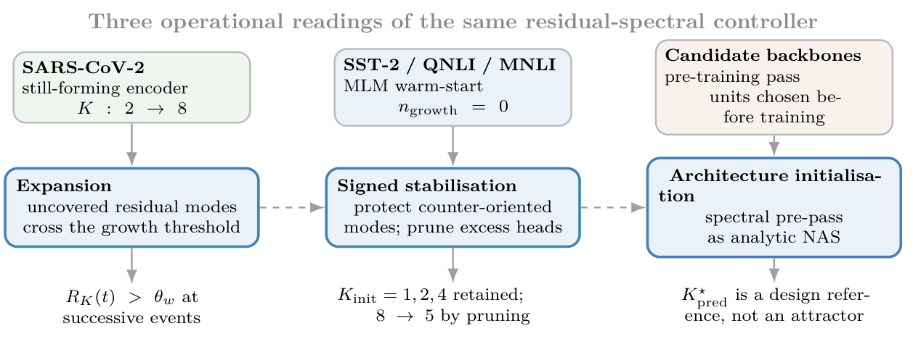
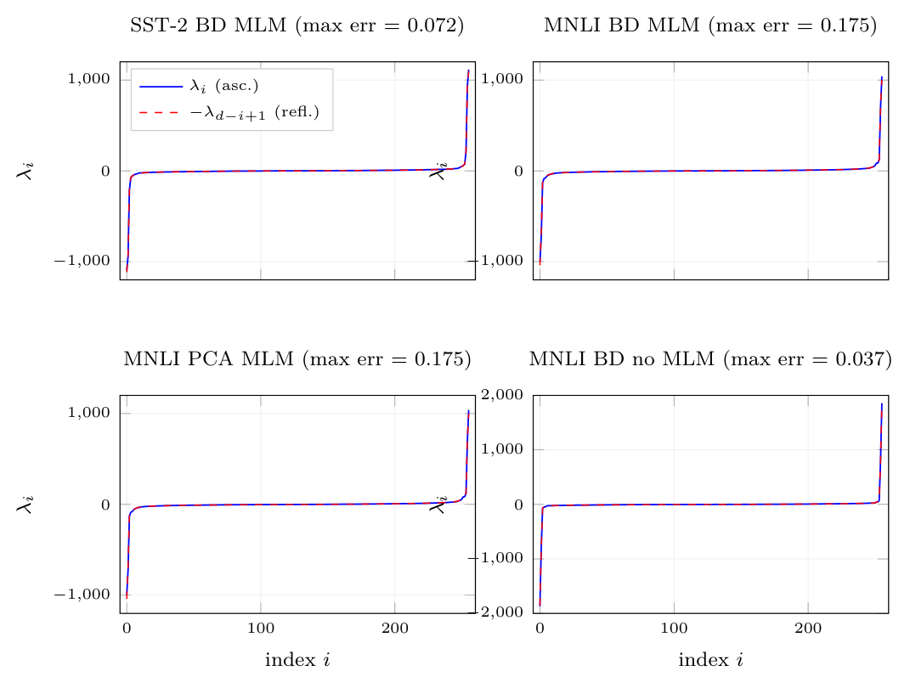

# Chapter 18: warm-start protocol, operational regimes, and signed spectral pairing

[Library index](../README.md) · [Source and transcription policy](../SOURCE.md)

[Previous source](0722-0725-ch17-adaptive-dispatch-and-optimiser-aware-gates.md#pdf-0725) · [Following source](0729-0731-ch18-signed-pruning-and-initial-head-count-sweep.md#pdf-0729)

## PDF 726 · Book page 690

# Chapter 18

# Experimental Validation

## 18.1 Signed-INCRT stabilisation regime: cross-task validation

The preceding campaigns of this chapter mainly document the expansion-oriented use of INCRT, or its use as an offline architectural selector: each starts from an initially under-parametrised attention block or from a frozen pretrained encoder, runs the controller to convergence, and reports the converged head count $K^\star$ as the architectural output. The present section reports a complementary campaign that exercises the same controller, on the same task family, under a setting that produces qualitatively different dynamics. The single structural change is the initial condition of the encoder: instead of a randomly initialised attention block, the controller is run on a Transformer block whose parameters have been warm-started by one epoch of masked-language pretraining (MLM) on the task corpus. The result is a regime in which no growth event is ever triggered, in which the controller operates only through protection and pruning, and in which the final head count $K_{\rm obs}$ tracks the initial head count $K_{\rm init}$ rather than the compressed-sensing prediction $K_{\rm pred}^\star$. The campaign is joint work with G. Ghione (Politecnico di Torino); it occupies in the empirical chapter the role that the signed-spectral extension of Chapter 16 occupies in the theoretical development, namely the empirical anchor for the second of the three operational regimes of the INCRT controller identified in Chapter 19.

The falsifiable claim of the case study is stated upfront. *Under MLM warm-start, the compressed-sensing target $K_{\rm pred}^\star$ predicted by Theorem ?? of Chapter 15 is not in general approached by the controller from below.* The controller does observe growth and pruning events on the same task family in the absence of MLM warm-start; the dynamics under MLM warm-start are not, however, those of an expanding architecture. Three pieces of empirical evidence document the phenomenology: a structural property of the residual operator that the indefinite signed framework of Chapter 16 predicts (Section 18.1.1), a per-head pruning diagnostic that motivates the signed protection rule of the same chapter (Section 18.1.2), and a $K_{\rm init}$ sweep that exhibits the controller’s identity behaviour up to a pruning-on-the-boundary correction (Section 18.1.3). A cross-task multi-seed table on SST-2 and QNLI closes the empirical reporting (Section 18.1.4); the section ends with the lessons that this campaign contributes to the monograph’s development of INCRT (Section 18.1.5).

**Supplementary synthesis figure.** Figure 18.1 condenses the experimental logic of the whole chapter into the three operational faces of INCRT that will be revisited in the remaining case studies.

In the expansion regime, the residual spectrum repeatedly exposes uncovered modes above

## PDF 727 · Book page 691

**Figure 18.1:** Supplementary synthesis of the three operational regimes exercised or motivated by the experiments of Chapter 18.

> Searchable text printed in the figure: “Three operational readings of the same residual-spectral controller”. Left: “SARS-CoV-2”, “still-forming encoder”, $K:2\to8$; “Expansion”, “uncovered residual modes cross the growth threshold”; $R_K(t)>\theta_w$ “at successive events”. Centre: “SST-2 / QNLI / MNLI”, “MLM warm-start”, $n_{\rm growth}=0$; “Signed stabilisation”, “protect counter-oriented modes; prune excess heads”; $K_{\rm init}=1,2,4$ “retained;” $8\to5$ “by pruning”. Right: “Candidate backbones”, “pre-training pass”, “units chosen before training”; “Architecture initialisation”, “spectral pre-pass as analytic NAS”; $K_{\rm pred}^\star$ “is a design reference, not an attractor”.

the growth threshold. In the warm-started NLP regime, the controller acts as a signed stabiliser: it protects negative counter-oriented modes and prunes only excess heads. In the architecture-initialisation regime, the same spectral diagnostics are used as a deterministic pre-pass for selecting the initial architecture.

The figure is not meant to replace the detailed campaign-specific plots; it is a reader’s map for interpreting them as evidence for expansion, signed stabilisation, and spectral architecture initialisation.

### 18.1.1 Setup, four configurations, and the diagnostic spectrum

The encoder used throughout the campaign is a single-layer Transformer block of embedding dimension $d=256$, sequence length $n=128$, and an initial head count $K_{\rm init}$ ranging from 1 to 8 across the experiments. The four canonical configurations are obtained by crossing two factors. The first factor is the bidirectional-gate variant: BD denotes the standard bidirectional gate of Definition ?? of Chapter 15; PCA denotes a variant in which the negative probe is replaced by the second principal direction of the residual covariance and the gate is unilateral. The second factor is the warm-start: “MLM” denotes one epoch of masked-language pretraining on the task corpus before the INCRT controller is engaged, while “no MLM” denotes a random initialisation. The four canonical configurations are therefore SST-2 BD MLM, MNLI-50k BD MLM, MNLI-50k PCA MLM, and MNLI-50k BD no MLM. All four use the gate threshold $\theta_w=0.40\,\Gamma_0$ of Chapter 15, where $\Gamma_0$ is the directional energy of the residual at the start of training. The relevant control quantities of the four configurations, read directly from the diagnostic logs, are summarised in Table 18.1.

$\Gamma_0$ is the initial residual directional energy on the calibration batch; $\theta_w=0.40\,\Gamma_0$ is the gate threshold of Chapter 15; $\rho_{\rm calib}$ is the spectral radius of $A_{\rm res}^{\rm calib}$; the four counts report how many eigenvalues exceed the marked thresholds, on the positive and on the negative side respectively. The no-MLM column documents a calibration spectrum dominated by a single large negative mode, reflecting the absence of pretraining.

The first empirical observation is that the calibration residual operator $A_{\rm res}^{\rm calib}\in\mathbb R^{d\times d}$ is, across all four configurations, very nearly antisymmetric in its spectrum. Sorting the eigenvalues in ascending order $\lambda_1\le\cdots\le\lambda_d$ and comparing the $i$-th eigenvalue with the reflected one $-\lambda_{d-i+1}$ yields, in each configuration, a maximum relative pairing error of order $10^{-1}$ relative to the top-10 mean magnitude. The pairing errors are reported in Figure 18.2; they range from 0.037 in the no-MLM configuration to 0.175 in the two MLM-warm-started MNLI

## PDF 728 · Book page 692

**Table 18.1:** Four canonical configurations of the stabilisation campaign.

| Configuration | SST-2 BD MLM | MNLI BD MLM | MNLI PCA MLM | MNLI BD no MLM |
|---|---:|---:|---:|---:|
| $\Gamma_0$ | 2084.92 | 1788.60 | 1788.60 | 2876.17 |
| $\theta_w$ | 833.97 | 715.44 | 715.44 | 1150.47 |
| $\rho_{\rm calib}$ | 1115.22 | 1040.00 | 1040.00 | 1867.48 |
| $\#\{\lambda>+\theta_w\}$ | 2 | 1 | 1 | 1 |
| $\#\{\lambda<-\theta_w\}$ | 2 | 2 | 2 | 1 |
| $\#\{\lvert\lambda\rvert>\phi_g\}$ | 13 | 17 | 17 | 6 |

configurations.

Blue: eigenvalues $\lambda_i$ in ascending order. Red dashed: $-\lambda_{d-i+1}$ (reflected reverse order). Maximum relative pairing error reported in the title of each panel, relative to the top-10 mean magnitude. The four configurations differ by warm-start (MLM vs random) and by gate variant (BD vs PCA); the pairing property holds in all four.

**Figure 18.2:** Empirical signed pairing of the calibration residual operator $A_{\rm res}^{\rm calib}$ across the four canonical configurations.

> Searchable text printed in the figure: SST-2 BD MLM (max err = 0.072); MNLI BD MLM (max err = 0.175); MNLI PCA MLM (max err = 0.175); MNLI BD no MLM (max err = 0.037). Legend: $\lambda_i$ (asc.), $-\lambda_{d-i+1}$ (refl.). Horizontal axes: “index $i$”, ticks 0, 100, 200. Vertical axes: $\lambda_i$; ticks −1,000, 0, 1,000 in the first three panels, and −2,000, −1,000, 0, 1,000, 2,000 in the no-MLM panel.

The pairing is more than a curiosity. Proposition 16.13.1 of Chapter 16 establishes that $A_{\rm res}^{\rm sig}=\operatorname{sym}(\Sigma_XK)=\tfrac12[\Sigma_X,K]$ is symmetric and traceless, where $\Sigma_X$ is the input covariance and $K=\operatorname{skew}(M_{\rm eff})$ the antisymmetric part of the effective head operator. Symmetry and zero trace imply only that the eigenvalues are real and sum to zero, not that they pair $(+\lambda,-\lambda)$. The empirical observation of pairing across four otherwise diverse configurations is therefore evidence in favour of an additional structural constraint that the indefinite framework of Chapter 16 catalogues among its open questions: the existence of a structural involution $J^2=I$ with $J\Sigma_XJ^\top=\Sigma_X$ and $JKJ^\top=-K$, which is equivalent to a block-off-diagonal structure of $A_{\rm res}^{\rm sig}$. The empirical pairing is consistent with that structural hypothesis but does not prove it; the data support the hypothesis as [P-COND].
