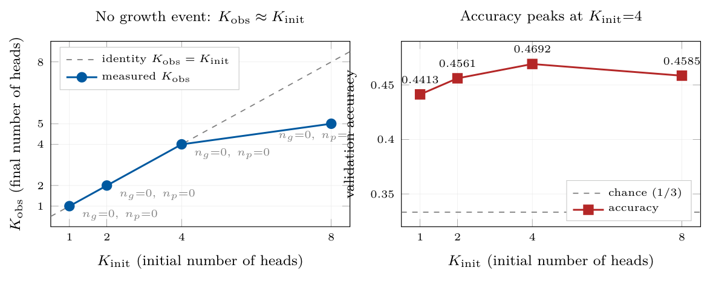

# Chapter 18: signed protection diagnostics and the initial-head-count sweep

[Library index](../README.md) · [Source and transcription policy](../SOURCE.md)

[Previous source](0726-0728-ch18-warm-start-protocol-and-signed-protection.md#pdf-0728) · [Following source](0732-0734-ch18-cross-task-validation-and-proteome-setup.md#pdf-0732)

## PDF 729 · Book page 693

**Table 18.2:** Per-head Rayleigh quotients $\gamma_h$ on the calibration batch, with the resulting pass/fail outcome under the one-sided rule $\gamma_h>+\phi_g$ and under the signed-magnitude rule $|\gamma_h|>\phi_g$.

| Configuration | $h$ | $\gamma_h$ | sign | one-sided | signed-magnitude |
|---|---:|---:|:---:|:---:|:---:|
| SST-2 BD MLM | 0 | +614.62 | + | pass | pass |
| SST-2 BD MLM | 1 | −208.58 | − | fail | pass |
| SST-2 BD MLM | 2 | +252.69 | + | pass | pass |
| SST-2 BD MLM | 3 | +280.35 | + | pass | pass |
| MNLI BD MLM | 0 | −49.26 | − | fail | pass |
| MNLI BD MLM | 1 | +135.43 | + | pass | pass |
| MNLI BD MLM | 2 | −88.25 | − | fail | pass |
| MNLI BD MLM | 3 | −171.38 | − | fail | pass |
| MNLI PCA MLM | 0 | −302.46 | − | fail | pass |
| MNLI PCA MLM | 1 | +152.37 | + | pass | pass |
| MNLI PCA MLM | 2 | +44.76 | + | pass | pass |
| MNLI PCA MLM | 3 | −378.23 | − | fail | pass |
| MNLI BD no MLM | 0 | +12.56 | + | fail | fail |
| MNLI BD no MLM | 1 | −2.13 | − | fail | fail |
| MNLI BD no MLM | 2 | −38.32 | − | fail | fail |
| MNLI BD no MLM | 3 | +30.80 | + | fail | fail |

### 18.1.2 Per-head diagnostics and the one-sided versus signed-magnitude pruning rule

The four-head residual decomposition of the configurations affords a direct check of the practical consequence of the signed pairing. The diagnostic quantity is the per-head Rayleigh quotient $\gamma_h=u_h^\top A_{\rm res}u_h$, where $u_h$ is the head probe of Chapter 15; the sign of $\gamma_h$ indicates whether the head responds to the positive or to the negative mode of the indefinite operator. Two pruning rules are compared. The first is the one-sided (or positive-only, level-zero) rule:

$$
\operatorname{protect}(h)\iff\gamma_h>+\phi_g,
$$

where $\phi_g=0.05\,\theta_w$ is the auxiliary threshold of Chapter 15. This rule was the original pruning rule of the INCRT controller and is sign-asymmetric: it prunes every head whose Rayleigh quotient is negative, regardless of magnitude. The second is the signed-magnitude (or level-one) protection rule of the signed-spectral extension of Chapter 16:

$$
\operatorname{protect}(h)\iff|\gamma_h|>\phi_g,
$$

which preserves every head whose response is large in magnitude, irrespective of whether it points along the positive or along the negative mode of $A_{\rm res}^{\rm sig}$. The two rules agree on heads of unambiguous positive sign and on heads of magnitude below threshold, but disagree on every head whose Rayleigh quotient is sizeable and negative. Table 18.2 reports the per-head values across the four configurations.

The one-sided rule prunes every head whose response is negative; the signed-magnitude rule preserves heads whose response is large in magnitude regardless of sign. The no-MLM configuration fails both rules: under random initialisation, no head exceeds even the loose protection threshold, and the diagnostic reports an empty surviving set.

Two observations follow from the diagnostic table. First, the one-sided rule removes between one and three of the four heads in the MLM-warm-started configurations, whereas the

## PDF 730 · Book page 694

**Table 18.3:** $K_{\rm init}$ sweep on MNLI-50k BD $\theta=0.40$ seed $=42$, with MLM warm-start and the signed-magnitude pruning rule, six training epochs.

| $K_{\rm init}$ | $K_{\rm obs}$ | $K_{\rm pred}^\star$ | $n_{\rm growth}$ | $n_{\rm pruning}$ | Acc | $\Gamma_0$ | $\theta_w$ |
|---:|---:|---:|---:|---:|---:|---:|---:|
| 1 | 1 | 5.73 | 0 | 0 | 0.4413 | 3628.31 | 1451.32 |
| 2 | 2 | 5.73 | 0 | 0 | 0.4561 | 2446.91 | 978.76 |
| 4 | 4 | 5.73 | 0 | 0 | 0.4692 | 1788.60 | 715.44 |
| 8 | 5 | 5.73 | 0 | 3 | 0.4585 | 1508.88 | 603.55 |

signed-magnitude rule preserves all four. This confirms that the negative residual responses are not noise: they are counter-oriented signed modes, with magnitudes of the same order as the positive ones (compare for example, in MNLI BD MLM, $|\gamma_0|=49.26$ and $|\gamma_3|=171.38$ against $\gamma_1=+135.43$). The signed-magnitude rule is therefore the correct level-one protection diagnostic for indefinite residual operators. Second, under random initialisation (the fourth row block of the table), all four values of $|\gamma_h|$ fall below $\phi_g$, regardless of sign. The diagnostic therefore reports an empty surviving set, and the controller declares that the encoder has not produced any identifiable signed mode on the calibration batch. This last phenomenon is reproducible: under random initialisation on MNLI-50k, the calibration spectrum is dominated by a single large negative eigenvalue (here $\lambda_{\min}\approx-1867.5$, $\rho=1867.5$ in Table 18.1), and the per-head residual response is two orders of magnitude smaller than the dominant eigenvalue. The encoder is then well below the regime in which INCRT can be expected to produce useful architectural decisions; the diagnostic correctly flags this rather than fabricating a head count.

### 18.1.3 The $K_{\rm init}$ sweep on MNLI-50k

The most direct empirical test of the central claim of the case study is obtained by sweeping the initial head count $K_{\rm init}$ across the values $\{1,2,4,8\}$, on the single canonical configuration MNLI-50k BD $\theta=0.40$ seed $=42$, under MLM warm-start and the signed-magnitude pruning rule. The sweep tests whether the controller, when started with a head count below the compressed-sensing prediction $K_{\rm pred}^\star=5.73$ of Theorem ??, will grow the architecture from $K_{\rm init}$ towards $K_{\rm pred}^\star$, or whether the warm-started controller exhibits a different dynamics. Table 18.3 reports the per-run outcome.

The trajectory $K_{\rm obs}$ is constant across epochs in all four runs. The compressed-sensing prediction $K_{\rm pred}^\star=5.73$ is the same in all four runs by construction; what changes is the initial directional energy $\Gamma_0$, which scales with $K_{\rm init}$, and the gate threshold $\theta_w=0.40\,\Gamma_0$. The trajectory $K_{\rm init}\mapsto K_{\rm obs}$ follows the identity diagonal for $K_{\rm init}\in\{1,2,4\}$ and departs from it on the boundary at $K_{\rm init}=8$, where three of the eight initial heads fail the protection rule and are pruned away. The number of growth events is zero in all four runs; the controller never adds a head, even from the strongly under-initialised configuration $K_{\rm init}=1$, in which the architectural deficit relative to $K_{\rm pred}^\star$ exceeds four heads. The accuracy improves with $K_{\rm init}$ up to $K_{\rm init}=4$, where it reaches its maximum at 0.4692, and decreases slightly at $K_{\rm init}=8$ to 0.4585, a fall consistent with the three pruning events removing heads that the calibration spectrum supported only marginally. Figure 18.3 renders the two trajectories side by side.

Left: $K_{\rm obs}$ versus $K_{\rm init}$, with the identity line dashed; no growth event is triggered in any run, and a single boundary pruning step removes three heads when $K_{\rm init}=8$. Right: validation accuracy versus $K_{\rm init}$; the chance level for MNLI three-class classification is $1/3$. The trajectory peaks at $K_{\rm init}=4$ and falls slightly when the controller is over-initialised.

## PDF 731 · Book page 695

**Figure 18.3:** $K_{\rm init}$ sweep on MNLI-50k BD $\theta=0.40$ seed $=42$ with MLM warm-start and the signed-magnitude pruning rule.

> Searchable text printed in the figure: left title “No growth event: $K_{\rm obs}\approx K_{\rm init}$”; legend “identity $K_{\rm obs}=K_{\rm init}$”, “measured $K_{\rm obs}$”; vertical axis “$K_{\rm obs}$ (final number of heads)” with ticks 1, 2, 4, 5, 8. For $K_{\rm init}=1,2,4,8$, measured $K_{\rm obs}=1,2,4,5$, with annotations $n_g=0,n_p=0$ for the first three points and $n_g=0,n_p=3$ for the last. Right title “Accuracy peaks at $K_{\rm init}=4$”; vertical axis “validation accuracy”, ticks 0.35, 0.4, 0.45; labelled values 0.4413, 0.4561, 0.4692, 0.4585. Legend “chance (1/3)”, “accuracy”. Both horizontal axes: “$K_{\rm init}$ (initial number of heads)”, ticks 1, 2, 4, 8.

The qualitative content of Figure 18.3 is the central empirical claim of the case study. In a setting where the compressed-sensing bound predicts six heads and the encoder is started with one, the warm-started INCRT controller does not grow to six; it keeps the head it was given. In the same setting where the controller is started with eight heads, it does not preserve all eight; it prunes the three heads whose per-head signed response is below the gate threshold, and stabilises at five. The prediction $K_{\rm pred}^\star=5.73$ is therefore not, in the warm-started regime, a dynamic attractor of the controller; it is a diagnostic upper bound that the over-initialised run approaches from above and that the under-initialised runs never reach. This observation is the empirical content of the second of the three regimes identified in the synthesis section of Chapter 19, and it is the empirical motivation behind the cautious framing of $K^\star$ in that synthesis as a common diagnostic reference rather than a guaranteed dynamic attractor.

**Remark 18.1 (Interpretation of the boundary pruning at $K_{\rm init}=8$).** The single pruning event at $K_{\rm init}=8$ is itself a diagnostic signal. Three of the eight initial heads have, on the calibration batch, a signed response $|\gamma_h|<\phi_g$, and are therefore removed by the signed-magnitude rule. The five surviving heads are precisely those whose response exceeds the gate threshold; the controller stabilises on this set without ever attempting to add a head. This is consistent with the structural reading of the stabilisation regime in Chapter 19: the homeostatic controller, when started above its operating point, converges from above by selecting the surviving heads under the signed-magnitude protection rule of Chapter 16; when started below, it does not converge from below in the warm-started case studied here. The asymmetry of behaviour around $K^\star$ is itself the empirical signature distinguishing the expansion regime of Section 18 from the stabilisation regime of the present section.

### 18.1.4 Cross-task multi-seed aggregation

The MNLI-50k sweep is the single-seed deep dive of the campaign. A parallel multi-seed cross-task aggregation, repeating each configuration over five seeds, was carried out on SST-2 and on QNLI; it documents that the no-growth/no-attractor phenomenology survives both averaging and a change of task. Two notes on the protocol should be stated before reading Table 18.4.

“high $\theta$” denotes the gate threshold $\theta_w=0.40\,\Gamma_0$ of the main campaign; “low $\theta$” denotes a relaxed variant $\theta_w=\theta_{\rm low}$ used to stress-test the protection rule. The zero in the $n_{\rm growth}$ column is uniform across the $5\times8=40$ runs of the table. The goal of the cross-task
