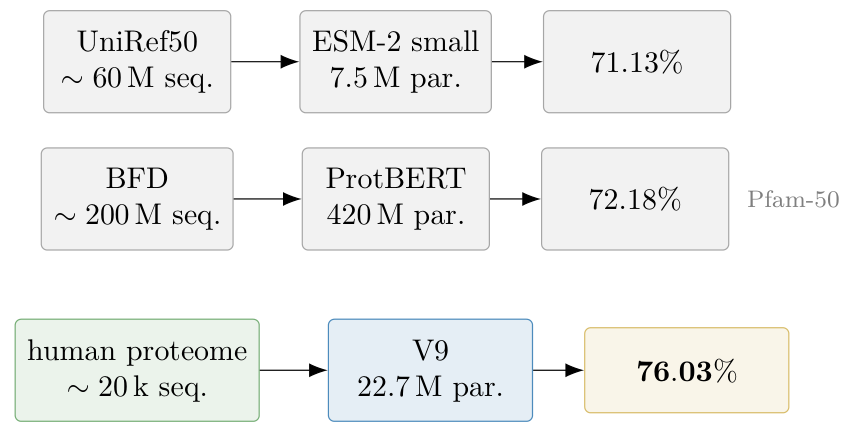

# Chapter 18: cross-task validation, empirical lessons, and proteome pretraining setup

[Library index](../README.md) · [Source and transcription policy](../SOURCE.md)

[Previous source](0729-0731-ch18-signed-pruning-and-initial-head-count-sweep.md#pdf-0731) · [Following source](0735-0738-ch18-proteome-mlm-mechanism-and-ablation.md#pdf-0735)

## PDF 732 · Book page 696

**Table 18.4:** Cross-task multi-seed aggregation on SST-2 and QNLI under the same gate and warm-start protocol as Section 18.1.2, with $K_{\rm init}=4$ and five seeds per configuration.

| Task | Gate | $\theta$ | Acc (mean ± std) | $K_{\rm obs}$ (mean ± std) | $K_{\rm pred}^\star$ | $n_{\rm growth}$ | $n_{\rm pruning}$ |
|---|---|---|---:|---:|---:|---:|---:|
| SST-2 | BD | high | 0.532 ± 0.032 | 2.0 ± 1.41 | 5.73 | 0 | 2.0 |
| SST-2 | BD | low | 0.532 ± 0.032 | 2.0 ± 1.41 | 230.26 | 0 | 2.0 |
| SST-2 | PCA | high | 0.557 ± 0.045 | 2.2 ± 1.30 | 5.73 | 0 | 1.8 |
| SST-2 | PCA | low | 0.554 ± 0.042 | 2.4 ± 1.14 | 230.26 | 0 | 1.6 |
| QNLI | BD | high | 0.511 ± 0.013 | 1.2 ± 0.45 | 5.73 | 0 | 2.8 |
| QNLI | BD | low | 0.511 ± 0.013 | 1.2 ± 0.45 | 230.26 | 0 | 2.8 |
| QNLI | PCA | high | 0.531 ± 0.017 | 2.4 ± 1.34 | 5.73 | 0 | 1.6 |
| QNLI | PCA | low | 0.538 ± 0.019 | 2.6 ± 1.52 | 230.26 | 0 | 1.4 |

table is not competitive NLP performance, but the behaviour of the INCRT controller on small Transformer encoders under MLM warm-start; the accuracy levels reported below are consequently a diagnostic readout, not a baseline against which to compare against NLP models of standard scale. The seeds are five per configuration, and the accuracy is reported as the mean and standard deviation over the seeds. Table 18.4 reports the aggregated results.

Three regularities visible in the table deserve underlining. First, the column $n_{\rm growth}$ is uniformly zero across all forty runs of the multi-seed campaign; this is the result that the $K_{\rm init}$ sweep of Section 18.1.3 produces in deep-dive form, here confirmed by averaging. Second, the value of $K_{\rm pred}^\star$ swings dramatically with the threshold $\theta$ (from 5.73 at the operational threshold $\theta_w=0.40\,\Gamma_0$ to 230.26 at the loose threshold), without any corresponding change in the controller’s behaviour: $K_{\rm obs}$ remains in the range 1.2–2.6 in either threshold setting. The compressed-sensing prediction is therefore not the operational quantity that drives the controller’s trajectory in the warm-started regime; the local per-head signed diagnostic is.

Third, the PCA-gate variant attains marginally higher accuracy than the BD variant on both SST-2 and QNLI, at the cost of higher variance in $K_{\rm obs}$; this is consistent with the PCA variant trading a strictly bidirectional probe for a data-conditional one, increasing both the seed-level variance and the average final head count.

### 18.1.5 Lessons for the monograph

The campaign reported in this section contributes three lessons to the development of INCRT in Volume I.

**First lesson: empirical evidence for the structural involution.** The signed pairing of $A_{\rm res}^{\rm calib}$ documented in Section 18.1.1 and Figure 18.2 is the empirical counterpart of the signed Jordan decomposition introduced in Chapter 16. The two extreme observations in this respect are SST-2 BD MLM, which attains the smallest pairing error after MLM warm-start that produces a clean two-cluster spectrum on either side of zero, and MNLI BD no MLM, which attains an even smaller pairing error (0.037) despite a markedly more asymmetric spectrum dominated by two large modes of opposite sign. Both observations are consistent with the structural-involution hypothesis announced as an open question in the signed-spectral extension chapter; neither proves it.

**Second lesson: signed magnitude is the correct level-one protection diagnostic.** The per-head diagnostic of Section 18.1.2 shows that a one-sided positive pruning rule and the signed-magnitude rule disagree on roughly half of the heads in the MLM configurations. The heads removed by the one-sided rule have negative Rayleigh quotients, but their magnitudes

## PDF 733 · Book page 697

are well above the protection threshold. They therefore correspond to counter-oriented residual modes rather than to noise. This confirms the signed-spectral interpretation of Chapter 16: protection must depend on the magnitude of the signed response, while the sign itself must be retained as geometric information.

**Third lesson: $K^\star$ is a diagnostic reference, not a dynamic attractor.** The $K_{\rm init}$ sweep of Section 18.1.3 is the most direct evidence for this lesson, with the multi-seed aggregation of Section 18.1.4 confirming it across tasks and threshold settings. The compressed-sensing prediction $K_{\rm pred}^\star$ is, in the warm-started regime, an upper bound that the controller approaches from above by pruning when over-initialised, and that it does not approach from below by growth when under-initialised. The empirical picture is consistent with the synthesis section of Chapter 19, in which the three operational regimes of the INCRT controller are catalogued: the present section reports the second regime (stabilisation), the campaign of Section 18 reports the first (expansion), and the third regime (architecture-initialisation) is articulated in the same synthesis section as a pre-pass on the head-level signed operators rather than as a separate empirical case study.

The section thus closes with a sentence that is itself the qualitative content of the three-regime synthesis: in simple or still-forming encoders, INCRT appears as explicit growth; in warm-started encoders, as protection and pruning; in candidate untrained backbones, as the spectral pre-pass that produces the architecture deterministically. The case study of the next section returns to the first regime and pushes it to a setting in which the controller’s depth-growth trigger of Chapter 17, rather than its head-growth trigger, becomes the architectural decision under test.

## 18.2 Self-architecting MLM pretraining on a reference proteome

The first three campaigns of this chapter — SARS-CoV-2 viral-genome classification (Section 18), SST-2 sentiment analysis (Section 18), and the cross-task verification block (Section 18) — exercise INCRT in its offline mode: the residual operator is constructed once on a frozen pretrained encoder, the converged head count $K^\star$ is exported as an architectural hyperparameter, and the downstream classifier is then trained on the resulting fixed-width encoder. The present section reports a campaign that is offline in the same sense of Chapter 15 but differs from Sections 18 and 18 in one structural respect: the homeostatic dynamics of INCRT are run *during* masked-language pretraining itself, not on a pretrained encoder treated as fixed. The architectural object whose head count and depth are adjusted by the framework is therefore the encoder under self-supervision, and the downstream benchmark — protein family classification — inherits whatever representation the in-pretraining growth schedule produces.

The biological setting deserves a sentence of context before the experimental design enters. A protein, for the purposes of this case study, is a string over an alphabet of size twenty: each letter is one of the standard amino acids, the chemical building blocks from which proteins are assembled inside cells. The full set of proteins encoded by a single organism is its proteome; the human reference proteome contains approximately twenty thousand sequences, one per protein-coding gene, and is the corpus on which the principal pretraining experiment of the case study is run. From the point of view of a sequence model, a protein is therefore a tokenised string over a small alphabet, structurally analogous to a sentence in natural language — an analogy that motivates an entire research field, “protein language modelling”,

## PDF 734 · Book page 698

**Figure 18.4:** Pretraining-corpus size, parameter count, and Pfam-50 linear-probe accuracy for ESM-2 small, ProtBERT, and the V9 variant of Cirrincione and Lovino (2026).

> Searchable text printed in the figure: “UniRef50”, “∼ 60 M seq.” → “ESM-2 small”, “7.5 M par.” → “71.13%”; “BFD”, “∼ 200 M seq.” → “ProtBERT”, “420 M par.” → “72.18%”; “human proteome”, “∼ 20 k seq.” → “V9”, “22.7 M par.” → “76.03%”. Shared benchmark label: “Pfam-50”.

and that makes a transformer the natural architecture to apply to such sequences.

The shift of regime from the classification campaigns is consequential. Sections 18–18 treat INCRT as a procedure that consumes a pretrained model and outputs a number; the present campaign treats it as a procedure interleaved with pretraining itself, that produces both the converged head count and the depth of the resulting encoder, through the Level-3 trigger of Chapter 17. The case study is reported in two papers, joint work with M. Lovino (Department of Engineering “Enzo Ferrari”, University of Modena and Reggio Emilia). The first Cirrincione et al. (2026) is a pilot ablation presented at CIBB 2026; it isolates two design choices and reports a substantial gap to the ESM-2 baseline on a single-proteome budget. The second Cirrincione and Lovino (2026) extends the empirical campaign to a four-variant ablation, adds a multi-seed analysis, and exhibits the asymmetry-loss regulariser $\mathcal L_\alpha$ as the mechanistic component without which the Level-3 trigger never fires; on the same Pfam-50 benchmark it also reverses the small-data-versus-large-corpus comparison of the pilot, with a 22.7 M-parameter self-architected model exceeding both ESM-2 small (7.5 M, UniRef50) and ProtBERT (420 M, BFD). Figure 18.4 previews the contrast that the rest of this section will then unpack in detail.

### 18.2.1 Setup and the in-pretraining mode

The benchmark is the masked-language modelling (MLM) objective of Devlin et al. (2019b) applied to amino-acid sequences. A pretraining corpus $\mathcal D_{\rm pre}$ of $n_{\rm pre}$ proteins is assembled from a public reference proteome; each protein is tokenised into a sequence of residues; fifteen percent of the tokens of each sequence is masked according to the BERT-style 80/10/10 corruption, and the encoder is trained to reconstruct the masked positions. The objective requires no labels: every protein in the proteome is its own training example. After pretraining, the encoder is evaluated on Pfam-50 family classification — a fifty-class restriction of the Pfam database, the standard catalogue of evolutionarily-related protein families — under two protocols: a linear probe on frozen mean-pooled representations and a light fine-tune of the full encoder with a newly initialised classification head. Full physical details of the biological objects involved are reported in Cirrincione and Lovino (2026); for the purposes of the present chapter only three properties of the benchmark matter.

**(i) Self-supervised target with quasi-convex training loss.** The MLM cross-entropy of Devlin et al. (2019b) is convex per sample given fixed representations and is empirically near-convex on the basin of standard initialisations ?. The benchmark therefore lies in the convex half-plane of Figure 18.18, the same region in which the classification campaigns of

> Page boundary: item (i) of §18.2.1 ends here with “the same region in which the classification campaigns of”. The sentence continues on [PDF 735](0735-0738-ch18-proteome-mlm-mechanism-and-ablation.md#pdf-0735).
