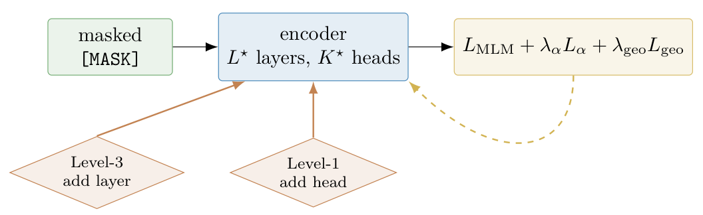
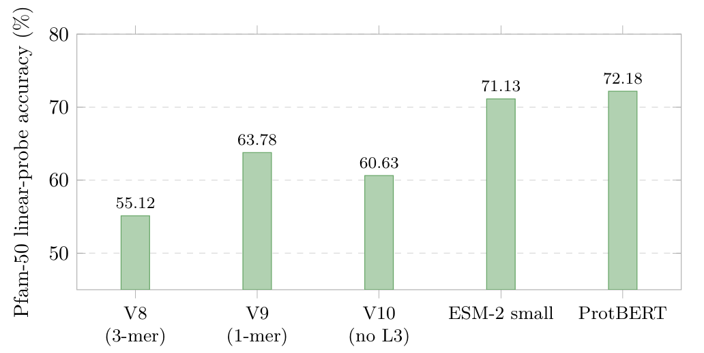
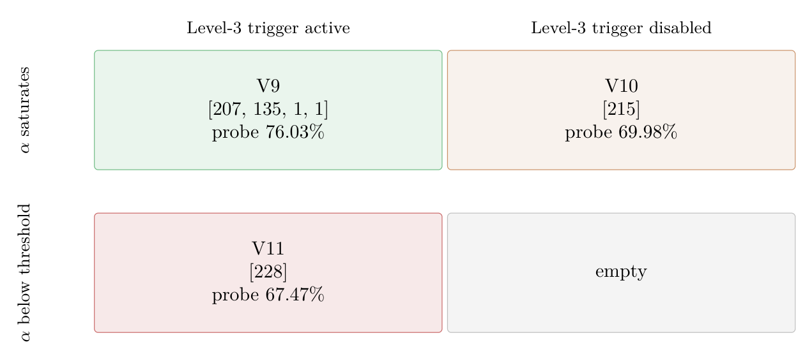

# Chapter 18: proteome MLM, asymmetry mechanism, and pilot/full ablations

[Library index](../README.md) · [Source policy](../SOURCE.md) · [Previous source](0732-0734-ch18-cross-task-validation-and-proteome-setup.md#pdf-0734) · [Next source](0739-0742-ch18-corpus-alignment-and-proteome-transfer-limits.md#pdf-0739)

> Editorial note: Full transcription of PDF 735–738. The range starts and ends in continuing paragraphs. Original trigger names, the sign of (18.2), placeholders, experiment descriptions, numbers and their discrepancies are preserved. Figures are direct crops of the original PDF; the reported experiments have not been rerun.

## PDF 735 · Book page 699

**Figure 18.5:** In-pretraining mode: at each step the masked-language gradient and the two architectural triggers act on the same encoder.

> Searchable figure labels: “masked [MASK]”; “encoder $L^\star$ layers, $K^\star$ heads”; $L_{\mathrm{MLM}}+\lambda_\alpha L_\alpha+\lambda_{\mathrm{geo}}L_{\mathrm{geo}}$; “Level-3 add layer”; “Level-1 add head”.

Sections 18–18 sit, and Proposition 18.3 of Section 18.3 predicts that the offline and runtime modes of INCRT should produce asymptotically equivalent terminal architectures.

**(ii) Small-corpus regime.** The principal pretraining corpus is the human reference proteome from Ensembl release 115: approximately twenty thousand sequences after filtering and deduplication ?, against the tens to hundreds of millions used by ESM-2 (UniRef50, $\sim60$ M) ? and ProtBERT (BFD, $\sim200$ M) ?. The orders-of-magnitude gap places the pretraining problem outside the regime in which the implicit assumption of standard pLM recipes — that capacity should be allocated up front to absorb a large, heterogeneous corpus — is operative. The compressed-sensing bound of Theorem ?? of Chapter 15 predicts, instead, that the head count required to span the dominant directions of variation in $D_{\mathrm{pre}}$ is determined by the intrinsic complexity of the corpus, not by its cardinality.

**(iii) Two coupled triggers.** Unlike the classification campaigns, in which only the Level-1 head-growth trigger of Chapter 15 is exercised, the protein case study activates both the Level-1 trigger on attention heads and the Level-3 trigger on encoder depth introduced in Chapter 17. The Level-3 trigger fires when the per-head asymmetry index of the deepest layer saturates above a phase-transition threshold $\alpha_{\mathrm{crit}}$ for a sustained window. The new layer is soft-identity-initialised (Gaussian noise at scale $10^{-3}$), so its insertion preserves the forward pass at the event instant. The interaction between the two triggers is the principal architectural object of the case study (Figure 18.5).

The deployment of INCRT used in this case study is structurally as follows. The residual operator of Chapter 15, restricted to layer $\ell$, is $A_{\mathrm{res}}^{(\ell)}=A^{(\ell)}-\mathbf1\bar a^\top$, the attention matrix of layer $\ell$ averaged over heads with its rank-one column-mean component removed. The Level-1 grow trigger fires when $\lambda_{\max}(A_{\mathrm{res}}^{(\ell)})>\theta_w$ with $\theta_w=0.10$; a new head is then injected at layer $\ell$ with soft-identity initialisation. The per-head asymmetry index is

$$
\alpha^{(\ell,h)}
=\|M_a^{(\ell,h)}\|_F^2/\|M^{(\ell,h)}\|_F^2\in[0,1],
\tag{18.1}
$$

with $M^{(\ell,h)}=W_Q^{(\ell,h)}W_K^{(\ell,h)\top}$ the bilinear interaction operator of head $(\ell,h)$ and $M_a^{(\ell,h)}$ its skew-symmetric component. The Level-3 grow trigger fires when $\alpha_{\mathrm{top}}^{(\ell_{\max})}(t)=\max_h\alpha^{(\ell_{\max},h)}(t)>\alpha_{\mathrm{crit}}$ holds for all $t\in[t_0,t_0+T_{\mathrm{wnd}}]$, with $\alpha_{\mathrm{crit}}=0.9$ and $T_{\mathrm{wnd}}=200$ optimisation steps.

To bias the pretraining dynamics towards the regime in which the Level-3 trigger is informative, an asymmetry-loss regulariser

$$
L_\alpha=\sum_{\ell,h}
\bigl[\alpha^{(\ell,h)}-\alpha_{\mathrm{crit}}+\varepsilon_\alpha\bigr]_+,
\qquad\varepsilon_\alpha=0.01,
\tag{18.2}
$$

is added to the MLM cross-entropy with weight $\lambda_\alpha=10$, together with a geometric loss $L_{\mathrm{geo}}$

## PDF 736 · Book page 700

that rewards decorrelation across heads of the same layer Cirrincione and Lovino (2026). The full training objective is $L=L_{\mathrm{MLM}}+\lambda_\alpha L_\alpha+\lambda_{\mathrm{geo}}L_{\mathrm{geo}}$.

Behind the design of the experiments lies a precise mechanism claim, which the empirical campaign exists to test. The claim is the natural counterpart, for the in-pretraining mode of INCRT, of Proposition 18.3 for the offline/runtime contrast.

**Proposition 18.2 ($L_\alpha$ as enabler of Level-3 growth).** *Suppose the encoder is initialised with a single attention layer and that the geometric regulariser $L_{\mathrm{geo}}$ alone is active, with $\lambda_\alpha=0$ in (18.2). Then the per-head asymmetry index satisfies $\sup_{(\ell,h)}\alpha^{(\ell,h)}(t)\le\bar\alpha_{\mathrm{geo}}<\alpha_{\mathrm{crit}}$ for all $t$ during pretraining, with $\bar\alpha_{\mathrm{geo}}$ an explicit constant depending only on $\lambda_{\mathrm{geo}}$ and on the spectrum of the input data covariance. Consequently the Level-3 trigger never fires, the Level-2 head-growth trigger drives the model towards a single-layer wide configuration, and the resulting encoder is depth-collapsed. Reintroducing $L_\alpha$ with $\lambda_\alpha$ above an explicit lower bound restores $\sup_{(\ell,h)}\alpha^{(\ell,h)}(t)\ge\alpha_{\mathrm{crit}}+\varepsilon_\alpha$ on the active window of the trigger and re-enables Level-3 growth.*

A proof sketch using the convergence properties of the homeostatic dynamics on $L_\alpha$ is given in Cirrincione and Lovino (2026); the lower bound on $\lambda_\alpha$ follows from a one-sided application of Proposition ?? of Chapter 17. The proposition is structurally distinct from the offline/runtime equivalence claim of Section 18.3: it does not concern the equivalence of two deployment modes, but rather the necessity of a specific component — the asymmetry regulariser — for the spectral trigger of Chapter 17 to be operative on a real data distribution.

The empirical content of Sections 18.2.2 and 18.2.3 can now be stated sharply: the pilot study identifies tokenisation granularity and Level-3 on/off as the operative axes; the full study isolates $L_\alpha$ as the third axis and shows that removing it decouples the architectural diagnostics from the growth mechanism, in exact agreement with Proposition 18.2.

### 18.2.2 Pilot study

The first paper Cirrincione et al. (2026) reports a controlled ablation of two design axes on the human reference proteome, restricted to three variants of the same in-pretraining INCRT deployment. The two design axes are tokenisation granularity and the on/off status of the Level-3 trigger.

**Tokenisation granularity.** A protein is a string of twenty-symbol residues; the tokeniser is the procedure that converts this string into the discrete units consumed by the encoder. Two choices are compared: a 1-mer tokeniser, in which each amino-acid letter is its own token (vocabulary 25, comprising the twenty residues plus five special tokens), and a 3-mer tokeniser, in which each consecutive triple of residues is a single token (vocabulary 8005, the standard $20^3+5$ trimer alphabet plus special tokens). The 3-mer choice is motivated by an analogy with subword tokenisation in natural-language processing; the 1-mer choice is the character-level analogue. The two are not equivalent on a small corpus, as the empirical results below will show.

**Variants V8, V9, V10.** V8 uses the 3-mer tokeniser with both Level-1 and Level-3 triggers active. V9 switches to the 1-mer tokeniser at the same trigger configuration (tokenisation comparison, V8 $\to$ V9). V10 retains the 1-mer tokeniser of V9 but disables the Level-3 trigger by design, so that depth growth cannot fire and the encoder remains at a single (wide) attention layer (depth-growth comparison, V9 $\to$ V10). Hyperparameters — hidden width $d=256$, per-head width $d_k=d_v=64$, $\lambda_\alpha=10$, $\lambda_{\mathrm{geo}}=10^{-5}$, $\alpha_{\mathrm{crit}}=0.9$ — are held fixed across the three variants; ten epochs of pretraining are performed on a single NVIDIA A100 (40 GB) GPU. Pfam-50 evaluation uses the linear-probe and light-fine-tune protocols of

## PDF 737 · Book page 701

**Figure 18.6:** Pilot ablation of Cirrincione et al. (2026): Pfam-50 linear-probe accuracy of the three INCRT variants V8/V9/V10 against the two external baselines.

> Searchable figure labels: vertical axis “Pfam-50 linear-probe accuracy (%)”, ticks 50, 60, 70, 80; V8 (3-mer) 55.12; V9 (1-mer) 63.78; V10 (no L3) 60.63; ESM-2 small 71.13; ProtBERT 72.18.

Section 18.2.1. The headline result is visualised in Figure 18.6.

Three observations from Figure 18.6 merit emphasis. The first is the magnitude and direction of the tokenisation ablation. Switching from the 3-mer tokeniser of V8 to the 1-mer tokeniser of V9 yields a $+8.66$ percentage-point improvement at 40% fewer parameters. The mechanism, identified in Cirrincione et al. (2026), is the mismatch between vocabulary size and dataset cardinality: with approximately 8000 trimer tokens and approximately 20 000 proteins, many trimers occur infrequently in the corpus, and the embedding rows associated with low-frequency trimers receive sparse and noisy gradient updates. The 1-mer alphabet has cardinality 20 and the empirical token distribution is approximately uniform; every embedding row receives many gradient updates per epoch. The Level-1 head-growth trigger does not compensate for this: V9 grows to 344 heads against 281 for V8, but the additional capacity attaches to a better-conditioned input representation, not to a remedy for the tokenisation mismatch.

The second observation concerns the asymmetry between the two evaluation protocols on the depth ablation. Disabling the Level-3 trigger (V9 $\to$ V10) costs $-3.15$ pp on the linear probe and $-8.66$ pp on the fine-tune. The asymmetry is not predicted by a reading of the architecture as a fixed feature extractor: under such a reading the linear-probe accuracy already measures the representational quality of the frozen encoder, and the fine-tune should at best preserve that quality. The observed gap of 5.5 pp between the two protocols, in favour of fine-tuning V9 over V10, is diagnostic of a property of the architecture itself: the four-layer encoder grown by V9 admits an end-to-end optimisation trajectory that the single-layer encoder of V10 does not. This difference is referred to below as a plasticity gap between the two evaluation protocols, and return to its mechanistic interpretation in Section 18.2.5.

The third observation is the gap to the external baselines. V9 (22.7 M parameters, 63.78% probe) trails ESM-2 small (7.5 M parameters, 71.13% probe) by 7.35 pp despite having three times more parameters. The pilot study does not close this gap; it constitutes the principal negative result of the first paper and the explicit motivation for the extended study reported below. Cirrincione et al. (2026) attributes the gap to the difference in pretraining scale (60 M sequences for ESM-2 against 20 k for V9) and registers, as a follow-up, the question of whether a component of the framework not exercised by V8/V9/V10 might also be load-bearing. The component that the pilot does not isolate, and that the second paper

## PDF 738 · Book page 702

**Table 18.5:** Full ablation of Cirrincione and Lovino (2026) on the human reference proteome, with the V11 variant introduced. The $\Delta$ column reports percentage-point differences relative to V9 in linear-probe accuracy. Multi-seed values are mean$\pm$standard deviation over seeds $\{0,1,2\}$. ESM-2 small and ProtBERT are evaluated under the identical Pfam-50 protocol.

| Variant | Probe | $\Delta$ | FT | Probe (3 seeds) | Top-5 |
|---|---:|---:|---:|---:|---:|
| ESM-2 small ? | 71.13 | – | – | – | 86.88 |
| ProtBERT ? | 72.18 | – | – | – | 88.19 |
| V8 (3-mer) | 63.58 | $-12.45$ | 58.10 | – | 86.0 |
| V9 (1-mer, full) | **76.03** | 0.00 | 70.78 | $75.04\pm1.82$ | **92.7** |
| V10 (no Level-3) | 69.98 | $-6.05$ | 63.01 | $69.94\pm2.49$ | 89.0 |
| V11 (no $L_\alpha$) | 67.47 | $-8.56$ | 63.47 | $67.92\pm2.89$ | 88.9 |

**Figure 18.7:** Full ablation of Cirrincione and Lovino (2026) arranged as a two-by-two factorisation; each cell reports the final per-layer head architecture and Pfam-50 linear-probe accuracy.

> Searchable figure labels: columns “Level-3 trigger active” and “Level-3 trigger disabled”; rows “$\alpha$ saturates” and “$\alpha$ below threshold”. Top-left V9, $[207,135,1,1]$, probe 76.03%; top-right V10, $[215]$, probe 69.98%; bottom-left V11, $[228]$, probe 67.47%; bottom-right “empty”.

exposes as critical, is the asymmetry-loss regulariser of (18.2).

### 18.2.3 Mechanism: $L_\alpha$ as enabler of Level-3 growth

The second paper Cirrincione and Lovino (2026) extends the pilot ablation to a four-variant design. V8, V9, V10 are retained unchanged from Cirrincione et al. (2026); a new variant V11 is added, in which the asymmetry-loss regulariser $L_\alpha$ of (18.2) is removed ($\lambda_\alpha=0$) while all other components, in particular the geometric loss $L_{\mathrm{geo}}$, are kept identical to V9. The full study also re-runs V9, V10 and V11 over three random seeds $\{0,1,2\}$ to provide mean$\pm$standard-deviation error bars; V8 is omitted from the multi-seed analysis as its single-seed gap to V9 is more than four times the largest seed-induced standard deviation observed in the sweep. The headline result is reported in Table 18.5 and visualised in Figure 18.7.

Two findings from Table 18.5 are decisive. The first is that V9 reaches a Pfam-50 probe accuracy of 76.03%, which exceeds both ESM-2 small (71.13%) and ProtBERT (72.18%) under the identical evaluation protocol. The reversal of the small-corpus-versus-large-corpus comparison of the pilot is not attributable to a different downstream protocol — the linear-probe pipeline is the same in both papers, and the ESM-2 and ProtBERT numbers reproduce exactly. It is attributable to the joint effect of the tokenisation choice fixed in the pilot (1-mer
