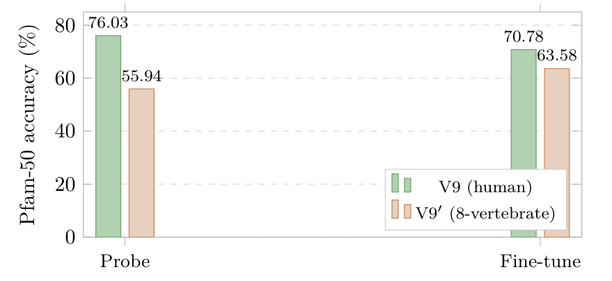

# Chapter 18: asymmetry diagnostics, corpus alignment, and proteome transfer limits

[Library index](../README.md) · [Source policy](../SOURCE.md) · [Previous source](0735-0738-ch18-proteome-mlm-mechanism-and-ablation.md#pdf-0738) · [Next source](0743-0745-ch18-euler-lagrange-control-and-deployment-equivalence.md#pdf-0743)

> Editorial note: Full transcription of PDF 739–742. Original quadrant descriptions, statistical claims, pilot/full-study comparisons, convexity assertions, and Open Problem 16 are preserved. The experiment descriptions remain source-reported; Figure 18.8 is an original PDF crop.

## PDF 739 · Book page 703

alphabet) and a better-tuned pretraining configuration in Cirrincione and Lovino (2026), in particular a sharper setting of the geometric-loss weight $\lambda_{\mathrm{geo}}$ and a tighter persistence window for the Level-3 trigger ($T_{\mathrm{wnd}}=200$ steps). The compressed-sensing bound of Theorem ?? of Chapter 15 predicts that the head count required to span the dominant directions of variation in $D_{\mathrm{pre}}$ is determined by the intrinsic complexity of the corpus, not by its cardinality; the empirical observation that a 22.7 M-parameter encoder pretrained on 20 k sequences exceeds a 420 M-parameter encoder pretrained on $\sim200$ M sequences on a Pfam-50 test set is consistent with this prediction in the regime in which the downstream task is narrowly scoped, here on human-derived families only. The prediction is not claimed to transfer to broader benchmarks.

The second, and central, finding concerns the V11 ablation. Removing $L_\alpha$ produces the largest single-component drop of the four variants: $-8.56$ pp on the linear probe and $-7.31$ pp on fine-tuning. The mechanistic explanation is unambiguous from the per-layer spectral diagnostics of Cirrincione and Lovino (2026). In V11 the layer-0 asymmetry index of (18.1) has mean 0.671 with maximum 0.709 across heads; it never reaches the trigger threshold $\alpha_{\mathrm{crit}}=0.9$ at any point during pretraining. The Level-3 trigger therefore never fires (zero events over the entire run), and V11 silently collapses into a single-layer model with 228 heads. By contrast, V9 reaches a layer-0 asymmetry mean of 0.989 (max 0.996) and fires the Level-3 trigger three times during pretraining (at steps 487, 1723 and 2423), producing the final architecture $[207,135,1,1]$ with $K_{\mathrm{total}}^\star=344$ heads distributed across four layers. V10, in which the Level-3 trigger is disabled by design, also reaches mean 0.992 (max 0.997) but no growth follows because the mechanism is suppressed.

The four configurations form a clean two-by-two design that factorises “does the asymmetry saturate?” from “is the depth trigger active?” (Figure 18.7). V11 sits in the lower-left cell: the asymmetry does not saturate, and the trigger is active but never fires. V9 sits in the upper-right: both conditions hold. V10 sits in the upper-left: the asymmetry does saturate, but the trigger is administratively disabled. The lower-right cell is empty by construction.

This is the central mechanistic finding of the case study and the empirical instantiation of Proposition 18.2. The geometric loss $L_{\mathrm{geo}}$ alone is insufficient to drive the attention layers towards spectral saturation, and a layer that is geometrically well-conditioned (in the sense of the $L_{\mathrm{geo}}$ off-diagonal-Frobenius bound) can sit comfortably below the asymmetry trigger and never request additional depth. The asymmetry-loss regulariser explicitly biases attention distributions towards the regime in which a new layer would be informative; only then does the data-driven growth criterion of Chapter 17 become actionable. Removing $L_\alpha$ does not merely degrade performance; it disables the architectural-growth mechanism altogether. The pairwise gaps of 5.10 and 7.12 pp between V9 and V10/V11 are several times larger than the corresponding seed-induced standard deviations (1.82 $\to$ 2.89 pp) and well outside any reasonable two-sigma band, so the ordering V9 $>$ V10 $>$ V11 is statistically robust.

A second, complementary observation supports the curriculum reading of Chapter 17. The qualitative shape of the V9 architecture is more informative than its headline accuracy: the Level-3 trigger does not produce a wide deep stack, but rather inserts compositional bottlenecks on top of a wide first layer. Layers 3 and 4 of V9 each contain a single head, and the layer-wise head distribution $[207,135,1,1]$ is monotonically decreasing. The shape is consistent with the broader architectural recipe of Cirrincione and Fagiolini (2026a): capacity is allocated where it is informative, depth where attention saturates, width where heads cover orthogonal directions, and zero parameters in head positions that would otherwise be redundant.

## PDF 740 · Book page 704

**Figure 18.8:** Pfam-50 probe and fine-tune accuracy for V9 (human-only, ten epochs) and V9′ (eight-vertebrate corpus, two epochs at matched MLM loss).

> Searchable figure labels: vertical axis “Pfam-50 accuracy (%)”, ticks 0, 20, 40, 60, 80; categories “Probe”, “Fine-tune”; V9 (human): 76.03, 70.78; V9′ (8-vertebrate): 55.94, 63.58.

### 18.2.4 Multi-vertebrate scaling

A scaling experiment of an apparently simple kind is reported in Cirrincione and Lovino (2026): replicate the V9 configuration on a multi-vertebrate corpus assembled from eight species (*Homo sapiens, Mus musculus, Rattus norvegicus, Bos taurus, Macaca mulatta, Gallus gallus, Xenopus tropicalis, Danio rerio*) spanning approximately 450 million years of vertebrate divergence, and ask whether the additional taxonomic breadth improves Pfam-50 accuracy. The corpus retains 283 891 sequences after the same filters and deduplication, fourteen times the size of the human-only corpus.

Two caveats apply to this run. First, pretraining was truncated to two epochs because of repeated out-of-memory and disconnect events on the available compute, against ten for V9; the run is therefore not converged. Second, at the second epoch the masked-language loss reached $L_{\mathrm{MLM}}=2.67$, essentially matching the final (epoch-10) value of the human-only run (2.66), so the multi-vertebrate comparison is most honestly read as “how does taxonomic breadth at matched MLM loss affect downstream transfer” rather than as a converged scaling sweep.

The result, denoted V9′ in Cirrincione and Lovino (2026), is visualised in Figure 18.8. The Level-3 trigger fires five times in the two epochs, producing a six-layer architecture with head counts $[241,172,117,103,69,50]$ and 49.4 M parameters; Pfam-50 probe accuracy drops to 55.94%, a $-20.09$ pp regression relative to V9, while light fine-tuning reaches 63.58% ($-7.20$ pp).

The interpretation requires care, because the reading suggested by the headline number — a fourteen-fold increase in pretraining data degrades downstream accuracy by twenty percentage points — is consistent with three non-exclusive mechanisms, none of which the experiment in isolation can disentangle. First, a *truncation-budget effect*: V9′ inherits V9’s context window, which was tuned to the human sequence-length distribution, so multi-vertebrate sequences are systematically truncated and the effective number of tokens per protein drops. Second, a *specialisation-drift effect*: the self-architecting trigger fires on the aggregate corpus and allocates heads to inter-species variability that is, by construction, absent from the human-only Pfam test split. Third, a *probe-distribution mismatch*: Pfam-50 evaluation remains human, so any capacity spent on non-human sequences yields no return on the downstream metric. The empirical pattern most suggestive of the third effect is the sign of the plasticity gap: V9, V10 and V11 all exhibit negative gaps ($-5.25,-6.97,-4.00$ pp), consistent with a frozen probe that already extracts most of the available signal; V9′ is the only model in the study with a positive plasticity gap ($+7.64$ pp), consistent with a

## PDF 741 · Book page 705

representation in which capacity has been allocated to directions that the linear probe cannot extract but that fine-tuning can partially recover. Fine-tuning recovers most, but not all, of the deficit.

This finding is registered as an explicit Open Problem of Volume II, parallel in form to the four problems registered in Section 18.4.4.

**Open Problem 16 (Pretraining-distribution alignment for the in-pretraining mode of INCRT).** The negative scaling result of V9′ shows that, on a Pfam-50 benchmark restricted to human-derived families, a fourteen-fold increase in pretraining-corpus cardinality at matched MLM loss degrades downstream probe accuracy by approximately twenty percentage points. The natural conjecture is that the negative effect is a function of the misalignment between the pretraining distribution (eight vertebrate species, weighted by number of proteins per proteome) and the downstream-probe distribution (human only), and that the in-pretraining mode of INCRT is, by design, more sensitive to this misalignment than fixed-architecture pretraining, because the Level-3 trigger fires on the aggregate distribution and allocates depth to inter-species variability. A sufficient experimental falsifier exists: re-evaluate V9′ on a multi-species Pfam probe (Pfam-50 restricted to families present in all eight species) and ablate the truncation effect by extending the context window. If both interventions narrow the gap to V9, the conjecture is confirmed; if neither does, the in-pretraining mode of INCRT must be qualified by a per-species curriculum or a probe-aware growth schedule, both left for Volume II.

### 18.2.5 Lessons of the case study

The two-paper sequence of Cirrincione et al. (2026); Cirrincione and Lovino (2026) exposes three features of the in-pretraining mode of INCRT that the classification campaigns of Sections 18–18 were not in a position to expose, because in those campaigns INCRT is run on a frozen pretrained encoder and neither the Level-3 trigger nor the asymmetry regulariser is exercised.

The first feature is the load-bearing role of the asymmetry regulariser $L_\alpha$. The classification campaigns of Sections 18–18 do not isolate $L_\alpha$ as a distinct component, because the Level-3 trigger of Chapter 17 is not active in any of those campaigns and the requirement that the per-head asymmetry saturate at $\alpha_{\mathrm{crit}}=0.9$ never enters the deployment. In the in-pretraining mode the Level-3 trigger is structurally coupled to $L_\alpha$ in the sense made precise by Proposition 18.2: the spectral trigger that the theory of Chapter 17 prescribes is, on the protein masked-language distribution, conditional on a regularisation regime that biases the attention dynamics towards saturation. The V11 variant is the empirical falsifier of the unconditional reading of Chapter 17: the trigger mechanism is correct, but the input distribution alone does not place the encoder in the regime in which the trigger fires.

The second feature is the plasticity gap between linear-probe and fine-tune evaluations of grown architectures. The four-layer encoder of V9 outperforms the single-layer encoder of V10 by 3.15 pp on the linear probe and by 8.66 pp on the fine-tune; the gap of 5.51 pp between the two protocols is, to the best of available knowledge, not previously reported in the growing-transformer literature ??. The empirical reading suggested by the gap is the following: linear-probe accuracy measures the quality of the representation *before* the downstream optimiser intervenes, while fine-tune accuracy measures the quality of the representation *after* the optimiser has had the chance to exploit the representation’s capacity. A grown deep architecture and a grown wide-shallow architecture can produce representations that are nearly equivalent at the frozen-probe stage but that differ substantially in the fine-tune

## PDF 742 · Book page 706

stage; the difference is in the optimisation landscape, not in the representation itself.

The third feature is the apparent reversal of the small-corpus-versus-large-corpus scaling on the Pfam-50 benchmark. A 22.7 M-parameter encoder pretrained on a 20 k-sequence corpus exceeds, on a narrowly scoped downstream probe, a 420 M-parameter encoder pretrained on a $\sim200$ M-sequence corpus. The cautious reading — the only one defensible on present evidence — is that the Pfam-relevant signal in the human proteome lies on a relatively low-dimensional manifold, and that the larger pretrained models are over-parametrised relative to this specific benchmark; their capacity is necessarily allocated to inter-species variability that the human Pfam-50 test set does not exercise. The compressed-sensing bound of Theorem ?? is consistent with this reading: the head count required to span the dominant directions of variation in $D_{\mathrm{pre}}$ is determined by the intrinsic complexity of the corpus, not by its cardinality, and a self-architecting framework that allocates capacity on demand is, by construction, less penalised by an over-broad pretraining distribution than a fixed-architecture recipe. The negative scaling result of V9′ on the multi-vertebrate corpus is the counter-pressure on this reading: when the in-pretraining mode is applied to a broader corpus while the downstream probe remains narrowly scoped, the framework allocates capacity to dimensions that the probe cannot read.

The protein case study reports a single benchmark family — Pfam family classification on the human proteome, with eight-vertebrate scaling as a control — and a single self-supervised pretraining objective, namely the BERT-style MLM of Devlin et al. (2019b). The case study establishes that the load-bearing role of the asymmetry regulariser is non-trivial; it does not establish that the same component plays the same role in other self-supervised regimes (contrastive learning with InfoNCE, diffusion-style denoising on continuous embeddings, or prefix-language-modelling on sequence-to-sequence proteins). Whether $L_\alpha$ remains load-bearing across these regimes, or whether the load shifts to a different regulariser whose form is not currently known, is the natural extension of Open Problem 16 and is left for Volume II.

The chapter-summary scatter of Figure 18.18 is therefore extended by a third marker shape for the protein case study, in the convex half-plane (the MLM loss is near-convex on the basin of standard initialisations) and at a memory-horizon requirement determined by the protein context window. The marker sits adjacent to the classification benchmarks of Sections 18–18, with which it shares the convex half-plane, but is structurally distinct from them: in the classification campaigns INCRT consumes a pretrained encoder, while in the protein campaign INCRT runs in pretraining itself. The architectural object the theory predicts and the one the empirical campaign produces is therefore an end-to-end self-architected encoder, not a head count consumed by a downstream classifier. The distinction is recorded in the updated summary table of Section 18.4.3.

In all three case-study findings, the convexity assumption of Proposition 18.3 held: the MLM cross-entropy is near-convex, the offline and runtime modes of INCRT can therefore be expected to produce equivalent terminal architectures, and indeed the Pfam-50 case study did not require the runtime mode to expose its central mechanism. The next case study turns to a regime in which the convexity assumption fails by construction: a reinforcement-learning loop, in which the downstream learner is an actor–critic optimisation with its own attractor structure. The contrast with the present section is sharp — offline and runtime modes are no longer equivalent — and the experimental falsification of the equivalence hypothesis is the principal finding of Section 18.3.
