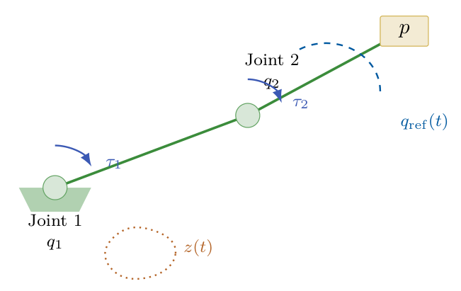
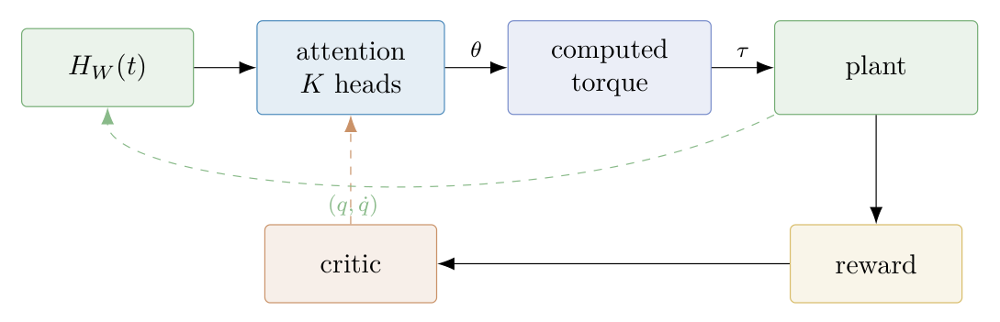

# Chapter 18: Euler–Lagrange control, temporal operators, and deployment equivalence

[Library index](../README.md) · [Source policy](../SOURCE.md) · [Previous source](0739-0742-ch18-corpus-alignment-and-proteome-transfer-limits.md#pdf-0742) · [Next source](0746-0748-ch18-static-control-failure-and-runtime-growth.md#pdf-0746)

> Editorial note: Full transcription of PDF 743–745. The original structural substitutions, convexity/equivalence claims and unresolved theorem references remain intact. Figures are direct PDF crops. The text reports the author's case-study experiments; it does not document a reproduction here.

## PDF 743 · Book page 707

**Figure 18.9:** The benchmark plant: a 2-DOF rigid manipulator with joint angles $q_1,q_2$, torques $\tau_1,\tau_2$, payload $p$, sinusoidal end-effector reference $q_{\mathrm{ref}}(t)$, and hidden friction-memory state $z(t)$.

> Searchable figure labels: “Joint 1”, $q_1$, $\tau_1$; “Joint 2”, $q_2$, $\tau_2$; payload $p$; $q_{\mathrm{ref}}(t)$; $z(t)$.

## 18.3 Self-architecting attention for Euler–Lagrange control

The contrast announced at the close of Section 18.2.5 is the organising idea of the present case study. The protein masked-language pretraining campaign sits in the convex half-plane of Figure 18.18: the MLM cross-entropy is near-convex on the basin of standard initialisations and the offline mode of INCRT, run during pretraining itself, is sufficient to expose the load-bearing role of the asymmetry regulariser. The campaign reported below is structurally different. The task is no longer to label a sequence but to control a physical plant whose state evolution is governed by an Euler–Lagrange equation with friction memory; the architectural object whose head count is selected by INCRT is no longer a sentence encoder but the meta-controller of a reinforcement-learning loop; and the downstream optimisation landscape is the actor–critic landscape of Soft Actor–Critic, non-convex by construction. The shift of regime is substantive, and the experimental findings turn out to expose a feature of INCRT that the classification benchmarks of Sections 18–18 and the protein benchmark of Section 18.2 could not: the difference between INCRT used as an offline architecture-search procedure and INCRT used as a runtime homeostatic controller of capacity during training.

The case study is reported in two papers, joint work with A. Fagiolini (University of Palermo). The first Cirrincione and Fagiolini (2026b) develops the temporal-attention meta-controller and uses INCRT in the Phase-1/Phase-2 separation of Chapter 15: the head count is determined offline from a temporal-residual operator and then frozen for reinforcement-learning training. The second Cirrincione and Fagiolini (2026a) carries out the programme announced in the discussion of the first: the INCRT growth and pruning dynamics are moved inside the training loop, so that heads are added and removed during the optimisation rather than fixed in advance. The two papers together provide an experimental falsifier for the working hypothesis of Chapter 15, that the homeostatic formulation of INCRT is not merely a convenient reformulation of the offline construction but is operationally distinct from it.

The exposition below is organised around the offline/runtime contrast. Section 18.3.1 introduces the plant of Figure 18.9 and the control problem, in the minimal form needed to interpret the experiments. Section 18.3.2 reports the findings of the static Phase-1/Phase-2 deployment and isolates the failure mode that motivates the second study. Section 18.3.3 reports the runtime deployment and the elimination of the failure mode. Section 18.3.4 draws the lessons of the comparison for the monograph’s broader thesis on representational capacity.

## PDF 744 · Book page 708

**Figure 18.10:** Meta-controller training loop: the attention block parametrises the gains $\theta$ of a computed-torque law that drives the plant; the SAC critic backpropagates through the attention block.

> Searchable figure labels: $H_W(t)$ → “attention $K$ heads” → $\theta$ → “computed torque” → $\tau$ → “plant”; “reward”; “critic”; feedback $(q,\dot q)$.

### 18.3.1 Setup, theoretical translation, and a falsifiable equivalence claim

The benchmark is a non-Markovian dynamical system whose evolution depends on a hidden internal state with a finite memory horizon $\tau_z>0$; full physical details, including the Euler–Lagrange equation, the Stribeck friction model, and the inadequacy of classical adaptive control, are reported in Cirrincione and Fagiolini (2026b). For the purposes here only three properties of the benchmark matter: (i) the system has a hidden state $z(t)$ that is not recoverable from the instantaneous measurement $(q,\dot q)$; (ii) past values of $(q,\dot q)$ over a sliding window $H_W(t)$ carry information about $z(t)$, with the temporal extent of that information governed by $\tau_z$; (iii) the control objective induces a non-convex downstream optimisation landscape, namely the actor–critic landscape of Soft Actor–Critic. Properties (i)–(iii) are sufficient to distinguish this benchmark from the classification benchmarks of Sections 18–18, which satisfy none of them.

The control architecture is a computed-torque law whose gains $\theta=(K_d,\Lambda)$ are produced by a single-layer attention block over the history window $H_W(t)$. The attention block does not output joint torques directly; it outputs the gains of the computed-torque law, so the policy is a map from history to gains and the architectural object exposed to INCRT is the head count $K$ of that attention block. Three values of the memory horizon are swept: $\tau_z\in\{1,2,5\}$ s, corresponding to short, matched, and long regimes relative to the window length.

**Theoretical translation.** The connection to the framework of Chapters 15–17 is most efficiently expressed as a translation table between the symbols of the classification benchmarks and the symbols of the control benchmark. In the classification campaigns of Sections 18 and 18, INCRT tracks the residual-energy criterion $\Gamma_{\mathrm{res}}$ on the residual matrix $A_{\mathrm{res}}^{(K)}$ constructed in the feature domain of input embeddings; the homeostatic dynamics converge, under the bidirectional gate of Chapter 17, to the directional task-complexity index $\kappa_T$ established by Theorem ??. In the control task the relevant directions are not features but temporal lags: information distinguishing one memory regime from another is carried by the auto-covariance of the gradient of $z(t)$ along the window $H_W(t)$. The feature-domain residual operator of Chapter 15 is replaced by the temporal residual operator

$$
A_{\mathrm{res}}^{\mathrm{temp}}(\tau_z)
=\mathbb E\!\left[\nabla_{\mathrm{hist}}z(t)\,
\nabla_{\mathrm{hist}}z(t)^\top\right]
\in\mathbb R^{W\times W},
\tag{18.3}
$$

with $\nabla_{\mathrm{hist}}z(t)$ the gradient of the unobservable memory state with respect to the entries of the history window. The substitution is structural, not theoretical: under the three structural hypotheses of Theorem ??, the homeostatic fixed point $K^\star(\tau_z)$ of the INCRT dynamics on

## PDF 745 · Book page 709

**Table 18.6:** Translation between the symbols of the INCRT theory of Chapters 15–17 (constructed for the classification benchmarks of Sections 18–18) and the symbols of the control benchmark of this section. The translation is structural: theorems are not re-proved, only re-instantiated.

| Classification setting | Control setting |
|---|---|
| input feature domain $\mathbb R^{d_{\mathrm{model}}}$ | temporal lag domain $\mathbb R^W$ |
| residual matrix $A_{\mathrm{res}}^{(K)}$ | temporal residual $A_{\mathrm{res}}^{\mathrm{temp}}(\tau_z)$ |
| residual energy $\Gamma_{\mathrm{res}}$ | $\Gamma_{\mathrm{res}}^{\mathrm{temp}}(\tau_z)$ |
| task-complexity index $\kappa_T$ | memory-complexity index $\kappa_T(\tau_z)$ |
| fixed-point head count $K^\star$ | $K^\star(\tau_z)$ |
| downstream loss: cross-entropy (convex) | SAC loss (non-convex, attractor-laden) |

$A_{\mathrm{res}}^{\mathrm{temp}}$ inherits the same compressed-sensing upper bound that the feature-domain operator provides; the verification that the three hypotheses transfer to the temporal construction is checked in Cirrincione and Fagiolini (2026b).

The translation is summarised in Table 18.6. Every symbol of the INCRT theory has a control-task counterpart; no theorem of Chapters 15–17 loses its status; only the underlying domain of the residual operator changes.

**An equivalence claim.** Behind the design of the case-study experiments lies a precise working hypothesis, which the empirical campaign exists to test. It is stated here so that the experiments of Sections 18.3.2 and 18.3.3 can be read as a falsification attempt with a definite null. The two formulations of INCRT introduced in Chapter 15 are the offline mode (Algorithm ?? run once on a frozen residual operator) and the runtime mode (the homeostatic dynamics monitored during downstream training).

**Proposition 18.3 (Offline–Runtime equivalence under convexity).** *Suppose the downstream learner that consumes the INCRT-selected architecture has a training objective that is locally convex on the basin of the policy initialisation, with no spurious local attractors within that basin. Then the offline and runtime formulations of INCRT, instantiated on the same residual operator and with matched homeostatic thresholds $(\gamma_{\mathrm{add}},\gamma_{\mathrm{prune}})$, produce asymptotically equivalent terminal architectures: the head counts $K_{\mathrm{offline}}^\star$ and $K_{\mathrm{runtime}}^\star$ agree up to a finite buffer of size at most $\lceil\log_2(1/\varepsilon_{\mathrm{prune}})\rceil$.*

The proposition is the natural converse of the runtime mode’s raison d’être. If the downstream landscape is benign, homeostatic monitoring during training adds no information beyond what offline INCRT already extracts from the residual operator. A proof sketch using the contraction property of $\Gamma_{\mathrm{res}}$ on convex basins is given in Cirrincione and Fagiolini (2026a); the bound on the buffer follows from Proposition ?? of Chapter 17, applied to the discrete-time runtime dynamics.

The empirical content of Sections 18.3.2 and 18.3.3 can now be stated sharply. Proposition 18.3 predicts that on the classification benchmarks of Sections 18–18 the offline and runtime modes are indistinguishable; on the control benchmark of this section, where convexity fails, they need not be. The case-study experiments test this prediction.

This is the architectural setting of the case study. The two papers differ only in *when* the INCRT dynamics are run. Figure 18.11 previews the contrast that Sections 18.3.2 and 18.3.3 will then unpack in detail.
