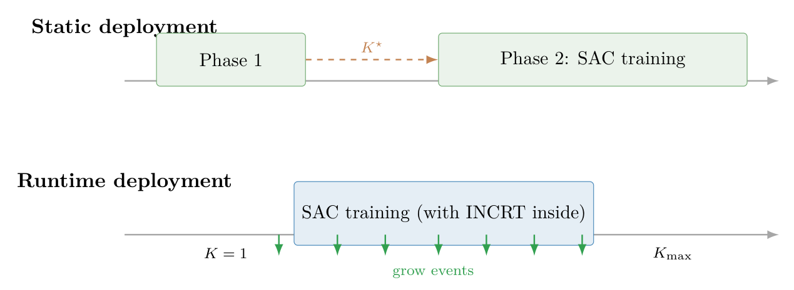
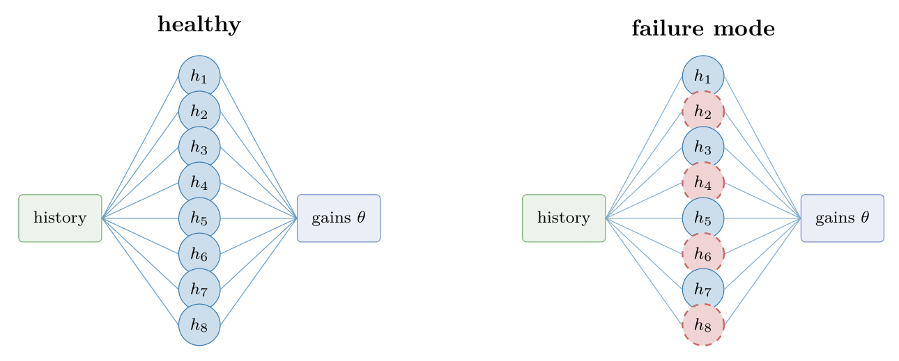

# Chapter 18: static control failure, head-count search, and runtime grow/prune rules

[Library index](../README.md) · [Source policy](../SOURCE.md) · [Previous source](0743-0745-ch18-euler-lagrange-control-and-deployment-equivalence.md#pdf-0745) · [Next source](0749-0750-ch18-runtime-control-results-curriculum-and-prediction-p5.md#pdf-0749)

> Editorial note: Full transcription of PDF 746–748. The original static-search interval, reported seed counts, comparisons, non-monotone head counts, and runtime monitoring prescription are preserved. The figures are original PDF crops; all training outcomes are source-reported.

## PDF 746 · Book page 710

**Figure 18.11:** When the INCRT dynamics are run. Top: once, offline (Phase 1), then frozen for SAC training (Phase 2). Bottom: kept running during SAC training, with grow events distributed along the run.

> Searchable figure labels: “Static deployment”, “Phase 1”, $K^\star$, “Phase 2: SAC training”; “Runtime deployment”, “SAC training (with INCRT inside)”, $K=1$, “grow events”, $K_{\max}$.

### 18.3.2 Phase-1/Phase-2 deployment: a tight upper bound and an unanticipated failure mode

The first paper Cirrincione and Fagiolini (2026b) deploys INCRT in its classical offline form. Algorithm ?? of Chapter 15 is run on the empirical realisation of $A_{\mathrm{res}}^{\mathrm{temp}}(\tau_z)$ estimated from $N=2048$ trajectory samples; the converged head count $K^\star(\tau_z)$ is then frozen as an architectural hyperparameter for a reinforcement-learning campaign that trains the meta-controller from scratch. No growth or pruning takes place during reinforcement-learning training: Phase 1 outputs an integer, Phase 2 consumes it.

Two findings from this deployment merit emphasis. The first concerns the shape of the function $\tau_z\mapsto K^\star$. The direct application of INCRT in the feature domain — the classical construction of Chapter 15 — yields $K^\star$ approximately constant in the range 3–5 across the entire sweep $\tau_z\in[0.2,5]$ s; the feature dimension does not encode the memory structure of the task. A second variant, in which $Y$ is replaced by a stack of future-horizon predictions, fares no better: $K^\star$ remains flat at $\approx5$ throughout. Only the temporal residual operator ((18.3)) produces a $K^\star(\tau_z)$ that varies non-monotonically with the memory horizon, peaking at the matched regime $\tau_z\approx W\Delta t$ and declining at both ends. The non-monotone shape is a quantitative prediction of Corollary ?? of Cirrincione and Fagiolini (2026b), scaled by a nonlinearity factor introduced by the Stribeck envelope; the predicted shape is reproduced empirically with $K^\star\in\{8,14,8,9,11\}$ at $\tau_z\in\{1,2,3,4,5\}$ s.

The second finding is the operational role played by $K^\star$ in the reinforcement-learning campaign. Because $K^\star$ is a compressed-sensing upper bound on the representational capacity required, not a prescription for training, the reinforcement-learning stage is run with a Phase-2 grid search over $K\in\{\lceil K^\star/2\rceil,\ldots,K^\star\}$ at fixed per-head dimension $d_k=16$. The value of $K$ retained at each regime, together with the corresponding tracking-error reduction $\Delta\%$ relative to a fixed-gain baseline and the comparison to a deeper Transformer baseline, is summarised in Table 18.7.

$K^\star$ is the Phase-1 head-count bound from Cirrincione and Fagiolini (2026b); Retained $K$ is the value selected by the Phase-2 grid search; $\Delta\%$ is the relative reduction of tracking RMSE with respect to a fixed-gain computed-torque baseline (negative is better); $d$ is Cohen’s effect size against a 4-head, 2-layer Transformer baseline; $p_U$ is the Mann–Whitney one-sided $p$-value. Failure rate is the fraction of seeds that either diverged in training or collapsed onto a payload-invariant policy.

## PDF 747 · Book page 711

**Table 18.7:** Static Phase-1/Phase-2 deployment of INCRT for the manipulator task.

| $\tau_z$ (s) | $K^\star$ (Phase-1) | Retained $K$ | $\Delta\%$ | $d$ | Failure rate |
|---:|---:|---:|---:|---|---:|
| 1 | 8 | 4 | $-40.0$ | $-1.1$ ($p_U<0.05$) | 0/10 |
| 2 | 14 | 7 | $-35.0$ | $-2.1$ ($p_U<0.05$) | 0/5 |
| 5 | 11 | 8 | $+5.0$ | $\approx0$ | 4/10 |

**Figure 18.12:** Two end-of-training attention blocks at $K=8$, $\tau_z=5$ s, differing only in the random seed. Dashed nodes denote heads silenced near initialisation.

> Searchable figure labels: “healthy”, “failure mode”; “history” → heads $h_1,\ldots,h_8$ → “gains $\theta$”. In the failure-mode drawing $h_2,h_4,h_6,h_8$ are dashed.

At the short and matched regimes the deployment performs as the INCRT theory predicts. The Phase-1 bound is tight enough that the Phase-2 search budget is reduced from sixteen to four–seven training runs per regime; the Phase-2 winner outperforms the deeper Transformer baseline by twelve and nineteen percentage points respectively, with large effect sizes and Mann–Whitney $p$-values below 0.05 in both cases. The $K^\star$ value at $\tau_z=2$ s is the largest of the three (peaking at the matched regime, as predicted), and the corresponding meta-controller exploits the additional capacity through the gain partition $Kd_k=7\cdot16=112$.

At the long regime the picture changes. The pilot at $n=5$ seeds reported in Cirrincione and Fagiolini (2026b) suggested an advantage of $-32.6\%$ $\Delta\%$ over the Transformer baseline, but the replication at $n=10$ closes the gap to statistical insignificance: four of the ten reinforcement-learning runs at $\tau_z=5$ s either diverge during training (two seeds) or converge to a policy whose tracking error is approximately invariant to payload (two seeds). The four failure-mode runs contribute the bulk of the variance and the entirety of the non-negative tail of the $\Delta\%$ distribution; the corresponding Transformer baseline at the same regime has one diverged run and no payload-invariant collapse. The asymmetry 4/10 versus 1/10 is the empirical signal that the Phase-1/Phase-2 separation has a specific failure mode at long memory horizons.

The mechanism, identified in Cirrincione and Fagiolini (2026b), is diagnostic of the static deployment of INCRT (Figure 18.12). The Phase-1 prediction $K^\star=11$ is sufficient to represent the temporal structure of the memory; the Phase-2 architecture instantiated at $K=8$ inherits enough capacity. What the static pipeline does not guarantee is that the reinforcement-learning gradient will exploit all $K$ heads. If during early training the gradient norm of the payload-sensitive heads falls below the noise floor of the SAC update, those heads cease to receive informative gradient signal, freeze near initialisation, and the policy reduces to a function of the trajectory reference alone. The signature of this collapse is unambiguous: tracking RMSE becomes nearly invariant in payload (range $\le0.05$ rad over a

## PDF 748 · Book page 712

1.5 kg payload sweep), and the run stabilises near the fixed-gain baseline.

The failure mode locates the limitation of the static deployment precisely: at the interface between Phase 1 and Phase 2. Phase 1 prescribes a representational capacity sufficient to encode the memory; Phase 2 does not, and cannot, guarantee that the optimisation instantiates that capacity. The longer the memory horizon, the larger the head count, and the larger the combinatorial possibilities for a subset of heads to silence themselves during training. The failure-mode rate is therefore a function of $K^\star$ itself: it is zero at $K^\star=8$ (with $K=4$ retained), zero at $K^\star=14$ (with $K=7$ retained), and 4/10 at $K^\star=11$ with $K=8$ retained — the regime in which the Phase-2 architecture inherits the largest absolute number of heads to manage during reinforcement-learning training.

The first paper closes by announcing a follow-up: move the INCRT dynamics inside the reinforcement-learning loop, so that heads are added and pruned during training in response to the observed effective rank of the on-policy data, rather than fixed in advance. The second paper of the case study carries out this programme.

### 18.3.3 Runtime deployment: capacity as curriculum

The second paper Cirrincione and Fagiolini (2026a) replaces the static head count of the first by a runtime controller — referred to in the paper as Runtime-INCRT — that schedules grow and prune events during reinforcement-learning training. The architecture is the variable-head attention block: $K_{\max}$ heads are allocated at construction time, but only an active subset of them, of cardinality $K(t)\in[K_{\min},K_{\max}]$, contributes to the attention output at training step $t$. The active set is updated every $t_{\mathrm{chk}}$ steps according to the homeostatic logic of Chapter 15, adapted to the on-policy distribution of context tokens:

- **Grow trigger.** Let $\widehat\rho_\alpha(t)$ be the empirical effective rank of the last $N$ encoder-input tokens at energy threshold $\alpha$ (the on-line analogue of $r_{\mathrm{eff}}(A_{\mathrm{res}})$ of Chapter 15). Grow fires when $\widehat\rho_\alpha(t)>K(t)(1+\varepsilon_{\mathrm{grow}})$ and a cooldown $\Delta_{\mathrm{grace}}$ has elapsed since the previous event. The newly-activated head is initialised with its output projection set to zero, so the policy is unchanged at the event instant (Cirrincione and Fagiolini (2026a); cf. Proposition ?? of Chapter 17).
- **Prune trigger.** For each active head $i$, let $\pi_i(t)$ be its relative output magnitude. Prune fires when $\pi_i(t)<\varepsilon_{\mathrm{prune}}$ for the least-contributing head and the cooldown has elapsed; the policy jump at the event is bounded by an explicit constant times $\varepsilon_{\mathrm{prune}}$ Cirrincione and Fagiolini (2026a).

The grow rule is the runtime analogue of the homeostatic growth condition $\Gamma_{\mathrm{res}}>\gamma_{\mathrm{add}}$ of Theorem ??; the prune rule is the runtime analogue of $\Gamma_{\mathrm{res}}<\gamma_{\mathrm{prune}}$. Under a mild assumption on the long-time behaviour of $\widehat\rho_\alpha$ (testable a posteriori, and verified in every run of the main campaign), the active head count converges to a steady-state interval whose endpoints are explicit functions of $\varepsilon_{\mathrm{grow}}$ and $\varepsilon_{\mathrm{prune}}$ Cirrincione and Fagiolini (2026a).

The empirical campaign uses $K_{\max}=8$, $K_{\mathrm{init}}=1$, $\varepsilon_{\mathrm{grow}}=10^{-1}$, $\varepsilon_{\mathrm{prune}}=10^{-3}$, $\Delta_{\mathrm{grace}}=2000$ steps, and $t_{\mathrm{chk}}=500$ steps, fixed across all three memory regimes. Ten seeds are run per regime. The headline result is reported in Table 18.8.

Runtime-INCRT uses $K_{\max}=8$, $K_{\mathrm{init}}=1$, $\Delta_{\mathrm{grace}}=2000$ steps, fixed across regimes; static INCRT-1L uses the regime-specific retained $K$ of Table 18.7. $\Delta\%$ is the relative reduction of tracking RMSE relative to the same fixed-gain baseline, with 95% confidence interval.

Three observations from Table 18.8 are decisive. The first is the elimination of the long-horizon failure mode: all ten Runtime-INCRT seeds at $\tau_z=5$ s succeed, against six of ten
