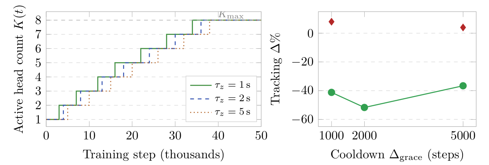

# Chapter 18: runtime-control results, capacity curriculum, compute, and Prediction P5

[Library index](../README.md) · [Source policy](../SOURCE.md) · [Previous source](0746-0748-ch18-static-control-failure-and-runtime-growth.md#pdf-0748)

> Editorial note: Full transcription of PDF 749–750. Original table arithmetic, confidence-interval/standard-deviation descriptions, schedule claims, compute estimate and Prediction P5 are preserved. The range ends mid-sentence in the chapter-synthesis paragraph. PDF 751 was inspected only to identify the continuation.

## PDF 749 · Book page 713

**Table 18.8:** Runtime-INCRT versus the static Phase-1/Phase-2 deployment of Table 18.7, at matched seed budget ($n=10$ per regime).

| $\tau_z$ (s) | Static INCRT-1L: $\Delta\%$ (failures) | Runtime-INCRT: $\Delta\%\pm\mathrm{CI}_{95}$ (failures) | Improvement (points) |
|---:|---:|---:|---:|
| 1 | $-40.0$ (0/10) | $-45.8\pm7.1$ (0/10) | $-5.8$ |
| 2 | $-35.0$ (0/10) | $-50.9\pm8.4$ (0/10) | $-15.8$ |
| 5 | $+5.0$ (4/10) | $-54.2\pm5.4$ (0/10) | $-59.1$ |

**Figure 18.13:** Left: active head count $K(t)$ for one representative seed at each memory regime. Right: tracking $\Delta\%$ as a function of the cooldown $\Delta_{\mathrm{grace}}$ at $\tau_z=2$ s (circles: mean; diamonds: seed failures).

> Searchable figure labels: left axis “Active head count $K(t)$”, ticks 1–8; horizontal “Training step (thousands)”, ticks 0, 10, 20, 30, 40, 50; $K_{\max}$; legend $\tau_z=1$ s, $\tau_z=2$ s, $\tau_z=5$ s. Right axis “Tracking $\Delta\%$”, ticks 0, $-20,-40,-60$; horizontal “Cooldown $\Delta_{\mathrm{grace}}$ (steps)”, ticks 1000, 2000, 5000; circles and failure diamonds.

under the static deployment. The second is the magnitude of the improvement: the worst Runtime-INCRT seed at $\tau_z=5$ s ($-38.8\%$) is forty-four points better than the mean of the static deployment at the same regime, and the matched-regime improvement of $-15.8$ points is itself larger than the entire advantage of static INCRT-1L over the Transformer baseline at any regime. The third is the reversal of the variance pattern: the per-seed standard deviation of Runtime-INCRT is smallest at $\tau_z=5$ (5.4%), against 9.9% at $\tau_z=1$ and 11.7% at $\tau_z=2$ — the regime in which the static deployment was least stable becomes the regime in which the runtime deployment is most stable.

The interpretation of these results requires care, because the reading suggested by the runtime label — the controller adapts $K$ to task complexity — is not what the data show. The active head count $K(t)$ saturates at $K_{\max}=8$ in every run of the main campaign, the growth schedule is identical across the three memory regimes, and the prune trigger never fires. Capacity does not adapt to task; it grows monotonically in time and stops at the cap. The $K_{\max}$ ablation reported in Cirrincione and Fagiolini (2026a) clarifies the role of the cap: the smallest cap $K_{\max}=2$ produces the best mean performance ($-57.2\%$ versus $-50.9\%$ at $K_{\max}=8$ and $-43.8\%$ at $K_{\max}=16$), and the per-seed variance is minimised at $K_{\max}=2$ as well. A larger representational ceiling does not help; if anything it hurts. The mechanism driving the improvement is therefore not the value of $K^\star$ at training end — the static and runtime deployments both reach $K=8$ at the long-horizon regime — but the trajectory that connects $K_{\mathrm{init}}=1$ to that terminal value.

This trajectory admits a clean interpretation. Each grow event is policy-continuous: the newly activated head is initialised with zero output projection, so the policy at the event instant is unchanged. The reinforcement-learning optimisation therefore begins in the smallest-capacity subspace of the architecture — a single-head attention block — and is escorted through a sequence of strictly larger subspaces, each transition leaving the policy output invariant.

## PDF 750 · Book page 714

The local-attractor structure responsible for the static failure mode at $\tau_z=5$ s exists in the full-capacity $K=8$ landscape; it does not exist in the single-head $K=1$ landscape, because there is no subset of heads that can silence itself when there is only one head. The early stages of training therefore operate in a landscape free of the relevant attractor, and by the time the architecture has grown to its full capacity the policy has already entered a basin that the attractors do not contain. The runtime mechanism, in this reading, is a capacity curriculum internal to a single reinforcement-learning training run: the homeostatic growth schedule that the INCRT theory of Chapter 15 prescribes on the residual matrix is repurposed as a schedule on the representational ambient space.

The curriculum reading makes a falsifiable prediction that the static reading does not. If the mechanism is the schedule, then the pace of the schedule should matter: too fast, and each new head is injected before the SAC critic has stabilised its evaluation of the previous capacity level; too slow, and the terminal capacity is reached too close to the end of the training budget for the full-capacity policy to consolidate. The pace is controlled by the cooldown $\Delta_{\mathrm{grace}}$. Sweeping $\Delta_{\mathrm{grace}}\in\{1000,2000,5000\}$ at $\tau_z=2$ s produces a non-monotone profile with a clear optimum at the default value: mean $\Delta\%$ degrades from $-51.7\%$ at the default to $-41.2\%$ at the fast cooldown and $-36.6\%$ at the slow cooldown, with one catastrophic seed failure at each extreme (Figure 18.13, right panel). The static reading would predict no such pace dependence — the terminal capacity is the same in all three sweeps. The curriculum reading predicts the observed shape.

**Compute overhead of the runtime monitor.** A natural concern about the runtime mode is its computational cost. The runtime monitor of Cirrincione and Fagiolini (2026a) estimates the empirical effective rank $\widehat\rho_\alpha(t)$ of the last $N$ encoder-input tokens once every $t_{\mathrm{chk}}$ training steps. Using the FLOPs accounting introduced in Chapter ?? of this volume, the cost per checkpoint is dominated by the construction of the empirical residual operator over $N$ tokens of dimension $d_{\mathrm{model}}$, which costs $O(N\cdot d_{\mathrm{model}}^2)$ FLOPs, plus a singular-value decomposition of an $N\times d_{\mathrm{model}}$ matrix at $O(Nd_{\mathrm{model}}^2)$. A single attention-block forward pass, by the same accounting, costs $24Ld_{\mathrm{model}}^2+4L^2d_{\mathrm{model}}+\ldots$ FLOPs at sequence length $L$. With the parameters of the main campaign ($N=2048$, $L=256$, $d_{\mathrm{model}}=64$, $t_{\mathrm{chk}}=500$ steps), the monitor adds approximately 3% to the wall-clock cost of training. The 59-percentage-point improvement at $\tau_z=5$ s is therefore, in compute terms, nearly free.

**A counterfactual prediction (P5).** Proposition 18.3 predicts that on benchmarks whose downstream loss is convex (or nearly so) on the initialisation basin, offline and runtime INCRT must produce asymptotically equivalent architectures. The case-study experiments do not test this prediction directly, because their downstream learner is non-convex by construction. To make the prediction falsifiable in the strict sense of Section 18, the prediction is therefore added below to the list of falsifiable predictions of this chapter.

**Prediction P5 (offline–runtime equivalence on classification benchmarks).** Re-running the SST-2 campaign of Section 18 or the SARS-CoV-2 campaign of Section 18 under the runtime monitor of Cirrincione and Fagiolini (2026a) should yield terminal head counts within $\lceil\log_2(1/\varepsilon_{\mathrm{prune}})\rceil$ of the offline values reported in those sections, and downstream accuracies indistinguishable at $p>0.05$. A statistically significant deviation in either quantity falsifies Proposition 18.3 and demands a refinement of the convexity hypothesis under which it was stated.

This prediction occupies the empty quadrant of Figure 18.18 of Section 18.4: the lower-right region of the benchmark space, currently unpopulated. The chapter-level synthesis of all

> Batch boundary: PDF 750 ends mid-sentence after “The chapter-level synthesis of all”. PDF 751 begins “five experimental campaigns (Tables 18.7, 18.8, and the extended summary table 18.9) is deferred to Section 18.4.3, …”. Prediction P5 itself is complete on PDF 750; the synthesis paragraph, §18.3.3 and Chapter 18 continue. Section 18.3.4 begins on PDF 751 and is outside this batch.

> Continuation now available: [PDF 751](0751-0753-ch18-runtime-scope-and-geopolymer-inverse-design.md#pdf-0751). The sentence split after “The chapter-level synthesis of all” is completed there; batch 015 remains the historical record of PDF 701–750.
