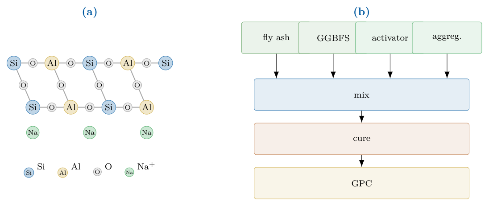

# Chapter 18: runtime scope and the geopolymer inverse-design setting

[Library index](../README.md) · [Source policy](../SOURCE.md)

> Editorial note: Full transcription of PDF 751–753. This range completes the sentence begun on PDF 750, closes §18.3 and begins §18.4. Original unresolved references (`??`, `?`, “Sections 18–18”), scope claims and campaign counts are retained. Figure 18.14 is a crop of the original PDF. Editorial assessment belongs in the linked reading notes, not in the source text.

## PDF 751 · Book page 715

five experimental campaigns (Tables 18.7, 18.8, and the extended summary table 18.9) is deferred to Section 18.4.3, after the case study of Section 18.4 has added the prototype-only operational mode of INCRT to the picture.

The classification campaigns of Sections 18–18 were run exclusively in the offline mode of INCRT; the protein case study of Section 18.2 extends the offline mode to in-pretraining deployment; the control case study of Section 18.3 was the first to exercise the runtime mode; the inverse-design case study of this section is the first to exercise the prototype-only mode. The *Primary INCRT object* column identifies which output of Algorithm ?? is consumed by the downstream procedure.

### 18.3.4 Lessons of the case study for the monograph’s thesis

The two-paper case study of Cirrincione and Fagiolini (2026b,a) exposes a feature of INCRT that the classification campaigns of the preceding sections were not in a position to expose, because in those campaigns the architecture is not optimised against a reinforcement-learning loop with its own attractor structure. The feature is the following.

The INCRT framework of Chapters 15–17 admits two distinct modes of use. In the **offline mode**, the residual matrix is constructed once on a fixed dataset, the homeostatic dynamics are run to convergence, and the resulting fixed-point head count is exported as a frozen architectural hyperparameter. This is the mode that the classification benchmarks exercise; it is also the mode of the first case-study paper. In this mode the role of INCRT is architectural prediction, and the relevant theorem is the compressed-sensing bound of Theorem ??: the converged head count is an upper bound on the representational capacity required. In the **runtime mode**, the residual energy is monitored during the training of the downstream learner, and the homeostatic growth and pruning operations are performed in response to that monitoring. This is the mode of the second case-study paper. In this mode the role of INCRT is no longer architectural prediction but trajectory shaping: the mechanism imposes a curriculum on the optimiser, and the relevant property is no longer the fixed-point head count but the policy continuity of the growth and pruning events — Proposition ?? of Chapter 17 and its runtime adaptation in Cirrincione and Fagiolini (2026a).

The classification campaigns do not separate these two modes. Because the cross-entropy loss of a sentence classifier does not exhibit the local-attractor structure of an actor–critic reinforcement-learning loop, the offline and runtime modes produce indistinguishable terminal architectures on those benchmarks; the runtime monitor is operationally redundant. The control case study does separate the two modes, because the SAC optimisation landscape contains payload-invariant attractors that the static deployment cannot avoid and the runtime deployment can. The 59-point improvement at the long-horizon regime is therefore not an incremental performance gain on a continuous-control benchmark; it is an experimental falsifier of the working hypothesis of Chapter 15, that the offline and runtime formulations of INCRT are operationally equivalent. They are not. The runtime formulation is strictly more expressive when the downstream learner has an attractor structure of its own.

This finding qualifies, but does not retract, the methodological recommendation of Chapter 15. For supervised tasks with convex or near-convex training objectives — the regime of the JMLR construction and of the classification benchmarks in this chapter, and the in-pretraining mode of the protein case study — the offline mode is sufficient and is to be preferred on grounds of computational cost: a single offline run of Algorithm ?? is cheaper than a continuous online monitor. For non-convex downstream learners with their own optimisation pathologies — reinforcement learning, but plausibly also adversarial training and constrained policy optimisation ?? — the runtime mode adds a second guarantee, on the trajectory rather

## PDF 752 · Book page 716

than on the architecture, that the offline mode does not provide. The present chapter’s broader thesis, that representational capacity in transformer architectures admits both a static and a dynamic characterisation, finds its sharpest empirical confirmation in the contrast between Tables 18.7 and 18.8.

A final caveat is in order. The control case study reports an empirical falsification of the offline/runtime equivalence hypothesis on a single benchmark family — Stribeck friction in a two-degree-of-freedom manipulator — and a single reinforcement-learning algorithm, namely Soft Actor–Critic. The case study establishes that the question of offline/runtime equivalence is non-trivial; it does not establish that the answer is the same in every non-convex setting.

The chapter-level synthesis of all five experimental campaigns, together with the Open Problems that the present case study and that of Section 18.4 raise but cannot settle, is deferred to Section 18.4.3 and Section 18.4.4, after the third operational mode of INCRT — the prototype-only mode — has been exercised on the small-data inverse-design benchmark of Section 18.4.

### 18.4 Self-architecting prototypes for inverse design of geopolymers

The four campaigns of Sections 18–18 deploy INCRT in its offline mode: Algorithm ?? of Chapter 15 is run once on a frozen residual operator, the converged head count $K^\star$ is exported as an architectural hyperparameter, and the full attention block of width $K^\star$ is trained downstream. The protein case study of Section 18.2 extends the offline mode to in-pretraining deployment, with the same exported architectural object. The case study of Section 18.3 deploys INCRT in its runtime mode: the homeostatic dynamics of Chapter 15 are kept running during downstream training, and the trajectory they trace out shapes the optimisation rather than the final architecture. The present section reports a case study that exercises a third operational mode of the same framework, distinct from both of the preceding two and structurally more reduced than either.

In the case study below, only the converged prototype set $\mathcal P=\{p_k\}_{k=1}^{K^\star}$ produced by Algorithm ?? is retained; the attention machinery, the gain partition, and the downstream learner that consumes $K^\star$ heads are all omitted. The prototype set is exported, alone, as a data-support index for an external decision procedure — specifically, the inverse-design procedure of a small, mixed-variable, physically constrained engineering dataset. The question the case study asks is whether the prototype layer of INCRT, when stripped of the rest of the architecture, is still an operationally useful object. The answer turns out to be affirmative, and the mechanism by which the answer becomes affirmative is informative about the function of INCRT prototypes in the offline and runtime modes too.

The engineering setting deserves a few sentences of context before the experimental design enters. Concrete is the most-used engineering material on Earth and the backbone of essentially every modern construction; conventional concrete uses Portland cement as its binder, and Portland cement manufacture is a substantial source of carbon dioxide emissions, accounting for approximately 8% of global anthropogenic CO$_2$ output. A **geopolymer** is an alternative binder, formed by activating an aluminosilicate precursor (typically a powder rich in silicon and aluminium oxides) with a strong alkaline solution; the resulting material has compressive strengths comparable to Portland-cement concrete but, because no high-temperature calcination of limestone is required, embodies substantially less CO$_2$ per cubic metre. The aluminosilicate precursors used in the present benchmark are themselves

## PDF 753 · Book page 717

**Figure 18.14:** (a) Schematic of the geopolymer Si–O–Al network with charge-balancing Na$^+$ cations. (b) Manufacturing flow: fly ash or ground-granulated blast-furnace slag (GGBFS) precursors are combined with the alkaline activator and aggregates, mixed, cured, and yield the finished GPC.

> Searchable figure labels: (a) Si, Al, O, Na$^+$; (b) fly ash, GGBFS, activator, aggreg. → mix → cure → GPC.

industrial by-products: fly ash, the fine residue collected from coal-fired power plants, and ground-granulated blast-furnace slag, a by-product of iron-making. A geopolymer concrete (GPC) mixture therefore consists of an aluminosilicate precursor, an activator solution, water, and aggregates, in proportions that must be selected to meet a target mechanical performance.

Designing a concrete is the problem of choosing a recipe: the quantities of each constituent per unit volume of finished material. A typical GPC recipe has approximately twenty components, including continuous quantities (kilograms of fly ash per cubic metre, mass of fine aggregate, molarity of NaOH solution), discrete choices (binder type: fly-ash-only, slag-only, or blend), and binary indicators (curing protocol: ambient versus heat-cured). The performance to be matched is typically the 28-day compressive strength, the standard mechanical measure for concrete; for low-carbon design, a second performance variable is the embodied CO$_2$ per cubic metre. The **forward problem** — given a recipe, predict the strength and the carbon — is a standard supervised regression task. The **inverse problem** — given a target strength and a desire for low carbon, propose a recipe that will likely meet the target — is the engineering problem that the case study addresses, and is structurally distinct from supervised regression: there is no held-out test set in the supervised sense; there is, instead, an external optimiser that searches the recipe space for points whose forward prediction matches the target. The optimiser does not know which regions of recipe space the forward model can be trusted on; it will happily propose recipes that lie far outside the experimentally observed cloud, in regions where the forward surrogate is extrapolating wildly. The prediction at such an extrapolated point may be numerically plausible (the surrogate is a smooth function and produces a number for any input) but is empirically unsupported: no mixture resembling it has ever been tested in a laboratory. This is the **surrogate-extrapolation failure mode** of inverse design, and it is the failure mode that the prototype set $\mathcal P$ of INCRT, used as a data-support index, is designed to detect.

The case study is reported in two companion papers, joint work with F. Grassia Cirrincione and Grassia (2026a,b), and uses the public Mendeley benchmark of Pham ? for fly-ash and ground-granulated blast-furnace-slag GPC mixtures. The exposition below is organised as follows. Section 18.4.1 introduces the inverse-design problem and the prototype-only

> Source boundary: the sentence continues on PDF 754 with “reduction of INCRT.” The partial reference “Pham ?” and the duplicated-looking attribution “F. Grassia Cirrincione and Grassia (2026a,b)” are present in the PDF.

> Editorial navigation: [Previous source](0749-0750-ch18-runtime-control-results-curriculum-and-prediction-p5.md#pdf-0750) · [Next source](0754-0757-ch18-geopolymer-screening-sufficiency-and-results.md#pdf-0754)
