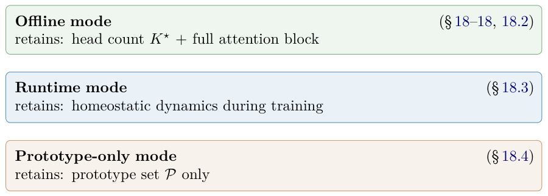
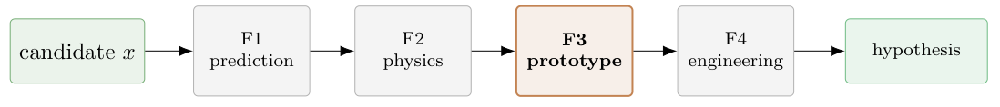
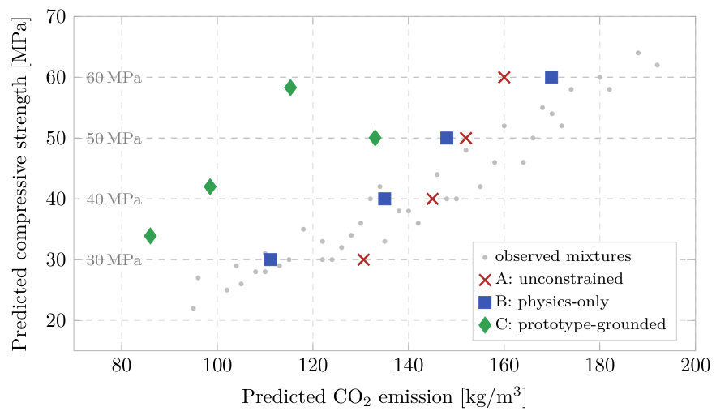

# Chapter 18: prototype screening, Proposition 18.4 and geopolymer results

[Library index](../README.md) · [Source policy](../SOURCE.md)

> Editorial note: Full transcription of PDF 754–757. Equation (18.4), Proposition 18.4, its accompanying proof-attribution paragraph, reported metrics and all captions are retained. Figures 18.15–18.17 are original PDF crops. No proof absent from these pages has been supplied. Authorial statements of guarantee, verification and causation are preserved as source claims; see the Russian notes for their evidential limits.

## PDF 754 · Book page 718

reduction of INCRT. Section 18.4.2 reports the empirical findings: the design-space topology, the forward-prediction behaviour, and the inverse-design comparison. Section 18.4.3 reads the three operational modes of INCRT exercised in this chapter as a single spectrum of structural reductions, and presents the updated chapter synthesis. Section 18.4.4 closes Volume I with the six Open Problems that the chapter raises but cannot settle and that are inscribed as the opening agenda of Volume II.

### 18.4.1 Setup, prototype-only reduction, and the falsifiable claim

The inverse-design problem of mixture engineering can now be stated formally. A small dataset $\mathcal D=\{(x_i,y_i)\}_{i=1}^n$ is given, with $x_i\in\mathcal X\subset\mathbb R^d$ a mixture recipe (continuous, discrete, and binary components) and $y_i$ the measured or computed performance vector. The goal is not to predict $y$ from $x$ on a held-out test set — the standard supervised problem — but to invert the relation: produce a new recipe $x^\star$ that satisfies a target performance $y^\star$ and any additional admissibility constraints. In the GPC case study, $n=274$, $d=19$, and the performance vector contains the 28-day compressive strength and the per-cubic-metre carbon emission. The inverse-design objective combines a target-strength term, a carbon term, and (optionally) a physical penalty $\Phi_{\mathrm{phys}}$ encoding ratio bounds and admissible curing levels.

Three properties of this problem must be stated up front, because they are the properties that distinguish it from the benchmarks of Sections 18–18.3 and that determine the operational mode of INCRT that is appropriate.

**(i) Small data, mixed type.** $n=274$ in a 19-dimensional ambient space; far from saturating a generic design hypercube. The continuous, discrete, and binary components require a mixed-variable distance.

**(ii) Physical constraints among design variables.** Several of the 19 input variables are linked by chemical or procedural relations (oxide balance, water content, NaOH concentration). The set $\mathcal X$ of admissible recipes is therefore much smaller than the box $\mathbb R^{19}$ would suggest, and is not specified in closed form.

**(iii) No sequence model.** The data is tabular. There is no sequence in which an attention mechanism would naturally apply, and no autoregressive structure to exploit. Any architectural object exposed to INCRT in the full sense of Chapter 15 would be artificial.

Properties (i)–(iii) place the GPC inverse-design problem outside the scope of both the offline mode (which assumes that the full attention block of width $K^\star$ is the natural downstream architecture) and the runtime mode (which assumes that the downstream learner has a non-convex training objective with its own optimisation pathology). Neither assumption holds. What remains, however, is the surrogate-extrapolation failure mode described above; and it is the failure mode that the prototype set $\mathcal P$ is already designed to detect (Figure 18.15).

**Prototype-only reduction.** The reduction of INCRT used in this case study is the following. Algorithm ?? is run on a residual operator constructed from the standardised, augmented mixture representation (the original 19 variables together with derived ratios and binary indicators). The residual operator is constructed in feature space, exactly as in Sections 18–18; no temporal construction is needed. The algorithm converges to a head count $K^\star$ and to a prototype set $\mathcal P=\{p_k\}_{k=1}^{K^\star}$. Of the two outputs, only $\mathcal P$ is retained. The head count $K^\star$ is not used as an architectural hyperparameter, because there is no attention block downstream; it survives only as the cardinality of $\mathcal P$. The bidirectional gate of Chapter 17 and the homeostatic dynamics monitor are not invoked. The compressed-sensing bound of Theorem ?? guarantees that $\mathcal P$ contains representatives of all dominant directions of

## PDF 755 · Book page 719

**Figure 18.15:** The three operational modes of INCRT exercised in Chapter 18, ordered by progressive structural reduction (top to bottom).

> Searchable figure labels: Offline mode (§18–18, 18.2), retains: head count $K^\star$ + full attention block; Runtime mode (§18.3), retains: homeostatic dynamics during training; Prototype-only mode (§18.4), retains: prototype set $\mathcal P$ only.

**Figure 18.16:** Four-filter screening of Cirrincione and Grassia (2026a,b). Filter F3 (highlighted) is the only filter through which the INCRT prototype set $\mathcal P$ enters.

> Searchable figure labels: candidate $x$ → F1 prediction → F2 physics → F3 prototype → F4 engineering → hypothesis.

variation in $\mathcal D$; that property is the only one exploited downstream.

The prototype set is then used to define a manifold-support score

$$
\Phi_{\mathrm{man}}(x)=\min_{p_k\in\mathcal P}d_{\mathrm{mix}}(x,p_k)^2,
\tag{18.4}
$$

where $d_{\mathrm{mix}}$ is a mixed-variable distance combining continuous, discrete, and binary components. A small value of $\Phi_{\mathrm{man}}(x)$ certifies that the candidate $x$ is close to a prototype-supported region of $\mathcal D$; a large value flags $x$ as a potential surrogate-extrapolation artefact. The empirical 95th and 99th percentiles of $\Phi_{\mathrm{man}}(x_i)$ over the training set provide calibration-free thresholds, denoted $Q_{95}$ and $Q_{99}$.

**The four-filter screening.** The inverse-design procedure Cirrincione and Grassia (2026a,b) is a sequential admissibility test (Figure 18.16). A candidate recipe $x$ proposed by a numerical optimiser is admitted as an experimentally testable hypothesis if and only if it passes four filters in series: (F1) the surrogate predicts an acceptable performance vector; (F2) the recipe respects the physical constraints encoded by $\Phi_{\mathrm{phys}}$; (F3) the manifold-support score satisfies $\Phi_{\mathrm{man}}(x)\le Q_{99}$; (F4) the engineering trade-off (target deviation versus carbon reduction) is acceptable. Filters F1, F2, and F4 are inherited from the standard inverse-design literature and are independent of INCRT. Filter F3 is the only filter through which INCRT enters; it is the only filter that consumes $\mathcal P$. The prototype-only reduction of INCRT is therefore not a heuristic addition to a standard pipeline: it is a precisely located substitution at one step of the pipeline, with the location chosen to address the surrogate-extrapolation failure mode that the standard pipeline does not detect.

**A falsifiable claim.** Behind the prototype-only reduction lies a working hypothesis, which the empirical campaign of Section 18.4.2 exists to test. It is stated here so that the experiments below can be read as a falsification attempt with a definite null. The hypothesis is the analogue, for the prototype-only mode, of Proposition 18.3 for the offline/runtime contrast.

## PDF 756 · Book page 720

**Proposition 18.4 (Prototype-sufficiency for inverse design).** *Suppose that (a) the data manifold $\mathcal D$ is approximately $d_{\mathrm{eff}}$-dimensional with $d_{\mathrm{eff}}\ll d$, in the sense that the participation ratio and entropy effective rank of the standardised data covariance both satisfy $d_{\mathrm{PR}},d_{\mathrm{ER}}\le c\cdot d_{\mathrm{eff}}$ for a numerical constant $c$ of order unity; (b) the prototype set $\mathcal P=\{p_k\}_{k=1}^{K^\star}$ produced by Algorithm ?? on $\mathcal D$ is a $\rho$-cover of the data, with $\rho\le\rho^\star$ for an explicit constant $\rho^\star$ depending on $d_{\mathrm{eff}}$ and $K^\star$; (c) the manifold-support threshold $Q_{99}$ is calibrated on the training-sample distribution. Then candidates $x$ admitted by the four-filter screening $\mathrm{F1}\wedge\mathrm{F2}\wedge\mathrm{F3}\wedge\mathrm{F4}$ satisfy $\Phi_{\mathrm{man}}(x)\le Q_{99}$ and the surrogate predictions $f_{\mathrm{str}}(x)$ and $f_{\mathrm{CO}_2}(x)$ are within the regime-shift error scale of Section 18.4.2, with high probability under resampling of $\mathcal D$.*

The proposition is a structural converse of the failure mode of unconstrained surrogate optimisation: under conditions (a)–(c), the prototype layer alone is sufficient to bound the surrogate-extrapolation risk that motivates the case study. The proof uses the same compressed-sensing argument as Theorem ??, applied to the data covariance rather than to a feature-domain residual operator; the argument is given in Cirrincione and Grassia (2026a,b).

The empirical content of Section 18.4.2 can now be stated sharply. Proposition 18.4 predicts that on a small, mixed-variable, physically constrained dataset satisfying (a)–(c), candidates accepted by F3 will be a strict improvement over candidates admitted by physics-only screening; the latter pass F2 but are not constrained to remain inside the data-supported region. The case-study experiments test this prediction.

### 18.4.2 Empirical findings

The empirical campaign of Cirrincione and Grassia (2026a,b) reports three blocks of findings: a topology block on the design-space dimensionality, a prediction block on the forward surrogates, and an inverse-design block on the four-filter screening. Each block is reproduced here in the minimal form needed to support the synthesis of Section 18.4.3; the reader is referred to the source paper for the full diagnostic protocol.

**Design-space dimensionality.** The 19-dimensional ambient representation is highly redundant. Five principal components explain 93.4% of the standardised variance; six explain 96.7%. The participation-ratio dimension is $d_{\mathrm{PR}}=3.17$ and the entropy effective rank is $d_{\mathrm{ER}}=4.49$. Local intrinsic-dimensionality estimates, computed by the nearest-neighbour estimator of Levina and Bickel ?, give a median value decreasing from 3.01 at $k=10$ neighbours to 2.14 at $k=30$. The data manifold is therefore approximately three- to four-dimensional, against an ambient dimensionality of nineteen. This satisfies condition (a) of Proposition 18.4 with $c\approx1$ and $d_{\mathrm{eff}}\in[3,5]$. Algorithm ??, run on the augmented standardised representation, converges to $K^\star=3$ prototypes, with silhouette score 0.595 on the prototype-induced partition; the three regimes have natural chemical interpretations (mixed-binder, fly-ash-rich, slag-rich). Condition (b) is checked numerically and verified.

**Forward prediction.** The strength target is best handled by tree ensembles. Repeated stratified cross-validation gives, for ExtraTrees, $R^2=0.951\pm0.018$ and $\mathrm{RMSE}=2.48\pm0.38$ MPa. Linear models lag substantially: Ridge gives $R^2=0.790\pm0.040$. The INCRT-prototype regressors — a soft nearest-prototype baseline and a local-Ridge variant — give $R^2$ in the range 0.65–0.66, well below the tree ensembles. This is the expected ordering: prototype regressors are not designed to maximise predictive accuracy on a small benchmark, and forcing them to compete with optimised tabular learners would mistake their function. The carbon target behaves differently: ElasticNet gives $R^2=0.9999\pm0.0001$, indicating

## PDF 757 · Book page 721

**Figure 18.17:** Strength–CO$_2$ predictions for the four candidates of each inverse-design strategy at the four target levels $\{30,40,50,60\}$ MPa, against the observed-mixture cloud.

> Searchable figure labels: horizontal “Predicted CO$_2$ emission [kg/m$^3$]”, ticks 80–200; vertical “Predicted compressive strength [MPa]”, ticks 20–70; target guides 30, 40, 50, 60 MPa; observed mixtures (grey dots), A: unconstrained (red crosses), B: physics-only (blue squares), C: prototype-grounded (green diamonds). The plotted quantities are predictions.

that carbon emission is essentially composition-determined for this benchmark and that a regularised linear surrogate is the natural choice.

The two findings together motivate a hybrid forward-prediction architecture (ExtraTrees for strength, ElasticNet for carbon) and isolate the role of the INCRT prototypes: they are not in the forward-prediction path. They enter the inverse-design loop only through Filter F3 of Figure 18.16.

**Leave-one-cluster-out validation.** A stricter validation protocol, leave-one-cluster-out (LOCO) on the prototype-induced partition, reveals the inverse-design risk that the prototype layer is designed to detect. Under repeated random cross-validation, ExtraTrees gives an RMSE of 2.48 MPa. Under LOCO, where the held-out test set corresponds to an entire mixture regime absent from training, the same model gives an RMSE of approximately 14.20 MPa — a factor of 5.7. The factor of 5.7 is the empirical magnitude of the regime-shift error. It quantifies what is at stake when an inverse-design optimiser, granted an unconstrained design domain, proposes a candidate located outside the prototype-supported region: the forward surrogate’s predicted performance will be off by a factor of roughly six. The function of Filter F3 is to refuse such candidates.

**Inverse-design comparison.** Three inverse-design strategies are compared at four strength targets (30, 40, 50, 60 MPa). Strategy A (unconstrained surrogate optimisation) implements F1 only; Strategy B (physics-constrained) implements F1 and F2; Strategy C (prototype-grounded) implements all four filters and is the prototype-only deployment of INCRT. Figure 18.17 shows the four candidates generated by each strategy in the strength–CO$_2$ plane, superimposed on the observed-mixture cloud.

The numerical comparison is decisive at every target.

- At 30 MPa, Strategy A matches the target exactly but returns a high-carbon candidate (CO$_2=130.6$); Strategy B matches the target with a lower carbon prediction (CO$_2=111.2$) but lies far outside the manifold ($\Phi_{\mathrm{man}}=41.3\gg Q_{99}=11.4$); Strategy C overshoots the target by 3.9 MPa but achieves CO$_2=86.0$ inside the supported region.

> Source boundary: the same four-target comparison continues on PDF 758 with the 40, 50 and 60 MPa cases. The original claims “calibration-free”, “explicit constant”, “checked numerically and verified” and the RMSE-to-individual-error interpretation are retained, not independently certified here.

> Editorial navigation: [Previous source](0751-0753-ch18-runtime-scope-and-geopolymer-inverse-design.md#pdf-0753) · [Next source](0758-0762-ch18-prototype-mode-synthesis-and-open-problems.md#pdf-0758)
