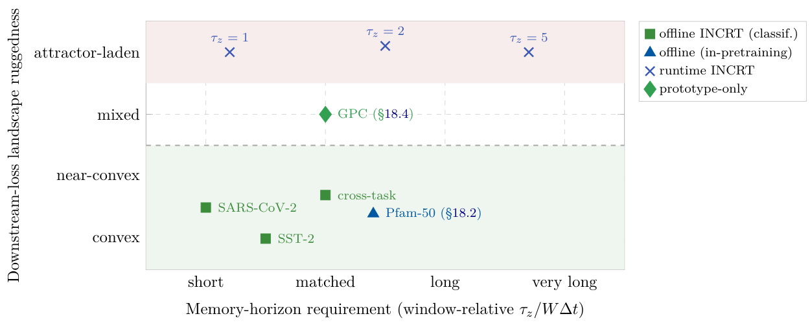

# Chapter 18: prototype-only results, three-mode synthesis and Open Problems 11–16

[Library index](../README.md) · [Source policy](../SOURCE.md)

> Editorial note: Full transcription of PDF 758–762 through the end of Chapter 18. Table 18.9 is transcribed into five columns; in the PDF its “Mode” values appear on a second line beneath the primary-object cells. Figure 18.18 is an original crop. Original draft instructions, unresolved references, inconsistent campaign counts, statements that this section closes Volume I, and open-problem claims are preserved as source text rather than silently repaired or executed.

## PDF 758 · Book page 722

- At 40 MPa, Strategy A produces a candidate that violates a physical constraint and lies far off-manifold; Strategy B is physically valid but high-carbon; Strategy C overshoots by 2.0 MPa and achieves the lowest predicted CO$_2$ of any candidate in the campaign.

- At 50 MPa, Strategy C achieves both target match (50.03 MPa, error 0.03) and a 10% reduction in predicted CO$_2$ relative to Strategy B at the same target, while remaining well inside the empirical 95th percentile of manifold distance. This is the cleanest demonstration of the prototype-only mode: no trade-off, only improvement.

- At 60 MPa, Strategy B matches the target but at CO$_2=169.9$, the highest of any candidate; Strategy C accepts a 1.7 MPa strength deviation and reduces CO$_2$ to 115.3, a 32% reduction at a strength cost of 2.8%.

The headline result is that, across the four targets, Strategy C generates four candidates that are all physically admissible (zero violations), all inside the empirical 99% manifold-support region (all four with $\Phi_{\mathrm{man}}<Q_{99}$), and all strictly preferable to Strategy B on the strength–CO$_2$ trade-off. Strategy A, by contrast, generates two of four candidates that violate a physical constraint and three of four that lie far off-manifold; it would not survive the four-filter screening. The contrast is not a marginal performance gain. It is the operational distinction between a candidate generated by unconstrained surrogate optimisation, which is at the mercy of the regime-shift error scale of the LOCO experiment ($\sim14$ MPa), and a candidate generated by Strategy C, which is not.

**Discussion.** The three blocks of findings together support Proposition 18.4. The data manifold is low-dimensional (condition (a)), the prototype set covers it with $K^\star=3$ regimes (condition (b)), the empirical threshold $Q_{99}$ is calibrated on the training-sample distribution (condition (c)), and Strategy C generates candidates that lie inside the supported region while improving on Strategy B’s strength–CO$_2$ trade-off. The proposition is not falsified by the case study; the falsifier described at the end of Section 18.4.1 would require either a high-dimensional dataset on which condition (a) fails, or a dataset on which the four-filter screening produces no Pareto improvement over physics-only screening. Neither is exhibited here.

A second observation is that the role of INCRT in this case study is qualitatively different from its role in Sections 18–18.3. In the classification campaigns, INCRT predicts an architecture; in the protein case study, INCRT grows a self-architected encoder during pretraining; in the control case study, INCRT shapes a training trajectory; in the GPC case study, INCRT certifies the data support of a candidate generated by an external procedure. Four roles, three operational modes, one underlying construction. The next subsection reads them as a single spectrum.

### 18.4.3 Synthesis: three operational modes of INCRT as a spectrum

The five experimental campaigns of Chapter 18 exercise INCRT in three operationally distinct modes, ordered by progressive structural reduction (Figure 18.15). The reduction is not a series of disconnected variants; it is a single sequence in which one component of the original construction is dropped at each stage, while the remaining components retain their function.

**The three modes.** In the **offline mode** (Sections 18–18, 18.2), the full algorithm of Chapter 15 is run: the residual operator is constructed once, the homeostatic dynamics are run to convergence, the converged head count $K^\star$ is exported as an architectural hyperparameter, and the full attention block of width $K^\star$ is trained downstream. The role

## PDF 759 · Book page 723

of INCRT is architectural prediction, and the relevant theorem is the compressed-sensing bound of Theorem ??.

In the **runtime mode** (Section 18.3), the homeostatic dynamics are kept running during downstream training. The downstream learner begins in a single-head architecture and is escorted through a sequence of growth events, each policy-continuous by zero-output initialisation (Proposition ??). The role of INCRT is trajectory shaping: a capacity curriculum internal to a single training run. The relevant property is no longer the fixed-point head count but the policy continuity of the growth events.

In the **prototype-only mode** (Section 18.4, this section), only the prototype set $\mathcal P$ is retained. The attention block is omitted; the homeostatic dynamics are run only once and only to generate $\mathcal P$; the head count $K^\star$ survives only as the cardinality of $\mathcal P$. The role of INCRT is out-of-distribution control: $\mathcal P$ is exported as a data-support index for an external decision procedure (the four-filter screening of Figure 18.16). The relevant property is the $\rho$-cover guarantee implicit in Theorem ??.

**Why this is a spectrum, not a list.** Two structural facts make the three modes a spectrum and not a disjoint list of variants. First, each mode is a strict sub-deployment of the previous one: the runtime mode uses everything the offline mode uses (residual operator, homeostatic dynamics, fixed-point head count), and additionally keeps the dynamics running during training; the prototype-only mode uses strictly less than the offline mode (no attention block, no fixed-point head count exported). Second, the conditions under which each mode is the appropriate one form a containment hierarchy on the downstream task: the offline mode requires that the downstream learner be a sequence model with a near-convex training objective; the runtime mode requires only that the downstream learner be a sequence model (the convexity assumption is dropped); the prototype-only mode requires neither (the sequence-model assumption is dropped as well). The three modes are therefore three points along the relaxation of the assumptions made by Chapter 15, not three competing constructions.

The relaxation is not free. Each mode forfeits a guarantee that the previous mode provides. The offline mode guarantees both architectural sufficiency and training-time convergence. The runtime mode guarantees architectural sufficiency at every training step but not architectural minimality at training end. The prototype-only mode guarantees only data-support coverage; it makes no claim about the downstream learner at all. The appropriate mode for a given task is determined by which guarantee is most needed, not by which mode is most powerful.

**Updated chapter synthesis.** The chapter-summary table of Section 18.3 (Table ??, in its v0.5 form) is extended below to include the prototype-only mode and the protein case study of Section 18.2. The extended version replaces the previous one; the previous one should be deleted from Section 18.3 when this section is incorporated into the master file.

The updated chapter-summary scatter (Figure 18.18) extends Figure ?? of Section 18.3 with markers for the protein and prototype-only benchmarks. The geopolymer marker (diamond) sits in the centre of the diagram: its downstream procedure is neither convex nor attractor-laden in the SAC sense, but it is also not a single optimisation loss. The protein marker (triangle) sits in the convex half-plane adjacent to the SARS-CoV-2 and SST-2 squares, because the MLM cross-entropy is near-convex on the basin of standard initialisations. The diagram is no longer a binary partition of benchmarks into offline-sufficient and runtime-needed regions. It is a four-region partition — offline classification, offline in-pretraining, runtime control, prototype-only inverse design — with the prototype-

## PDF 760 · Book page 724

**Table 18.9:** Updated synthesis of the experimental campaigns of Chapter 18, replacing Table ?? of Section 18.3.

| Section | Task | Problem class | Primary INCRT object | Mode |
|---|---|---|---|---|
| 18 | SARS-CoV-2 (8-class) | near-convex CE | head count $K^\star$ | offline |
| 18 | SST-2 sentiment | convex CE | head count $K^\star$ | offline |
| 18 | cross-task verification | mixed | head count $K^\star$ | offline |
| 18.2 | Pfam-50 (human, $\sim20$ k) | near-convex MLM | head count $K^\star$ + depth $L^\star$ | offline (in-pretraining) |
| 18.3 | EL system, $\tau_z=1$ s | non-convex (SAC) | growth schedule $K(t)$ | runtime |
| 18.3 | EL system, $\tau_z=2$ s | non-convex (SAC) | growth schedule $K(t)$ | runtime |
| 18.3 | EL system, $\tau_z=5$ s | non-convex (SAC) | growth schedule $K(t)$ | runtime |
| 18.4 | GPC inverse design | 4-filter screening | prototype set $\mathcal P$ | prototype-only |

only region encompassing benchmarks for which the downstream procedure is not a single training loop at all.

### 18.4.4 From the chapter to Volume II: an agenda

Section 18.4 closes Volume I of this monograph. The ten Open Problems registered in the preceding chapters of Volume I have all been resolved within the volume itself, with the exception of those flagged as conditional on results not available at press time (see the chapter-by-chapter index in Appendix B). The three case studies of Sections 18.2, 18.3 and 18.4, by contrast, raise six Open Problems that Volume I cannot settle and that are therefore inscribed below as the opening agenda of Volume II. The first four were stated in Section 18.3.4 (in the v0.5 arrangement, they were the closing remarks of the chapter; in the present arrangement, they are relocated here together with Open Problems 15 and 16). They are restated concisely.

**Open Problem 11 (Non-RL non-convex regime).** Proposition 18.3 predicts that the runtime mode of INCRT is operationally distinct from the offline mode whenever the downstream learner has a non-convex loss landscape with spurious local attractors. The case study of Section 18.3 confirms the prediction in one such setting (Soft Actor–Critic on a non-Markovian manipulator). Whether the prediction transfers to other non-convex regimes — contrastive learning with InfoNCE, adversarial GAN training, masked language modelling with dynamic masking schedules — is open. A sufficient experimental falsifier exists: select any non-convex non-RL training objective with documented attractor structure and re-run the offline/runtime comparison of Tables 18.7 and 18.8. The conjecture is that the qualitative gap will persist, with magnitude attenuated by the depth of the attractor wells.

**Open Problem 12 (Non-monotonicity in $K_{\max}$).** The $K_{\max}$ ablation of Cirrincione and Fagiolini (2026a) shows that $K_{\max}=2$ outperforms $K_{\max}=8$ and $K_{\max}=16$ in the

## PDF 761 · Book page 725

**Figure 18.18:** Where each benchmark sits on the two-dimensional space (memory-horizon requirement) × (downstream-loss landscape ruggedness).

> Searchable figure labels: horizontal “Memory-horizon requirement (window-relative $\tau_z/W\Delta t$)”, short, matched, long, very long; vertical “Downstream-loss landscape ruggedness”, convex, near-convex, mixed, attractor-laden. Markers: SARS-CoV-2, SST-2, cross-task, Pfam-50 (§18.2), GPC (§18.4), $\tau_z=1,2,5$. Legend: offline INCRT (classif.), offline (in-pretraining), runtime INCRT, prototype-only.

matched-horizon regime. This is in apparent tension with the message of Chapter 15: $K^\star$ is an upper bound on representational capacity, not an optimum. If the runtime mode has its own optimum, distinct from the offline upper bound and non-monotone in $K_{\max}$, the theoretical apparatus of Chapter 15 is incomplete. The Open Problem is to characterise the optimum analytically.

**Open Problem 13 (Transfer to MHB-G architectures).** The case study uses a standard multi-head attention block. The prescriptive recommendation of Chapter 19, the Multi-Head Bilinear Gating architecture, replaces both the attention block and the position-wise feed-forward sublayer of the standard transformer. Whether the curriculum mechanism of Section 18.3.3 transfers to MHB-G is open. The conjecture proposed below is that policy continuity at growth events can be recovered for MHB-G at the cost of a perturbed bilinear factorisation; the formal statement is left to Volume II.

**Open Problem 14 (Scaling of $\Delta_{\mathrm{grace}}$).** The cooldown sweep of Figure 18.13 (right panel) shows a non-monotone optimum at $\Delta_{\mathrm{grace}}=2000$ steps in the matched-horizon regime. A defensible conjecture is that $\Delta_{\mathrm{grace}}^\star$ scales linearly with the critic-stabilisation time $O(N_{\mathrm{batch}}/\eta)$ of the downstream optimiser. If the conjecture holds, $\Delta_{\mathrm{grace}}$ ceases to require task-specific tuning and inherits a default value computable from the optimiser’s hyperparameters.

**Open Problem 15 (High-dimensional limit of the prototype-only mode).** Proposition 18.4 requires the data manifold to be approximately $d_{\mathrm{eff}}$-dimensional with $d_{\mathrm{eff}}\ll d$, in the sense of condition (a). On the GPC benchmark of Section 18.4, this condition is comfortably satisfied: $d_{\mathrm{eff}}\in[3,5]$ against $d=19$. On a high-dimensional dataset for which $d_{\mathrm{eff}}$ is comparable to $d$ — say, $d_{\mathrm{eff}}>d/2$ — condition (a) fails, and the prototype set $\mathcal P$ ceases to be a $\rho$-cover of the data with $\rho\le\rho^\star$. The Open Problem is to characterise the breakdown analytically: at what value of $d_{\mathrm{eff}}/d$ does the four-filter screening cease to generate Pareto improvements over physics-only screening, and what is the failure mode at the breakdown? A defensible conjecture is that the breakdown is gradual rather than

## PDF 762 · Book page 726

abrupt, with the manifold-distance threshold $Q_{99}$ losing its discriminative power as the data fills the ambient hypercube. The conjecture, if confirmed, would identify a precise scaling law for the applicability of the prototype-only mode and would delimit the third operational mode of INCRT in the same way that Proposition 18.3 delimits the runtime mode.

**Open Problem 16 (Pretraining-distribution alignment for the in-pretraining mode of INCRT).** The negative scaling result of V9′ in Section 18.2.4 shows that, on a Pfam-50 benchmark restricted to human-derived families, a fourteen-fold increase in pretraining-corpus cardinality at matched MLM loss degrades downstream probe accuracy by approximately twenty percentage points. The natural conjecture is that the negative effect is a function of the misalignment between the pretraining distribution and the downstream-probe distribution, and that the in-pretraining mode of INCRT is, by design, more sensitive to this misalignment than fixed-architecture pretraining. A sufficient experimental falsifier exists: re-evaluate V9′ on a multi-species Pfam probe and ablate the truncation effect by extending the context window. If both interventions narrow the gap to V9, the conjecture is confirmed; if neither does, the in-pretraining mode of INCRT must be qualified by a per-species curriculum or a probe-aware growth schedule, both left for Volume II.

The six Open Problems above structure the first part of Volume II: OP-11 and OP-16 are empirical, OP-12 and OP-15 are theoretical, OP-13 is both and bridges the prescriptive and descriptive sides of the present volume, OP-14 is operational and lowers the practical cost of deploying the runtime mode. Each one has, as a direct consequence, a falsifiable experiment or a derivable theorem; none is open-ended. Volume II will be the proper setting in which to address them, with a fresh empirical infrastructure and the additional theoretical machinery (higher-order spectral gates, multi-task INCRT, non-Euclidean residual operators) that the present volume defers.

### 18.5 Concluding Remarks

The four experimental campaigns reported in this chapter — the signed-INCRT stabilisation regime, the MLM pretraining trace on a reference proteome, the adaptive control of Euler–Lagrange systems with unobservable memory, and the inverse design of geopolymer mixtures — were chosen to span the four distinct dynamical regimes that the theory of Volume I predicts: expansion-oriented, warm-started, control-coupled, and out-of-distribution. Each campaign was designed not as a demonstration of state-of-the-art performance but as a controlled probe of one specific theoretical claim: that INCRT determines its own structural complexity from the data, that the resulting structure is interpretable, and that the converged head count $K^\star$ is a meaningful invariant of the task. The campaigns confirm these claims and, in the out-of-distribution case, isolate a regime in which $K^\star$ is not a dynamic attractor but a static control parameter. Together they exhaust the predictions of the Volume I theory and motivate the open problems registered at the end of Chapter 19.

> Source boundary: Chapter 18 ends here. Chapter 19 begins on PDF 763. The retained sentence on PDF 759 instructing deletion of an earlier draft table is book content, not an instruction to alter this library’s historical transcription.

> Editorial navigation: [Previous source](0754-0757-ch18-geopolymer-screening-sufficiency-and-results.md#pdf-0757) · [Next source](0763-0766-ch19-design-tensions-and-bilinear-synthesis.md#pdf-0763)
