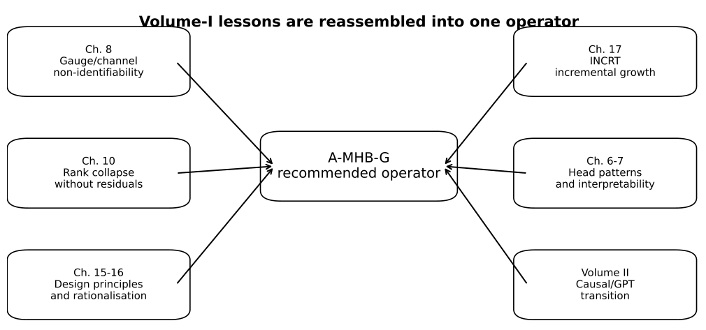
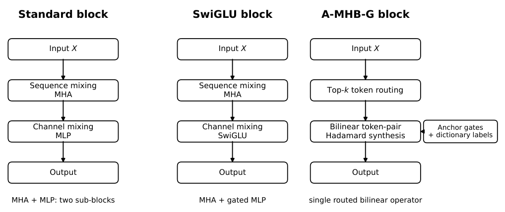

# Chapter 19: design tensions, synthesis question and the A-MHB-G block

[Library index](../README.md) · [Source policy](../SOURCE.md)

> Editorial note: Full transcription of PDF 763–766, including the chapter opening, §§19.1–19.2, the opening of §19.3 and both figure captions. Figures 19.1–19.2 are crops of the original PDF. The author’s introductory expressivity/symmetry claims and the parameter figures in the extended caption of Figure 19.2 are retained; this transcription does not substitute the later formal hypotheses for the introductory wording.

## PDF 763 · Book page 727

## Chapter 19 — Anchored Multi-Head Bilinear Gating: The Recommended Architecture

After eighteen chapters of theoretical analysis and experimental validation, this final chapter of Volume I addresses the prescriptive question implicit in the entire monograph: given everything we have learned, what architecture should one actually use? We propose the **Anchored Multi-Head Bilinear Gated (A-MHB-G)** layer as the recommended endpoint of the volume. The construction begins with MHB-G, a bilinear token-to-token operator that simultaneously replaces Multi-Head Attention and the position-wise MLP, and then adds dictionary-based anchor gates that break the residual head-permutation symmetry and make the layer naturally compatible with INCRT-style growth. We provide the operator definition, dataflow, implementation notes, a corrected symmetry audit, parameter and FLOPs analysis, empirical evidence from WikiText-2 and GLUE, an expanded INCRT-compatible growth controller with DDCL-style anchor splitting, and a closing synthesis showing how the apparent open problems of the design are resolved architecturally rather than left as conceptual gaps.

### 19.1 Design tensions identified in this monograph

The eighteen chapters that precede this one have established a substantial body of theoretical and empirical results about the Transformer architecture. Each chapter has, in passing, exposed an architectural tension — a place where the standard design solves one problem at the cost of creating another, or where a desirable property is achieved only because of an apparently arbitrary choice. We recapitulate these tensions briefly, because the chapter that follows is structured precisely as a response to them.

The first tension is **channel destruction versus the expressivity of MHA**. The Channel Destruction Theorem of Ch. 8 (Global Information Flow) shows that the standard MHA composes its $H$ attention heads through a sum that is a priori symmetric in the head index, and that this symmetry collapses information across heads unless an additional symmetry-breaking mechanism is introduced. In the standard Transformer this mechanism is implicit and statistical: it emerges from the random initialisation and is preserved (rather than enforced) by training. There is no architectural component whose explicit role is to break $S_H$.

## PDF 764 · Book page 728

The second tension is **rank collapse versus the cost of residual connections plus MLPs**. Theorem 5.3 of Paper 5 (Ch. 10 of this volume) establishes that, in the absence of a residual stream, repeated attention application generically collapses the row-rank of hidden states; the residual connection generically obstructs this collapse. The standard architecture pays for this obstruction with a substantial parameter cost — the residual stream by itself is free, but the MLP that sits on the same residual path doubles the per-block parameter count.

The third tension is between **head specialisation and interpretability**. Chapters 6 (Eight Attention Patterns) and 7 (Pattern Completeness) document that the heads of a trained Transformer specialise into a small number of recognisable patterns, and that these patterns suffice to span the space of behaviours observed empirically. This specialisation is desirable for interpretability and efficiency, but the standard architecture provides no mechanism to encourage it: heads start out interchangeable and become differentiated only through training stochasticity.

The fourth tension is the **artificial separation of sequence mixing and channel mixing** into MHA and MLP, respectively. Sequence mixing happens in the attention block: tokens look at one another, but each token’s channels are processed identically. Channel mixing happens in the MLP block: each token’s channels are recombined non-linearly, but tokens are processed independently. This separation is computationally convenient but conceptually opaque: there is no a priori reason why useful interactions between tokens cannot involve their channels jointly.

The fifth tension concerns **INCRT** (the development of Chs. 15–17) **and architectural rigidity**. The INCRT controller of Chs. 15–17 grows over training by adding heads dynamically; this requires that the layer’s structure be compatible with a variable head count $H(t)$. Standard MHA accommodates this naturally because $\sum_h$ is permutation-symmetric, but the same property obstructs the breaking of $S_H$ identified in Tension 1.

The sixth and final tension is the most synthetic. Chapters 15 (Design Principles) and 16 (Rationalised Transformer) have consolidated a set of architectural recommendations that emerge from the preceding analysis. These recommendations remain disembodied: they are stated as principles but not yet instantiated in a single coherent operator that one can drop into existing codebases.

The present chapter proposes such an instantiation. The construction proceeds in two steps. First, the Multi-Head Bilinear Gated (MHB-G) layer replaces the separated MHA+MLP pair by a single bilinear token-to-token operator. Second, the anchored variant A-MHB-G attaches each head to a learned dictionary atom, thereby resolving the residual head-permutation ambiguity and making the operator naturally compatible with INCRT growth. The remainder of the chapter is organised as a guided tour of how this final operator addresses the six tensions above.

### 19.2 The synthesis question

The six tensions of Section 19.1 are not independent. They share a common structural root, which we now identify and which motivates the form of the operator proposed in this chapter.

**The shared root: an artificial separation.** The standard Transformer block separates the work of a layer into two sub-blocks — attention and MLP — that interact only through addition along the residual stream. Sequence mixing happens in attention, channel mixing

## PDF 765 · Book page 729

happens in the MLP, and the two are kept architecturally disjoint. This separation is the source, directly or indirectly, of all six tensions:

- **Tension 1 (channel destruction):** arises because $H$ heads sum symmetrically inside attention, with no mechanism for symmetry-breaking other than what the random initialisation provides.

- **Tension 2 (rank collapse):** arises because attention alone is rank-contractive and the residual stream + MLP is added *around* attention rather than *into* the operator.

- **Tension 3 (head specialisation):** arises because heads in attention are interchangeable by construction.

- **Tension 4 (sequence vs. channel mixing):** is itself the artificial separation.

- **Tension 5 (INCRT compatibility):** arises because incremental head addition is well-defined for the symmetric sum but not for the channel-mixing MLP that follows.

- **Tension 6 (un-instantiated principles):** arises because the design principles of Ch. 15 implicitly call for a single operator, not two.

The synthesis question of this chapter is therefore:

> Does there exist a single layer that mixes sequence and channels jointly, breaks the head symmetry by composition with the mechanisms already established in earlier chapters, generically obstructs rank collapse without requiring a residual stream, and is compatible with incremental head growth?

We answer this question affirmatively. The operator we propose — first in its base MHB-G form, and finally in its anchored A-MHB-G form — is designed so that each architectural choice resolves one of the six tensions:

**(R1) Bilinear cross-token product** $(W_L^h x_i)\odot(W_R^h x_j)$ mixes channels and sequence *jointly* within a single operator, eliminating the artificial separation (Tension 4).

**(R2) Reduced gauge symmetry** $(\mathrm{diag}^{\star}(d_h))^H$ from the Hadamard structure (Lemma 19.2) shrinks the channel non-identifiability automatically, partially addressing Tension 1.

**(R3) Content-dependent top-$k$ routing** $T_k(i)$ generically obstructs rank collapse without residuals (Lemma 19.6), addressing Tension 2.

**(R4) Multi-head structure** $\sum_h$ preserves the architectural compatibility with INCRT (Tension 5), at the cost of *not* breaking $\mathrm{Sym}_H$ by construction. This residual symmetry is then broken by composition with PG-OP (Ch. 8) or the Dictionary-Geometric Framework (Ch. 14/15), exactly as Tension 1 demands.

**(R5) Single-operator replacement** of MHA + MLP makes the design principles of Ch. 15 architecturally explicit, addressing Tension 6.

**(R6) Head specialisation** (Tension 3) emerges automatically from the head-specific projections $W_L^h,W_R^h$ acting on the same input: different heads converge to different bilinear forms during training.

The remainder of the chapter proceeds in three movements. Section 19.3 states the operator and gives its pseudocode. Sections 19.4 and 19.5 provide a formal symmetry audit and a quantitative parameter/FLOPs accounting. Section 19.8 positions MHB-G against the recent literature, and Section 19.9 reports an empirical illustration on WikiText-2 and three GLUE tasks.

## PDF 766 · Book page 730

**Figure 19.1:** Each component of the A-MHB-G architecture is the response to a specific lesson of an earlier chapter. The chapter does not introduce these lessons; it consolidates them into a single operator.

> Searchable figure labels: “Volume-I lessons are reassembled into one operator”; centre “A-MHB-G recommended operator”; Ch. 8 Gauge/channel non-identifiability; Ch. 10 Rank collapse without residuals; Ch. 15–16 Design principles and rationalisation; Ch. 17 INCRT incremental growth; Ch. 6–7 Head patterns and interpretability; Volume II Causal/GPT transition.

### 19.3 The Multi-Head Bilinear Gated layer

Before stating the operator formally, we situate it visually against the two architectures it is closest to: the standard MHA + MLP block (BERT-like) and the modern SwiGLU variant (Shazeer 2020). All three retain the same outer interface (input, optional residual, output) but differ in their internal factorisation of sequence and channel mixing.

**Figure 19.2:** Three transformer block architectures compared at the level of their internal structure.

*The standard block separates sequence mixing (MHA) from channel mixing (MLP) into two disjoint sub-blocks; SwiGLU replaces the MLP with a Hadamard-gated variant; MHB-G replaces the entire MHA + MLP pair with a single bilinear cross-token operator. Parameter counts use the convention $d_{\mathrm{ff}}=4d$ for the standard MLP and $d_{\mathrm{ff,SwiGLU}}=\frac83d$ for SwiGLU (Shazeer 2020). For BERT-base ($d=768$, $H=12$, $d_h=64$): standard $\approx7.1$M parameters per block, SwiGLU $\approx5.5$M, MHB-G $\approx1.8$M.*

> Searchable figure labels: Standard block: Input X → Sequence mixing MHA → Channel mixing MLP → Output, “MHA + MLP: two sub-blocks”; SwiGLU block: Input X → Sequence mixing MHA → Channel mixing SwiGLU → Output, “MHA + gated MLP”; A-MHB-G block: Input X → Top-k token routing → Bilinear token-pair Hadamard synthesis → Output, with “Anchor gates + dictionary labels” feeding the synthesis, “single routed bilinear operator”.

> Source boundary: §19.3 continues on PDF 767 with the formal operator definition. The chapter opening and diagrams are complete for PDF 763–766; they do not themselves state or prove the later lemmas.

> Editorial navigation: [Previous source](0758-0762-ch18-prototype-mode-synthesis-and-open-problems.md#pdf-0762) · [Next source](0767-0770-ch19-bilinear-operator-anchored-gates-and-routing.md#pdf-0767)
