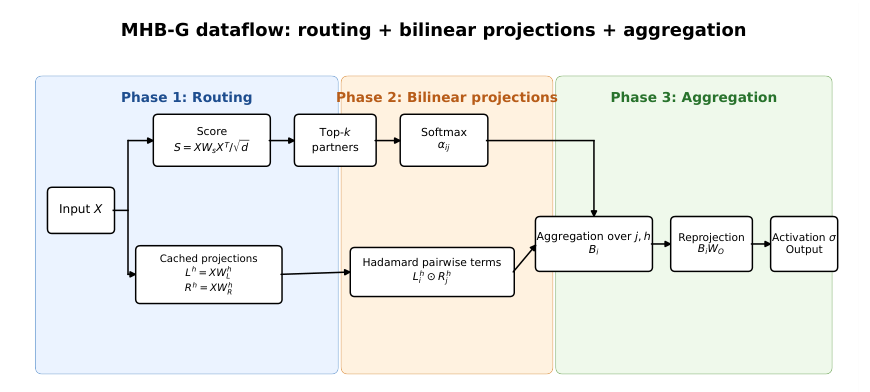
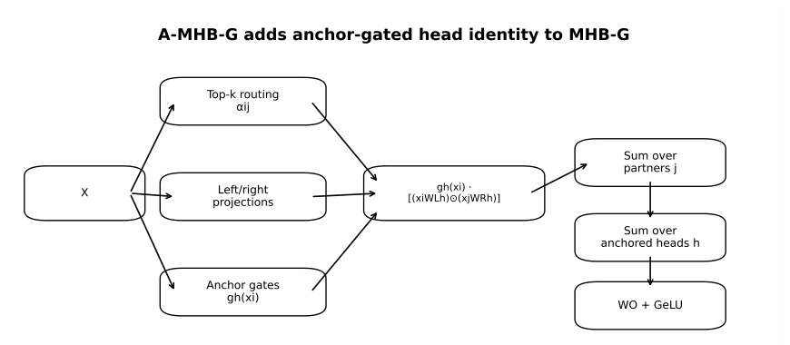
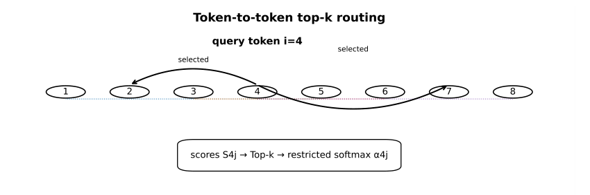

# Chapter 19: bilinear operator, anchored gates, Algorithm 8 and routing

[Library index](../README.md) · [Source policy](../SOURCE.md)

> Editorial note: Full transcription of PDF 767–770. Printed formulas, claims, algorithm steps, numerical values and source inconsistencies are preserved. Editorial analysis is separate in the Russian reading notes and SOURCE-NOTES.md. Figure images are direct renders of the source PDF.

## PDF 767 · Book page 731

### 19.3.1 Definition

**Definition 19.1 (MHB-G operator).** Let $X\in\mathbb R^{n\times d}$ be the input matrix with rows $x_1,\ldots,x_n\in\mathbb R^d$. Let $H\in\mathbb N$ be the number of heads with $d_h:=d/H$. Let $W_L^h,W_R^h\in\mathbb R^{d\times d_h}$ for $h=1,\ldots,H$, $W_s\in\mathbb R^{d\times d}$, $W_O\in\mathbb R^{d_h\times d}$, and let $\sigma:\mathbb R^d\to\mathbb R^d$ be a non-linearity (e.g., GeLU). Let $k\in\mathbb N$ be a routing parameter.

Define the scoring matrix $S\in\mathbb R^{n\times n}$ with $S_{ij}=(x_iW_sx_j^T)/\sqrt d$, the top-$k$ partner sets $T_k(i)=\arg\operatorname{Top\text{-}k}(\{S_{ij}\}_{j=1}^n)$, and the softmax weights $\alpha_{ij}$ restricted to $T_k(i)$. The **Multi-Head Bilinear Gated** operator is:

$$
\operatorname{MHBG}(x_i,X)=\sigma\bigl(B_i(X)W_O\bigr),\qquad
B_i(X)=\sum_{j\in T_k(i)}\alpha_{ij}\sum_{h=1}^H(x_iW_L^h)\odot(x_jW_R^h),
\tag{19.1}
$$

where $\odot$ denotes the Hadamard product.

### 19.3.2 Anchored head gates and the recommended A-MHB-G operator

The unanchored operator of Definition 19.1 already unifies sequence and channel mixing, reduces the bilinear gauge, and provides the rank-preserving mechanism studied in Section 19.4. It still leaves one non-identifiability unresolved: the heads can be permuted without changing the operator. In the final recommended architecture this ambiguity is removed by assigning each head a learned **anchor**, or dictionary atom,

$$
a_h\in\mathbb R^d,\qquad h=1,\ldots,H.
$$

For a token row vector $x_i$, define the anchor gate

$$
g_h(x_i)=\frac{\exp(x_i a_h)}{\sum_{q=1}^H\exp(x_i a_q)},\qquad h=1,\ldots,H.
\tag{19.2}
$$

The **Anchored MHB-G** operator is then

$$
(x_i,X)=\sigma\bigl(B_i^A(X)W_O\bigr),
\tag{19.3}
$$

with

$$
B_i^A(X)=\sum_{j\in T_k(i)}\alpha_{ij}\sum_{h=1}^H g_h(x_i)\bigl[(x_iW_L^h)\odot(x_jW_R^h)\bigr].
\tag{19.4}
$$

The base MHB-G layer is recovered from A-MHB-G by taking uniform gates $g_h(x_i)=1/H$, up to the harmless global scaling absorbed by $W_O$.

The anchors add only $Hd$ parameters per block. For BERT-base, $H=12$ and $d=768$, hence the overhead is 9216 parameters, negligible compared with the 5.26M parameters removed per block by replacing MHA+MLP. Conceptually, however, the anchors are important: they turn heads from interchangeable summands into dictionary-indexed bilinear experts. This is the mechanism that closes the head-identifiability issue rather than leaving it as an open problem.

> Editorial transcription note: In the printed display (19.3), the operator name before $(x_i,X)$ is absent. The omission is retained.

## PDF 768 · Book page 732

### 19.3.3 Pseudocode (Algorithm 19.1)

**Algorithm 8 — Anchored Multi-Head Bilinear Gated (A-MHB-G) layer**

**Require:** Input matrix $X\in\mathbb R^{n\times d}$ with rows $x_1,\ldots,x_n$; weights $W_L^h,W_R^h\in\mathbb R^{d\times d_h}$ and anchors $a_h\in\mathbb R^d$ for $h=1,\ldots,H$; scoring matrix $W_s\in\mathbb R^{d\times d}$; output matrix $W_O\in\mathbb R^{d_h\times d}$; routing parameter $k$; non-linearity $\sigma$ (e.g. GeLU).

**Ensure:** Output matrix $Y\in\mathbb R^{n\times d}$.

| Line | Original operation |
|---:|---|
| 1 | `// Phase 1 — Routing` |
| 2 | $S\leftarrow\frac1{\sqrt d}XW_sX^T$; $S\in\mathbb R^{n\times n}$ |
| 3 | **for** $i=1,\ldots,n$ **do** |
| 4 | $T_k(i)\leftarrow\operatorname{argTopK}(\{S_{ij}\}_{j=1}^n;k)$ |
| 5 | **for** $j\in T_k(i)$ **do** |
| 6 | $\alpha_{ij}\leftarrow\dfrac{\exp(S_{ij})}{\sum_{j'\in T_k(i)}\exp(S_{ij'})}$ |
| 7 | **end for** |
| 8 | **end for** |
| 9 | `// Phase 2 — Bilinear projections (cached)` |
| 10 | **for** $h=1,\ldots,H$ **do** |
| 11 | $L^h\leftarrow XW_L^h$; $L^h\in\mathbb R^{n\times d_h}$ |
| 12 | $R^h\leftarrow XW_R^h$; $R^h\in\mathbb R^{n\times d_h}$ |
| 13 | **end for** |
| 14 | `// Phase 3 — Aggregation` |
| 15 | **for** $i=1,\ldots,n$ **do** |
| 16 | $B_i\leftarrow0\in\mathbb R^{d_h}$ |
| 17 | **for** $j\in T_k(i)$ **do** |
| 18 | **for** $h=1,\ldots,H$ **do** |
| 19 | $B_i\leftarrow B_i+\alpha_{ij}(L_i^h\odot R_j^h)$ |
| 20 | **end for** |
| 21 | **end for** |
| 22 | $y_i\leftarrow\sigma(B_iW_O)$ |
| 23 | **end for** |
| 24 | **return** $Y=(y_1,\ldots,y_n)^T$ |

The dataflow of Algorithm 8 is illustrated in Figure 19.3.

**Phase 1 (Routing, blue):** the scoring matrix $S=XW_sX^\top/\sqrt d$ produces a partner pool, from which top-$k$ partners are selected per query and softmax-weighted into $\alpha_{ij}$. **Phase 2 (Bilinear projections, orange):** the $H$ left and right projections $L^h,R^h$ are computed and cached, shared across all $(i,j)$ pairs in Phase 3. **Phase 3 (Aggregation, green):** the cached projections are combined via Hadamard product, summed over heads, and weighted by $\alpha_{ij}$ to produce $B_i$, which is finally reprojected by $W_O$ and passed through $\sigma$. The three phases (Routing, Bilinear projections, Aggregation) are visually separated by colour and correspond to the three groups of lines in the pseudocode.

> Editorial transcription note: The source title calls Algorithm 8 “Anchored” and its Require line includes anchors, but the printed algorithm does not compute or apply $g_h$. Its steps are retained as printed.

## PDF 769 · Book page 733

**Figure 19.3:** Dataflow of the MHB-G layer.

> Searchable figure labels: “MHB-G dataflow: routing + bilinear projections + aggregation”; “Phase 1: Routing”, “Phase 2: Bilinear projections”, “Phase 3: Aggregation”; Input $X$; Score $S=XW_sX^T/\sqrt d$; Top-$k$ partners; Softmax $\alpha_{ij}$; Cached projections $L^h=XW_L^h$, $R^h=XW_R^h$; Hadamard pairwise terms $L_i^h\odot R_j^h$; Aggregation over $j,h$, $B_i$; Reprojection $B_iW_O$; Activation $\sigma$, Output. The phase backgrounds and original label placement are retained in the image.

**Figure 19.4:** Final A-MHB-G dataflow. Compared with base MHB-G, the anchor branch computes $g_h(x_i)$ and modulates each bilinear head contribution before summation. The added branch is lightweight in parameters but decisive in interpretation and symmetry breaking.

> Searchable figure labels: “A-MHB-G adds anchor-gated head identity to MHB-G”; $X$; Top-k routing, $\alpha_{ij}$; Left/right projections; Anchor gates, $g_h(x_i)$; $g_h(x_i)\cdot[(x_iW_L^h)\odot(x_jW_R^h)]$; Sum over partners $j$; Sum over anchored heads $h$; $W_O$ + GeLU. Mathematical symbols displayed imperfectly in the source diagram remain unchanged in the image.

The routing of Phase 1 is itself worth visualising: it differs structurally from MHA’s dense quadratic attention by selecting only $k$ partners per query token, but differs from Mixture-of-Experts routing by routing tokens to other tokens rather than to fixed expert sub-networks (cf. §19.8). Figure 19.5 illustrates the procedure for a single query token in a sequence of length $n=8$ with $k=2$.

## PDF 770 · Book page 734

**Figure 19.5:** Content-dependent top-$k$ routing in MHB-G. The query token $x_4$ scores all $n$ tokens via the bilinear form $s_{ij}=x_i^\top W_sx_j/\sqrt d$, selects the $k$ highest-scoring partners (highlighted), softmaxes the selected scores into $\alpha_{ij}$, and uses these weights in the bilinear aggregation of Phase 3.

> Searchable figure labels: “Token-to-token top-k routing”; “query token i=4”; tokens 1–8; selected partners 2 and 7; “scores S4j → Top-k → restricted softmax α4j”. The caption's column-vector form is retained although Definition 19.1 uses row vectors.

### 19.3.4 Implementation notes

The pseudocode above admits a clean PyTorch implementation in approximately 80 lines of code (cf. the companion notebook `MHB_G_kaggle_experiments.ipynb`). Several aspects of Algorithm 8 deserve comment.

**Three GPU kernels.** The three phases of Algorithm 8 (routing, bilinear projections, aggregation) decompose naturally into three CUDA kernels. Phase 1 (scoring + top-$k$) is dominated by two matrix multiplications $XW_s$ and $(XW_s)X^\top$, each implemented as a single GEMM call; the top-$k$ selection on each row of the scoring matrix uses a partial sort (`torch.topk`) and contributes negligible cost. Phase 2 (bilinear projections) consists of $2H$ independent matrix multiplications $XW_L^h$ and $XW_R^h$, which are batched into two single GEMMs of shape $(n,d)\times(d,Hd_h)$ followed by a reshape; this exploits the tensor cores efficiently and matches the throughput of a standard MHA $W_{QKV}$ projection. Phase 3 (aggregation) is the only phase that involves a non-standard pattern: a gather along the partner dimension, a broadcasted Hadamard product, a sum over heads, and a weighted sum over partners. On a P100 it runs in $\approx0.05$ GFLOPs per block (cf. Table 19.2), entirely memory-bound rather than compute-bound.

**Caching matters.** The two projections $L^h=XW_L^h$ and $R^h=XW_R^h$ are computed once per input $X$, in Phase 2, and reused for every $(i,j)$ pair in Phase 3. Without caching — that is, recomputing $W_L^{h\top}x_i$ and $W_R^{h\top}x_j$ inside the inner loops — the cost of Phase 3 would scale as $O(nkHdd_h)$ instead of $O(nkd_h)$ after Phase 2. The factor $d/d_h=H$ saving is substantial for typical configurations and brings MHB-G into competitive throughput territory.

**Top-$k$ gradients.** The discrete `argTopK` operation in Phase 1 is non-differentiable in the partner indices. Gradients flow through MHB-G in two ways. First, through the softmax weights $\alpha_{ij}$: the gradient with respect to $W_s$ (which determines the scores) flows back through the softmax restricted to the selected top-$k$ partners. Second, through the bilinear weights $W_L^h,W_R^h$: the gradient flows through the partner indices that were selected, but not through the partners that were excluded. This is exactly the gradient flow pattern of Mixture-of-Experts top-$k$ routing (Shazeer et al. 2017, Fedus et al. 2022, [mixtral2024]), and inherits its training dynamics.

> Editorial navigation: [Previous source](0763-0766-ch19-design-tensions-and-bilinear-synthesis.md#pdf-0766) · [Next source](0771-0773-ch19-symmetry-rank-and-bilinear-span.md#pdf-0771)
