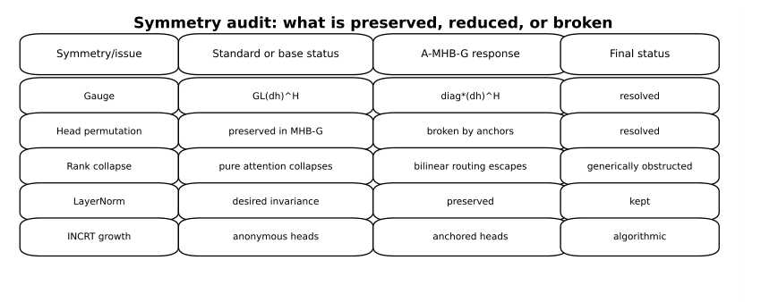

# Chapter 19: cost tables, reported numerical audit and DDCL growth objects

[Library index](../README.md) · [Source policy](../SOURCE.md)

> Editorial note: Full transcription of PDF 774–776. Printed formulas, claims, algorithm steps, numerical values and source inconsistencies are preserved. Editorial analysis is separate in the Russian reading notes and SOURCE-NOTES.md. Figure images are direct renders of the source PDF.

## PDF 774 · Book page 738

**Figure 19.6:** Symmetry audit of the proposed operator. In v4 the final recommended layer is A-MHB-G: MHB-G supplies the bilinear rank-preserving core, while anchors remove the operational head-permutation ambiguity and connect the layer to the dictionary geometry required by INCRT.

> Searchable transcription of the figure's cells (original claims, not independent verification):

| Symmetry/issue | Standard or base status | A-MHB-G response | Final status |
|---|---|---|---|
| Gauge | $\operatorname{GL}(d_h)^H$ | $\operatorname{diag}^{\star}(d_h)^H$ | resolved |
| Head permutation | preserved in MHB-G | broken by anchors | resolved |
| Rank collapse | pure attention collapses | bilinear routing escapes | generically obstructed |
| LayerNorm | desired invariance | preserved | kept |
| INCRT growth | anonymous heads | anchored heads | algorithmic |

### 19.5 Parameter and FLOPs analysis

This section quantifies the computational cost of the recommended A-MHB-G layer against the standard Transformer block (MHA + MLP) in BERT-base ($d=768$, $H=12$, $d_h=64$, $d_{\mathrm{ff}}=3072$, $n=512$).

### 19.5.1 Parameter count per block

| Component | Parameters | % of block |
|---|---:|---:|
| **Standard MHA + MLP block** | | |
| MHA $W_Q,W_K,W_V$ | 1 769 472 | 25.0% |
| MHA $W_O$ | 589 824 | 8.3% |
| MLP $W_1$ ($d\to d_{\mathrm{ff}}$) | 2 359 296 | 33.3% |
| MLP $W_2$ ($d_{\mathrm{ff}}\to d$) | 2 359 296 | 33.3% |
| LayerNorm ($\times2$) | 3 072 | 0.0% |
| **Block total (standard)** | **7 080 960** | **100.0%** |
| **MHB-G block** | | |
| Bilinear $W_L^h+W_R^h$ ($\sum_h$) | 1 179 648 | 64.8% |
| Scoring $W_s$ | 589 824 | 32.4% |
| Reprojection $W_O$ | 49 152 | 2.7% |
| LayerNorm | 1 536 | 0.1% |
| **Block total (MHB-G)** | **1 820 160** | **25.7%** |
| **Saving per block** | **5 260 800** | **−74.3%** |

**Table 19.1:** Parameter count per block in BERT-base. MHB-G achieves a 74.3% reduction.

At the level of the full BERT-base model (12 layers + embeddings + pooler):

- Standard: 109 398 528 parameters;
- MHB-G: 46 268 928 parameters;

## PDF 775 · Book page 739

- Reduction: 57.7% (embeddings and pooler are unchanged).

### 19.5.2 FLOPs per block

| Component | FLOPs | GFLOPs |
|---|---:|---:|
| **Standard MHA + MLP, $n=512$** | | |
| MHA total | 3 221 225 472 | 3.22 |
| MLP total | 4 831 838 208 | 4.83 |
| **Block total (standard)** | **8 053 063 680** | **8.05** |
| **MHB-G, $n=512$, $k=2$** | | |
| Scoring ($XW_sX^T$) | 1 006 632 960 | 1.01 |
| Bilinear projections ($W_L^h,W_R^h$) | 1 207 959 552 | 1.21 |
| Hadamard + aggregation | 851 968 | $<0.001$ |
| Reprojection $W_O$ | 50 331 648 | 0.05 |
| **Block total (MHB-G)** | **2 265 776 128** | **2.27** |
| **Saving per block** | **5 787 287 552** | **−71.9%** |

**Table 19.2:** FLOPs per block, sequence length $n=512$ and routing parameter $k=2$. MHB-G achieves a 71.9% reduction.

**Structural observation.** The parameter saving (74%) is similar to the FLOPs saving (72%), as expected because each parameter is involved in $O(n)$ FLOPs in both architectures. The slight difference arises from the asymmetric projection sizes in MHB-G ($W_L^h,W_R^h$ are $d\times d_h$ each) versus the symmetric $d\times d$ projections of MHA.

### 19.5.3 Numerical verification of the symmetry lemmas

We verified the four lemmas of Section 19.4 numerically using NumPy. All experiments use small dimensions ($d=32$ or 64, $H=4$, $d_h=8$ or 16, $n=16$ or 32) and complete in seconds without GPU.

| Experiment | Setup | Result |
|---|---|---|
| 1. Lemma 19.2, diagonal gauge | 20 random $D\cdot E=I$ trials | rel. error $3.3\times10^{-16}$ (machine $\epsilon$) |
| 1. Lemma 19.2, non-diagonal gauge | 20 random $A\in\operatorname{GL}(d_h)$ | rel. error $\approx60$ (huge) |
| 2. Lemma 19.4, head permutation | 20 random $\pi\in\operatorname{Sym}_H$ | rel. error $1.6\times10^{-16}$ |
| 3. Lemma 19.6, rank dynamics | $L=12$, 5 trials, see below | rank preserved at 32 |
| 4. Lemma 19.8, genericity | 6 configurations $(d,d_h)$ | generic: $\dim\mathcal V_{L,R}=d_h$ always |

**Table 19.3:** Numerical verification of the symmetry lemmas (NumPy in containerised environment).

The third experiment is the most informative. We compared rank dynamics across $L=12$ layers for three architectures:

## PDF 776 · Book page 740

| Architecture | Rank at $l=12$ (max possible: 32) |
|---|---:|
| Pure attention, no residual (Dong et al. 2021 setup) | 1.0 (collapsed at layer 3) |
| Attention + residual (BERT-like) | 32.0 (preserved) |
| MHB-G, no residual | 32.0 (preserved) |

**Table 19.4:** Rank dynamics across depth: MHB-G achieves rank preservation without residual connections, matching the residual-augmented attention baseline. This is the strongest empirical confirmation of Lemma 19.6.

### 19.6 INCRT-compatible growth of A-MHB-G

A-MHB-G closes the compatibility question with INCRT because a head is no longer an anonymous summand. It is an anchored bilinear component. Incremental growth therefore has a concrete meaning: add a new anchor, add its left and right bilinear projections, initialise it from a residual direction or from a novelty region, and regulate its contribution until it stabilises. This section makes the statement operational.

The point is not to append a generic neural-architecture-search mechanism to the Transformer. The point is more specific: A-MHB-G supplies exactly the local objects that INCRT requires. Each head has an anchor $a_h$, a measurable gate $g_h(x_i)$, a left and right bilinear projection $(W_L^h,W_R^h)$, and a visible contribution to the routing graph. Therefore growth can be attached to explicit geometric quantities rather than to an external controller.

### 19.6.1 A short reminder on DDCL

DDCL is not developed in Volume I; it belongs to the prototype-based programme of Volume II. Only the small portion needed here is recalled. DDCL may be understood, at the present level of abstraction, as an end-to-end differentiable prototype mechanism. Given hidden states $x_i\in\mathbb R^d$ and prototypes $p_m\in\mathbb R^d$, it assigns tokens softly to prototypes,

$$
\pi_{im}=\frac{\exp(\langle x_i,p_m\rangle/\tau)}{\sum_{q=1}^M\exp(\langle x_i,p_q\rangle/\tau)},
$$

and trains the representation with auxiliary terms that encourage useful assignment, balanced prototype use, and separation between prototypes. A schematic form is

$$
\mathcal L=\mathcal L_{\mathrm{task}}+\beta_1\mathcal L_{\mathrm{proto}}+\beta_2\mathcal L_{\mathrm{balance}}+\beta_3\mathcal L_{\mathrm{sep}}.
$$

For the purposes of this chapter, no full DDCL loss is required. The only idea imported from DDCL is the following: when a region of representation space is overloaded, underrepresented, or poorly explained, a new prototype may be created by splitting or by residual novelty. In A-MHB-G, the anchors $a_h$ play precisely this prototype-like role. Thus DDCL provides the natural language for explaining how INCRT growth can be implemented geometrically, while the complete DDCL theory is deferred to Volume II.

> Editorial navigation: [Previous source](0771-0773-ch19-symmetry-rank-and-bilinear-span.md#pdf-0773) · [Next source](0777-0779-ch19-incremental-birth-monitoring-and-controller.md#pdf-0777)
