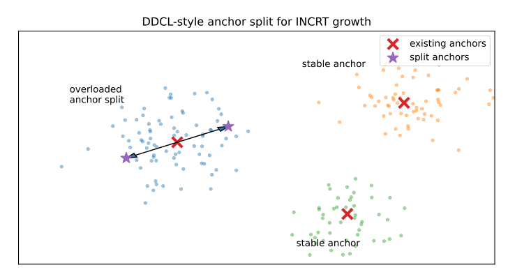

# Chapter 19: incremental birth, monitoring, anchor initialisation and Algorithm 9

[Library index](../README.md) · [Source policy](../SOURCE.md)

> Editorial note: Full transcription of PDF 777–779. Printed formulas, claims, algorithm steps, numerical values and source inconsistencies are preserved. Editorial analysis is separate in the Russian reading notes and SOURCE-NOTES.md. Figure images are direct renders of the source PDF.

## PDF 777 · Book page 741

**Figure 19.7:** Didactic DDCL-style anchor split. An overloaded anchor can be split along a local residual or variance direction, producing two nearby but distinguishable anchors. In INCRT-A-MHB-G, each new anchor is accompanied by a new bilinear head $(W_L^{H+1},W_R^{H+1})$. The figure is schematic rather than a benchmark result.

> Searchable figure labels: “DDCL-style anchor split for INCRT growth”; “overloaded anchor split”; two “stable anchor” labels; legend “existing anchors” (crosses) and “split anchors” (stars). This is the original schematic, with no inferred numerical data.

### 19.6.2 The incremental object

At training step $t$, an INCRT-A-MHB-G layer has a variable number of heads $H(t)$. The layer computes

$$
B_i(t)=\sum_{j\in T_k(i)}\alpha_{ij}\sum_{h=1}^{H(t)}\gamma_h(t)g_h(x_i)\bigl[(x_iW_L^h)\odot(x_jW_R^h)\bigr],
$$

$$
y_i(t)=\sigma(B_i(t)W_O),
$$

where $\gamma_h(t)\in[0,1]$ is a warm-up coefficient. Existing mature heads have $\gamma_h(t)=1$. A newly born head starts with $\gamma_{H+1}(t_{\mathrm{birth}})=0$ and is annealed to one over a short stabilisation window. This single scalar is important: it makes growth non-destructive at birth.

**Proposition 19.9 (Non-destructive birth).** Let $f_H$ be an A-MHB-G layer with $H$ heads, and let $f_{H+1}$ be obtained by adding one head with warm-up coefficient $\gamma_{H+1}=0$. Then

$$
f_{H+1}(X)=f_H(X)
$$

for every input $X$, independently of the initial values of the new anchor and bilinear projections.

*Proof.* The contribution of the new head is multiplied by $\gamma_{H+1}=0$, hence it vanishes identically. All previous terms are unchanged. Therefore the enlarged layer computes the same function at the birth step. $\square$

**Corollary 19.10 (Monotone expressivity under growth).** If $\mathcal F_H$ denotes the function class represented by A-MHB-G with $H$ heads, then

$$
\mathcal F_H\subseteq\mathcal F_{H+1}.
$$

The corollary is modest but useful. Growth does not force a functional jump; the old model is embedded as a subcase of the new one. Optimisation may still be difficult, but the architecture itself does not destroy the already learned map.

## PDF 778 · Book page 742

### 19.6.3 Monitoring quantities

Let

$$
\rho_h=\frac1n\sum_{i=1}^n g_h(x_i)
$$

be the mean load of head $h$. Let

$$
\mathcal H_{\mathrm{head}}=-\frac1n\sum_{i=1}^n\sum_{h=1}^H g_h(x_i)\log g_h(x_i)
$$

be the head-gate entropy, and let

$$
\mathcal H_{\mathrm{route}}=-\frac1n\sum_{i=1}^n\sum_{j\in T_k(i)}\alpha_{ij}\log\alpha_{ij}
$$

be the routing entropy. Finally, let $r_{\mathrm{eff}}(X)$ denote an effective rank of the hidden-state matrix, for instance

$$
r_{\mathrm{eff}}(X)=\exp\left(-\sum_\ell p_\ell\log p_\ell\right),\qquad
p_\ell=\frac{s_\ell(X)}{\sum_qs_q(X)},
$$

where $s_\ell(X)$ are the singular values of $X$.

A growth signal is triggered only when two types of evidence coincide. The first is an optimisation signal: the loss improvement has plateaued over a patience window,

$$
\Delta L_t=L_{t-P}-L_t<\varepsilon_L.
$$

The second is a structural signal, for example

$$
\max_h\rho_h>\rho_{\max},\qquad
\mathcal H_{\mathrm{head}}<\eta_{\mathrm{head}},\qquad
\mathcal H_{\mathrm{route}}<\eta_{\mathrm{route}},\qquad
r_{\mathrm{eff}}(X)<r_{\min}.
$$

In words: growth is not activated merely because the loss is high. It is activated when the loss no longer improves and the internal geometry shows saturation, routing collapse, or insufficient spectral spread.

### 19.6.4 Growth by residual novelty and anchor splitting

There are three natural ways to initialise the new anchor $a_{H+1}$.

**Residual novelty.** Let $R_i$ denote a residual feature, for instance the component of $x_i$ poorly reconstructed or poorly explained by the current anchors. One may set

$$
a_{H+1}=\frac{v_1(R)}{\|v_1(R)\|},
$$

where $v_1(R)$ is the leading residual direction. This is the most spectral form of INCRT growth.

**Underserved token.** Alternatively, select the token least covered by existing anchors,

$$
i^\star=\arg\min_i\max_hg_h(x_i),\qquad
a_{H+1}=\frac{x_{i^\star}}{\|x_{i^\star}\|}.
$$

This is simple and robust: a new head is born where the current dictionary is weakest.

## PDF 779 · Book page 743

**DDCL-style split.** If a head is overloaded,

$$
h^\star=\arg\max_h\rho_h,
$$

then split its anchor along a local variance direction $v$:

$$
a_{h^\star}^+=\operatorname{norm}(a_{h^\star}+\delta v),\qquad
a_{H+1}=\operatorname{norm}(a_{h^\star}-\delta v).
$$

The associated projections may also be split with small perturbations,

$$
W_L^{H+1}=W_L^{h^\star}+\epsilon Z_L,\qquad
W_R^{H+1}=W_R^{h^\star}+\epsilon Z_R.
$$

This is the most DDCL-like version: an overloaded prototype is divided into two specialised anchored heads.

### 19.6.5 Growth, pruning, and freezing algorithm

**Algorithm 9 — INCRT growth controller for A-MHB-G**

**Require:** Initial head count $H_0$, maximum head count $H_{\max}$, patience window $P$, thresholds $\rho_{\max},\eta_{\mathrm{head}},\eta_{\mathrm{route}},r_{\min}$.

**Ensure:** A trained A-MHB-G layer with an adapted number of heads.

| Line | Original operation |
|---:|---|
| 1 | Initialise anchors $a_1,\ldots,a_{H_0}$ and bilinear heads $(W_L^h,W_R^h)$. |
| 2 | **for** training step $t=1,2,\ldots$ **do** |
| 3 | Perform one gradient update on the current architecture. |
| 4 | Update warm-up factors $\gamma_h(t)$ for recently born heads. |
| 5 | **if** $t$ is a monitoring step **then** |
| 6 | Compute $\Delta L_t,\rho_h,\mathcal H_{\mathrm{head}},\mathcal H_{\mathrm{route}}$, and $r_{\mathrm{eff}}(X)$. |
| 7 | Set `structural-saturation` $\leftarrow$ true if any structural threshold is violated persistently. |
| 8 | **if** $\Delta L_t<\varepsilon_L$ and `structural-saturation` and $H<H_{\max}$ **then** |
| 9 | Select birth rule: residual novelty, underserved token, or DDCL-style split. |
| 10 | Create new anchor $a_{H+1}$. |
| 11 | Initialise $W_L^{H+1},W_R^{H+1}$ with small norm or split perturbation. |
| 12 | Set $\gamma_{H+1}(t)=0$ and start warm-up. |
| 13 | Optionally reduce the learning rate of mature heads during the stabilisation window. |
| 14 | $H\leftarrow H+1$. |
| 15 | **end if** |
| 16 | **if** a head has low load and low contribution over a pruning window **then** |
| 17 | Remove or merge the head, provided validation loss stays within tolerance. |
| 18 | **end if** |
| 19 | **if** a subset of heads is stable and specialised **then** |
| 20 | Optionally freeze anchors or reduce their learning rate. |
| 21 | **end if** |
| 22 | **end if** |
| 23 | **end for** |

The controller has three important features. First, it is conservative: no growth occurs without both optimisation plateau and structural saturation. Second, it is non-destructive: the new head is born with zero or small functional influence. Third, it is reversible: pruning and merging prevent unbounded growth.

> Editorial navigation: [Previous source](0774-0776-ch19-cost-tables-numerical-audit-and-ddcl.md#pdf-0776) · [Next source](0780-ch19-didactic-growth-and-geometry-illustrations.md#pdf-0780)
