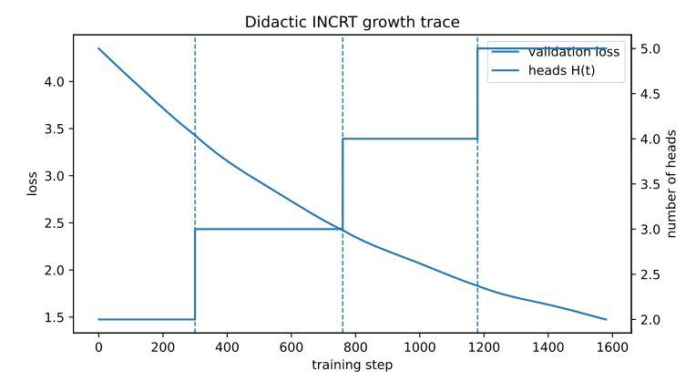
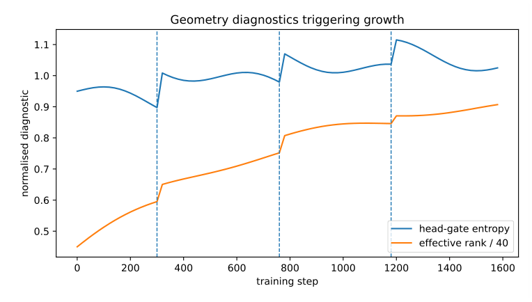

# Chapter 19: synthetic didactic growth and geometry illustrations

[Library index](../README.md) · [Source policy](../SOURCE.md)

> Editorial note: Full transcription of PDF 780–780. Printed formulas, claims, algorithm steps, numerical values and source inconsistencies are preserved. Editorial analysis is separate in the Russian reading notes and SOURCE-NOTES.md. Figure images are direct renders of the source PDF.

## PDF 780 · Book page 744

### 19.6.6 Didactic growth experiment

Figure 19.8 gives a didactic trace of the controller. The curves are synthetic sanity illustrations, not benchmark results. Their role is pedagogical: they show what should be monitored in an implementation and how growth events should appear if the controller behaves as intended. The desired pattern is not uncontrolled head creation. It is a small number of growth events occurring near plateaus, followed by renewed loss decrease and improved geometric diagnostics.

**Figure 19.8:** Didactic INCRT growth trace. The number of heads $H(t)$ increases only at persistent plateaus. Each growth event is followed by a short stabilisation phase and a renewed decrease of the validation loss. The figure illustrates the intended controller behaviour rather than reporting a benchmark.

> Searchable figure labels: “Didactic INCRT growth trace”; horizontal axis “training step”, ticks 0–1600 in steps of 200; left axis “loss”, ticks 1.5–4.0 in steps of 0.5; right axis “number of heads”, ticks 2.0–5.0 in steps of 0.5; legend “validation loss” and “heads H(t)”; three dashed event lines near steps 300, 750 and 1150. These positions are readings of the diagram, not logged training events.

**Figure 19.9:** Didactic diagnostic curves for INCRT-A-MHB-G. Head-gate entropy and effective rank are monitored together with the loss. Growth is triggered when the optimiser stalls and the geometry indicates saturation.

> Searchable figure labels: “Geometry diagnostics triggering growth”; horizontal axis “training step”, ticks 0–1600 in steps of 200; vertical axis “normalised diagnostic”, ticks 0.5–1.1 in steps of 0.1; legend “head-gate entropy” and “effective rank / 40”; three dashed event lines near steps 350, 800 and 1200. Their offsets relative to Figure 19.8 and the entropy values above one are retained from the original illustration.

> Editorial navigation: [Previous source](0777-0779-ch19-incremental-birth-monitoring-and-controller.md#pdf-0779) · [Next source](0781-0784-ch19-growth-closure-variants-and-related-work.md#pdf-0781)
