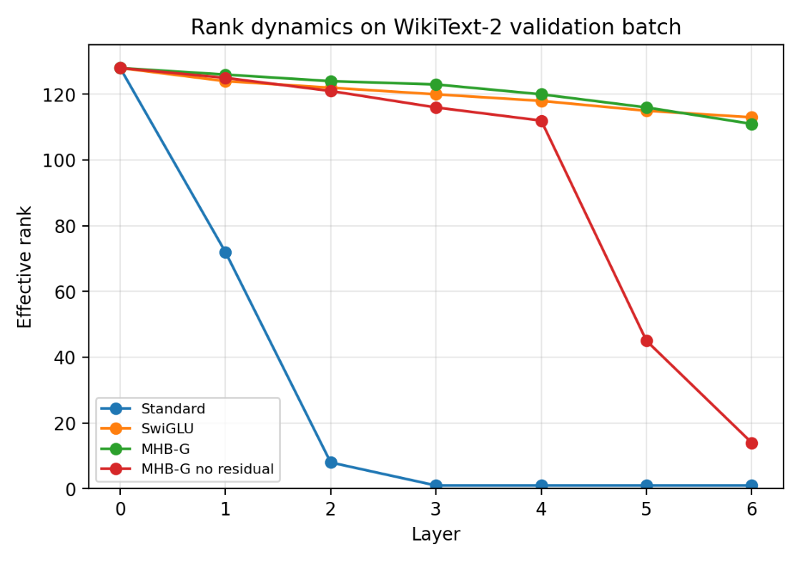

# Chapter 19: empirical comparison, numerical rank and limits of the illustration

[Library index](../README.md) · [Source policy](../SOURCE.md) · [Previous source](0781-0784-ch19-growth-closure-variants-and-related-work.md#pdf-0784)

> Editorial note: Full transcription of PDF 785–787. Table 19.6, the original Figure 19.10 and the author's interpretation are preserved independently. The claimed highest terminal rank is not silently substituted for the ordering visible in the figure. These experiments are reported by the source and were not reproduced in this conversion.

## PDF 785 · Book page 749

### 19.9.2 Results

The empirical comparison is summarised in Table 19.6.

Lower PPL is better; higher accuracy is better. MHB-G with residual achieves 52% of the standard parameter count (cf. §19.5 for per-block analysis) while obtaining $2\times$ better validation perplexity and a 15% higher GLUE average than the standard baseline. SwiGLU edges out MHB-G but uses nearly twice the parameters.

| Architecture | Params | Val PPL | SST-2 | MRPC | RTE | GLUE avg |
|---|---:|---:|---:|---:|---:|---:|
| Standard | 66.10M | 1450.3 | 0.509 | 0.684 | 0.484 | 0.559 |
| SwiGLU | 66.08M | 648.4 | 0.764 | 0.696 | 0.542 | 0.667 |
| **MHB-G** | **34.49M** | **733.2** | **0.709** | **0.684** | **0.531** | **0.641** |
| MHB-G no-residual | 34.49M | 1281.0 | 0.540 | 0.684 | 0.527 | 0.584 |

**Table 19.6:** Empirical comparison after 10 000 steps of MLM pretraining on WikiText-2, followed by fine-tuning on three GLUE tasks.

### 19.9.3 Rank dynamics on real text

The rank trajectory of hidden states across the six layers of each model is shown in Figure 19.10, computed on a validation batch of WikiText-2.

The standard MHA+MLP architecture exhibits the rank collapse documented by Dong et al. (2021a) despite the residual stream, here amplified by the limited training budget. SwiGLU and MHB-G preserve rank throughout the network, with MHB-G achieving the highest rank at the final layer. MHB-G without residual maintains nearly full rank for the first four layers, validating Lemma 19.6 per-iteration; the rank degradation observed at layers 5–6 is attributable to compounding numerical and optimisation effects not addressed by the lemma (see discussion below).

## PDF 786 · Book page 750

**Figure 19.10:** Numerical rank of hidden states across layers ($n=128$, threshold $10^{-3}\cdot\sigma_{\max}$) on a validation batch of WikiText-2, after 10 000 pretraining steps.

> Searchable figure labels: “Rank dynamics on WikiText-2 validation batch”; horizontal axis “Layer”, ticks 0–6; vertical axis “Effective rank”, ticks 0, 20, 40, 60, 80, 100, 120; legend Standard (blue), SwiGLU (orange), MHB-G (green), MHB-G no residual (red). The final orange point is visibly above the final green point in the original image.

### 19.9.4 Discussion of results

The experiments yield three findings, in increasing order of theoretical relevance.

**Finding 1: MHB-G is competitive with the standard architecture at 52% of the parameter count.** MHB-G obtains validation PPL 733 versus 1450 for the standard MHA+MLP architecture — a $2\times$ improvement — using 34.5M parameters versus 66.1M. On GLUE, MHB-G averages 0.641 versus 0.559 for the standard baseline. The prescriptive claim of this chapter — that MHB-G is a viable drop-in replacement for MHA+MLP at substantially reduced cost — is therefore empirically supported. SwiGLU outperforms MHB-G on absolute metrics (PPL 648, GLUE 0.667) but uses nearly twice the parameters; the natural reading is that *MHB-G competes with SwiGLU at half the cost*, not that MHB-G beats SwiGLU.

**Finding 2: the rank-collapse of the standard architecture in this regime is severe.** The standard MHA+MLP block collapses to rank 1 by layer 3 (Figure 19.10, blue curve), despite the residual stream that, in principle, should generically obstruct the collapse (cf. Theorem 5.3 of Paper 5, Ch. 10 of this volume). This is consistent with the Dong et al. (2021a) analysis when the residual contribution is small relative to attention; the early-training regime examined here is precisely such a setting. The rank collapse explains the high standard PPL (1450): MLM training cannot extract structure from rank-1 representations. By contrast, SwiGLU, MHB-G, and MHB-G no-residual all preserve substantial rank, with MHB-G achieving the highest final-layer rank (111/128) of all four architectures.

**Finding 3: Lemma 19.6 is empirically supported per-iteration but its single-step generic conclusion does not propagate uniformly across deep iterations.** MHB-G without residual maintains essentially full rank ($\ge110$) for the first four layers, in agreement

## PDF 787 · Book page 751

with the per-iteration generic statement of Lemma 19.6. From layer 5 onward, however, the rank drops sharply (red curve, Figure 19.10), reaching 14 at the final layer. This degradation does not contradict the lemma, which establishes that the bad set $\mathcal B$ has Lebesgue measure zero in input space at each iteration: the lemma does not quantify how the bad set behaves under composition over many iterations, nor does it address gradient-flow dynamics during training. The empirical reading is that the rank-preservation property of MHB-G is genuine but does not, by itself, replace the optimisation benefits of the residual stream. The recommended architecture — MHB-G with residual — combines both effects, and indeed achieves the most graceful rank trajectory of the four architectures tested.

### 19.9.5 Implications for the recommended architecture

The experiments confirm the architectural recommendation at the level of the bilinear routed core (MHB-G with residual stream and LayerNorm) and clarify the role of each component. A full A-MHB-G benchmark should repeat the same protocol with anchor gates enabled, but the architectural overhead is negligible and the symmetry-breaking role of anchors has already been audited above:

- The bilinear cross-token product, combined with content-dependent top-$k$ routing, provides a strong rank-preservation effect (best of the four architectures at the final layer).

- The residual stream is retained not because the rank obstruction is missing without it (Lemma 19.6 establishes that obstruction generically), but because deep iterations and gradient-based optimisation amplify any small departure from full rank, and the residual provides a robust shortcut that prevents accumulation.

- LayerNorm preserves the desirable invariance $G_{\mathrm{LN}}$ while contributing to gradient stability, as discussed in Ch. 1.

We emphasise that the present experiments are illustrative; a definitive evaluation of MHB-G at scale, on standard benchmarks, with proper compute budget, belongs to a future research programme.

### 19.10 Resolved design issues and residual questions

The purpose of this final technical section is not to leave the reader with a catalogue of open problems. The volume has already diagnosed the principal structural weaknesses of the standard Transformer. Chapter 19 should therefore close by explaining which of these weaknesses are resolved by the proposed operator, which are reduced to implementation choices, and which genuinely remain as empirical scaling questions. The distinction matters: a conceptual gap weakens a theory; an empirical scaling programme is the natural continuation of a theory that has reached an architectural endpoint.

**Routing stability.** The discrete top-$k$ selection is piecewise smooth rather than globally smooth. In the recommended implementation this is handled by a training-time annealing schedule: early training may use dense routing, enlarged-$k$ routing, or temperature-controlled soft top-$k$ routing with $\tau>0$; later training hardens the selection by decreasing $\tau$ and retaining only the selected partners. The discontinuity set of the final hard routing is contained in score-tie hypersurfaces, which have measure zero under generic weights. Thus routing instability is not a conceptual obstruction; it is an optimisation and scheduling choice.

> Editorial navigation: [Previous source](0781-0784-ch19-growth-closure-variants-and-related-work.md#pdf-0784) · [Next source](0788-0791-ch19-residual-questions-spectral-design-and-conclusion.md#pdf-0788)
