# DPO Deep Dive — How Direct Preference Optimisation Works in llm_mvp_core

**Version:** 2  
**Date:** 2026-05-07  
**Scope:** Full pipeline from a raw developer prompt to a saved checkpoint  
**Changes from v1:** DevelopmentPromptCompiler wired into pipeline (A55 fix);
model config updated to 4 layers hidden 32 (A58); BpeTokenizer vocabulary seeding
corrected; run metrics section updated with root-cause diagnosis; new section on
what changes for the next calibration run; manifest now stores OriginalPrompt

---

## What DPO is trying to accomplish in plain terms

The system observes a real developer prompt that it cannot yet answer well. It knows
what a good answer looks like for that prompt — and it knows what a bad answer looks
like. DPO is the mechanism that teaches the model to prefer the good answer over the
bad one, by adjusting the model's weights so that good answers become more likely to
be generated in the future.

The key idea is that the model does not need a human scoring every response. Instead,
the teacher constructs a simple pair: a preferred response (called "chosen") and a
rejected response. The optimizer then pushes the model's weights in the direction that
makes the chosen response more likely and the rejected response less likely, relative
to a frozen reference copy of the model that acts as an anchor to prevent the model
from drifting too far.

---

## The full pipeline — from prompt to saved checkpoint

```mermaid
flowchart TD
    A[Developer prompt arrives as a knowledge-edge branch\nfrom AdaptiveLogicalOrchestrator] --> B

    B[DefaultLogicalCapabilityTrainer\nTrainAndRegisterAsync] --> B1

    B1[DevelopmentPromptCompiler.Compile\nproduces predicate ids + normalised text\n+ domain + stack language] --> C

    C{Is there a prior\ncheckpoint for\nthis domain?} -->|No| D[Build fresh LlmModel\nand fresh BpeTokenizer\nseeded from compiled vocabulary]
    C -->|Yes, warm cache hit| E[Reuse cached PolicyModel\nand Tokenizer directly]
    C -->|Yes, disk load| F[Load checkpoint from disk\nBpeTokenizer.Load\nLlmModel.LoadCheckpoint]

    D & E & F --> G[TeachingStack assembled\nPolicyModel + Tokenizer + Version + StepCount]

    G --> H[BuildTrainingText\nCompiled predicate ids + normalised text + domain + stack\n+ branch result + sub-phase metadata\n+ semantic compression + 60-slot teaching vector\nbuilt from compiled form not raw text]

    H --> I[AutonomousLearningReplayMixer.BuildPreferences\nCurrent branches × repeatCount\n+ up to 30 pct replay from prior manifests]

    I --> J[LogicalDpoTrainingUnit.ExecuteAsync\nApply LoRA adapters to query and value projections\n8 adapters across 4 layers\nLoad parent checkpoint weights if available]

    J --> K[DpoTrainer.StepVector\nOne optimizer update across all preferences\nweighted by teaching vector signal]

    K --> L{For each preference pair}

    L --> M[LogProbs on reference model\nfrozen, no gradient]
    L --> N[LogProbs on policy model\ntrainable]

    M & N --> O[Compute margin\nβ × polChosen − refChosen − polRejected − refRejected]

    O --> P[DPO loss\n−log σ margin]

    P --> Q[BackwardLogProbs\ngradient scaled by β and teaching vector weight]

    Q --> R[AdamW.Step\nlr = 1e-5\nweight decay = 0.01]

    R --> S[ZeroGrad]

    S --> T{More preferences\nin this batch?}
    T -->|Yes| L
    T -->|No — single optimizer step after all| R

    R --> U[SaveMetrics\ndpo_step_000001.json]

    U --> V[Save policy.bin and tokenizer.json\nper sub-phase checkpoint directory\nmanifest stores OriginalPrompt]

    V --> W[Wrap trained model as\nTransformerEmbeddingKnnLogicalUnit\nfor runtime routing]

    W --> X[SaveGeneratedCapabilityManifest\ngenerated_capability_manifest.json]

    X --> Y[Register unit in InMemoryLogicalUnitRegistry\nRegister flow in InMemoryLogicalFlowRegistry]

    Y --> Z[Update warm cache\n_teachingCache keyed by domain family id]

    Z --> AA[At inference time:\nGeneratedCapabilityFlow.ExecuteAsync\ncompiles incoming prompt before KNN lookup\nthen CapabilityResultTranslator converts\nKNN output to developer-readable response]
```



---

## The entities involved and what each one does

### LlmModel — the transformer that learns

The model being trained is a deliberately small transformer. Its architecture
parameters are fixed before training starts and never change during a session
(locked A58 — do not revert):

| Parameter | Value used for capability training |
|---|---|
| Vocabulary size | 512 tokens |
| Context length | 64 token positions |
| Hidden dimension | **32** |
| Number of layers | **4** |
| Number of attention heads | 4 |
| Key-value head groups | 2 |
| Feed-forward hidden dimension | **64** |
| **Total parameters** | **69,920** |
| **Checkpoint size (float32)** | **~273 KB** |

Four layers are necessary so the model can compose patterns across multiple attention
rounds. One layer (the prior config) applied a single attention pass, which was
insufficient to learn that IMPLEMENT + BUG + stack:typescript reliably maps to
sub-phase 4.1 when surface vocabulary varies between developers.

The model lives in `03.TransformerModel/LlmModel.cs`. It exposes `Forward`
(produces logits from token ids), `Parameters` (returns all weight tensors for
the optimizer), `ZeroGrad` (resets accumulated gradients), `SaveCheckpoint` and
`LoadCheckpoint` (binary serialization to disk).

Two instances of this model exist in every DPO step:

- The **policy model** — the model being trained, whose weights change with every
  optimizer step.
- The **reference model** — a frozen copy that never changes, used as an anchor
  to measure how far the policy has drifted.

The reference model is a field on `DefaultLogicalCapabilityTrainer` and is shared
across all domain groups in a session. The policy model is constructed fresh per
domain group (or loaded from the prior checkpoint for that domain).

**Prior checkpoints (1-layer, hidden 16) are incompatible with this config and
must not be loaded as continued-learning parents (A60).**

### BpeTokenizer — the vocabulary builder

Before the model can process text, the text must be turned into a sequence of integer
token ids. `BpeTokenizer` in `01.Tokenizer/BpeTokenizer.cs` learns a vocabulary from
the training text at the start of each new capability chain. The vocabulary size is
capped at 300 merge operations, producing a vocabulary of up to 512 token entries.

**The tokenizer is now seeded from canonical predicate vocabulary (A55 fix).**

`BuildTokenizer` receives the `DevelopmentPromptCompilation` from the compiled prompt.
The vocabulary is seeded from the compiled predicate ids (IMPLEMENT, SECURITY,
API_CONTRACT, ARCHITECTURE, TEST, etc.), normalised text roots, and the full
development predicate lexicon — not from the raw surface words of the developer's
message. This ensures the token id for "IMPLEMENT" is stable across all capability
chains in the same domain, regardless of what surface vocabulary the developer used.

Previously the vocabulary was seeded from raw surface text, making token ids different
in every capability chain. A model trained on one session's vocabulary produced
meaningless embeddings when the same concept appeared in different surface form in the
next session.

The tokenizer is saved alongside the model weights so that future training sessions
for the same domain can load it and continue without vocabulary drift.

### LoraConfig and LoraApplicator — the adapter tier

Rather than updating all of the model's weights during training, LoRA (Low-Rank
Adaptation) inserts small adapter matrices into the attention layers. The base model
weights are frozen; only the adapter weights are trainable.

The configuration used for capability training:

| Parameter | Value |
|---|---|
| Rank | 2 |
| Alpha | 4 |
| Dropout | 0 |
| Target modules | query projection, value projection |
| **Adapters per layer** | **2** |
| **Total adapters (4 layers)** | **8** |
| **Total LoRA-trainable parameters** | **2,048** |

`LoraApplicator.Apply` in `10.LoRA/LoraApplicator.cs` freezes all base parameters,
then uses reflection to find the query and value `Linear` submodules in each
attention block and wraps them with `LoraLinear` adapters. With 4 layers, this
produces 8 adapter pairs. The adapter matrices are the only parameters that receive
gradient updates during the DPO step.

Moving from 1 layer to 4 layers increased LoRA-trainable parameters from 256 to
2,048 — 8× more signal capacity per DPO step.

### DpoPair and DpoBatch — the preference data shape

A `DpoPair` is the raw human-readable preference: a prompt string, a chosen response
string, and a rejected response string.

A `DpoBatch` is the tokenized and padded version ready for the model. It contains
four tensors: `ChosenIds`, `ChosenMask`, `RejectedIds`, `RejectedMask`. Each tensor
has shape `[1, T]` where T is the context length (64). The mask is 1 for real tokens
and 0 for padding positions.

### LogicalDpoPreferenceExample — the extended preference with teaching signal

`LogicalDpoPreferenceExample` is the capability trainer's extension of a raw pair.
It adds a `TeachingVector` — a 60-element float array that encodes the semantic
content of the prompt. This vector is used in `StepVector` to modulate how strongly
each preference pair's gradient influences the final optimizer update.

### DpoVectorBatch — the weighted batch fed to StepVector

`DpoVectorBatch` wraps a `DpoBatch` with a weight and a teaching vector. The weight
starts at 1.0 for all current preferences and is scaled in the trainer by the
`VectorSignal` function, which measures how many of the 60 teaching vector slots are
non-zero. A prompt that activates more semantic dimensions gets a stronger gradient
contribution. The signal is clamped between 1.0 and 2.0.

### DpoTrainer — the core optimizer loop

`DpoTrainer` in `11.DPO/DpoTrainer.cs` is the mathematical core. It holds the policy
model, the reference model, an `AdamW` optimizer, and a checkpoint directory. It
exposes three entry points:

- `Step` — processes a single preference pair. Used by the base path.
- `StepMany` — processes multiple pairs, averaging gradients before applying one
  optimizer step.
- `StepVector` — processes multiple weighted vector batches. Used by the capability
  training path. This is the entry point that the runner actually calls.

All three share the same mathematical logic. The difference is how gradients are
accumulated and scaled before the single optimizer update.

### AdamW — the optimizer

`AdamW` in `04.TrainingLoop/Optimizers/AdamW.cs` is the optimizer that actually
changes the model weights. It uses the Adam moment estimates (first and second
moments of gradients) with an additional weight decay term that penalizes large
weight values. The parameters used in capability training:

| Parameter | Value |
|---|---|
| Learning rate | 0.00001 (1e-5) |
| Weight decay | 0.01 |

The learning rate is small deliberately — each teaching step is building on top of a
prior checkpoint, so a large step would erase previous learning.

### TeachingStack — the assembled context for one domain group

`TeachingStack` is an internal record in `DefaultLogicalCapabilityTrainer` that
bundles everything needed to run a DPO step for one domain group: the policy model,
the tokenizer, the parent manifest (the prior checkpoint's metadata), the version
string, the step count, the parent checkpoint path, and a flag indicating whether the
stack was served from the warm cache or loaded from disk.

### GeneratedCapabilityCheckpointManifest — the persistent record of one training epoch

After every domain group is trained, a manifest file is written to disk alongside the
checkpoint. The manifest is a JSON record containing:

- The unit id and flow id for registry lookup
- The domain tag, sub-phase id, phase id, and task type
- The full paths to the saved `policy.bin` and `tokenizer.json`
- The training text, chosen text, and example id used in the KNN layer
- The model architecture parameters (vocab size, hidden dim, layers, heads, etc.)
- The LoRA configuration (rank, alpha, dropout, target modules)
- The creation timestamp and the unit family id
- The parent unit id and parent checkpoint path for chaining
- The training step count (how many domain groups have trained in this family chain)
- The trust state at the time of registration
- **`OriginalPrompt`** — the raw developer prompt at training time (new in v2),
  used by `CapabilityResultTranslator` at inference time to include the original
  request in the back-translated human response

This manifest is what makes continued learning possible across separate sessions.
The next time the same domain is trained, the trainer loads this manifest to find the
checkpoint path and continues from those weights rather than starting from scratch.

### AutonomousLearningReplayMixer — the dataset assembler

Before the DPO step runs, `BuildPreferences` assembles the full list of preference
examples by combining:

1. The current branches repeated `currentRepeatCount` times (1 to 3 repetitions
   depending on how rare the current sub-phase is in the overall corpus).
2. Up to 30 percent replay from the most recent manifests for the same domain,
   which keeps the model from forgetting what it learned in previous sessions.

The repeat count is computed by `LogicalTeachingDatasetWeighter.ComputeCurrentRepeatCount`
using the formula `total_manifests / (distinct_classes × rare_examples)`, clamped
to 1–3. On the first training step, the count is always 1.

### TrainingVectorBuilder — the 60-slot semantic fingerprint

Every preference example carries a 60-element float vector built from the prompt text.
The vector has three zones:

- Slots 0–21: predicate presence flags (AUTH_OP, CREATE_OP, VALIDATE_OP, SEND_OP,
  GET_OP, FAIL — each incremented when the prompt contains root words that imply
  those predicates).
- Slots 22–26: domain classification (one slot set to 1.0 for CODE_Q, BUG, PLAN,
  ARCH, or REFACTOR based on keyword matching).
- Slots 27–58: root vocabulary presence (up to 32 roots extracted from the prompt,
  each mapped to a slot by a session-level vocabulary dictionary).
- Slot 59: a compound-request flag (2.0 if the prompt contains " and ", 1.0 otherwise).

This vector is used in `DpoTrainer.StepVector` to compute `VectorSignal`:
the count of non-zero slots divided by 60, added to 1.0, and clamped to [1.0, 2.0].
A prompt that activates 30 of the 60 slots gets a signal of 1.5, amplifying its
gradient contribution by 50 percent relative to a minimal prompt.

---

## The mathematics in human language

The central question DPO answers is: **does the policy model prefer the chosen answer
over the rejected answer, and by how much more than the reference model does?**

For each preference pair, the trainer computes log-probabilities from both models.
A log-probability measures how likely the model thinks a particular sequence of tokens
is, averaged across all token positions. Higher is more likely.

The **margin** is the degree to which the policy model has learned to distinguish
chosen from rejected, relative to the same distinction in the reference model:

```
margin = β × ( (policy log-prob of chosen − reference log-prob of chosen)
             − (policy log-prob of rejected − reference log-prob of rejected) )
```

`β` is a constant (0.1) that controls how strongly the KL-divergence penalty from the
reference model acts. A smaller β means the policy can drift further from the
reference; a larger β keeps it closer.

When the margin is positive, the policy model already prefers the chosen answer
more than the reference model does — this is correct behaviour. When the margin is
negative, the policy still prefers the wrong answer.

The **loss** is `-log σ(margin)`, where σ is the sigmoid function. When the margin
is large and positive, the sigmoid is near 1, its log is near 0, and the loss is
near 0 — the model is doing well and no strong gradient is needed. When the margin
is negative, the sigmoid is below 0.5, the log is negative and large in magnitude,
and the loss is high — a strong gradient pushes the weights toward the correct direction.

The **accuracy** metric reported in the run summary is simply 1 if the margin is
positive, 0 if it is negative. An accuracy of 0.35 means 35 percent of the preference
pairs in that domain group had a positive margin — the model was already leaning toward
the chosen answer on 35 percent of examples before the optimizer step.

The backward pass computes `σ(margin) − 1` as the gradient of the loss with respect
to the margin, which flows back into both the chosen and rejected log-prob computations
with opposite signs. The gradient is scaled by β and by the teaching vector signal
weight before being accumulated in the logits gradient tensor.

One call to `AdamW.Step` applies all accumulated gradients in a single update. This
means every preference pair in a domain group contributes to one combined weight
update rather than updating the weights separately for each pair. This is the "one DPO
step per domain group" design that the run reports confirm: `BatchedDpoStepCount = 1`
regardless of how many branches are in the domain group.

---

## Key parameters at a glance

| Parameter | Location | Value | What it controls |
|---|---|---|---|
| Beta | `DpoTrainer.cs` | 0.1 | KL-divergence penalty strength |
| Learning rate | `DpoTrainer.cs` | 1e-5 | How large each weight update is |
| Weight decay | `AdamW` constructor | 0.01 | Penalty for large weights |
| Max replay share | `ReplayMixer` | 0.30 | Fraction of prior examples in each step |
| Max repeat count | `DatasetWeighter` | clamped 1–3 | How many times rare examples are repeated |
| Teaching vector width | `TrainingVectorBuilder` | 60 slots | Semantic fingerprint resolution |
| VectorSignal range | `DpoTrainer.StepVector` | 1.0–2.0 | Gradient amplification per example |
| LoRA rank | `BuildCapabilityLoraConfig` | 2 | Adapter expressivity |
| LoRA alpha | `BuildCapabilityLoraConfig` | 4 | Adapter learning rate scale |
| LoRA adapters total | `LoraApplicator` at 4 layers | **8** (2 per layer × 4) | Trainable adapter count |
| LoRA trainable parameters | `LoraApplicator` | **2,048** | Weight update capacity |
| Vocab size | `BuildTinyConfig` | 512 | Tokenizer capacity |
| Vocab seeding | `BuildTokenizer` | **compiled predicate ids** | Stable cross-session token ids |
| Context length | `BuildTinyConfig` | 64 tokens | Maximum prompt+response length |
| Hidden dimension | `BuildTinyConfig` | **32** (locked A58) | Model capacity |
| Layers | `BuildTinyConfig` | **4** (locked A58) | Model depth — pattern composition |

---

## Code references

### The core DPO step

**File:** `11.DPO/DpoTrainer.cs`

The mathematical core. The `StepVector` method is what the capability training path
calls. It processes each weighted batch, accumulates gradients, and calls
`AdamW.Step` once at the end.

```csharp
// From DpoTrainer.StepVector — the entry point used by capability training
var totalWeight = Math.Max(1e-6f, batches.Sum(batch => Math.Max(0.01f, batch.Weight)));

foreach (var vectorBatch in batches)
{
    var vectorSignal  = VectorSignal(vectorBatch.TeachingVector);
    var scaledWeight  = (Math.Max(0.01f, vectorBatch.Weight) / totalWeight) * vectorSignal;

    float refChosenLogP    = LogProbs(_reference, batch.ChosenIds,   batch.ChosenMask);
    float refRejectedLogP  = LogProbs(_reference, batch.RejectedIds, batch.RejectedMask);
    float polChosenLogP    = LogProbs(_policy,    batch.ChosenIds,   batch.ChosenMask);
    float polRejectedLogP  = LogProbs(_policy,    batch.RejectedIds, batch.RejectedMask);

    float chosenReward   = Beta * (polChosenLogP   - refChosenLogP);
    float rejectedReward = Beta * (polRejectedLogP - refRejectedLogP);
    float margin         = chosenReward - rejectedReward;
    float loss           = -MathF.Log(Sigmoid(margin) + 1e-8f);
    float gradMargin     = (Sigmoid(margin) - 1f) * scaledWeight;

    BackwardLogProbs(_policy, batch.ChosenIds,    batch.ChosenMask,   gradMargin * Beta);
    BackwardLogProbs(_policy, batch.RejectedIds,  batch.RejectedMask, -gradMargin * Beta);
}

_optimizer.Step(_policy.Parameters(), lr: 1e-5f);
_policy.ZeroGrad();
```

### Teaching stack construction — continued learning

**File:** `21.AgentInfrastructure/Logical/DefaultLogicalCapabilityTrainer.cs`

The warm cache check and disk fallback that enable continued learning across batches
without losing prior weights.

```csharp
// From BuildTeachingStack — checks cache, then disk, then starts fresh
var unitFamilyId = BuildUnitFamilyId(domainAdapterTag);
if (_teachingCache.TryGetValue(unitFamilyId, out var cached) &&
    string.Equals(cached.Manifest.UnitId, parent.UnitId, StringComparison.Ordinal))
{
    // Warm cache hit — no disk read needed, weights already in memory
    return OperationResult<TeachingStack>.Ok(new TeachingStack(
        cached.PolicyModel, cached.Tokenizer, parent,
        IncrementPatchVersion(parent.Version),
        Math.Max(1, parent.TrainingStepCount) + 1,
        null, true));
}

// Cold load from prior checkpoint — disk read, model weights deserialized
var tokenizer   = BpeTokenizer.Load(parent.TokenizerPath);
var policyModel = new LlmModel(config);
policyModel.LoadCheckpoint(parent.PolicyCheckpointPath);
```

### LoRA adapter application

**File:** `21.AgentInfrastructure/Logical/LlmIngredientLogicalUnits.cs`

LoRA adapters are applied before the parent checkpoint is loaded, so the adapter
weights are initialized fresh each time while the base model weights are loaded
from the prior checkpoint.

```csharp
// From LogicalDpoTrainingUnit.ExecuteAsync
var adapters = LoraApplicator.Apply(request.Input.PolicyModel, request.Input.LoraConfig ?? new LoraConfig());
if (!string.IsNullOrWhiteSpace(request.Input.ParentPolicyCheckpointPath))
    request.Input.PolicyModel.LoadCheckpoint(request.Input.ParentPolicyCheckpointPath);

var trainer = new DpoTrainer(request.Input.PolicyModel, request.Input.ReferenceModel,
    request.Input.CheckpointDirectory);
var batches = request.Input.Preferences
    .Select(p => new DpoVectorBatch(
        BuildBatch(request.Input.Tokenizer, p),
        p.TeachingVector ?? TrainingVectorBuilder.Build(p.Prompt),
        1f))
    .ToArray();
var lastMetrics = trainer.StepVector(batches, 1);
```

### Replay mixing and dataset assembly

**File:** `21.AgentInfrastructure/Logical/LogicalExperimentOptimizations.cs`

The replay mixer combines current branches with prior manifests. The 30 percent replay
ratio and the repeat count calculation ensure the model is reminded of prior learning
while focusing primarily on the new material.

```csharp
// From AutonomousLearningReplayMixer.BuildPreferences
var safeRepeatCount = Math.Max(1, currentRepeatCount);
foreach (var current in currentPreferences)
    for (var i = 0; i < safeRepeatCount; i++)
        preferences.Add(current with { TeachingVector = ... });

var replayCount = Math.Max(1, (int)Math.Round(currentCount * ReplayRatio / (1.0 - ReplayRatio)));
replayCount = Math.Min(replayCount, replayManifests.Count);
foreach (var manifest in replayManifests.OrderByDescending(m => m.CreatedAtUtc).Take(replayCount))
    preferences.Add(new LogicalDpoPreferenceExample(
        manifest.TrainingText, manifest.OutputText,
        $"Do not generate a capability for sub-phase {manifest.SubPhaseId}.",
        TrainingVectorBuilder.Build(manifest.TrainingText)));
```

### The 60-slot teaching vector

**File:** `23.SemanticCompilerAdapter/TrainingVectorBuilder.cs`

The vector encodes semantic content as three zones. The VectorSignal function in
`DpoTrainer` uses the count of active slots to amplify gradient weight for
semantically richer prompts.

```csharp
// Zone 1: predicate slots (0-21) — AUTH_OP, CREATE_OP, etc.
foreach (var predicate in predicates)
{
    var slot = PredicateSlot(predicate);
    if (slot >= 0 && slot < PredicateSlotCount)
        vector[slot] += 1f;
}

// Zone 2: domain slot (22-26)
vector[PredicateSlotCount + PredictDomainSlot(prompt)] = 1f;

// Zone 3: root vocabulary (27-58)
foreach (var root in roots)
    if (rootVocab.TryGetValue(root, out var slot) && slot < RootSlotCount)
        vector[PredicateSlotCount + DomainSlotCount + slot] += 1f;

// Slot 59: compound request flag
vector[VectorWidth - 1] = prompt.Contains(" and ", ...) ? 2f : 1f;
```

### Post-training wrapping and registration

**File:** `21.AgentInfrastructure/Logical/DefaultLogicalCapabilityTrainer.cs`

After DPO completes, the trained model is wrapped as a KNN unit and registered in the
runtime registries so the orchestrator can route future prompts to it.

```csharp
// The trained model becomes an executable KNN unit
var learnedUnit = TransformerEmbeddingKnnLogicalUnit<string>.Train(
    unitId, GeneratedCapabilityUnitRole, domainAdapterTag,
    policyModel, tokenizer,
    BuildKnnTrainingExamples(replayManifests, branchPlans));

// Saved to disk
policyModel.SaveCheckpoint(policyCheckpointPath);
tokenizer.Save(tokenizerPath);
TeachingRegistryPersistence.SaveGeneratedCapabilityManifest(manifest, manifestPath);

// Registered for runtime use
request.Units.Register<string, string>(unitId, GeneratedCapabilityUnitRole, domainAdapterTag, ...);
request.Flows.RegisterFactory(flowId, scenarioId, ...);

// Warm cache updated so next domain group in this session skips disk load
_teachingCache[manifest.UnitFamilyId] = new CachedTeachingStack(policyModel, tokenizer, manifest);
```

---

## What the run metrics mean

From the batch-20 completed run (run-2026-05-07-133809) — **this run used the old
pipeline (1-layer model, raw-prompt vocabulary, synthetic UserRequest). The metrics
below diagnose what went wrong. They do not represent expected performance from the
corrected pipeline.**

**Loss ~0.694 across all domains** — this value is close to `ln(2) ≈ 0.693`, which
is the loss when the margin is exactly zero — meaning the model assigns equal
probability to chosen and rejected. The model was near the initialization plateau
throughout the entire run. This had three causes that have since been fixed:

1. The tokenizer vocabulary was seeded from raw surface words — different for every
   capability chain. The token id for the same concept varied between training
   sessions, so accumulated weight updates from prior batches carried no useful
   signal into the next batch.
2. The DPO prompt side was the raw developer string, not compiled predicate form.
   The model was trying to associate "fix this Angular null ref" with sub-phase 4.1
   instead of "IMPLEMENT BUG stack:typescript" — surface vocabulary varies too much
   for a 69,920-parameter model to generalise from 200 examples.
3. The runner's UserRequest was a synthetic batch-description string, not actual
   developer prompts. Every training text for every domain group was built from
   the same generic string.

**Accuracy 0.23–0.49 across domains** — BUG is the hardest at 0.23; ARCH is the
easiest at 0.49. With the corrected pipeline, ARCH should improve most noticeably
because ARCH prompts compile to a narrow, stable predicate set (ARCHITECTURE) that
is easy for the model to learn from compiled form.

**DPO time = 97.7 percent of elapsed** — unchanged by the pipeline fixes. The 4-layer
model is approximately 4–6x slower per branch than the 1-layer model. Expected elapsed
for a 200-row batch-20 run with the corrected pipeline: 4–6 hours instead of 1 hour.

**317 manifests written** — these are obsolete. They were trained with the 1-layer
config and raw-prompt vocabulary and must not be used as continued-learning parents
for the corrected pipeline (A60). The next run starts from a fresh checkpoint directory.

---

## What changes for the next calibration run

The corrected pipeline changes five things:

1. **Prompt side of every DPO pair** is now compiled predicate ids + normalised text
   + domain + stack language. The model sees "IMPLEMENT BUG stack:typescript" instead
   of "fix the null ref in the Angular service."

2. **Tokenizer vocabulary** is seeded from the canonical development predicate lexicon.
   IMPLEMENT, SECURITY, API_CONTRACT, and the other 7 predicate ids occupy stable token
   positions across all runs.

3. **Runner UserRequest** is the joined real prompts from the domain-group rows, compiled
   before being passed to the trainer.

4. **Model depth**: 4 layers, hidden 32. The model can now compose patterns across
   four attention rounds. LoRA-trainable parameters: 2,048 (was 256).

5. **Inference path**: `GeneratedCapabilityFlow` compiles the incoming developer prompt
   before the KNN lookup and translates the routing decision back into a human-readable
   response via `CapabilityResultTranslator`.

The expected improvement: loss breaking out of the 0.694 plateau earlier, higher
accuracy on ARCH and PLAN domains (narrow predicate sets that compile cleanly), and
`FinalHumanResult` returning a structured developer-facing response instead of a
machine routing label.

---

## The checkpoint directory structure produced by one run

```
checkpoints/
  {run-id}/
    {domain}/
      domain-batch/
        dpo_step_000001.json        ← DpoMetrics for the shared domain DPO step
      {sub-phase-id}/
        policy.bin                  ← Saved model weights for this sub-phase
        tokenizer.json              ← BPE vocabulary for this sub-phase
        generated_capability_manifest.json  ← Full manifest record
```

The `domain-batch` directory holds the metrics from the single shared DPO optimizer
step that covered all branches in the domain group. The per-sub-phase directories
hold the checkpoint artifacts that the KNN unit and the next session's
`BuildTeachingStack` call will use.
